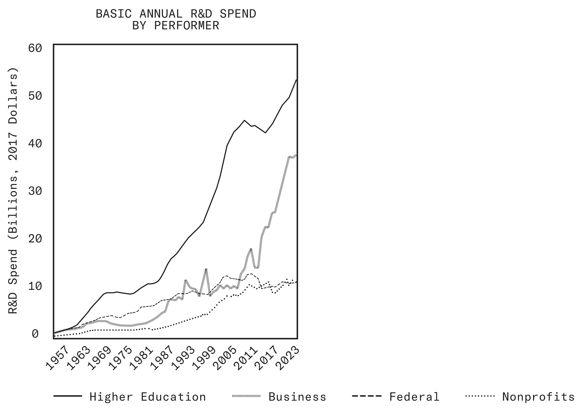
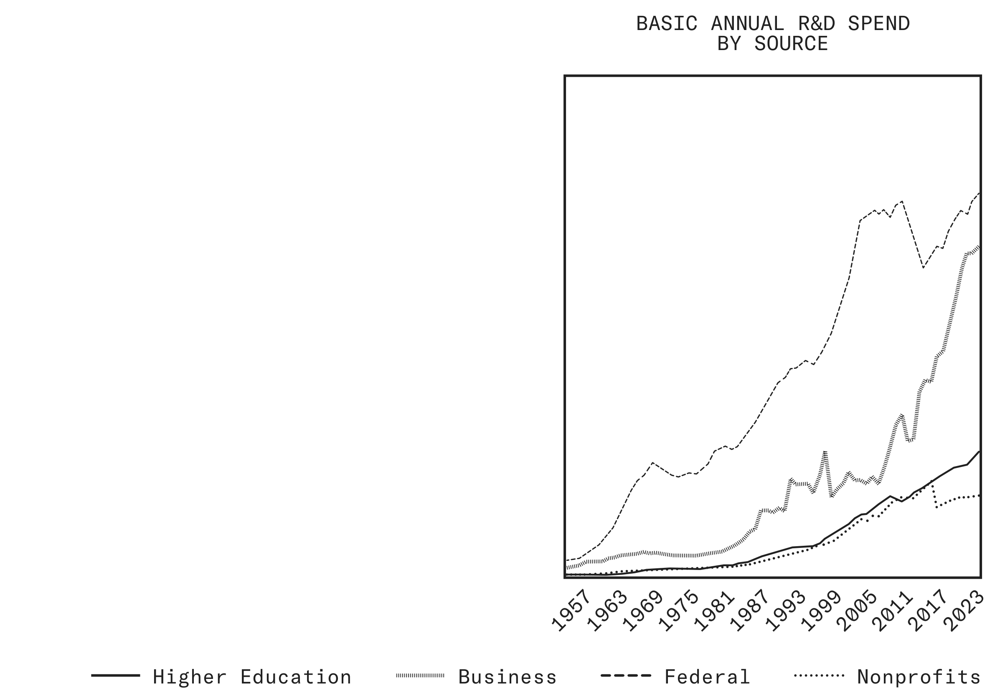
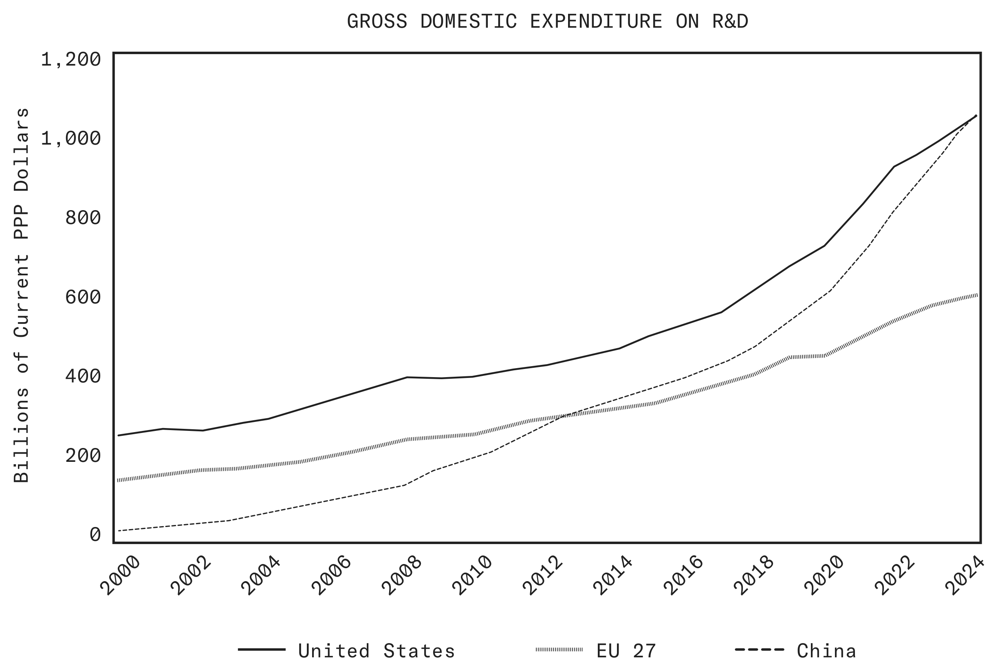
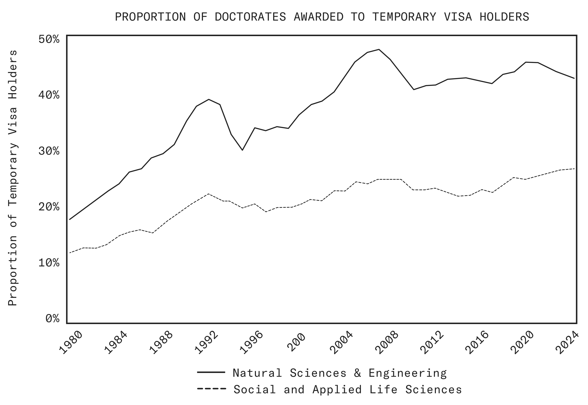
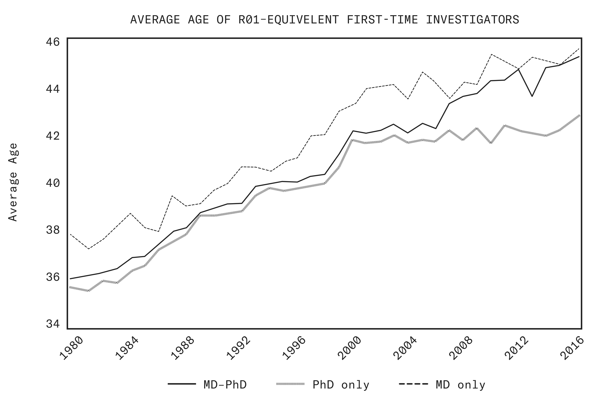

# 科学：一个新的黄金时代 · *Science: A New Golden Age*

> 中英对照全本 · 白宫科学技术政策办公室（OSTP）2026 年 7 月 21 日提交总统的报告
>
> **怎么读**：每一段先给英文原文（引用块），紧接中文译文；章节标题与图表标题中英并列。
> 人名保留原文（Vannevar Bush、Donald Stokes、Trump 等），机构缩写保留原文并在首次出现时给中文全称。
> `[^n]` 沿用**官方印刷版**脚注编号（全书 1–185 连续），注释按章附在每章末尾，参考文献保留英文。
> 图 1–图 4 取自官方发布的原始图表，正文中按图注位置插在对应段落之后。

## 目录

1. 前言、致函与报告摘要（69 段）
2. 第一章 引言（60 段，25 条脚注）
3. 第二章 振兴美国科学技术事业（117 段，57 条脚注）
4. 第三章 确保美国在关键与新兴技术上的主导地位（72 段，38 条脚注）
5. 第四章 让科学技术改善所有美国人的生活（53 段，23 条脚注）
6. 第五章 一个新的黄金时代（87 段，42 条脚注）
7. 2028 财年研发优先事项备忘录（93 段，5 条脚注）

> `[^n]` 沿用官方印刷版脚注编号。[^n] 定义见各章末尾，或全书合并稿的注释部分。

# 前言、致函与报告摘要 · *Front Matter: Letters and Summary*

### 致总统函
*Letter of Transmittal*

> **DEAR MR. PRESIDENT**:

**尊敬的总统先生**：

> Eighty-one years ago, President Franklin D. Roosevelt wrote a letter to Vannevar Bush, tasking him with reorganizing America’s scientific enterprise after World War II. Bush’s response was a report, titled *Science: The Endless Frontier*. It established the Federal Government’s role in supporting basic science, led to the creation of the National Science Foundation, and shaped our nation’s science and technology strategy for decades afterward. That report was foundational to the American Century and to the technological world in which we live today.

八十一年前，Franklin D. Roosevelt 总统致信 Vannevar Bush，委托他在第二次世界大战之后重组美国的科学事业。Bush 的回应是一份报告，题为《科学：无尽的前沿》（*Science: The Endless Frontier*）。它确立了联邦政府在支持基础科学中的角色，促成了国家科学基金会的成立，并在此后数十年间塑造了我国的科学技术战略。那份报告是「美国世纪」的基石，也是我们今天所生活的技术世界的基石。

> Now, as we celebrate the United States’ 250th anniversary, we have the responsibility to renew our foundations once more. Never have science and technology been more central to our nation’s security and prosperity, and, although America continues to set the pace of scientific progress, global competitors are racing to challenge our leadership. This historical moment demands that we modernize our institutions to match the achievements of our past and the ambitions of our future.

如今，在我们庆祝美国建国 250 周年之际，我们再次肩负起更新自身根基的责任。科学与技术从未像今天这样处于我国安全与繁荣的核心；尽管美国仍在引领科学进步的节奏，全球竞争者正在奋力挑战我们的领导地位。这一历史时刻要求我们实现制度现代化，使之与我们过去的成就和未来的雄心相匹配。

> In your letter of March 26, 2025, on the occasion of my Senate confirmation as Director of the Office of Science and Technology Policy, you challenged me to reexamine America’s research and development ecosystem in light of changes brought on by the 21st century.

在您 2025 年 3 月 26 日、也就是我经参议院确认出任白宫科学技术政策办公室主任之际给我的信中，您要求我结合 21 世纪带来的变化，重新审视美国的研发生态。

> The report I present here diagnoses the obstacles American researchers face today, and the ways our scientific enterprise has fundamentally transformed since its basic organization was established in 1945. Though our investments in research have grown, scientific productivity has slowed. We have become dependent on a narrow set of legacy institutions. Our incentive structures reward conformity over bold inquiry. And the capacity that once turned American discoveries into American strength has eroded, undermined by decades of industrial offshoring.

我在此提交的报告，诊断了美国研究者今天面临的障碍，以及自 1945 年确立基本组织架构以来我国科学事业发生的根本性转变。尽管我们的研究投入增加了，科学生产率却放缓了。我们变得依赖数量有限的既有机构。我们的激励机制奖励循规蹈矩，而不是大胆探索。曾经把美国发现转化为美国实力的那种能力已经遭到侵蚀，被数十年的产业外迁所削弱。

> To address these and related challenges, this report puts forward recommendations for the entire scientific and technological ecosystem, across government, academia, philanthropy, and industry. Underlying all of these recommendations is a simple measure of success. A decade from now, American researchers should look back at our work and say: “The vital questions I could not pursue then, I am free to pursue now.” That purpose will be achieved if we make progress toward four overarching goals.

为应对这些挑战及相关问题，本报告面向整个科学技术生态——涵盖政府、学术界、慈善界和产业界——提出建议。贯穿所有这些建议的，是一个简单的成功标准。十年之后，美国研究者回看我们的工作时应当说：「当年我无法探究的那些重大问题，如今我可以自由探究了。」如果我们朝四项总目标取得进展，这一目标就能实现。

> First, the U.S. research system should prioritize the individual scientist over legacy institutions. If we are serious about expanding what our scientists can do, we must invest directly in American researchers and the bold ideas that drive them. Too much of our research enterprise has come to serve itself rather than the scientists within it. Federal funding agencies should support a broader range of performers, including a new generation of mission-driven research organizations, to expand our scientific horizons. And these agencies should organize themselves around the interdisciplinary frontiers of science today, rather than the academic silos of the last century.

第一，美国科研体系应当把个人科学家置于既有机构之上。如果我们真心想扩大科学家能够做到的事，就必须直接投资于美国研究者以及驱动他们的大胆想法。我们的科研事业有太多部分变成了自我服务，而不是服务于其中的科学家。联邦资助机构应当支持更广泛的执行主体，包括新一代使命驱动型研究组织，以拓展我们的科学视野。这些机构还应当围绕当今科学的跨学科前沿来组织自身，而不是围绕上一个世纪的学科竖井。

> Second, the Federal Government should fundamentally change *how* research dollars are allocated, distributed, and assessed. Instead of a one-size-fits-all approach, the government should fund more flexible types of grants, including fast-track grants, long-horizon grants, and new mechanisms that allow reviewers to champion radically unconventional proposals. Federal research agencies should evaluate their own performance as capital allocators, test new ways of making grants, and construct portfolios with the intentionality of a serious investor.

第二，联邦政府应当从根本上改变研究经费*如何*配置、发放和考核。政府不应采取一刀切的做法，而应提供更灵活的资助形式，包括快速通道资助、长周期资助，以及允许评审人支持极为非常规提案的新机制。联邦研究机构应当作为资本配置者评估自身绩效、试验新的资助方式，并以严肃投资者那样的意识来构建资助组合。

> Third, the Federal Government should set clear scientific goals and build the industrial muscle to translate scientific discovery into technological strength. The greatest technical achievements of the last century came about because leaders in government identified national priorities and marshaled the resources to accomplish them. As our competitors race us to capture the value chain of strategic technologies, including with tactics we would never countenance, we can no longer assume that the fruits of American science will accrue to our own people. Government must mobilize the full force of our enterprise around national challenges, clear the ground for American builders, and reunite the work of discovery and manufacturing across the country.

第三，联邦政府应当设定清晰的科学目标，并建设把科学发现转化为技术实力的产业能力。上个世纪最重大的技术成就之所以实现，是因为政府领导人确定了国家优先事项并调动资源去完成它们。当竞争者与我们争夺战略技术的价值链时——其中还包括我们绝不会容忍的手段——我们再也不能假定美国科学的成果会归于我们自己的人民。政府必须围绕国家挑战调动整个事业的力量，为美国建设者扫清障碍，并在全国范围内重新把发现与制造接合起来。

> Fourth, we must prepare our research enterprise for the AI revolution. AI will accelerate and radically transform the way we do science. But even the most capable AI models will be slowed down in the bottleneck of institutions and systems built for the last century. As we renew the infrastructure that powers American science, we must reengineer it for the AI age. And even as AI compresses the time from question to answer, we will still need human hands to build the instrument or prototype. We must build that capacity, too, investing in advanced manufacturing, the skilled trades, and the vast pools of talent and tacit knowledge outside the traditional academic pipeline.

第四，我们必须让科研事业为 AI 革命做好准备。AI 将加速并彻底改变我们从事科学的方式。但即使是最强大的 AI 模型，也会受制于为上个世纪而建的制度与体系这一瓶颈。在更新驱动美国科学的基础设施时，我们必须按 AI 时代的要求重新设计它。而且，即便 AI 压缩了从问题到答案的时间，我们仍然需要人手去制造仪器或原型。我们也必须建设这种能力，投资先进制造、技术工种，以及传统学术通道之外庞大的人才与默会知识储备。

> In preparing this report, I have consulted widely across the country’s scientific enterprise, from entrepreneurs driving world-changing breakthroughs in fusion technology, to researchers eager to pursue bold ideas in neuroscience at our universities, to venture capitalists funding revolutionary platforms for drug discovery. Their message is clear and inspiring: given the right conditions, American ingenuity will continue to achieve the impossible.

在撰写本报告的过程中，我在全国科学事业范围内广泛征询意见：从在聚变技术领域推动改变世界突破的创业者，到渴望在我们大学里探索神经科学领域大胆想法的研究者，再到为革命性药物发现平台提供资金的风险投资人。他们传达的信息清晰而令人振奋：只要条件合适，美国的创造力将继续把不可能变为可能。

> Throughout our history, Americans have shown remarkable courage in their willingness to reinvent our institutions when the challenges we faced demanded it, from establishing the land-grant university to creating the National Science Foundation to launching the Apollo Program. Each generation has seized its opportunity to expand the frontiers of knowledge and lay down the paving stones of progress. Now it is our time to build the scientific enterprise that will carry America forward and bring prosperity to Americans through the 21st century and beyond.

纵观我们的历史，每当所面临的挑战提出要求时，美国人都会展现出重塑自身制度的非凡勇气——从建立赠地大学，到创建国家科学基金会，再到启动阿波罗计划。每一代人都抓住了扩展知识疆界、为进步铺就铺路石的机会。现在轮到我们，去建设能够承载美国前行、并在整个 21 世纪及其后为美国人带来繁荣的科学事业。

> Mr. President, you have called for a Golden Age of American Innovation. This report is the map to that vision. Our nation cured polio, placed men on the Moon, decoded the human genome, and launched the digital revolution. With your leadership, we will extend our scientific and technological might into the Second American Century and continue to deliver the innovations and discoveries that define the modern world.

总统先生，您呼吁开创美国创新的黄金时代。这份报告就是通往那一愿景的路线图。我们的国家曾攻克小儿麻痹症、把人送上月球、破译人类基因组，并开启了数字革命。在您的领导下，我们将把科学技术实力延伸至第二个美国世纪，并继续交付定义现代世界的创新与发现。

> Respectfully submitted,

谨此呈交，

> Michael Kratsios Assistant to the President for Science and Technology

Michael Kratsios 总统科学技术助理

> Director, Office of Science and Technology Policy

白宫科学技术政策办公室主任

> July 21, 2026

2026 年 7 月 21 日

### Trump 总统的来信
*President Trump's Letter*

> Dear Mr. Kratsios:

尊敬的 Kratsios 先生：

> Scientific progress and technological innovation were the twin engines that powered the American century. The Manhattan Project fueled the atomic era. The Apollo Program won us the space race. The internet connected us to a digital future. Today, we will usher in the Golden Age of American Innovation. We will make America safer, healthier, and more prosperous than ever before. We will create a future of American greatness for every citizen, restoring the American Dream.

科学进步与技术创新，是驱动美国世纪的两台引擎。曼哈顿计划点燃了原子时代。阿波罗计划让我们赢得太空竞赛。互联网把我们接入数字未来。今天，我们将开启美国创新的黄金时代。我们将使美国比以往任何时候都更安全、更健康、更繁荣。我们将为每一位公民创造伟大的美国未来，重振美国梦。

> The triumphs of the last century did not happen by chance. As World War II drew towards a close, President Franklin D. Roosevelt wrote a letter like this one to his science and technology advisor, Vannevar Bush, charging him to explore new frontiers of the mind for the sake of national greatness and pioneer science in peacetime. Dr. Bush’s response laid the groundwork for the uniquely successful American partnership of Government, industry, and academia that built the greatest and most productive nation in human history.

上个世纪的辉煌并非偶然。当第二次世界大战接近尾声时，Franklin D. Roosevelt 总统给其科技顾问 Vannevar Bush 写了一封与这封信类似的信，委托他为了国家的伟大而探索心智的新前沿，并在和平时期开创科学。Bush 博士的回应，为美国政府、产业界与学术界之间那种独特而成功的合作奠定了基础——正是这种合作造就了人类历史上最伟大、最高产的国家。

> But today, rivals abroad seek to usurp America’s position as the world’s greatest maker of marvels and producer of knowledge. We must recapture the urgency which propelled us so far in the last century. The time has come to return to our roots and renew the American scientific enterprise for the century ahead. So, just as FDR tasked Vannevar Bush, I am tasking you with meeting the challenges below to deliver for the American people.

但今天，海外对手试图篡夺美国作为世界最大奇迹创造者和知识生产者的地位。我们必须重拾上个世纪推动我们走到今天的紧迫感。现在是回归根本、为未来一个世纪更新美国科学事业的时候了。因此，正如 Roosevelt 总统当年委托 Vannevar Bush 那样，我委托您应对以下挑战，为美国人民交付成果。

> First: How can the United States secure its position as the unrivaled world leader in critical and emerging technologies—such as artificial intelligence, quantum information science, and nuclear technology—maintaining our advantage over potential adversaries?

第一：美国如何才能确保其在关键与新兴技术——如人工智能、量子信息科学和核技术——上无可争议的世界领导地位，保持对潜在对手的优势？

> We need to accelerate research and development, dismantle regulatory barriers, strengthen domestic supply chains and manufacturing, spur robust private sector investment, and advance American companies in global markets. Rival nations are pushing hard to overtake the United States, and we must blaze a bold path to maintain our technological supremacy.

我们需要加快研发、拆除监管壁垒、强化本土供应链与制造能力、激发强劲的私营部门投资，并推动美国企业在全球市场上前进。竞争国家正在全力追赶美国，我们必须开辟一条大胆的道路，以维持我们的技术优势。

> Second: How can we revitalize America’s science and technology enterprise—pursuing truth, reducing administrative burdens, and empowering researchers to achieve groundbreaking discoveries?

第二：我们如何振兴美国的科学技术事业——追求真理、减轻行政负担，并让研究者能够取得突破性发现？

> We need new paradigms for the research enterprise, including innovative models for funding and sharing scientific research, redefining how America conducts the business of discovery. We must build an ecosystem that attracts top talent, celebrates merit, protects our intellectual edge, and enables scientists to focus on meaningful work rather than administrative box checking.

我们需要科研事业的新范式，包括资助与共享科学研究的新模式，重新定义美国从事发现的方式。我们必须建立一个能够吸引顶尖人才、褒奖才能、保护我们的智力优势，并让科学家专注于有意义的工作而非行政打勾的生态。

> Third: How can we ensure that scientific progress and technological innovation fuel economic growth and better the lives of all Americans?

第三：我们如何确保科学进步与技术创新推动经济增长，并改善所有美国人的生活？

> During my first term, we made unprecedented advances in America’s scientific and technological leadership. We launched the American Artificial Intelligence Initiative, vaulting the United States to the front of the pack in the development and deployment of artificial intelligence. Our National Quantum Initiative established the foundation for national quantum supremacy. We created the United States Space Force and charted a new and daring course for America’s further exploration of space. All of this buttressed our security and bolstered our prosperity, and it reaffirmed America’s place as the world’s preeminent technological superpower.

在我的第一个任期内，我们在美国科学技术领导力上取得了前所未有的进展。我们启动了「美国人工智能倡议」，把美国推上人工智能开发与部署的第一梯队。我们的「国家量子倡议」为国家量子霸权奠定了基础。我们创建了美国太空军，并为美国进一步探索太空规划了一条全新而大胆的路线。所有这些都巩固了我们的安全、增进了我们的繁荣，并再次确认了美国作为世界首要技术超级大国的地位。

> Now, after four long years of weakness and complacency, we must set our sights even higher. I am calling upon you to blaze a trail to the next frontiers of science. We have the opportunity to cement America’s global technological leadership and usher in the Golden Age of American Innovation. We are not just competing with other nations; we are seeking, striving, fighting to make America greater than ever before.

如今，在长达四年的软弱与自满之后，我们必须把目标定得更高。我呼吁您为科学的下一个前沿开辟道路。我们有机会巩固美国的全球技术领导地位，并开启美国创新的黄金时代。我们不仅仅是在与其他国家竞争；我们是在寻求、在努力、在奋斗，让美国比以往任何时候都更伟大。

> Sincerely,

诚挚地，

> Donald J. Trump

Donald J. Trump

> President of the United States

美利坚合众国总统

### 报告摘要
*Summary of the Report*

> American scientific progress was the beating heart of the 20th century. It delivered victory on the battlefields of World War II, secured America’s triumph in the Cold War, and produced the most prosperous nation in human history. We developed the alchemy that taught sand how to think, conjuring the digital world from silicon chips. American science conquered polio, placed men on the Moon, and gave humanity general-purpose artificial intelligence (AI). This leadership has improved lives and defined the very structure of our modern world.

美国的科学进步是 20 世纪跳动的心脏。它在第二次世界大战的战场上带来胜利，确保美国赢得冷战，并造就了人类历史上最繁荣的国家。我们发展出那种教沙子如何思考的炼金术，用硅芯片变出数字世界。美国科学攻克了小儿麻痹症、把人送上月球，并给予人类通用人工智能（AI）。这种领导地位改善了人们的生活，也定义了现代世界本身的结构。

> The foundation of these profound advancements was laid in the years following World War II, thanks largely to the vision set out by Vannevar Bush, the chief science advisor to Presidents Roosevelt and Truman. In his canonical 1945 report, *Science: The Endless Frontier*, Bush made the prescient case for federal support of basic research, laying the groundwork for the modern scientific enterprise. That enterprise, however, was predominantly built around what became called the “linear model” of technical progress, flowing from basic research to applied research to development of technology and industry. A simplification even then, that model has grown increasingly inadequate as a description of progress eighty-one years later. Discovery today is most often an iterative loop between fundamental and applied work, with industry and engineering playing a vital part in spurring even basic research.

这些深刻进步的基础，是在第二次世界大战之后的年代奠定的，主要归功于 Vannevar Bush——Roosevelt 总统和 Truman 总统的首席科学顾问——所提出的愿景。在他 1945 年那份经典报告《科学：无尽的前沿》（*Science: The Endless Frontier*）中，Bush 以前瞻性的论证主张联邦支持基础研究，为现代科学事业奠定了基础。然而，这一事业主要是围绕后来被称为「线性模型」的技术进步观念建立的：从基础研究到应用研究，再到技术与产业的开发。即便在当时，这也是一种简化；八十一年后的今天，这一模型作为对进步的描述已越来越不充分。今天的发现，最常见的是基础工作与应用工作之间的迭代循环，而产业界与工程在其中发挥着关键作用，甚至推动着基础研究。

> Government funding of research and development, especially basic science in the academy and national labs, has rightly grown in the eight decades since Bush’s report. But private industry has become by far the largest source of research and development (R&D) funding in the United States, with its share nearly doubling from the 1950s to today. American companies now deploy around $700 billion annually, more than triple the combined spending from government and higher education. This evolution has made the pie bigger for everybody and should be welcomed across the research ecosystem, but it demands a corresponding adjustment to the nature of the Federal Government’s contributions.

自 Bush 的报告以来八十年间，政府对研发——尤其是学术界与国家实验室中的基础科学——的资助理所当然地增长了。但私营产业已成为美国研发（R&D）资金遥遥领先的最大来源，其份额从 20 世纪 50 年代到今天几乎翻了一倍。美国企业现在每年投入约 7,000 亿美元，是政府与高等教育投入总和的三倍多。这一演变把蛋糕做得更大，理应受到整个研发生态的欢迎，但它要求联邦政府的贡献方式作出相应调整。

> New challenges have arisen in recent decades. Despite massive increases in biomedical funding since the 1990s, the rate of significant breakthroughs appears to have slowed and drug approvals have flatlined. Researchers today often spend half their time on paperwork and administrative tasks, a burden worsened by expanding federal and university bureaucracies that further reduce funding available for actual science. A smaller proportion of American citizens now fill post-graduate spots in science, technology, engineering, and mathematics (STEM) fields. Our competitors are channeling unprecedented resources into science and engineering, taking a whole-of-society approach to seize the high ground in strategic technologies. The AI revolution, meanwhile, is transforming the conduct of science, and legacy scientific institutions and infrastructure are not ready to take full advantage of this transformation.

近几十年来出现了新的挑战。尽管自 1990 年代以来生物医学经费大幅增加，重大突破的速率似乎放缓，药物批准数量也停滞不前。今天的研究者常常把一半时间花在文书和行政事务上；联邦与大学官僚体系的膨胀又加剧了这一负担，进一步减少了可用于真正科学研究的经费。如今，美国公民在科学、技术、工程和数学（STEM）领域研究生名额中占的比例更小。我们的竞争者正把前所未有的资源投入科学与工程，采取「全社会」路径去抢占战略技术的高地。与此同时，AI 革命正在改变科学的开展方式，而既有的科学机构与基础设施尚未准备好充分利用这一转变。

> America has led the world in scientific progress because Americans have refused to stand still. We have adapted to changing conditions before by boldly reinventing how we structure science, and we must innovate again. Never has scientific and technological development been more essential to our national and economic security, and never has this progress been so deeply intertwined with our diplomatic relationships worldwide.

美国之所以在科学进步上领先世界，是因为美国人拒绝原地不动。我们过去曾通过大胆重塑科学的组织方式来适应变化，现在必须再次创新。科学技术发展从未像今天这样对国家安全和经济安全如此关键，也从未像今天这样与我们的全球外交关系如此紧密交织。

> President Trump has been very clear about his priorities, as he seeks to lay the foundations for a new Golden Age of American Innovation. He has asked this administration to revitalize the national science enterprise, to secure U.S. leadership in emerging technologies against foreign rivals, and to ensure that all of America’s citizens will benefit from new scientific breakthroughs and technological transformations. The President understands the American story as one of ambition, discovery, and invention, of pioneers who forever seek new frontiers for exploration, particularly now in science and technology.

Trump 总统对其优先事项非常明确，他正在为美国创新的新黄金时代奠定基础。他要求本届政府振兴国家科学事业、在与外国对手的竞争中确保美国在新兴技术上的领导地位，并确保所有美国公民都能从新的科学突破与技术变革中受益。总统把美国的故事理解为一部关于雄心、发现和发明的故事，是永远寻找新探索前沿的先驱者的故事——尤其是在今天的科学与技术领域。

> The following chapters provide recommendations, insights, and guidance to the entire U.S. scientific enterprise, from the government to universities to the private sector and philanthropy.

以下各章为整个美国科学事业——从政府到大学，再到私营部门和慈善界——提供建议、洞见与指引。

**第二章：振兴美国科学技术事业**
*Chapter II: Revitalizing America’s Science and Technology Enterprise*

> To reverse stagnation and restore breakthrough momentum, the Federal Government must free American scientists to do their best work. Federal funding in academia remains anchored to mid-century assumptions, channeled through traditional disciplines and overly focused on short, project-based grants. Review panels often gatekeep proposals by consensus, disincentivizing transformative ideas. Agencies face little corrective pressure when portfolios underperform. We must strip away unnecessary burdens, realign funding toward excellence and risk-taking, and embed continuous, evidence-based improvement across an approximately $200 billion annual R&D portfolio.

为扭转停滞、恢复突破势头，联邦政府必须解放美国科学家，让他们做出最好的工作。学术界中的联邦资助仍然锚定在世纪中叶的假设上：通过传统学科分配，并过度集中于短期的项目制资助。评审小组往往以共识为门槛来把关提案，抑制变革性想法。当资助组合表现不佳时，各机构几乎感受不到纠偏压力。我们必须清除不必要的负担，把经费重新对准卓越与承担风险，并在规模约 2,000 亿美元的年度研发组合中嵌入持续、基于证据的改进。

> - **Refocus on the Individual Scientist:** Put the working researcher back at the center of America’s scientific enterprise. Free them from the growing administrative burdens that now weigh them down for nearly half their working hours. Bet on people, not just projects, by expanding portable graduate fellowships like the National Science Foundation (NSF) Graduate Research Fellowship Program (GRFP), backing early-career independence, and scaling long-horizon grants for the best and brightest modeled on National Institutes of Health (NIH) Director’s Pioneer Award. Open alternative pathways beyond standard academia, and ensure that selection rests purely on merit, not the political fashions of the day.
- **聚焦个人科学家：** 把一线研究者重新放回美国科学事业的中心。把他们从如今占用近一半工作时间、且不断加重的行政负担中解放出来。要押注于人，而不只是项目：扩大可携带的研究生奖学金（如国家科学基金会（NSF）研究生研究奖学金计划（GRFP）），支持早期职业独立，并参照国立卫生研究院（NIH）主任先锋奖，为最优秀者扩大长周期资助规模。开辟标准学术路径之外的替代通道，并确保遴选纯粹依据才能，而不是当下的政治风向。

> - **Diversify Funding Mechanisms:** Move beyond consensus-driven peer review by adopting a broader menu of selection mechanisms suited to different kinds of science. Examples include “golden tickets” that empower individual reviewers to champion ambitious proposals, fast grants that deliver rapid funding decisions, prize challenges and advanced market commitments that pay for results, and regranting models that delegate funding authority to scientists to draw on distributed expertise.
- **多元化资助机制：** 超越共识驱动的同行评议，采用更适合不同类型科学的更丰富的遴选机制。例如：让单个评审人有权支持雄心勃勃提案的「金色门票」；能迅速作出资助决定的快速资助；按结果付费的奖金挑战与预先市场承诺；以及把资助权限下放给科学家、以调用分布式专长的再资助模式。

> - **Create New Institutional Models:** Many of today’s most important problems are too large for an academic lab, too cross-disciplinary for a single department, and too hard to commercialize for a private corporation. Federal funding should support a wider range of performers. The recently launched X-Labs can assemble agile, time-bound teams of professional scientists and engineers to break specific bottlenecks. Advanced Research Projects Agencies (ARPAs) can empower individual program managers to make bold bets and curate researchers to execute them. Curiosity-driven institutes can give our best minds the stability needed to pursue fundamental questions over long time horizons.
- **创建新的机构模式：** 今天许多最重要的问题，对学术实验室来说太大，对单一院系来说过于跨学科，对私营公司来说又难以商业化。联邦资助应当支持更广泛的执行主体。最近启动的 X-Labs 可以组建敏捷、有期限的职业科学家与工程师团队，去突破特定瓶颈。高级研究计划署（ARPA）类机构可以授权单个项目经理做出大胆押注，并汇聚研究者去执行。好奇心驱动型研究所则能给我们最优秀的人才提供追求长期根本问题所需的稳定性。

> - **Reduce Bureaucratic Burdens:** Requirements on federal grants have ballooned over the past decades. Some grants now take nearly two years from submission to award, almost as long as it took to design and produce the first Boeing 747. Compress review cycles, eliminate duplicative reporting, and rein in indirect cost recovery that supports administrative bloat, redirecting that money to real scientific infrastructure. Advance reforms that reduce grant-writing burdens, with relief directed specifically to early-career researchers.
- **减轻官僚负担：** 过去几十年，联邦资助的要求不断膨胀。有些资助从提交到获批需要近两年，几乎与设计和生产第一架波音 747 所需的时间相当。压缩评审周期、取消重复报告、管住支撑行政膨胀的间接成本回收，把资金重新导向真正的科研基础设施。推进减轻写申请负担的改革，并把缓解措施专门面向早期职业研究者。

> - **Institutionalize Continuous Improvement:** Funders should bring the same critical attention to their own performance that they are supposed to bring to the review of grant applications. Stand up an empowered metascience unit in federal science agencies, reporting directly to the director, with authority to run controlled experiments on review and funding mechanisms and to drive change across the organization. Elevate the prestige of program officers, grow their discretion in setting scientific direction, and support them as the architects of the fields they help shape.
- **把持续改进制度化：** 资助方应当以它们本应对资助申请评审所抱持的那种批判性关注，来审视自身绩效。在联邦科学机构中设立有实权的元科学部门，直接向机构负责人汇报，有权对评审与资助机制开展对照实验，并推动整个组织的变革。提升项目官员的声望，扩大他们在确定科学方向上的自主权，并支持他们成为自己所助力塑造领域的设计师。

**第三章：确保美国在关键与新兴技术上的主导地位**
*Chapter III: Securing U.S. Dominance in Critical and Emerging Technologies*

> America has the world’s most vibrant scientific enterprise and most dynamic private sector, which routinely turns novel ideas into new industries. But scientific leadership alone does not guarantee national strength or economic vitality. We must tightly couple our science and technology enterprises to ensure that groundbreaking ideas invented in the United States are rapidly prototyped, tested, manufactured, and scaled domestically.

美国拥有世界上最活跃的科学事业和最具活力的私营部门，后者不断把新想法变成新产业。但仅靠科学领先并不能保证国家实力或经济活力。我们必须把科学事业与技术事业紧密耦合，确保在美国诞生的突破性想法能够迅速在本土完成原型、测试、制造和规模化。

> - **Restore Permissionless Innovation:** American regulators have grown skilled at weighing the risks of action, but blind to the costs of inaction. Developing good rules require real-world evidence, and building that evidence base only comes from letting innovators prototype and experiment. Extend the President’s reforms in nuclear, pharmaceuticals, and drones across other sectors. Weigh benefits alongside risks, streamline permitting, and use regulatory sandboxes to test new technologies under controlled conditions.
- **恢复无需许可的创新：** 美国监管者已擅长权衡行动的风险，却对不行动的代价视而不见。制定好的规则需要真实世界的证据，而建立证据基础只能靠让创新者去做原型和试验。把总统在核能、制药和无人机领域的改革推广到其他部门。在权衡风险的同时评估收益，简化许可流程，并利用监管沙盒在受控条件下测试新技术。

> - **Open Federal Infrastructure to American Builders:** The Federal Government has facilities and testbeds no startup can replicate on its own. Broaden industry access to America’s laboratory research infrastructure, including at Department of Energy (DOE) national laboratories, National Aeronautics and Space Administration (NASA) centers, and Department of War (DOW) facilities. Consider innovative potential alongside scientific merit in use approvals, streamline Cooperative Research and Development Agreements (CRADAs) and licensing, further leverage Other Transaction Authority (OTA) to enable private-sector engagement in co-designing research directions, and expand partnerships with the private sector to make joint investments into cutting-edge equipment.
- **向美国建设者开放联邦基础设施：** 联邦政府拥有创业公司无法自行复制的设施与试验场。扩大产业界对美国实验室研究基础设施的使用，包括能源部（DOE）国家实验室、国家航空航天局（NASA）中心以及战争部（DOW，2025 年由国防部更名）的设施。在使用审批中，把创新潜力与科学价值一并考虑，简化合作研究与开发协议（CRADA）与许可流程，进一步运用其他交易授权（OTA）让私营部门参与共同设计研究方向，并扩大与私营部门的伙伴关系，对前沿设备进行联合投资。

> - **Strengthen Public-Private Partnerships and Talent Flows:** The university is no longer the only home of America’s most innovative scientific research. Expand agency-adjacent foundations, focus Small Business Innovation Research (SBIR) and Small Business Technology Transfer (STTR) programs to build strategic capabilities, and support joint centers among industry, academia, and federal facilities. Scale industry Ph.D. and postdoc fellowships that move talent fluidly between sectors, drawing on America’s private sector strengths to bring industry-scale resources to our academic researchers.
- **强化公私伙伴关系与人才流动：** 大学不再是美国最具创新性科学研究的唯一家园。扩大附属于机构之外的基金会，把「小企业创新研究」（SBIR）和「小企业技术转移」（STTR）计划聚焦于建设战略能力，并支持产业界、学术界与联邦设施之间的联合中心。扩大产业界博士与博士后奖学金，让人才在部门之间自由流动，借助美国私营部门的优势，为我们的学术研究者带来产业规模的资源。

> - **Organize Pre-Competitive Consortia and Grand Challenges:** The Apollo Program and the Human Genome Project succeeded because the Federal Government marshaled scientific effort at a scale no single institution could match. Leverage grand challenges that pull breakthroughs forward, and create moonshot-scale missions for issues of national importance. Support industry consortia and use federal resources to break shared engineering bottlenecks in foundational areas, as Extreme Ultraviolet Limited Liability Company (EUV LLC) did for semiconductor lithography.
- **组织竞争前联盟与重大挑战：** 阿波罗计划和人类基因组计划之所以成功，是因为联邦政府以任何单一机构都无法比拟的规模调动了科学力量。善用能把突破拉向前方的重大挑战，为国家重要议题创建「登月级」任务。支持产业联盟，并用联邦资源去突破基础领域的共性工程瓶颈，正如极紫外有限责任公司（EUV LLC）在半导体光刻领域所做的那样。

> - **Use Counties and States as Laboratories:** Federalism is one of America’s greatest assets. States can experiment with regulation, permitting, and economic incentives in ways the Federal Government cannot replicate. Support state-led experimentation, partner with the jurisdictions that move the fastest, and let localities compete to support regional innovation. Ensure that innovation strategies that work spread across the nation, advancing science and technology in every county and state.
- **把县与州当作实验室：** 联邦制是美国最大的资产之一。各州可以在监管、许可和经济激励上做联邦政府无法复制的试验。支持州主导的试验，与行动最快的辖区合作，让地方为支持区域创新而相互竞争。确保行之有效的创新战略在全国扩散，在每个县和州推进科学与技术。

**第四章：让科学技术改善所有美国人的生活**
*Chapter IV: Ensuring That Science and Technology Better the Lives of All Americans*

> America’s scientific creativity and entrepreneurial culture position us to translate breakthroughs into technologies that enrich every American’s life. That enrichment should include the creation of manufacturing jobs, not just the development of consumer products. By rebuilding the link between science and hands-on craft, federal leadership can ensure that the economic returns of discovery, including the jobs, supplier networks, and process knowledge encoded in the hands of workers, accrue to Americans in every region of the country and every sector of the economy, sustaining our technological leadership for generations to come.

美国的科学创造力与创业文化，使我们能够把突破转化为丰富每一位美国人生活的技术。这种丰富应当包括创造制造业就业，而不只是开发消费品。通过重建科学与动手技艺之间的联系，联邦领导层可以确保发现所带来的经济回报——包括就业、供应商网络，以及编码在工人双手中的工艺知识——归于全国每一个地区、每一个经济部门的美国人，从而在未来数代人中维持我们的技术领先。

> - **Integrate Hands-On Training:** Technology is encoded not just in papers and patents, but in the tacit knowledge passed from mentor to mentee. Require universities and community colleges to embed practical technical training and externships into STEM curricula. Let hands-on experience and industry credentials count toward degrees. Reform accreditation, admissions, and tenure to reward real-world technical work alongside academic publication.
- **整合动手训练：** 技术不仅编码在论文和专利里，也编码在师徒相传的默会知识中。要求大学与社区学院把实用技术训练与企业实习（externship）嵌入 STEM 课程。让动手实践经验与行业证书可以计入学位。改革认证、招生与终身教职制度，使现实世界的技术工作与学术发表同样受到奖励。

> - **Open Scientific Careers Beyond the Academic Ladder:** Establish national fellowships for skilled craftspeople, practitioner-in-residence programs embedding machinists and technicians alongside Ph.D. researchers, and portable industry-recognized credentials in advanced manufacturing and lab techniques. Connect hobbyists and tinkerers in rural communities to formal research opportunities, and open up universities to technical training for local residents.
- **在学术阶梯之外开辟科学职业：** 为熟练技工设立国家奖学金，设立把机械师和技术员与博士研究者放在一起的「驻场实践者」计划，并在先进制造与实验室技术领域提供可携带、行业认可的证书。把农村社区的业余爱好者和修补匠与正式研究机会连接起来，并向本地居民开放大学的技术培训。

> - **Modernize Apprenticeships and Career Pathways:** Extend registered apprenticeships into science and technology fields. Adopt pay-for-performance funding models, scale Workforce Pell Grants, and back community colleges as regional hubs of scientific and technical talent. Integrate these hubs with industry sites and federally funded innovation and manufacturing centers.
- **现代化学徒制与职业通道：** 把注册学徒制延伸到科学与技术领域。采用按绩效付费的资助模式，扩大「劳动力佩尔助学金」（Workforce Pell Grants），并支持社区学院成为区域科学与技术人才中心。把这些中心与产业现场以及联邦资助的创新与制造中心整合起来。

> - **Build Dense, Local Innovation Clusters Across the Nation:** Technological leadership emerges from places where research and production sit close together. Expand regional innovation hubs, manufacturing institutes, and defense industrial base centers to anchor regional ecosystems. Drive coordinated efforts with local universities and national laboratories to build specializations and workforce pipelines. Pair these efforts with the reshoring of advanced manufacturing, and restore the feedback loops between researchers, engineers, and skilled technicians.
- **在全国建设密集的本地创新集群：** 技术领先产生于研究与生产彼此靠近的地方。扩大区域创新枢纽、制造业研究所和国防工业基地中心，以锚定区域生态。与本地大学和国家实验室协同努力，建设专业分工与人才通道。把这些努力与先进制造的回流配套推进，并恢复研究者、工程师与熟练技术员之间的反馈回路。

**第五章：一个新的黄金时代**
*Chapter V: A New Golden Age*

> America stands at the cusp of a revolution in science, in which AI will accelerate discovery, multiply human cognitive capabilities, and unlock solutions to some of our greatest challenges. But “AI for science” will still find itself subject to the frictions and inefficiencies of human institutions. We can only fully harness AI and its associated productivity uplift by boldly reforming our scientific institutions, building national-scale infrastructure, and ensuring rigorous verification of the knowledge base from which AI will learn.

美国正站在一场科学革命的门槛上：AI 将加速发现、倍增人类的认知能力，并为我们一些最艰巨的挑战找到解决方案。但「AI for science」仍将受制于人类制度的摩擦与低效。我们只有大胆改革科学制度、建设国家级基础设施，并确保 AI 所学习的知识基础得到严格验证，才能充分驾驭 AI 及其带来的生产率提升。

> - **Launch and Scale the Genesis Mission:** Fully fund and expand the Genesis Mission as America’s flagship AI for science initiative, integrating supercomputers, AI models, scientific instruments, and datasets across national laboratories to double the productivity and impact of U.S. science within a decade. Direct it at cross-cutting problems where breakthroughs unlock entire branches of downstream discovery and where AI can transform the practice of science itself.
- **启动并扩大 Genesis Mission：** 为 Genesis Mission 提供充足资金并加以扩展，把它作为美国「AI for science」的旗舰计划，整合国家实验室的超级计算机、AI 模型、科学仪器和数据集，在十年内使美国科学的生产率与影响力翻倍。把它对准那些突破能解锁整条下游发现链、且 AI 能改变科学实践本身的交叉性问题。

> - **Institutionalize Gold Standard Science:** AI operating on a flawed knowledge base will only entrench bad science. Enforce reproducibility, transparency, data sharing, and falsifiability across all federally funded research through the Restoring Gold Standard Science Executive Order, creating a trusted foundation for AI-powered discovery.
- **把「金标准科学」制度化：** 在有缺陷的知识基础上运行的 AI 只会让坏科学更加固化。通过《恢复金标准科学》（*Restoring Gold Standard Science*）行政命令，在所有联邦资助研究中落实可重复性、透明度、数据共享和可证伪性，为 AI 驱动的发现建立可信基础。

> - **Build Verification Infrastructure at Scale:** While the cost of generation has decreased exponentially, the cost of verification has not. Invest in AI-enabled verification systems, open standards, and continuous replication mechanisms. Set standards to enable the development of machine-auditable replication packages, and reward those who replicate or disprove influential scientific results.
- **大规模建设验证基础设施：** 生成的成本已呈指数下降，验证的成本却没有。投资于 AI 赋能的验证系统、开放标准和持续复现机制。制定标准，以支持开发机器可审计的复现包，并奖励那些复现或推翻有影响力科学结果的人。

> - **Accelerate Autonomous Experimentation:** Closed-loop autonomous laboratories can collapse discovery timelines by orders of magnitude and enable science at a truly industrial scale. Focus investments in robotics and automated laboratories, leveraging industry demand and federal R&D to ensure our scientific equipment industrial base is built on the world’s best hardware and software and leads the charge in the coming scientific revolution.
- **加速自主实验：** 闭环自主实验室能把发现周期压缩若干个数量级，并使科学在真正的工业规模上运行。把投资集中于机器人与自动化实验室，借助产业需求和联邦研发，确保我们的科学仪器工业基础建立在世界上最好的硬件与软件之上，并在即将到来的科学革命中领跑。

> - **Experiment With AI-Native Scientific Institutions:** Today’s funding structures, publication systems, and credit mechanisms were built for a world of human-paced discovery. Begin the transition to AI-native institutions, including through faster and more open forms of scientific publication, more granular credit attribution, and new market mechanisms that direct resources to problems where breakthroughs matter most.
- **试验 AI 原生的科学机构：** 今天的资助结构、出版体系和贡献认定机制，是为人类节奏的发现世界而建的。开始向 AI 原生机构过渡，包括更快速、更开放的科学出版形式，更细粒度的贡献归因，以及把资源导向「突破最要紧之处」的新市场机制。

---

> `[^n]` 沿用官方印刷版脚注编号。[^n] 定义见各章末尾，或全书合并稿的注释部分。

# 第一章 引言 · *Chapter I: Introduction*

### I.1 科学进步依然不可或缺
*I.1 Scientific Progress Remains Essential*

> Eighty-one years ago, Vannevar Bush wrote that scientific progress would be an “essential key to our security as a nation, to our better health, to more jobs, to a higher standard of living, and to our cultural progress.”[^1] Bush had seen a glimpse of science’s promise for America in the triumphs of penicillin and radar in securing victory in World War II. His vision proved prescient through the eight decades that followed.

八十一年前，Vannevar Bush 写道，科学进步将是决定「我们作为一个国家的安全、我们更好的健康、更多的工作岗位、更高的生活水准，以及我们的文化进步」的关键。[^1] 从青霉素和雷达帮助我们赢得第二次世界大战的胜利中，Bush 瞥见了科学对美国的许诺。此后八十年间，事实一再印证了他的远见。

> Since then, incredible breakthroughs have emerged from our nation’s laboratories: the transistor and the integrated circuit, the laser and the LED, the mapping of the human genome and the tools to edit it. The “new products, new industries, and more jobs”[^2] Bush envisioned have materialized as entire economic sectors, such as computing, biotechnology, aerospace, and telecommunications, which today employ tens of millions and generate trillions in wealth. Enabled by technologies unimaginable in Bush’s time, the energy revolution has made America the world’s largest oil and gas producer.

此后，我们国家的实验室里不断涌现出惊人的突破：晶体管与集成电路，激光与发光二极管（LED），人类基因组图谱以及编辑基因的工具。Bush 所设想的「新产品、新产业和更多就业」[^2]，已经具体化为计算、生物技术、航空航天、电信等完整的产业部门；这些部门今天雇用数千万人，创造数万亿美元的财富。在 Bush 时代无法想象的技术推动下，能源革命使美国成为世界最大的石油和天然气生产国。

> Now small computers in our pockets connect us instantly to family across the continent, unlock the world’s knowledge, and guide us through unfamiliar streets. Great advances in materials science have given us everything from nylon stockings to bulletproof vests, artificial joints, and fighter jets. We placed GPS satellites in orbit that guide our tractors to precision planting, our packages to on-time arrival, and our troops through hostile terrain. We established the field of modern biotechnology, invented MRI, and developed the lithium batteries that power our cordless world. And in mere decades after Bush’s letter, we walked on the Moon and sent scientific instruments to the edge of the solar system.

如今，我们口袋里的微型计算机让我们即时联系上大陆另一端的家人，打开全世界的知识，并在陌生街道上为我们导航。材料科学的巨大进步，给我们带来了从尼龙丝袜到防弹背心、人工关节和战斗机的一切。我们把 GPS 卫星送入轨道，它们引导我们的拖拉机精量播种，让我们的包裹准时送达，带我们的士兵穿越险恶地形。我们开创了现代生物技术领域，发明了磁共振成像（MRI），研制出为这个无线世界供电的锂电池。而在 Bush 那封信之后的短短数十年间，我们登上了月球，把科学仪器送到了太阳系边缘。

> Our scientists have achieved even more than this. We often forget that American farmers have tripled their output while using about a quarter of the labor used in the 1940s,[^3] or that the average American lives more than 10 years longer than when Bush penned his report.[^4] Within living memory, cancer has been transformed from a death sentence to a treatable condition for millions of Americans. The most common form of childhood leukemia has gone from universally fatal to curable in 90% of cases,[^5] and deaths from heart disease have fallen by more than half since their peak.[^6]

我们的科学家取得的成就远不止于此。我们常常忘记：美国农民在用掉 20 世纪 40 年代约四分之一劳动力的同时，把产量提高到原来的三倍；[^3] 美国人的平均寿命比 Bush 撰写报告时长了 10 年以上。[^4] 在许多人的有生之年里，癌症已从一纸死刑判决，变成数百万美国人可治疗的疾病。最常见的儿童白血病，过去几乎全部致命，如今 90% 的病例可以治愈；[^5] 心脏病死亡人数自峰值以来下降了超过一半。[^6]

### I.2 作为我们一切成就的源头
*I.2 As the Source of Our Triumphs*

> These triumphs happened, and happened here in America, only because of intentional choices made by our people and institutions.

这些成就之所以发生，而且发生在美国，完全是因为我们的人民和机构作出了深思熟虑的选择。

> First, consistent with what Bush outlined in his essay, the government played a vital role in supporting the scientific enterprise to achieve national goals. These include conquering disease, creating jobs, and ensuring security. Against the backdrop of pre-War federal research funding, which was largely focused on agriculture, this proved to be a key insight.[^7] Not all valuable research attracts private capital, particularly research that promises only slow, diffuse returns. In the capital environment of the mid-20th century, no investor would have funded efforts to build particle accelerators or discover the fundamental insights that underlie the genomic revolution.

第一，与 Bush 在文中阐述的主张一致，政府在支持科学事业以实现国家目标方面发挥了至关重要的作用——这些目标包括战胜疾病、创造就业和保障安全。在战前联邦科研经费主要投向农业的背景下，这被证明是一项关键洞见。[^7] 并非所有有价值的研究都能吸引私人资本，尤其是那些只带来缓慢而分散回报的研究。在 20 世纪中叶的资本市场环境中，没有任何投资者会出资建造粒子加速器，或去发现支撑基因组革命的那些基础性洞见。

> As Bush argued, there are “areas of science in which the public interest is acute but which are likely to be cultivated inadequately if left without more support than will come from private sources.”[^8] Today, we benefit from that insight with an extensive set of federal organizations to advance scientific research, including NSF, DOE national laboratories, NIH, NASA, the National Institute of Standards & Technology (NIST), the Defense Advanced Research Projects Agency (DARPA), and other research arms of federal departments and agencies.

正如 Bush 所言，「有些科学领域的公共利益诉求十分迫切，但如果只能依靠私人来源的支持，它们很可能会得不到充分的培育。」[^8] 今天，我们受益于这一洞见，拥有了一整套推进科学研究的联邦机构，包括 NSF、DOE 国家实验室、NIH、NASA、国家标准与技术研究院（NIST）、国防高级研究计划局（DARPA），以及联邦各部门和机构中的其他研究部门。

> Second, our government recognized that achieving those national purposes requires more coordination than any single institution can provide, and that our unique advantage, whether in defeating the Soviet Union or winning the technological race today, lies in our dynamic private sector. Describing the development of penicillin, Bush spoke of how the government launched a “coordinated attack on special problems,” supporting research and development among medical schools, universities, and the pharmaceutical industry, and helping ideas progress from early laboratory experimentation to large-scale production and use.[^9] This model became the foundation of the fruitful public-private partnerships that sent Americans to the Moon and built the internet. This dynamism between publicly funded science and private enterprise remains the engine of American innovation.

第二，我国政府认识到，实现这些国家目标所需的协调，超出任何单一机构所能提供的范围；而我们的独特优势——无论是在击败苏联时，还是在赢得今天的技术竞赛时——都在于充满活力的私营部门。在描述青霉素的研发过程时，Bush 讲到政府如何发起「针对特殊问题的协同攻关」，支持医学院、大学和制药业的研究与开发，帮助想法从早期实验室试验走向大规模生产和使用。[^9] 这一模式后来成为卓有成效的公私伙伴关系的基础，正是这种伙伴关系把美国人送上了月球，也建成了互联网。公共资助的科学与私营企业之间的这种互动，至今仍是美国创新的引擎。

> Third, we stayed true to the call for science to remain dynamic. “The pioneer spirit is still vigorous within this nation,” Bush wrote.[^10] “Science offers a largely unexplored hinterland for the pioneer who has the tools for his task.”[^11] Each of our past triumphs required substantial courage and institutional transformation. They compelled us to invent new models to drive scientific progress: dedicated science funding agencies, innovative partnerships that enabled the widespread commercialization of modern electronics, and reforms like the deregulation of space that opened the door to today’s vibrant era of commercial spaceflight.

第三，我们始终回应着让科学保持活力的要求。Bush 写道：「这个国家内部的开拓精神依然旺盛。」[^10]「对于掌握了工具的先驱者来说，科学提供了一片基本上未被探索的内陆腹地。」[^11] 我们过去的每一项成就，都需要相当大的勇气和制度变革。它们迫使我们去创造推动科学进步的新模式：专门的科学资助机构；使现代电子技术得以广泛商业化的创新伙伴关系；以及太空领域放松管制一类的改革——正是这些改革开启了今天蓬勃发展的商业航天时代。

> This willingness to venture into unknown territory, to challenge established methods, and to create new institutions when old ones prove inadequate, built the scientific supremacy that undergirds our vibrant economy and national security today.

正是这种敢于进入未知领域、敢于挑战既定方法、并在旧机构力不从心时创建新机构的意愿，造就了今天支撑我们繁荣经济与国家安全的科学优势。

### I.3 格局正在变化
*I.3 The Landscape Is Changing*

> The principles that government must support basic research, that this research drives national prosperity, and that America’s advantage lies in the dynamism of our institutions, remain as sound today as when Bush first articulated them. But principles are not processes. Bush would be the first to recognize that the landscape in which fundamental research is conducted has completely transformed since he wrote *Science: The Endless Frontier*.

政府必须支持基础研究，基础研究驱动国家繁荣，美国的优势在于其机构的活力——这些原则在今天依然像 Bush 最初阐发时一样成立。但原则不等于流程。Bush 本人会最先承认：自他写下《科学：无尽的前沿》（*Science: The Endless Frontier*）以来，开展基础研究的整体格局已经彻底改变。

> In 1950, a dozen engineers in basic laboratories drove progress in semiconductors. Today, the semiconductor industry invests more than $100 billion in capital and R&D each year and employs hundreds of thousands.[^12] They regularly solve physics and materials problems at the edge of possibility and build fabrication plants filled with robots that manipulate silicon atom by atom.

1950 年，十几名工程师在简陋的实验室里推动着半导体技术的进步。今天，半导体产业每年在资本支出和研发上投入超过 1,000 亿美元，雇用数十万人。[^12] 他们经常解决处于可能性边缘的物理与材料问题，并建造布满机器人的晶圆厂，让机器人逐原子地操作硅。

> In 1950, scientists mailed typewritten manuscripts to journal editors, who sent copies to reviewers from their personal networks at top universities. Today, researchers post papers online within hours of completion. Thousands read and debate the merits of the work immediately on social media and in discussion channels. Code gets replicated on the internet months before the paper appears in print.

1950 年，科学家把打字机打出的稿件寄给期刊编辑，编辑再把副本寄给自己在顶尖大学人脉网络中的审稿人。今天，研究者在论文完成几小时内就把它发布到网上，成千上万的人立刻在社交媒体和讨论频道中阅读并争论其价值。代码在论文印成铅字之前几个月，就已经在互联网上被人复现。

> In 1950, mathematicians worked alone with chalkboards and stacks of papers from the library. Today, they look up theorems instantly online. Computers enable experimental mathematics that would have been impossible with pencil and paper. Software languages modularize massive proofs, letting dozens of mathematicians collaborate on a single problem simultaneously from coast to coast.

1950 年，数学家独自面对黑板，以及从图书馆借来的一摞摞论文。今天，他们在网上瞬间就能查到定理。计算机使「实验数学」成为可能，而这在纸笔时代是无法做到的。软件语言把庞大的证明模块化，让数十位数学家可以同时从东海岸到西海岸协作研究同一个问题。

### I.4 新前沿与新路径
*I.4 New Frontiers and New Approaches*

> The institutions we build determine what problems get solved, which approaches get tried, what risks get taken, and whose talent contributes to discovery. When these institutions align with the nature of the scientific frontier and with our national needs, science advances; when they are misaligned, abundant resources and brilliant researchers go to waste. The misalignment shows up as diminishing returns to R&D investments, a decline in the pursuit of breakthrough ideas, and a slowdown in the benefits that technological progress delivers to the American people.

我们建立的制度决定了哪些问题会被解决、哪些路径会被尝试、哪些风险会被承担，以及谁的才能会投入到发现之中。当这些制度与科学前沿的性质、与我们的国家需求相契合时，科学就前进；当二者错配时，充裕的资源和杰出的研究者就被浪费。错配表现为：研发投入的回报递减，对突破性想法的追求减少，以及技术进步带给美国人民的收益放缓。

> Institutional design matters because individual researchers follow the signals their institutions send. Consider the incentives of a talented researcher working at the frontier of quantum information science.

制度设计之所以重要，是因为每一位研究者都会追随制度发出的信号。不妨看看一位在量子信息科学前沿工作的优秀研究者面对什么样的激励。

> As a Ph.D. student in a university lab, this researcher must publish regularly to graduate, craft narratives that satisfy journal reviewers and his dissertation committee, and build the personal connections that lead to academic jobs. His professor’s grant funding limits what equipment he can afford. He designs experiments around the apparatus in his lab more than the questions most worth asking. With two years until graduation, he actively looks for results that advance his dissertation’s narrative. When unexpected results appear, he sometimes chooses to pursue them, but remains cognizant of potential risks to his professional progress and his lab’s future funding.

作为大学实验室里的博士生，这位研究者必须定期发表论文才能毕业，必须编织出让期刊审稿人和博士论文委员会满意的叙事，还必须建立能带来学术职位的人脉。他能负担什么设备，取决于导师的经费。他设计实验时，更多是围绕实验室里已有的装置，而不是最值得追问的问题。距离毕业还有两年，他会主动寻找能推进其博士论文叙事的结果。当出现意外结果时，他有时会选择追下去，但同时始终清楚这对自己的职业进展和实验室未来经费可能意味着风险。

> As a startup founder raising venture capital, the same researcher faces different pressures. He pitches a bold vision of scalable quantum computing to investors. He can hire engineers and build quickly with tens of millions of dollars in seed funding. But he must also deliver revenue within five years and sustain a clear narrative as funding rounds continue. The technical approach he outlined to investors may not be the best path forward, but changing course risks losing investor confidence. Market pressure imposes scientific constraints that grant reviewers might not.

当同一位研究者成为正在融资的创业公司创始人时，他面对的压力截然不同。他向投资人讲述可规模化量子计算的大胆愿景。凭借数千万美元的种子资金，他可以迅速招聘工程师、快速搭建。但他也必须在五年内产生收入，并且在后续融资轮次中维持清晰的叙事。他向投资人阐述的技术路线未必是最佳路径，但改变方向可能失去投资人的信任。市场压力会施加一些资助评审人未必会施加的科学约束。

> Both paths advance science and technology, but both channel talent toward different problems in different ways. The discoveries that get made depend not only on the questions that are scientifically salient, but on the fit between those questions and the incentives researchers must navigate. It therefore falls to the public officials who steward federal funding, as the architects of the national scientific enterprise, to understand the constraints our researchers face, to create the right incentive structures wherever possible, and to drive R&D in whatever gaps remain. Only then can we unleash American scientists and give them ever greater freedom to explore.

两条路径都在推进科学技术，但它们以不同方式把人才引向不同的问题。最终会取得哪些发现，不仅取决于哪些问题在科学上重要，也取决于这些问题与研究者必须应对的激励之间是否契合。因此，作为国家科学事业的设计者，掌管联邦经费的公共官员有责任理解我们的研究者所面临的约束，尽可能建立正确的激励结构，并在尚存的空白领域推动研发。只有这样，我们才能释放美国科学家的能量，给他们越来越大的探索自由。

> Universities remain essential for training scientists and pursuing fundamental questions. Venture capital mobilizes private resources toward high-impact technologies. Federal agencies fund research that markets alone will not support. Each serves an essential purpose, but the scientific frontier is constantly shifting, requiring vigilant self-improvement to ensure these institutions remain suited to the answering the most important questions today.

大学在培养科学家和追寻根本问题方面依然不可或缺；风险投资把私人资源调动到高影响力技术上；联邦机构为市场本身不会支持的研究提供资金。三者各有不可替代的作用，但科学前沿在不断移动，这要求我们保持警醒、持续自我改进，确保这些机构仍然适合回答今天最重要的问题。

> The system that emerged from Bush’s vision served the last American Century. But every generation of Americans must show the courage to reinvent our institutions when the frontier demands it. We established land-grant universities when agriculture needed scientific foundations. We created DARPA when the pursuit of breakthrough military technologies required an agency willing to fund high-risk ideas that traditional funders would reject. We developed the venture capital model when a gap emerged between the long time horizons of emerging technology companies and the capacity of traditional capital markets.

从 Bush 的愿景中生长出来的这套体系，支撑了上一个美国世纪。但当前沿提出这样的要求时，每一代美国人都必须拿出重塑自身制度的勇气。当农业需要科学基础时，我们建立了赠地大学。当追求突破性军事技术需要一个愿意资助高风险想法、而传统资助者会拒绝这些想法的机构时，我们创建了 DARPA。当新兴技术公司的长周期与传统资本市场的承受能力之间出现缺口时，我们发展出了风险投资模式。

> The questions demanding answers, the tools required to answer them, the scale of coordination needed, and the timelines involved all shift as knowledge advances. As our predecessors did, we must continue to craft and refine the machinery of science, allowing each component to work to its full advantage and freeing our innovators from pressures that keep them from the greatest goals. A new American Century will require new engines of scientific discovery.

随着知识进步，亟待回答的问题、回答问题所需的工具、所需的协调规模以及所涉及的时间尺度都在变化。与前辈一样，我们必须不断打造和完善科学这部机器，让每个部件都充分发挥作用，并把创新者从那些使他们无法追求最宏大目标的压力中解放出来。一个新的美国世纪，需要新的科学发现引擎。

### I.5 私营部门研发持续增长
*I.5 Growing Private Sector R&D*

> One particularly visible shift in the scientific machine is who funds and performs research. When Bush penned his report in the middle of the 20th century, the Federal Government stood as the dominant patron of American science, marshaling the nation’s research capacity for victory in war. The landscape today would astonish him. Private industry has become by far the largest source of R&D funding in the United States, with its share roughly doubling from the 1950s to today, even as federal funding has grown by leaps and bounds. American companies now deploy around $700 billion annually, more than triple the spending of government and higher education.[^13] While this investment has historically been dominated by late-stage product development, strikingly, the share devoted to basic research, which Bush thought markets could not sustain alone, has also grown rapidly, particularly over the past two decades (*Figure 1*).

科学这部机器上一个尤其明显的变化，是谁来出资、谁来研究。20 世纪中叶 Bush 撰写报告时，联邦政府是美国科学的主导赞助者，为赢得战争而调动全国的研究能力。今天的格局会让他大为惊讶。私营产业已成为美国研发资金遥遥领先的最大来源，其份额从 20 世纪 50 年代到今天大约翻了一倍，而与此同时联邦经费也在大幅增长。美国企业现在每年投入约 7,000 亿美元，是政府与高等教育投入总和的三倍多。[^13] 这类投入历史上主要集中于后期产品开发；但引人注目的是，投向基础研究的份额也在快速增长——而这恰恰是 Bush 认为市场无法独自支撑的部分——尤其是在过去二十年（图 1）。

> Consider two transformative inventions of recent memory, the transistor and the transformer architecture that underpins modern machine learning. Both came from corporate laboratories that employ thousands of researchers who often produce collaborative, well-cited papers on problems of deep intellectual interest. Modern industrial powerhouses fund state-of-the-art experiments and pay salaries tens or hundreds of times more than the academy, drawing top talent from across the country. Researchers at American companies have earned Nobel Prizes for work on electron tunneling in semiconductors, surface chemistry, polymer science, and lasers, a testament to both the rigor of their research and the fundamental nature of their work.

不妨看看近来两项具有变革意义的发明：晶体管，以及支撑现代机器学习的 Transformer 架构。二者都出自企业实验室；这些实验室雇用成千上万名研究者，他们常常围绕具有深层智识价值的问题，产出协作性的、被广泛引用的论文。现代工业巨头资助最前沿的实验，并支付比学术界高出数十倍甚至上百倍的薪酬，从而吸引全国顶尖人才。美国企业的研究者凭借在半导体电子隧穿、表面化学、高分子科学和激光方面的研究获得诺贝尔奖——这既证明了他们研究的严谨，也证明了其工作的基础性。

> Figure 1: Private sector basic R&D has grown rapidly over the past two decades. It now rivals higher education among performers (left) and the Federal Government among funders (right) of basic research in the United States.[^14]

图 1：过去二十年，私营部门的基础研发快速增长。在美国基础研究的执行主体中（左图），它已可与高等教育比肩；在出资方中（右图），它已可与联邦政府比肩。[^14]

<!-- 图源：Science-A-New-Golden-Age.pdf physical page 24 (vector artwork, rendered at 432 dpi)。panel crop + the full shared legend row pasted underneath at its native scale (no rescaling); Figure 1 is one printed figure whose two panels share one y axis and one legend row, split at x=306 pt -->

<!-- 图源：Science-A-New-Golden-Age.pdf physical page 24 (vector artwork, rendered at 432 dpi)。panel crop + the full shared legend row pasted underneath at its native scale (no rescaling); Figure 1 is one printed figure whose two panels share one y axis and one legend row, split at x=306 pt -->

> This is not a sign that the academy has become less important, but rather that the scientific world has expanded. In certain domains, the scale of private investment dwarfs anything federal agencies can match. Universities face real limits in scaling up engineering efforts, with rare exceptions for government-sponsored big science projects like space probes and particle accelerators; yet Ph.D. students and professors can now raise hundreds of millions of dollars to found companies that pursue fundamental breakthroughs. Small startups increasingly perform basic research themselves, giving our most talented scientists new paths for ambitious work. These firms blur the distinction between basic and applied science, combining research and development to accelerate both.

这并不意味着学术界变得不重要，而是说明科学世界本身扩大了。在某些领域，私人投资的规模令联邦机构难以企及。大学在扩大工程规模方面确有实际限制——只有太空探测器、粒子加速器这类政府支持的大科学项目是少见的例外；但如今博士生和教授能够募集数亿美元创办公司，去追求基础性的突破。小型创业公司越来越多地自行开展基础研究，为我们最有才能的科学家提供了从事雄心勃勃工作的新路径。这些公司模糊了基础科学与应用科学的界限，把研究与开发结合起来，使两者同时加速。

### I.6 线性模型不再成立
*I.6 The Linear Model No Longer Holds*

> In his 1945 report, Vannevar Bush presented a progression from basic research through applied research to development, later termed the “linear model.”[^15] This framework laid out a clear role for each part of the research and development pipeline. Universities would pursue fundamental understanding without the pressure of practical application. Industry would turn discoveries into products. At the time, the separation was natural and productive.

在 1945 年的报告中，Vannevar Bush 提出了一条从基础研究到应用研究再到开发的递进路径，后来被称为「线性模型」。[^15] 这一框架为研发链条上的每个环节都规定了清晰的角色：大学在不受实际应用压力的情况下追求根本性的理解，产业界把发现转化为产品。在当时，这种分工自然且富有成效。

> Modern discovery, however, is increasingly shaped by continuous iteration between fundamental and applied work. Engineering challenges routinely expose unanswered scientific questions, and breakthroughs in basic understanding, in turn, open new engineering pathways. The relationship is recursive rather than unidirectional. The tools required to push the frontier, whether advanced fabrication equipment or specialized engineering teams, are often found outside traditional academic settings. Many of our most productive researchers now move fluidly between sectors, carrying ideas and techniques with them. Technology and science have become deeply interdependent, even, as we will discuss in *Chapter V*, in the purest fields of reason like mathematics.

然而，现代的科学发现越来越由基础工作与应用工作之间的持续迭代所塑造。工程难题常常暴露出尚未回答的科学问题；反过来，基础理解上的突破又打开新的工程路径。这种关系是递归的，而不是单向的。推进前沿所需的工具——无论是先进制造设备，还是专门的工程团队——往往存在于传统学术环境之外。我们今天许多最高产的研究者在不同部门之间自由流动，带着想法和技术一起走。技术与科学已经深度相互依存，甚至如我们将在第五章讨论的，在数学这样最纯粹的理性领域也是如此。

> This non-linearity is also captured by the framework Donald Stokes articulated half a century after Bush. “Pasteur’s quadrant,” as he termed it, now defines a growing share of the scientific frontier.[^16] Stokes argued that research can seek fundamental understanding while being motivated by considerations of use, observing that some of the most consequential scientific advances all arose precisely from this combination. Examples of such research include Pasteur’s investigations into why wine spoiled, the development of the transistor at Bell Labs, and Shannon’s work on information theory. Many of the transformative discoveries of our own era, from the computational study of protein folding that earned the 2024 Nobel Prize in Chemistry to the superconducting quantum devices that earned the 2025 Nobel Prize in Physics, emerged from efforts that were at once theoretically ambitious and deeply connected to practical problems.

这种非线性，也被 Donald Stokes 在 Bush 之后半个世纪提出的框架所刻画。他称之为「Pasteur 象限」（通译「巴斯德象限」）的这类研究，如今界定了科学前沿中越来越大的份额。[^16] Stokes 认为，研究可以在追求根本理解的同时受到使用考量的驱动；他观察到，一些最具影响力的科学进展恰恰都来自这种结合。这类研究的例子包括 Pasteur 对葡萄酒为何变质的探究、Bell Labs 对晶体管的开发，以及 Shannon 在信息论方面的工作。我们时代许多具有变革意义的发现——从获得 2024 年诺贝尔化学奖的蛋白质折叠计算研究，到获得 2025 年诺贝尔物理学奖的超导量子器件——都产生于既在理论上雄心勃勃、又与实践问题深度相连的努力。

> Our national laboratories and federally funded research centers have long been engines for this use-inspired research, and new centers of modern science reflect the same pattern. A greater share of scientists are leaving academia for industry, not because they have abandoned curiosity-driven inquiry, but because the tools, resources, and career opportunities required to pursue certain fundamental questions increasingly lie outside university walls. The task ahead is to enable scientists to move fluidly between problems of different shapes and to give them the freedom and resources to pursue discovery at today’s frontier.

我们的国家实验室和联邦资助的研究中心长期以来就是这类「受使用意图启发的研究」的引擎，而现代科学的新型中心也呈现出同样的模式。越来越多的科学家离开学术界进入产业界，并不是因为他们放弃了由好奇心驱动的探究，而是因为探究某些根本问题所需的工具、资源和职业机会，越来越多地存在于大学围墙之外。前方的任务是让科学家能够在形态各异的问题之间自由穿行，并给他们自由和资源，去在当今的前沿上从事发现。

> $886B U.S. R&D investment, 2024
> **2024 年美国研发投入 8,860 亿美元**

### I.7 我们的研究者面临日益严峻的挑战
*I.7 Our Researchers Face Mounting Challenges*

> These rapid changes demand that our institutions adapt. As will be addressed in *Chapter II*, significant portions of our federal funding apparatus remain anchored to outdated assumptions. This is not an indictment of the talented scientists and grantmakers who staff these bureaucracies, but a product of institutional inertia, born from the lack of market selection pressure that drives constant experimentation.

这些迅速的变化要求我们的制度作出调整。正如第二章将要讨论的，联邦资助体系中相当一部分仍然锚定在过时的假设上。这并非对在这些官僚机构中工作的优秀科学家和资助管理者的指责，而是制度惯性的产物——它源于缺少那种驱动持续试验的市场选择压力。

> NSF, for instance, still organizes itself primarily around academic disciplines, much as it did in the 1950s, and channels resources overwhelmingly to a single type of performer, the university-based, principal investigator-led research group. Many federal programs are still built around the linear model, making the assumption that basic research happens in academia while development happens in industry. Academic incentives often penalize rather than reward partnerships that cross institutional boundaries. Agencies face little external pressure to adapt, even as the scientific landscape transforms around them, preserving processes essentially unchanged for decades.

例如，NSF 至今仍主要按学科来组织自身，与 20 世纪 50 年代几乎无异，并把资源压倒性地投向单一类型的执行主体：以大学为依托、由首席研究员（PI）领导的研究组。许多联邦项目仍然建立在线性模型之上，假定基础研究发生在学术界、开发发生在产业界。学术界的激励机制往往惩罚而不是奖励跨越机构边界的合作。即便科学格局在其周围发生转变，各机构也几乎感受不到适应的外部压力，许多流程几十年来基本未变。

> Within academia itself, well-documented inefficiencies compound these structural problems. Administrative burdens on researchers have grown over time; one study found that investigators spend nearly half of their federally funded research time on paperwork rather than on research or teaching.[^17] Universities also extract significant overhead from researchers, which funds a mix of legitimate shared infrastructure and growing administrative bloat. Effective indirect cost rates at NIH-funded institutions average more than 40%,[^18] even though those same institutions frequently accept 10 to 15% overhead from private funders.[^19]

在学术界内部，已有充分记录的低效问题又放大了这些结构性缺陷。研究者的行政负担不断加重；一项研究发现，研究者把近一半的联邦资助研究时间用在文书工作上，而不是研究或教学。[^17] 大学还从研究者那里提取可观的间接费用，用于支撑一部分合理的共享基础设施，也用于不断膨胀的行政开支。由 NIH 资助的机构，其实际间接成本率平均超过 40%，[^18] 而这些同样的机构却常常接受私人资助方 10% 至 15% 的间接费用比例。[^19]

> The assumptions embedded in our federal grantmaking institutions, and the creeping inefficiencies within the universities they predominantly serve, reinforce one another. While researchers themselves recognize the need for renewal, few Administrations have had the will and mandate to pursue transformative change.

联邦资助机构中固有的假设，与它们主要服务的大学内部缓慢蔓延的低效，彼此相互强化。尽管研究者自己都认识到需要更新，但很少有哪一届政府拥有推动变革性改革的意愿和授权。

### I.8 科研需求紧迫之时
*I.8 At a Time of Urgent Scientific Need*

> On the global stage, America no longer stands alone as the unchallenged leader in science and technology. The United States risks losing its first position to competitors that are quicker to update their models of research funding, maintain greater institutional flexibility, and can build tighter connections between different sectors of their scientific enterprise.

在全球舞台上，美国已不再是无人挑战的科技领导者。美国有可能失去第一的位置，被那些更迅速地更新科研资助模式、保持更大制度灵活性、并能在其科学事业各部门之间建立更紧密联系的竞争者超越。

> Over the past twenty years, China’s R&D spending has surged from a negligible fraction of U.S. levels to full parity on a purchasing-power-adjusted basis by some metrics (*Figure 2*). This is a situation America did not face even during the Cold War, when the Soviet Union’s economy was appreciably smaller than our own.[^20] Beyond the sheer scale of its spending, Beijing is treating scientific research capacity as a central pillar of global competition, elevating decision-making to the highest level and taking a tightly integrated approach to partnerships across its sectors. This all-of-society approach has allowed China to surge resources toward basic scientific research, advance rapidly in technologies of key national interest, and drive improvements in its innovation process, where entrenched interests have resisted change.

过去二十年，中国的研发支出从相对美国微不足道的比例，跃升到按购买力调整后在某些指标上与美国完全相当的水平（图 2）。即使是在冷战时期，美国也未曾面对这样的局面——当时苏联的经济规模明显小于美国。[^20] 除了支出的绝对规模，北京还把科研能力视为全球竞争的核心支柱，把决策层级提升到最高，并以高度一体化的方式推进各部门之间的协作。这种「全社会」路径使中国能够把资源迅速集中到基础科学研究上，在关乎国家核心利益的技术上快速前进，并推动其创新流程的改进——在这一流程中，既得利益一直抵制改变。

> Figure 2: For the first time, the United States faces a peer-level competitor in R&D spending on a purchasing power parity (PPP)-adjusted basis.[^21]

图 2：按购买力平价（PPP）调整后，美国首次在研发支出上面临一个同级别的竞争者。[^21]

<!-- 图源：Science-A-New-Golden-Age.pdf physical page 27 (vector artwork, rendered at 432 dpi)。single chart crop from the printed page -->

> China is not the only country reforming its scientific enterprise. The United Kingdom, for example, has restructured its funding system to address internal inefficiencies, including creating a metascience unit to collect data and develop novel funding mechanisms. Norway has organized its national research council around a portfolio-based model, with boards that allocate funding across thematic priorities drawn from the government’s long-term research plan, alongside disciplinary portfolios. With new ideas bubbling up across the world and within our own vibrant philanthropic, metascience, and academic communities, it falls on the United States as the world’s premier scientific power to take a hard look at how we can accelerate our own scientific machine as well.

中国并非唯一在改革其科学事业的国家。例如，英国重组了资助体系以解决内部低效问题，包括设立一个元科学部门来收集数据、开发新的资助机制。挪威则围绕组合管理模式组织其国家研究理事会，由各委员会依据政府长期研究计划所确定的主题优先方向以及各学科组合来分配经费。当新想法在全世界以及在我们自己活跃的慈善界、元科学界和学术界不断涌现时，作为世界头号科学强国，美国也有责任认真审视：我们怎样才能让自己的科学机器也加速运转。

### I.9 重夺领导地位
*I.9 Regaining Leadership*

> Beyond strengthening science, we also have a duty to ensure that its downstream benefits accrue to the American people first.

除了加强科学本身，我们还有责任确保科学的下游收益首先归于美国人民。

> For decades, the United States has funded large cohorts of foreign students and tolerated technology transfer abroad under lax security standards. As of 2024, temporary visa holders accounted for around half of U.S. doctoral graduates in computer science and mathematics with confirmed postgraduation plans.[^22] This reliance on foreign talent sidelines American students, a deep domestic talent pool that remains under-supported by its own government. At the same time, we train extraordinary global talent at enormous expense, only to lose this effort when foreign governments recruit them to build up their own technological enterprises. The interest of vast scores of Americans in using taxpayer dollars to invest in our STEM pipeline has, consequently, eroded.

几十年来，美国资助了大批外国学生，并在宽松的安全标准下容忍技术向海外转移。截至 2024 年，在已确认毕业后去向的美国计算机科学与数学博士毕业生中，持临时签证者约占一半。[^22] 对外国人才的这种依赖使美国学生被边缘化——这是一支底蕴深厚、却始终未得到本国政府足够支持的国内人才队伍。与此同时，我们耗费巨资培养非凡的全球人才，却在外国政府招募他们去建设本国科技事业时失去了这份投入。其结果是，广大美国人对于用纳税人的钱投入我国 STEM 人才通道的兴趣已被侵蚀。

> America’s over-reliance on foreign students also creates a security challenge our institutions are ill-equipped to address. While our R&D ecosystem is now less vulnerable to exploitation due to Presidential actions taken in the first Trump Administration, there is an urgent need for a comprehensive approach to research security.[^23] Our competitors have learned to exploit a deep asymmetry between open and closed scientific systems, using our education system as an entry point into our innovation base while building domestic programs that undermine global scientific norms.

美国对外国学生的过度依赖，还带来了一项我们的制度无力应对的安全挑战。尽管由于第一届 Trump 政府采取的总统行动，我们的研发生态如今较不易被利用，但仍然迫切需要一套全面的科研安全方案。[^23] 我们的竞争者已学会利用开放科学体系与封闭科学体系之间的深刻不对称：把我们的教育体系当作进入我们创新基础的入口，同时在本国建设那些破坏全球科学规范的项目。

> The United States conducts research openly, publishes freely, and shares methods transparently. These values are central to scientific progress. However, there is a critical difference between sharing information on one’s own terms and being exploited; the parts of a scientific enterprise that are not shared are often its comparative advantages. These are precisely what our competitors work hardest to extract, leveraging human capital educated in our universities, harvesting data from our papers while restricting access to their own, and scaling breakthroughs first achieved in our laboratories on their factory floors.

美国公开开展研究、自由发表成果、透明共享方法。这些价值对科学进步至关重要。然而，「按自己的条件共享信息」与「被利用」之间有着关键区别；一项科学事业中不予共享的部分，往往正是它的比较优势所在。而这恰恰是我们的竞争者最着力获取的东西：利用在我们大学里培养出的人力资本，从我们的论文中获取数据却限制别人接触他们自己的数据，并把最早在我们实验室里取得的突破放到他们自己的工厂里规模化生产。

> For too long, the United States has believed that technological leadership can be secured solely by the discoveries made in America, regardless of whether those discoveries are then translated into products, capabilities, and industries here or on foreign soil. The consequences of this unguarded openness, in laboratories and in markets, have been severe. The United States pioneered many key enabling technologies for Extreme Ultraviolet (EUV) lithography,[^24] yet the only company capable of manufacturing EUV lithography machines today is headquartered in Europe. We pioneered lithium-ion batteries, yet Asian firms dominate global supply chains, and by extension, battery chemistry research. We developed advanced manufacturing techniques that now underpin factories abroad. Discovery without domestic manufacturing leaves America paying the research bill while rivals develop the process improvements and capture the economic, strategic, and knowledge returns.

长期以来，美国一直以为，只要发现诞生在美国，技术领先地位就能得到保障，而不论这些发现随后是在本国还是在外国转化为产品、能力和产业。这种在实验室与市场上的不设防开放，后果十分严重。美国开创了极紫外（EUV）光刻的许多关键使能技术，[^24] 但今天唯一有能力制造 EUV 光刻机的公司总部却在欧洲。我们开创了锂离子电池，但亚洲企业主导着全球供应链，进而主导着电池化学研究。我们开发出先进制造技术，如今却支撑着海外工厂。发现若不伴随本土制造，结果就是美国支付研究账单，而竞争对手完成工艺改进，并拿走经济、战略和知识上的回报。

> Figure 3: The share of U.S. doctorates awarded to temporary visa holders with definite postgraduation commitments has doubled over four decades, rising from roughly 20% to 40% in natural sciences and engineering, and from 10% to 20% in social, behavioral, and health sciences.[^25]

图 3：在四十年间，授予持临时签证者、且其毕业后去向已确定的美国博士学位所占比例翻了一倍：自然科学与工程领域从约 20% 升至 40%，社会、行为与健康科学领域从 10% 升至 20%。[^25]

<!-- 图源：Science-A-New-Golden-Age.pdf physical page 29 (vector artwork, rendered at 432 dpi)。single chart crop from the printed page -->

### I.10 总统的嘱托
*I.10 The President's Charge*

> As our competitors copy and adapt our scientific machine for themselves, sustained leadership requires us to keep innovating. Standing still while the world changes is not stability. The Manhattan Project succeeded not only because of brilliant physicists, but because we built new institutions capable of coordinating the activity of thousands across the basic science and immense engineering challenges needed to build the bomb. The Apollo Program reached the Moon because NASA could marshal resources and talent in ways no university or company could match. Each represented not merely new funding, but fundamentally new ways of organizing scientific work.

当竞争者复制并改造我们的科学机器时，要维持领先就必须不断创新。在世界变化时原地不动，并不是稳定。曼哈顿计划之所以成功，不仅因为有杰出的物理学家，更因为我们建立了新的机构，能够在制造原子弹所需的基础科学与庞大工程挑战之间协调数千人的活动。阿波罗计划之所以能登上月球，是因为 NASA 能以任何大学或公司都无法比拟的方式调动资源和人才。二者都不仅意味着新的经费，更意味着组织科学工作的全新方式。

> We must face the reality that more innovation is happening in industry than ever before, and that the balance and nature of work shared across the federal, university, and corporate pillars of the national research enterprise have shifted. We must acknowledge, too, that the linear model of discovery and technical progress no longer holds. The interplay between basic research, regular professional science, and commercialization is far more complex than had been assumed. Meanwhile, the context in which the American innovation enterprise operates has become global, and therefore intensely vulnerable; the technologies we invent rely on production chains that stretch around the world, and they are subject to theft by near-peer competitors. Finally, the technological context in which science is conducted and shared has been radically transformed by the internet and current information technologies, now changing even more with the rise of AI.

我们必须面对现实：产业界正在发生比以往任何时候都多的创新；国家研究事业中联邦、大学与企业这三大支柱之间分担工作的比重与性质已经改变。我们还必须承认，发现与技术进步的线性模型不再成立。基础研究、常规的职业科学工作与商业化之间的相互作用，远比人们过去假定的复杂。与此同时，美国创新事业所处的环境已经全球化，因而也极度脆弱：我们发明的技术依赖横跨世界的生产链，并且会被同级别竞争对手窃取。最后，科学开展与传播的技术环境已被互联网和当前的信息技术彻底改变，而随着 AI 的兴起，这种改变还在加速。

> Throughout our history, Americans have reinvented, reformed, and refounded our institutions when the moment demanded it. Each generation of American scientists, inventors, and pioneers has seized the opportunity to expand the frontiers of knowledge. On the occasion of America’s 250th anniversary, we must remember that ours is a Republic defined by courage, innovation, and exploration.

纵观我们的历史，美国人在时代提出要求时，一次次重塑、改革和重建我们的制度。每一代美国科学家、发明家和先驱者都抓住机会扩展知识的疆界。在美国建国 250 周年之际，我们必须记住：我们的共和国以勇气、创新和探索为标志。

> Just as scientific inquiry demands that we revise our theories when evidence contradicts them, evidence of scientific slowdown and serious competition from abroad should spur us to experiment with new systems, new models, and new ways of funding, conducting, and translating research. Vannevar Bush’s pioneering spirit calls us to do what he would surely do today: reimagine the entire enterprise for our time.

正如科学探究要求我们在证据与理论相悖时修正理论，科学放缓的证据和来自国外的严峻竞争，也应当促使我们去试验新的体系、新的模式，以及资助、开展和转化研究的新方式。Vannevar Bush 的开拓精神召唤我们去做他今天必定会做的事：为我们的时代重新构想整个科学事业。

---

## 本章脚注（沿用官方印刷版编号）

[^1]: Vannevar Bush, Science, the Endless Frontier, 75th anniversary ed. (National Science Foundation, 2020), xiv.

[^2]: Bush, Science, the Endless Frontier, 1.

[^3]: U.S. Department of Agriculture, “A Look at Agricultural Productivity Growth in the United States, 1948-2017,” USDA Blog, March 5, 2020, https://www.usda.gov/about-usda/news/blog/look-agricultural-productivity-growth-united-states-1948-2017.

[^4]: Elizabeth Arias et al., “United States Life Tables, 2023,” National Vital Statistics Reports 74, no. 6 (National Center for Health Statistics, July 15, 2025), https://www.cdc.gov/nchs/data/nvsr/nvsr74/nvsr74-06.pdf.

[^5]: Ching-Hon Pui and William E. Evans, “A 50-Year Journey to Cure Childhood Acute Lymphoblastic Leukemia,” Seminars in Hematology 50, no. 3 (2013): 185–196, https://pmc.ncbi.nlm.nih.gov/articles/PMC3771494.

[^6]: Earl S. Ford et al., “Explaining the Decrease in U.S. Deaths from Coronary Disease, 1980–2000,” New England Journal of Medicine 356, no. 23 (2007): 2388–2398, https://www.nejm.org/doi/full/10.1056/NEJMsa053935.

[^7]: Keith Fuglie et al., Agricultural Research and Development: Public and Private Investments Under Alternative Markets and Institutions, AER-735 (U.S. Department of Agriculture, Economic Research Service, May 1996), https://www.ers.usda.gov/publications/pub-details?pubid=40696.

[^8]: Bush, Science, the Endless Frontier, 9.

[^9]: Bush, Science, the Endless Frontier, 13.

[^10]: Bush, Science, the Endless Frontier, xiii.

[^11]: Bush, Science, the Endless Frontier, xiii.

[^12]: Semiconductor Industry Association, 2025 SIA Factbook, https://www.semiconductors.org/wp-content/uploads/2025/05/2025-SIA-Factbook-FINAL-1.pdf.

[^13]: National Center for Science and Engineering Statistics, National Patterns of R&D Resources: 2023-24 Data Update, NSF 26-313 (National Science Foundation, February 2026), https://ncses.nsf.gov/pubs/nsf26313.

[^14]: National Center for Science and Engineering Statistics, National Patterns of R&D Resources.

[^15]: Bush, Science, the Endless Frontier, 17–21.

[^16]: Donald E. Stokes, Pasteur’s Quadrant: Basic Science and Technological Innovation (Brookings Institution Press, 1997).

[^17]: Sandra L. Schneider et al., 2018 Faculty Workload Survey: Primary Report (Federal Demonstration Partnership, 2020), https://thefdp.org/wp-content/uploads/FDP-FWS-2018-Primary-Report.pdf.

[^18]: Pierre Azoulay et al., “Indirect Cost Recovery in U.S. Innovation Policy: History, Evidence, and Avenues for Reform” (NBER Working Paper No. 33627, National Bureau of Economic Research, June 2025), https://doi.org/10.3386/w33627; Congressional Research Service, “NIH Indirect Costs Policy for Research Grants: Recent Developments,” CRS Insight IN12516, April 17, 2026, https://www.congress.gov/crs-product/IN12516.

[^19]: National Institutes of Health, “Supplemental Guidance to the 2024 NIH Grants Policy Statement: Indirect Cost Rates,” NOT-OD-25-068, February 7, 2025, https://grants.nih.gov/grants/guide/notice-files/NOT-OD-25-068.html.

[^20]: National Science Board, Discovery: R&D Activity and Research Publications, NSB-2025-7 (National Science Foundation, National Center for Science and Engineering Statistics, July 23, 2025), https://ncses.nsf.gov/pubs/nsb20257; Central Intelligence Agency, “A Comparison of Soviet and U.S. Gross National Products, 1960-83,” research paper, released as sanitized, 1999, https://www.cia.gov/readingroom/docs/DOC_0000498181.pdf.

[^21]: National Science Board, Discovery: R&D Activity and Research Publications; Organisation for Economic Co-operation and Development, Main Science and Technology Indicators (OECD, 2026), https://www.oecd.org/en/data/datasets/main-science-and-technology-indicators.html.

[^22]: National Center for Science and Engineering Statistics, Doctorate Recipients from U.S. Universities: 2023, NSF 25-300 (National Science Foundation, December 2, 2024), Figure 8, https://ncses.nsf.gov/pubs/nsf25300.

[^23]: Donald Trump, National Security Presidential Memorandum 33: United States GovernmentSupported Research and Development National Security Policy, January 14, 2021, https://trumpwhitehouse.archives.gov/presidential-actions/presidential-memorandum-united-states-government-supported-research-development-national-security-policy.

[^24]: Chuck Gwyn and Stefan Wurm, “EUV LLC: An Historical Perspective,” in EUV Lithography, ed. Vivek Bakshi (SPIE Press, December 10, 2008), https://doi.org/10.1117/3.769214.

[^25]: National Center for Science and Engineering Statistics, “Table 6-3: Temporary Visa Holder Research Doctorate Recipients with Definite Postgraduation Commitments, by Major Field of Doctorate: 2024” in Doctorate Recipients from U.S. Universities: 2024 Data Tables, NSF 25-349 (U.S. National Science Foundation, 2025), https://ncses.nsf.gov/pubs/nsf25349.

---

> `[^n]` 沿用官方印刷版脚注编号。[^n] 定义见各章末尾，或全书合并稿的注释部分。

# 第二章 振兴美国科学技术事业 · *Chapter II: Revitalizing America's Science and Technology Enterprise*

### II.1 科学这部机器正陷入泥潭
*II.1 The Scientific Machine Is Getting Bogged Down*

> For the better part of a century, one of America’s most decisive advantages has been the ability to harvest novel discoveries for the prosperity of the American people. This advantage stemmed from the strength of our post-war innovation ecosystem: our universities, our national laboratories, and the symbiotic relationship between federal funding and research.

近一个世纪的大部分时间里，美国最具决定性的优势之一，就是能够收获新的发现，增进美国人民的繁荣。这一优势源自我们战后创新生态的实力：我们的大学、我们的国家实验室，以及联邦资助与研究之间的共生关系。

> As Bush wrote in 1945:

正如 Bush 在 1945 年所写：

> *A nation which depends upon others for its new basic scientific knowledge will be slow in its industrial progress and weak in its competitive position in world trade, regardless of its mechanical skill.*[^26]

*一个依赖他国提供新的基础科学知识的国家，工业进步必将缓慢，在世界贸易中的竞争地位也必将虚弱，无论它的机械技术多么高超。*[^26]

> However, our scientific dominance today is at risk. While our capacity to drive breakthroughs in basic science remains the envy of the world, as described in *Chapter I*, competitors are closing the gap. And while federally funded science continues to generate a high return on investment for our taxpayers, a growing body of work provides evidence that, across many fields, our researchers are fighting against an increasingly calcified system that has driven up the cost of scientific progress over time.[^27]

然而，我们今天在科学上的主导地位正面临风险。正如*第一章*所述，我们推动基础科学突破的能力仍然令世界羡慕，但竞争者正在缩小差距。而且，尽管联邦资助的科学持续为我们的纳税人带来很高的投资回报，越来越多的研究却提供证据表明，在许多领域，我们的研究者正在与一套日益僵化的体系相抗争，这套体系不断推高科学进步的成本。[^27]

> Despite massive funding increases in biomedical research since the 1990s, the rate of significant breakthroughs appears to have slowed, drug approvals have flatlined, and the enterprise’s productivity, hampered by growing burdens, has declined.[^28] It has become common to speak of “Eroom’s law” (Moore’s law in reverse) describing the predictable decline in the number of new drugs approved per billion dollars spent. Since 1950, pharmaceutical R&D efficiency, as measured in new drugs per billion dollars, has fallen roughly eighty-fold in inflation-adjusted terms, halving approximately every nine years.[^29] And although the NIH’s budget has more than doubled since the 1990s, we have not seen a proportional increase in breakthrough treatments, citation impact per dollar spent, or scientific productivity.[^30]

尽管自 20 世纪 90 年代以来生物医学研究的经费大幅增加，重大突破的出现速度似乎已经放缓，新药获批数量趋于停滞，而这一事业的生产率也在日益加重的负担拖累下有所下降。[^28] 人们如今常谈起「Eroom 定律」（Moore’s law 的倒写），用它来描述每投入 10 亿美元所获批新药数量的可预测下降。自 1950 年以来，以每 10 亿美元对应的新药数量来衡量，制药研发效率经通胀调整后降至约八十分之一，大约每九年减半。[^29] 而且，尽管 NIH 的预算自 20 世纪 90 年代以来增加了一倍以上，我们并未看到突破性疗法、单位支出所获引用影响或科学生产率出现相应增长。[^30]

> As a funder and institution-builder, the Federal government has fallen behind in creating environments where American scientists can do their best work. Evidence shows that the inputs required to sustain past rates of improvement have increased sharply across many fields. A famous study demonstrated that sustaining the historical pace of Moore‑style gains in transistor density has required a much larger workforce. Since the early 1970s, the number of researchers needed to double transistor density has risen more than eighteenfold, implying a 7% annual decline in “ideas productivity.” The pattern repeats in agriculture, where research effort has multiplied by factors of three to 25 since 1969, depending on the metric, while yield growth remains mostly flat; and in medicine, where the “years of life saved” per clinical trial peaked in the mid-1980s before falling sharply.[^31]

作为资助者与制度建设者，联邦政府在营造让美国科学家做出最佳工作的环境方面已经落后。有证据表明，在许多领域，维持以往进步速度所需的投入已急剧增加。一项著名研究显示，要维持晶体管密度历史上那种 Moore 式的提升速度，需要远为庞大的研究队伍。自 20 世纪 70 年代初以来，使晶体管密度翻倍所需的研究人员数量增至原来的十八倍以上，这意味着「想法生产率」每年下降 7%。这一模式在农业领域重演：自 1969 年以来，按不同指标衡量，研究投入增加了 3 到 25 倍，而产量增长却基本持平；医学领域也是如此：「每次临床试验所挽救的生命年数」在 20 世纪 80 年代中期达到峰值，随后急剧下降。[^31]

> Admittedly, slowdown in mature scientific subfields may be inevitable. One might argue that it is natural for the pace of progress to decline, once the proverbial low-hanging fruit has been picked. A slowdown could even be read as evidence of success. However, this intuition has repeatedly been proven wrong throughout modern history. And one would expect new mechanisms for sharing information, and new ways to compress scientific knowledge, to be countervailing forces that speed innovation.

诚然，成熟科学子领域的放缓或许不可避免。有人可能会说，众所周知「低垂的果实」一旦摘完，进步速度自然就会下降。放缓甚至可以被解读为成功的证据。然而，在现代历史上，这种直觉一再被证明是错误的。而且，人们本会期待新的信息共享机制和压缩科学知识的新方式成为抵消性力量，加快创新的步伐。

> The pattern of apparent stasis in a scientific field exploding into progress, opened by new discoveries and changes in scientific institutions, has repeated itself again and again. These punctuated equilibria are, in fact, the essential story of science. Max Planck famously had a professor tell him that physics was nearly as developed as mature fields like geometry, only for Planck’s own discoveries in quantum mechanics to completely reorient our understanding of the physical world. Many medical doctors believed their field was reaching perfection in the late 19th century, with one writing that “there cannot always be fresh fields for conquest by the knife.”[^32] Yet soon, the concurrent transformation of medical education and emergence of research hospitals created the institutional foundations for a broader understanding of disease and for modern medicine as we know it.[^33]

一个科学领域看似停滞、却因新发现和科学机构的变化而迸发为进步，这样的情形一再重演。这些间断平衡实际上正是科学的根本叙事。Max Planck 有一段著名的经历：一位教授曾告诉他，物理学几乎已像几何学这样的成熟学科一样发展完备；而 Planck 自己在量子力学上的发现，却彻底重塑了我们对物理世界的理解。许多医生在 19 世纪末相信，他们的领域正接近完美，有人写道：「不可能永远都有可供手术刀征服的新领域。」[^32] 然而不久之后，医学教育的同步变革与研究型医院的出现，为更广泛地理解疾病、也为我们今天所知的现代医学奠定了制度基础。[^33]

> Repeatedly, the tree has only looked bare from the current perspective; the fruits have not been exhausted at all. We had merely lacked the tools with which to pick them.

一再出现的情形是：站在当下看，那棵树显得光秃秃的；果实其实远未被摘尽。我们只是缺少摘取它们的工具。

> By adopting new social and material technologies, we can again accelerate the pace of discovery. It falls to us, as it fell to our predecessors, to imagine new machines capable of exploring the endless frontier.

通过采用新的社会技术与物质技术，我们能够再次加快发现的步伐。想象出能够探索无尽前沿的新机器，这一责任曾落在我们的前辈身上，如今也落在我们身上。

### II.2 被日益增多的摩擦拖慢
*II.2 Slowed by Growing Frictions*

> Our first step is to strip away the frictions that keep our brightest minds from pursuing the ideas most likely to lead to transformative breakthroughs. Consider a young scientist with a promising proposal for federally funded research, and the decades of accumulated institutional bureaucracy she must navigate to seek support in today’s enterprise.

我们的第一步，是清除那些摩擦：它们让最聪明的头脑无法去追求最有可能带来变革性突破的想法。不妨设想一位年轻科学家，她有一个很有前景的联邦资助研究提案，而为了在今天这套事业体系中争取支持，她必须穿越数十年积累起来的机构官僚程序。

> She spends two to four months drafting the proposal, assembling preliminary data for the same project requiring funding, and navigating her university’s internal review process. If she applies to NIH in February, she will be lucky to learn whether she succeeded by the end of the year. Certain grants even have up to a 20-month lead time.[^34] That is almost as long as it took for the Boeing 747 “Jumbo Jet” to go from the drawing board to production.[^35]

她要花两到四个月起草提案、为这个尚待资助的项目汇集初步数据，还要走完所在大学的内部评审流程。如果她在 2 月向 NIH 提交申请，能在年底前知道自己是否成功就算走运了。某些资助的提前期甚至长达 20 个月。[^34] 这几乎与波音 747「巨无霸」客机从设计图纸走到投产所需的时间一样长。[^35]

> If she is awarded the grant, she will face mounds of paperwork. From 1991 to January 2025, the Federal Government imposed at least 270 new requirements on research grants, far outpacing efforts to reduce administrative burdens on researchers.[^36] Federally negotiated indirect cost rates now reach 50 to 60% of direct research costs at major institutions, a figure our scientist will have to bear in mind as she drafts her application.[^37] While effective rates often run closer to 40%, this remains a substantial tax on research budgets, shaping what she asks for. Some of this covers legitimate infrastructure she uses every day, but much of it funds administrative expansion at her university that has outpaced the growth of research itself.

如果她拿到了资助，等待她的是一堆文书工作。从 1991 年到 2025 年 1 月，联邦政府对研究资助至少新增了 270 项要求，其增速远远超过为研究者减轻行政负担的努力。[^36] 在主要机构，经联邦协商确定的间接成本率如今已达到直接研究成本的 50% 至 60%，这是我们的科学家在起草申请时必须考虑的数字。[^37] 虽然实际执行的成本率往往接近 40%，这仍是对研究预算的一笔重税，并影响她提出什么样的申请。其中一部分用于她每天使用的合理基础设施，但很大一部分资助的是她所在大学行政规模的扩张，而这种扩张已超过研究本身的增长。

> Senior investigators can delegate paperwork to postdoctoral researchers, but our scientist runs a small lab and has no one to delegate to. She writes grant applications using hours that should have gone to experiments or mentoring students. This is a tax on innovation that does not appear in the federal budget but costs the nation dearly in foregone breakthroughs. These burdens also create a perverse incentive structure, in which scientists who excel at research administration leapfrog those who excel at research performance. The weight falls heaviest on the scientists America needs most.

资深研究者可以把文书工作交给博士后去做，但我们的科学家只带一个小实验室，无人可交。她用来写资助申请的时间，本应属于做实验或指导学生。这是对创新的一笔税，它不出现在联邦预算里，却让国家在错失的突破上付出高昂代价。这些负担还造成一种扭曲的激励结构：擅长研究管理的科学家，会在晋升上超过擅长研究表现的科学家。而这份重量，最重地压在美国最需要的那批科学家身上。

### II.3 在位者之税
*II.3 The Incumbency Tax*

> The academy is a long and difficult road, leading to few stable positions. We should encourage early-career scientists at every step of the academic crucible, from undergraduate lab assistant to first faculty job, to pursue big and creative ideas. We should enable and empower scientists who persist into a research career to focus on breakthrough research from the start. But the data suggest we do not. Between 1980 and 2008, the average age of the NIH principal investigators rose from 39 to 51 (*Figure 4*), while the average age of new principal investigators rose from 36 to 42, exceeding the average age of Nobel Prize-winning contributions in related fields over a comparable period.[^38] These patterns lengthen feedback loops and bias careers toward safer, incremental projects during the long apprenticeship years. Our early-career scientist has seen this gradual graying of our research workforce, and is likely to adjust her ambitions accordingly.

学术之路漫长而艰难，能通向的稳定职位却寥寥无几。从本科阶段的实验室助理到获得第一份教职，在学术熔炉的每一段路程上，我们都应当鼓励早期职业科学家去追求宏大而有创造力的想法。对于那些坚持走下去、真正投身研究生涯的科学家，我们应当让他们有能力也有底气，从一开始就专注于突破性研究。但数据表明，我们并没有做到这一点。1980 年至 2008 年间，NIH 首席研究员（PI）的平均年龄从 39 岁升至 51 岁（*图 4*），新晋首席研究员的平均年龄则从 36 岁升至 42 岁，超过了同一可比时期内相关领域诺贝尔奖获奖成果的平均年龄。[^38] 这样的格局拉长了反馈回路，并在漫长的学徒岁月里把职业选择推向更稳妥、更渐进的项目。我们这位早期职业科学家目睹了科研队伍这种缓慢的老化，很可能会据此调整自己的抱负。

> Figure 4: The average age of first-time NIH investigators has increased consistently over the past four decades, from mid-thirties in 1980 to the early forties today**,** across all degree types.[^39]

图 4：在过去四十年里，NIH 首次获得资助的研究者的平均年龄持续上升，从 1980 年的三十五六岁升至今天的四十岁出头，且各类学位背景皆然。[^39]

<!-- 图源：Science-A-New-Golden-Age.pdf physical page 34 (vector artwork, rendered at 432 dpi)。single chart crop from the printed page -->

> Our scientist may accept that these longer training cycles reflect increasing specialization, but these incumbency dynamics also dampen turnover at the frontier. The effect is encapsulated by Planck’s famous (mis)quote that “science advances one funeral at a time,” and is well documented.[^40] Studies show that when a star scientist in biomedicine passes unexpectedly, outsider contributions surge into the space the star’s network has informally dominated, and those outsider papers are then more likely to become highly cited.[^41]

我们这位科学家或许会承认，这些更长的训练周期反映的是专业化程度的提高；但这种在位者格局同样抑制了前沿地带的人员更替。Planck 那句著名的（被误传的）名言——「科学是在一场场葬礼中前进的」——恰好概括了这一效应，而且该效应已有充分文献记录。[^40] 研究表明，当生物医学界的一位明星科学家意外离世时，外来者的贡献会涌入这位明星的关系网络此前非正式主导的空间，而这些外来者论文随后更有可能成为高被引论文。[^41]

> At the system level, researchers find that as disciplinary fields grow large, attention ossifies around a fixed canon. New papers are less likely to displace central ideas, and even highly cited ones tend to receive citations in a burst rather than through steady accumulation.[^42]

在系统层面，研究者发现，随着学科领域不断膨胀，注意力会固着于一套固定的经典。新论文更难取代核心观点，即便是高被引论文，其引用也往往一次性爆发，而非稳步累积。[^42]

### II.4 择优机制的弱化
*II.4 Weakened Meritocracy*

> Our up-and-coming scientist is further discouraged by the corrosion of the merit principle that once made American research the envy of the world. What began with the NSF’s “broader impacts” criterion, which was a reasonable effort to ensure taxpayer funds benefit society, has evolved into a sweeping distortion of the selection process that reduces mobility for the best researchers. Between 2021 and 2024, the share of new NSF grants focusing on diversity, equity, and inclusion initiatives surged from fractions of a percent to more than a quarter.[^43] Our scientist has learned the new rules from principal investigators she has worked for, and is tempted to dress up her otherwise excellent technical proposals with ideological language to survive review. Until recently, NASA required research proposals to include plans for furthering “inclusion goals,” which were to be reviewed by review panels one-half composed of “diversity, equity, and inclusion professionals.”[^44]

我们这位崭露头角的科学家，还因为择优原则的侵蚀而更加气馁——这一原则曾让美国科研令世界欣羡。事情始于 NSF 的「广泛影响」标准，那本是一项合理的努力，意在确保纳税人的钱造福社会，如今却演变成对遴选过程的全面扭曲，压缩了最优秀研究者的上升通道。2021 年至 2024 年间，NSF 新批资助中聚焦多元化、公平与包容举措的比例，从区区零点几个百分点飙升至四分之一以上。[^43] 我们这位科学家从自己曾为之工作的首席研究员那里学到了这套新规则，为了通过评审，她很想给自己本来非常出色的技术提案套上意识形态的包装。直到不久前，NASA 还要求研究提案纳入推进「包容目标」的计划，而这类计划要交由评审组评审，其中半数成员是「多元化、公平与包容专业人士」。[^44]

> The American scientific establishment has placed politics above merit and performance before. In the 1920s, elite universities implemented quotas limiting Jewish enrollment. Harvard’s president worried about a “Jewish problem” as Jewish students grew from 6% to 22% of the student body. The methods are strikingly familiar: subjective criteria for “character” and “leadership,” diversity requirements designed to recruit from regions with fewer Jewish residents, and “holistic” reviews that obscured the actual basis for decisions. These quotas, maintained for decades, excluded some of the most talented minds in American science.[^45]

美国的科学建制此前也曾把政治置于择优与绩效之上。20 世纪 20 年代，精英大学曾推行限制犹太人入学的配额。随着犹太学生占学生总数的比例从 6% 升至 22%，哈佛校长曾为一个「犹太人问题」而忧心。当年的手法令人分外眼熟：以「品格」和「领导力」作为主观标准，设置旨在从犹太居民较少的地区招生的多元化要求，以及用「整体性」评审掩盖决策的真实依据。这些配额延续了数十年，把美国科学界一些最有才华的头脑排除在外。[^45]

> We should learn from this history rather than repeat it. When qualified candidates are passed over for reasons unrelated to their scientific ability, when they are judged for who they are rather than for their ideas, we injure the cause of progress, discovery, and America’s scientific competitiveness.

我们应当从这段历史中吸取教训，而不是重蹈覆辙。当合格的候选人因为与科研能力无关的原因而被弃用，当他们被评判的依据是身份而不是想法，我们就在损害进步、发现与美国科学竞争力的事业。

### II.5 错位的激励
*II.5 Misaligned Incentives*

> Even if the ambitious young scientist successfully navigates the selection gauntlet, she enters an academy whose incentives are severely misaligned with good scientific conduct.

即便这位有雄心的年轻科学家成功闯过遴选的重重关卡，她所进入的学术界，其激励结构也与良好的科研规范严重错位。

> Observing older peers, our scientist has learned that taking the long shot to challenge established paradigms may threaten her ability to deliver results and advance to tenure; yet by the time she achieves tenure, a substantial portion of her most creative years will be behind her. She notices, too, that the tenure and promotion system seems to reward quantity over quality. Cutting work into the smallest publishable units, which researchers call “salami-slicing,” often pays off more than making an ambitious attempt at transformative discovery.

观察年长的同行，我们这位科学家明白：为挑战既定范式而押注于高风险的长线研究，可能危及她拿出成果并晋升终身教职的能力；而等到她拿到终身教职时，自己最具创造力的岁月已经有相当一部分过去了。她还注意到，终身教职与晋升制度似乎重数量而轻质量。把研究工作切成尽可能小的可发表单元——研究者称之为「切香肠式发表」——往往比放手一搏、追求变革性发现更划算。

> Our scientist knows a better way is possible. Private-sector laboratories and startups routinely give young researchers tremendous responsibility, and there they are afforded the opportunity to change the world. Research shows that when investigators receive longer-horizon support with tolerance for early failure, they produce portfolios with both more hits and more misses, the signature of genuine exploration.[^46] But project-tied, short-cycle grants dominate the federal landscape, and our scientist feels pushed toward safer, more “fundable” territories. These incentives also help explain why her peers now commonly reach professional independence only in their forties, not their early thirties as in previous generations.

我们这位科学家知道，更好的做法是存在的。私营部门的实验室和初创企业常常把重任交给年轻研究者，在那里，他们有机会改变世界。研究表明，当研究者获得更长周期的支持、且早期失败得到宽容时，他们产出的成果组合会既有更多成功，也有更多失败——这正是真正探索的标志。[^46] 但在联邦资助格局中，与项目绑定、周期短小的资助占据主导，我们这位科学家感到自己被推向更稳妥、也更「容易拿到资助」的领域。这些激励也解释了，为什么她的同龄人如今普遍要到四十多岁才获得职业上的独立，而不像前几代人那样在三十岁出头就做到了。

> The publication economy amplifies these problems. The young scientist quickly learns that there is a particular narrative pattern common to all articles published in the top journals. Meta-research has documented a structural reduction in novelty in papers and patents, which are less disruptive and less likely to reorient a field than in prior decades.[^47] Scientists eschew negative results, even though failed experiments often teach more than successes. Competitive environments amplify this positive-results bias, crowding out careful negative findings and tool-building that lack tidy narratives. Because the system pays by the paper, it under-invests in public goods like datasets, open-source code, and shared engineering infrastructure. The team science now required at the technological frontier gets abandoned for work that generates individual credit.

论文经济放大了这些问题。年轻科学家很快就知道，顶级期刊上发表的所有文章都遵循某种特定的叙事套路。元研究已经记录到，论文与专利的新颖性出现了结构性下降：与过去几十年相比，它们更缺乏颠覆性，也更不可能重新调整一个领域的方向。[^47] 科学家回避负面结果，尽管失败的实验往往比成功教会我们更多。竞争性环境又放大了这种正向结果偏好，把缺少漂亮叙事的严谨负面发现和工具建设挤出局。由于这套体系按论文付酬，它对数据集、开源代码和共享工程基础设施等公共品投入不足。技术前沿如今所需要的团队科学，也因此被舍弃，让位于能带来个人功劳的工作。

### II.6 可重复性危机
*II.6 The Reproducibility Crisis*

> As many leaders in American science agree, the research enterprise must learn to value and incentivize reproducibility studies and to hold its members responsible for failures in the scientific process.

正如美国科学界许多领军人物所认同的那样，科研事业必须学会重视并激励可重复性研究，并让其中的人对科学过程中的失误承担责任。

> The reproducibility crisis, particularly acute in the social sciences, has undermined future research and public confidence. In one study that attempted to reproduce 100 psychology studies, fewer than 40 succeeded.[^48] The challenge extends across other fields as well. In Alzheimer’s research, a celebrated 2009 paper in a top journal presented a promising path to treating the disease.[^49] By 2012, other researchers had demonstrated its irreproducibility, and internal reviews at the sponsoring pharmaceutical company terminated drug development based on its findings.[^50] Yet the paper accumulated more than 800 citations, misdirecting research priorities and federal funding for another decade.[^51] Its lead author became a university president, and the paper was only finally retracted 15 years after publication, shortly after the lead author resigned amid a broader investigation into data manipulation in his laboratories.[^52] The scientific review process worked, eventually, but far too late.

可重复性危机在社会科学领域尤为严重，它损害了后续研究与公众信心。有一项研究试图重复 100 项心理学研究，其中成功的不到 40 项。[^48] 这一挑战同样遍布其他领域。在阿尔茨海默病研究中，2009 年发表在顶级期刊上的一篇著名论文，提出了一条治疗该病的希望之路。[^49] 到 2012 年，其他研究者已证明其结果无法重复，出资的制药公司经内部审查后，终止了基于该发现开展的药物开发。[^50] 然而这篇论文仍累积了 800 多次引用，在此后十年里持续误导研究优先级与联邦经费的投向。[^51] 它的第一作者后来成为一所大学的校长，而论文直到发表 15 年后才最终被撤稿——就在这位第一作者因其实验室的数据操纵问题受到更广泛调查而辞职之后不久。[^52] 科学评审流程最终起了作用，但来得太晚了。

> The good scientist knows that knowledge is probabilistic, that evidence accumulates gradually, and that uncertainty is inherent. But the system pressures researchers to deliver results in confident, discrete units. Journal editors want clear narratives. University press offices demand headlines. Nuance dies, as a result, in the race for attention.

优秀的科学家懂得，知识是概率性的，证据是逐步积累的，而不确定性是内在固有的。但这套体系却迫使研究者以笃定而彼此割裂的单元交付成果。期刊编辑想要清晰的叙事，大学新闻办公室索要抓眼球的标题。结果，在争夺注意力的竞赛中，细微之处荡然无存。

> This failure has spilled over to political decision-making. With notable and still-undercelebrated exceptions, the scientific establishment during the COVID-19 pandemic failed to recognize that science can only describe the world as it is, not the world that ought to be; while it informs policymakers, it cannot determine the best policy, or the tradeoffs that should be made. The scientific consensus to shutter schools demonstrated a profound inability to confront uncertainty or integrate knowledge across specializations. The best available evidence indicated that children were neither at high risk of the disease nor significant vectors of transmission. Conversely, the developmental costs of remote schooling and isolation were entirely predictable. Yet, scientific officialdom produced a “closed-ranks” response, preferring blind consensus over informed dissent. The scientific consensus failed to check its own work, communicate the limits of its own certainty, or remain skeptical of its own assumptions.

这一失灵已经外溢到政治决策之中。除了少数值得注意、却至今未获足够肯定的例外，新冠疫情期间的科学界建制未能认识到：科学只能描述世界实际的样子，而不能描述世界应当是什么样子；它为决策者提供依据，却无法决定什么是最好的政策，也无法决定应当作出哪些取舍。主张关闭学校的科学共识，暴露出一种严重的无能：既无法正视不确定性，也无法整合不同专业的认知。当时可得的最佳证据表明，儿童既不是这种疾病的高风险人群，也不是重要的传播媒介。反过来说，远程教学与隔离带来的发展代价完全是可以预见的。然而，科学界的官方体系给出的却是一种「一致对外」的回应，宁要盲目的共识，也不要知情的异议。这种科学共识未能检视自己的工作，未能说明自身确定性的边界，也未能对自己的假设保持怀疑。

### II.7 以及问责的缺失
*II.7 And A Lack of Accountability*

> Even as our individual scientists continue to do world-changing work, performing miracles that save American lives and defend our homeland, these challenges reflect a systematic breakdown in the lines of accountability that align the scientific enterprise with the public interest.

即便我们一位位科学家仍在做着改变世界的工作，创造着挽救美国人生命、保卫国土的奇迹，这些挑战也反映出：那条使科学事业与公共利益保持一致的问责链条，已出现系统性的断裂。

> While repeating the mantra that science must be “independent” of politics, parts of academia have become highly dependent on government funding. But as Bush understood, federal support for science must be politically accountable. Accountability does not mean dictating how a research agenda is to be executed, nor turning away from the basic research that has long been the wellspring of American prosperity. Quite the opposite. It means ensuring that the system serves the researchers who are its lifeblood, rather than the entrenched interests that have accreted around them. Only those parts of the national research enterprise directly responsive to the political process can prioritize among the many potential avenues of inquiry, fund those that best reflect national priorities, and be checked when the scientific process breaks down. In a self-governing nation of laws and citizens, the Federal Government elected by the people shall have the ability to determine how to allocate public resources in the public interest.

学术界的一部分人一边反复念叨科学必须「独立」于政治，一边却已高度依赖政府经费。但正如 Bush 所理解的那样，联邦对科学的支持必须经受政治问责。问责并不意味着规定一项研究议程该如何执行，也不意味着放弃长期以来作为美国繁荣之源的基础研究。恰恰相反。它意味着确保这套体系服务于作为其命脉的研究者，而不是服务于在他们周围层层堆积起来的既得利益。只有国家研究事业中那些直接回应政治过程的部分，才能在众多可能的探究路径之间排出优先次序，资助那些最能反映国家优先事项的路径，并在科学过程失灵时受到问责。在一个由法律和公民自我治理的国家里，由人民选举产生的联邦政府应当有权决定如何为了公共利益配置公共资源。

> Within that framework, the independent role of federally funded scientists is to design and execute the research and experimentation program that achieves those objectives. A properly accountable system is one that protects their freedom to do so.

在这一框架之内，由联邦资助的科学家所承担的独立角色，是设计和执行能够实现这些目标的研究与实验计划。一个问责得当的体系，正是保护他们如此行事的自由的体系。

> Originally intended to shield researchers from external political meddling, the invocation of “scientific autonomy” has too often been inverted. Autonomy, and indeed America’s culture of intellectual freedom, remains one of our most valuable scientific assets, but it has been cynically used as a shield against accountability, as scientific institutions are slow to police themselves, or even engage in political meddling of their own, often at the expense of our brightest and most energetic minds. The same scientists who receive grants often serve as the reviewers who dispense them, enforcing a consensus that perpetuates existing biases. Federal funding agencies, in particular, lack the feedback mechanisms found in the private sector. In venture capital or philanthropy, poor judgment faces the swift discipline of the market; bad bets lead to insolvency. In the federal sphere, absent deliberate action, there is no penalty for rejecting a breakthrough, nor for funding safe work that changes nothing.

「科学自主」的说辞原本意在让研究者免受外部政治干预，如今却常常被颠倒过来使用。自主——以及美国的知识自由文化——仍然是我们最宝贵的科学资产之一，但它已被玩世不恭地用作抵御问责的挡箭牌：科学机构在自我纠察上行动迟缓，甚至自己也从事政治干预，且往往以我们最杰出、最有干劲的头脑为代价。拿到资助的科学家，常常同时又是分配资助的评审人，维护着一种让既有偏见得以延续的共识。联邦资助机构尤其缺少私营部门那种反馈机制。在风险投资或慈善领域，判断失误会迅速受到市场纪律的约束；押错注就会破产。而在联邦领域，如果没有刻意的行动，拒绝一项突破不会受到惩罚，资助那种什么也改变不了的稳妥工作同样不会。

### II.8 一条更好的前行之路
*II.8 A Better Path Forward*

> One necessary step in restoring accountability to federally supported science is exercising better oversight of scientific funding so that research activities align with the best interests of the American people, through the intentional and principled allocation of capital.

要让联邦支持的科学重获问责，一个必要步骤是对科学资助实施更好的监督，通过有意识、有原则的资本配置，使研究活动与美国人民的最大利益保持一致。

> Our federal agencies distribute approximately $200 billion in annual R&D funding. Yet we have no systematic framework for identifying where those dollars could catalyze the greatest scientific returns, with deference instead given to the same incumbents that consume the funding. This process produces a portfolio that emerges by accident rather than intentional design.

我们的联邦机构每年分配约 2,000 亿美元的研发经费。然而，我们并没有一套系统性框架去识别这些资金在何处能催生最大的科学回报，反而把决定权让给了消耗这笔经费的同一批既有机构。这一过程产生的组合，是偶然形成的，而非刻意设计的结果。

> Driving meaningful improvements in our portfolio allocation will require a coordinated effort, but it is not impossible. We already have proof that bold models can dramatically accelerate progress and deliver new scientific opportunities for our researchers.

要实质性地改进我们的资源组合配置，需要协调一致的努力，但这并非不可能。我们已经有了证据：大胆的模式能够极大加快进展，为我们的研究者带来新的科学机会。

> Throughout history, Americans have developed various ways to support scientific progress that depart from the university-based, principal investigator-driven grant. These include Cold Spring Harbor Laboratory, a leading institution of biological research, founded in 1890, and the Institute for Advanced Study, founded in 1930, which gave luminaries like Einstein, Noether, Oppenheimer, and Gödel an opportunity to explore revolutionary ideas. Each provided a home for new kinds of science.

纵观历史，美国人发展出多种不同于以大学为依托、由首席研究员（PI）主导的资助方式来支持科学进步。其中包括 1890 年创立、生物学研究的顶尖机构冷泉港实验室（Cold Spring Harbor Laboratory），以及 1930 年创立、曾让 Einstein、Noether、Oppenheimer、Gödel 等杰出人物有机会探索革命性思想的普林斯顿高等研究院（Institute for Advanced Study）。它们各自都为新型科学提供了一处家园。

> Another famous example is DARPA, which gave us GPS, the internet, stealth aircraft, and autonomous vehicles. Rather than relying on consensus-based review panels as the primary decision-making mechanism, DARPA gives individual program managers the power to make bold technological bets and actively curate teams to execute them. Congress has taken notice, creating the Advanced Research Projects Agency for Health (ARPA-H), Advanced Research Projects Agency–Energy (ARPA-E), and other similar agencies, collectively representing billions of dollars organized around the program-manager model rather than traditional peer review.

另一个著名的例子是 DARPA，它给我们带来了 GPS、互联网、隐形飞机和自动驾驶汽车。DARPA 不把基于共识的评审小组作为主要决策机制，而是赋予单个项目经理做出大胆技术押注的权力，并主动遴选团队去执行这些押注。国会注意到了这一点，于是设立了高级健康研究计划署（ARPA-H）、高级能源研究计划署（ARPA-E）以及其他类似机构；这些机构合计掌握数十亿美元，围绕项目经理模式、而非传统同行评议来组织。

> Over the past decade, a growing community of researchers, philanthropists, and policymakers has turned the lens of scientific inquiry onto science itself, asking precisely how we can reduce frictions, align incentives, increase accountability, and inject more dynamism into the scientific enterprise. This field, often called metascience or the “science of science,” has begun generating rigorous evidence of what actually works, both by studying why models like DARPA or the Institute for Advanced Study succeed, and by running controlled experiments on new approaches.

过去十年间，一个不断壮大的研究者、慈善家与决策者群体把科学探究的镜头对准了科学本身，追问我们究竟怎样才能减少摩擦、对齐激励、增强问责，并为科学事业注入更多活力。这个领域常被称为元科学或「科学之学」，它已开始产生关于什么真正有效的严谨证据：既研究 DARPA 或普林斯顿高等研究院这类模式为何成功，也针对新做法开展对照实验。

> Philanthropies and federal agencies are now deliberately applying these insights and piloting new organizational forms to address gaps the traditional academic system cannot fill. For instance, the NIH has recently created a metascience office, and the new Directorate for Technology, Innovation and Partnerships (TIP) within the NSF has begun experimenting with alternatives to traditional peer review, designing and executing controlled experiments in alternative funding mechanisms in partnership with metascience researchers.[^53]

慈善机构与联邦机构如今正在有意识地运用这些洞见，试点新的组织形式，以填补传统学术体系无法填补的空白。例如，NIH 最近设立了一个元科学办公室，而 NSF 内部新设的技术、创新与伙伴关系学部（TIP）已开始试验传统同行评议之外的其他做法，与元科学研究者合作，就替代性资助机制设计和执行对照实验。[^53]

> These scattered successes confirm the possibility of systematically redesigning how we organize, fund, and conduct science. Realizing that potential will require us to understand how the nature of scientific work has changed, what new institutional forms those changes demand, and what funding mechanisms can best support them.

这些零散的成功证实，我们有可能系统地重新设计科学的组织、资助与开展方式。要兑现这一潜力，我们需要理解科学工作的性质发生了怎样的变化，这些变化要求什么样的新型制度形式，以及什么样的资助机制最能支撑它们。

> The answers will not come from any single reform but from building the capacity for continuous experimentation, for applying the scientific method to the scientific enterprise itself.

答案不会来自任何单一改革，而来自建设一种持续实验的能力——把科学方法应用于科学事业自身的能力。

### II.9 适应科学性质的变化
*II.9 Adapting to the Changing Nature of Science*

> The 19th and 20th centuries witnessed a series of institutional innovations that ushered in a fertile era of discovery. The natural philosophy of earlier ages, where a single scholar might range freely across what we now call physics, chemistry, and biology, had given way to specialized disciplines. Each had its own departments, journals, and staff. This transformation, pioneered primarily in German universities during the 19th century, laid the foundation for scientific professionalization.[^54]

19 世纪和 20 世纪见证了一系列制度创新，它们开启了一个发现成果丰硕的时代。更早时代的自然哲学——那时一位学者可以自由跨越我们今天所称的物理学、化学和生物学——已让位于专业化的学科。每个学科都有自己的系、期刊和人员。这一转变主要以 19 世纪的德国大学为先驱，为科学的职业化奠定了基础。[^54]

> America adopted this architecture of discovery and gave it a distinctive twist. Land-grant universities democratized access to scientific education, the college major system restructured undergraduate training, and technical universities focused on industry. These innovations proved remarkably successful. The combination of disciplinary depth with clear career ladders enabled the specialization that carried us into the scientific lead.

美国采纳了这套发现的组织架构，并做了别具一格的改造。赠地大学使科学教育的机会走向大众，大学主修专业制度重构了本科训练，技术大学则面向产业。这些创新被证明极为成功。学科深度与清晰职业阶梯的结合，造就了把美国送上科学领先地位的专业化。

> Yet the disciplinary framework that served us in the 20th century sits uneasily with science in the 21st. The most consequential questions of our era, such as how proteins fold and function, how certain disorders emerge from neural circuits, and how we can harness fusion energy, do not respect departmental boundaries.

然而，在 20 世纪服务于我们的学科框架，与 21 世纪的科学已难以契合。我们时代最重大的问题，例如蛋白质如何折叠并发挥功能、某些疾病如何从神经回路中产生、我们如何驾驭聚变能，并不理会院系的边界。

> The protein folding problem that earned the 2024 Nobel Prize in Chemistry belonged to no single academic department; it required deep knowledge of biochemistry alongside advances in AI and engineering at scale.[^55] Two of the three laureates came from a corporate research lab where team-based science harnessed diverse expertise. The third laureate’s work was seeded by NSF and later heavily supported by private philanthropy, spinning off into a large-scale, university-affiliated center.[^56] Both efforts depended on decades of infrastructure building and open science, such as the Critical Assessment of Structure Prediction competitions and the Protein Data Bank, built by over 60,000 experimentalists who shared their findings freely.[^57]

赢得 2024 年诺贝尔化学奖的蛋白质折叠问题，不属于任何一个学术院系；它既需要生物化学的深厚知识，也需要 AI 与大规模工程上的进步。[^55] 三位获奖者中有两位来自一家企业研究实验室，那里的团队式科学汇聚了多元专长。第三位获奖者的工作最初由 NSF 播下种子，后来得到私人慈善的大力支持，并衍生出一个大学附属的大型中心。[^56] 这两项努力都依赖数十年基础设施建设和开放科学的积累，例如「蛋白质结构预测关键评估」（CASP）竞赛和蛋白质数据库（Protein Data Bank）——后者由超过 60,000 名实验科学家共同建立，他们自由分享自己的发现。[^57]

> The shape of an institution determines the shape of the science it produces.[^58] The university laboratory, centered on the principal investigator and a rotating cast of graduate students, excels at curiosity-driven research and at training the next generation within established disciplines. The industrial R&D lab, with its permanent staff and tight feedback loops, is suited to engineering projects.[^59] The national laboratory and large-scale, multinational scientific projects maintain unique capabilities too large for any single actor to sustain. Each form is a container that dictates what research becomes possible and what research never gets attempted.

一个机构的形态，决定了它所产出的科学的形态。[^58] 以首席研究员（PI）和不断轮换的研究生为中心的大学实验室，擅长好奇心驱动的研究，也擅长在既有学科内培养下一代。产业研发实验室拥有长期固定的员工和紧密的反馈回路，适合工程项目。[^59] 国家实验室和大型跨国科学项目则维系着任何单一行动者都无法承担的独特能力。每一种形态都是一个容器，它规定着哪些研究成为可能、哪些研究永远不会被尝试。

> A growing share of scientific problems now demands containers that do not yet exist at scale in the federal portfolio, and does not yield immediate products that contribute to a company’s bottom line.[^60] Mapping the wiring of the mammalian brain, for example, requires not a student on a three-year cycle, but a sustained engineering team with the flexibility to scale quickly and hire from industry. It necessitates industrial-scale data collection and analysis, which is infeasible under the fragmented structure of traditional academic grants. It produces a public good whose benefits a single biotechnology company cannot fully internalize.

如今，越来越大比例的科学问题所需要的容器，在联邦资助组合中尚未达到相应规模，而且这些问题不会产生能立即贡献于企业利润的产品。[^60] 例如，绘制哺乳动物大脑的线路，需要的不是一个以三年为周期的学生，而是一支可持续的工程团队，能够灵活地迅速扩大规模并从产业界招人。它需要工业规模的数据采集与分析，而这在传统学术资助那种碎片化的结构下不可行。它产出的是公共品，其收益单靠一家生物技术公司无法完全内部化。

> This pattern extends across other key problems. Achieving practical fusion energy depends on progress in plasma physics, materials science, advanced manufacturing, and systems engineering, paired with the ability to scale up through venture funding. Understanding cognition well enough to address mental disease will benefit from new neural recording probes, machine learning suites that analyze neural activity patterns, and systems that deliver precise, closed-loop therapeutic interventions. Creating new institutional forms, then, plays a central role in bringing new scientific projects to life.

这一模式也延伸到其他关键问题。实现实用化的聚变能，取决于等离子体物理、材料科学、先进制造和系统工程方面的进展，再加上借助风险投资扩大规模的能力。要深入理解认知、达到足以应对精神疾病的程度，将受益于新型神经记录探针、分析神经活动模式的机器学习套件，以及能够实施精准闭环治疗干预的系统。因此，创造新的制度形式，在让新的科学项目落地生根方面发挥着核心作用。

> The standard NIH R01 grant, which typically offers a quarter of a million dollars a year for a pre-specified project, is the workhorse of American biomedical research. It excels at supporting hypothesis-driven science by small teams on tractable questions. But over-reliance on this structure creates systematic blind spots. Projects requiring tens of millions of dollars and a team of dozens fall outside the container of what any single investigator can assemble. Academic containers are further shaped by labor availability. Employing postdocs and graduate students remains effective for training the next generation of scientists, but doing so is poorly suited for executing large-scale, mission-driven programs that require continuity, specialization, and long-term institutional memory. Frequent turnover fragments efforts and slows progress. As science funders have noted, no technology company would entrust its core R&D to a workforce composed primarily of temporary trainees, yet this is the standard model in academic research.[^61] A more balanced approach would expand stable, well-compensated career paths for staff scientists, engineers, and technicians, roles critical to sustained institutional capability.

NIH 标准的 R01 资助通常为一项预先指定的课题每年提供 25 万美元，是美国生物医学研究的主力。它擅长支持小团队就可处理的问题开展假设驱动型科学。但过度依赖这一结构会制造系统性的盲区。需要数千万美元和数十人团队的项目，超出了任何单个研究者所能拼装的容器。学术容器还进一步受制于劳动力的可得性。雇用博士后和研究生，对于培养下一代科学家仍然有效，但用来执行需要连续性、专业分工和长期机构记忆的大规模使命导向型计划则很不合适。频繁的人员更替使努力变得碎片化，也拖慢进展。正如科学资助方所指出的，没有哪家技术公司会把核心研发托付给一支主要由临时受训者组成的队伍，但这却是学术研究的标准模式。[^61] 更平衡的做法，是为专职科学家、工程师和技术人员拓宽稳定且报酬优厚的职业路径——这些角色对维持机构能力至关重要。

> 44% of researcher time spent on grant administration
> **研究者有 44% 的时间花在资助管理上**

### II.10 依靠新型执行主体
*II.10 Through Novel Performers*

> Between the atomized work of the individual investigator and billion-dollar mega-projects like particle colliders lies a vast middle ground of mid-scale science. These are scientific problems requiring tens of millions of dollars, coordinated teams of ten to a hundred people, and timelines of half a decade. They range from the development of minimally invasive brain-computer interfaces that help people with Parkinson’s to the building of new platforms that decode immune memory. Such projects, which are often infrastructure-heavy, engineering-intensive, and cross-disciplinary, are challenging to perform in principal investigator-led academic labs. They are rarely pursued in industry either. Pharmaceutical companies face much stronger incentives to chase the next drug breakthrough than to build platform technologies for decoding basic biology.[^62]

在单个研究者的原子化工作与粒子对撞机这类十亿美元级大科学工程之间，还横亘着一片广阔的中间地带：中等规模的科学。这类科学问题需要数千万美元、十到一百人的协同团队，以及五年的时间尺度。它们既包括帮助帕金森病患者的微创脑机接口研发，也包括解码免疫记忆的新平台建设。这类项目往往高度依赖基础设施、工程密集、横跨多个学科，在以首席研究员（PI）为主导的大学实验室里很难开展，产业界也很少去做。制药企业追逐下一项药物突破的动力，远大于为解码基础生物学而构建平台技术。[^62]

> The ARPA model has proven so effective because it fills precisely this gap in mid-scale technology development. By offering grants in the tens of millions of dollars, these agencies can assemble new research teams and help startups tackle ambitious engineering challenges, from robotic satellite servicing to AI-equipped fighter jets.

ARPA 模式之所以被证明如此有效，正是因为它精准填补了中等规模技术开发中的这一缺口。通过提供数千万美元量级的资助，这些机构得以组建新的研究团队，帮助初创企业攻克雄心勃勃的工程难题——从机器人卫星在轨服务，到配备 AI 的战斗机。

> Funding at this scale, which has worked well in incubating new technological capabilities, could be extended to basic science as well, where the government is not merely procuring a weapons system, but pursuing scientific advancement for the national interest.

这种规模上的资助在孵化新技术能力方面成效显著，也可以延伸到基础科学领域：在那里，政府不只是采购一套武器系统，而是在为国家利益推进科学进步。

> Among private funders, a new class of focused research organizations, or “FROs,” has started to fill the gap. FROs are time-bound, nonprofit research startups, engineered to break specific scientific bottlenecks. They hire professional engineers and career scientists, building institutional memory instead of just cycling graduate students through their training process. They produce public goods like open datasets, platforms, and tools, rather than the proprietary intellectual property that defines the commercial startup. And unlike the national laboratory, which is built to last indefinitely, the FRO is built to dissolve, pursuing a well-defined technical milestone and winding down once the mission is complete. These organizations can set long time horizon milestones to target specific bottlenecks and provide full salary support, removing the grant-writing treadmill.[^63] The time-limited nature also gives scientists who complete the project a chance to return to academia, or to spin off a startup and raise venture capital.

在私人资助方中，一类新型的「聚焦型研究组织」（FRO）已经开始填补这一缺口。FRO 是有期限的非营利研究创业机构，其设计目标就是突破特定的科学瓶颈。它们雇用专业工程师和以研究为职业的科学家，积累机构记忆，而不是仅仅让一批批研究生走完培养流程。它们产出开放数据集、平台和工具这类公共品，而非定义商业初创企业的专有知识产权。与国家实验室被设计为永续存在不同，FRO 生来就是为了解散：它追求一个界定清晰的技术里程碑，一旦使命完成便逐步收尾。这类组织可以设定长周期的里程碑来瞄准特定瓶颈，并为其人员提供全额薪资支持，从而让人摆脱不停书写资助申请的苦役。[^63] 期限有限这一性质，还让完成项目的科学家有机会回归学术界，或者拆分出一家初创企业、募集风险投资。

> | **Activity** | **University** | **Corporate Lab** | **Federal** Lab | **New Institutions** |
> | --- | --- | --- | --- | --- |
> | Curiosity-driven, investigator-led research | ● | ○ | ◐ | By design |
> | Larger-scale, engineering-intensive science | ○ | ◐ | ◐ | By design |
> | Long-horizon platform and tool development | ○ | ◐ | ● | By design |
> | Public-goods data and infrastructure development | ◐ | ○ | ◐ | By design |
> | Mission-driven, public-good science | ◐ | ○ | ◐ | By design |
> | Proprietary product development | ○ | ● | ○ | By design |
> | Workforce training and apprenticeship | ● | ◐ | ○ | By design |

| **活动** | **大学** | **企业实验室** | **联邦**实验室 | **新型机构** |
| --- | --- | --- | --- | --- |
| 好奇心驱动、研究者主导的研究 | ● | ○ | ◐ | 按设计 |
| 更大规模、工程密集的科学 | ○ | ◐ | ◐ | 按设计 |
| 长周期的平台与工具开发 | ○ | ◐ | ● | 按设计 |
| 公共品数据与基础设施开发 | ◐ | ○ | ◐ | 按设计 |
| 使命驱动、服务公共利益的科学 | ◐ | ○ | ◐ | 按设计 |
| 专有产品开发 | ○ | ● | ○ | 按设计 |
| 人才培养与学徒训练 | ● | ◐ | ○ | 按设计 |

> ● Well-Suited ◐ Partially-Suited ○ Less-Suited

● 非常适合 ◐ 部分适合 ○ 不太适合

> Table 1: Established institutional forms, such as universities, corporate laboratories, and federal laboratories, each carry their own relative advantages. Future modes of organization should be designed to fill the scientific gaps our existing institutions miss.

表 1：大学、企业实验室和联邦实验室这些既有机构形态，各有其相对优势。未来的组织模式应当以填补现有机构所漏掉的科学缺口为设计目标。

> The FRO model acts as an open call for new kinds of science, and for ideas our researchers have rarely dared to pursue thus far because there are no avenues for them. Academic incentives filter out team-based execution; commercial incentives filter out public goods; national laboratories filter out the agility to hire flexibly and execute rapidly. The FRO occupies the new ground of problems too large for the standard federal grant, too non-commercial for venture capital, and too risky and fast-moving for government facilities.

FRO 模式相当于一次公开征集，召唤新的科学类型，也召唤我们的研究者迄今很少敢于追求的想法——因为此前根本没有这样的渠道。学术界的激励把团队化执行过滤掉，商业激励把公共品过滤掉，国家实验室则把灵活用人、快速执行的敏捷性过滤掉。而 FRO 占据了一片新地盘：这些问题对标准联邦资助而言太大，对风险投资而言太不具备商业性，对政府设施而言则风险过高、变化过快。

> But the FRO is just one point in a broader design space (Table 1). As the examples of Cold Spring Harbor Laboratory and the Institute for Advanced Study illustrate, many other approaches are possible. One proposal taxonomizes a range of novel institutional structures, including minimally constrained homes for basic science, FRO-style teams that execute against specific bottlenecks, and specific formats focused on the scouting and seed-funding of non-consensus ideas.[^64] Others have written about the variables that together map out the design space: the timeline over which projects are expected to pay off, the revenue strategy, the intellectual property policy, the size of the team, and the use of clear market signals to drive problem selection, among others.[^65]

但 FRO 只是更广阔设计空间中的一个点（表 1）。正如冷泉港实验室（Cold Spring Harbor Laboratory）与普林斯顿高等研究院（Institute for Advanced Study）这两个例子所示，还有许多其他路径是可能的。有研究提出了一份新型制度结构的分类，包括为基础科学提供约束极少的家园、针对特定瓶颈开展攻关的 FRO 式团队，以及专门用于侦察并种子资助非共识想法的特定形式。[^64] 也有研究者论述了共同勾勒出这一设计空间的若干变量：项目预期产生回报的时间尺度、收入策略、知识产权政策、团队规模，以及是否用明确的市场信号来驱动问题选择，等等。[^65]

> Betting exclusively on the existing funding model is like building a military composed entirely of infantry, effective for one kind of warfare, inadequate for others.

把赌注全部押在现有资助模式上，就像组建一支完全由步兵构成的军队：对某一种战争有效，对其他战争则力不从心。

> Fortunately, there are ways to expand the scope of federal grantmaking to support these innovations. The NIH and the NSF possess OTA that allows them to bypass traditional grant constraints. Our national laboratories can also create pathways to stand up flexible, federally supported scientific teams on time-bound missions. Recently, NSF’s TIP Directorate launched the X-Labs, the first federal program explicitly designed to fund independent research organizations outside of traditional academic institutions. X-Labs will provide full-time teams of researchers, scientists, and engineers with operational autonomy and milestone-based funding as they pursue technical breakthroughs. These teams will not only produce traditional research outputs like publications and datasets, but also command the resources and financial runway to develop revolutionary platform technologies that unlock new fields of scientific inquiry.

所幸，我们有办法扩大联邦资助的适用范围，来支持这类创新。NIH 和 NSF 都拥有 OTA，可以绕开传统资助的限制。我们的国家实验室同样可以开辟路径，围绕有期限的使命组建灵活、由联邦支持的科学团队。不久前，NSF 的 TIP 学部启动了 X-Labs——第一个明确设计用来资助传统学术机构之外的独立研究组织的联邦项目。X-Labs 将为由研究者、科学家和工程师组成的全职团队提供运营自主权和基于里程碑的资助，支持他们追求技术突破。这些团队不仅产出论文、数据集这类传统研究成果，还将掌握资源和资金跑道，去开发能够开启全新科学探索领域的变革性平台技术。

> NSF’s X-Labs represents a proof of concept for what federal science funding can become. Consider the mammalian brain mapping example again: one of neuroscience’s grand challenges. A federally supported initiative could draw from extensive public-private partnerships, leverage matching grants from America’s vibrant philanthropic sector, and bring the best researchers from academia together to develop moonshot infrastructure that scales connectome mapping, much as the Human Genome Project commoditized genetic sequencing. A hypothetical X-Lab could help map the reward and motivation circuits across various small mammals, producing one-of-a-kind datasets. For medicine, these circuit diagrams would offer a way to map the circuitry implicated in depression, addiction, and autism. For AI, they would provide a biological reference architecture for building more robust systems, drawn from natural structures that keep impulses in check and align short-term behavior with long-term goals.[^66]

NSF 的 X-Labs 是联邦科学资助未来形态的一次概念验证。再以绘制哺乳动物大脑图谱为例，这是神经科学的重大挑战之一：一项由联邦支持的倡议可以调动广泛的公私伙伴关系，借助美国活跃慈善部门的配套资助，并把学术界最优秀的研究者汇聚起来，去建设把连接组图谱绘制规模化的「登月」基础设施——正如人类基因组计划使基因测序走向商品化。一个假想中的 X-Lab 可以帮助绘制多种小型哺乳动物的奖赏与动机回路，产出独一无二的数据集。对医学而言，这些回路图提供了一条路径，去绘制与抑郁症、成瘾和自闭症相关的神经回路。对 AI 而言，它们提供了一套用于构建更稳健系统的生物学参照架构，而这套架构取自那些能够约束冲动、并使短期行为与长期目标保持一致的自然结构。[^66]

### II.11 新机制
*II.11 New Mechanisms*

> Reformed and new scientific institutions should also be matched with a broader menu of improved selection mechanisms for determining who and what type of organization receives scientific funding. Just as some organizations are better suited to certain kinds of scientific projects than others, so too are some selection processes better than others at identifying and motivating promising talent and programs.

改革后的科学机构与新建科学机构，还应当配备一份更为丰富的改进版遴选机制菜单，用来决定谁、以及哪类组织能够获得科学资助。正如有些组织比另一些更适合特定类型的科学项目，有些遴选流程在识别并激励有潜力的人才和项目方面，也确实优于其他流程。

> The economic field of mechanism design, recognized with the 2007 Nobel Prize, provides the theoretical foundation for understanding how rules shape behavior and outcomes. Mechanism design can be thought of as asking the inverse of traditional economics. Given a desired outcome, what incentives and institutions will produce it? The field has already transformed how we allocate spectrum licenses, match medical residents to hospitals, and price internet advertising. Science funding is an equally rich domain for applying the field’s tools.

2007 年获得诺贝尔奖的经济学分支「机制设计」，为理解规则如何塑造行为与结果提供了理论基础。可以把机制设计理解为对传统经济学提出反向的追问：给定一个期望的结果，什么样的激励与制度能够把它产生出来？这一分支已经改变了我们分配频谱许可、把医学住院医师匹配到医院，以及为互联网广告定价的方式。科学资助同样是应用这套工具的一片富矿。

> At its core, our challenge is that scientific research involves private information that funders cannot directly observe. Peer review emerged as one solution to this information problem, but while peer review has a long and time-honored history of distinguishing good science from bad, it struggles to distinguish the exceptional from the merely good. Furthermore, reliability is low, and multiple reviewers rating the same NIH proposal frequently reach contradictory conclusions about the credibility of the science.[^67] These structural flaws only get worse as the number of proposals rises. When a funding agency can support only one proposal in ten, the noise begins to drown out the signal. All too often, consensus-driven panels fund the least divisive ideas rather than the most promising.

归根结底，我们的挑战在于科学研究涉及资助方无法直接观察的私人信息。同行评议是解决这一信息问题的一种方案，但尽管同行评议在区分好科学与坏科学方面有着悠久而备受尊崇的历史，它却难以区分卓越与仅仅良好。此外，它的可靠性很低，多位评审人对同一份 NIH 申请打分，常常就这项科学的可信度得出相互矛盾的结论。[^67] 随着申请数量上升，这些结构性缺陷只会更严重。当一个资助机构只能支持十份申请中的一份时，噪声开始淹没信号。共识驱动的小组往往资助最不引发分歧的想法，而不是最有希望的想法。

> While these problems are widely recognized, reform has been slow because the incentives are asymmetric. A failed experiment invites Congressional scrutiny, whereas continuing the mediocre status quo draws little attention. The review panel thus serves as a convenient liability shield, allowing decisions to be attributed to “the scientific community” rather than to any individual who might be held accountable. A mechanism designed to hedge risk ends up precluding the risk-taking that breakthrough science requires.

这些问题广为人知，改革却一直缓慢，因为激励是不对称的。一项失败的实验会招来国会审视，而维持平庸的现状却几乎不引人注意。于是评审小组成了一道方便的免责屏障，让决策可以被归因于「科学界」，而不是任何可能被追责的个人。一套本为对冲风险而设计的机制，最终却排除了突破性科学所需要的冒险。

> But evidence from recent experiments suggests that modifications to funding mechanisms can yield substantial gains in both efficiency and scientific output.

但近期一些实验的证据表明，对资助机制作出修改，可以在效率和科学产出两方面都带来可观收益。

### II.12 更好的资助方式
*II.12 Better Grantmaking*

> One approach is to improve how peer review functions. In Denmark, a private foundation has experimented with a “golden ticket” system that allows individual reviewers to champion unconventional proposals lacking consensus support.[^68] This model helps rescue high-risk breakthroughs that colleagues might reject, and it is supported by a double-blind process that removes career history, cutting against elitism and leveling the playing field for younger or less prominent researchers.[^69] The approach also tends to attract higher-quality reviewers, who are individually empowered to make bold scientific bets.

一种办法是改进同行评议的运作方式。在丹麦，一家私人基金会试验了一套「金色门票」制度，允许单个评审人推举缺乏共识支持的非传统申请。[^68] 这一模式有助于挽救那些可能被同行否决的高风险突破，并且有一套双盲流程作为支撑：隐去职业履历，从而抑制精英主义，让年轻或名气较小的研究者站在同一起跑线上。[^69] 这种做法还往往能吸引更高水平的评审人，因为他们被赋予了个人权力去做出大胆的科学押注。

> The NSF has begun piloting golden tickets under its TIP Directorate, and opportunities exist for broader adoption across new federal extramural funding agencies.[^70]

NSF 已开始在其 TIP 学部试点金色门票，而在新设的联邦院外资助机构中，还有更广泛采用的机会。[^70]

> Another approach is to change what we fund, supporting people over projects. Using philanthropic money, the Howard Hughes Medical Institute (HHMI) has provided long-horizon support in roughly $10 million over seven years with minimal reporting requirements, while tolerating early failure and betting on people rather than on project proposals.[^71] When researchers compared these grantees against similarly accomplished federally funded scientists, they found that the privately supported investigators, who have been granted more academic freedom, produced high-impact publications at nearly double the rate of their peers and were far more likely to explore genuinely novel lines of inquiry.[^72]

另一种办法是改变我们资助的对象，从资助项目转向资助人。Howard Hughes Medical Institute（HHMI）用慈善资金提供了长周期支持，七年约 1,000 万美元，报告要求极少，同时容忍早期失败，把赌注押在人身上而不是项目申请书上。[^71] 当研究者把这些受资助者与成就相当的联邦资助科学家作比较时，他们发现，获得更多学术自由的私人资助研究者，产出高影响力论文的比例几乎是同行的两倍，也远更可能去探索真正新颖的探究方向。[^72]

> Similar approaches have been tried in federal agencies, but remain too small a share of the current portfolio. The NIH’s own Director’s Pioneer Award, designed to emulate the HHMI program, shows comparable results,[^73] and the NSF’s CAREER award, though smaller in grant size, has also produced countless breakthroughs. The same philosophy of betting on individuals can be used to support younger researchers as well. Since 1952, the NSF GRFP has directly funded some of America’s most promising incoming doctoral students. While more work remains to improve the selection mechanism and further empower students to choose their universities and principal investigators, such an approach has shown significant promise. The fellowship provides three years of support with full portability across institutions, freeing recipients to follow intellectual opportunity. The results speak for themselves: more than 40 GRFP alumni have gone on to become Nobel laureates.[^74]

在联邦机构中也尝试过类似做法，但它们在当前资助组合中占比仍然太小。NIH 自身的 Director's Pioneer Award 正是为效仿 HHMI 项目而设，结果与之相当，[^73] 而 NSF 的 CAREER 奖尽管资助额度较小，同样催生了无数突破。这种押注于个人的理念，也可以用来支持更年轻的研究者。自 1952 年以来，NSF GRFP 直接资助了一些最有前途的美国在读博士生。尽管在改进遴选机制、进一步让学生自主选择就读院校和首席研究员方面仍有工作要做，这种做法已展现出可观的潜力。该奖学金提供三年支持，并可在不同机构之间完整转移，让受资助者得以追随智识上的机会。结果本身就说明了一切：已有 40 多位 GRFP 校友成为诺贝尔奖得主。[^74]

> These long-time-horizon grants can be matched with fast grants that provide flexibility on shorter timescales. NSF has mechanisms for fast decision-making that bypass external review panels, but they remain underutilized and often behind schedule. Meanwhile, a privately funded American program has demonstrated that, without any significant sacrifice to scientific quality, funding decisions can be made effectively in 48 hours rather than 6 to 9 months, with applications that take 30 minutes, rather than months, to prepare.[^75] Scaling these just-in-time grants up within federal grantmaking agencies could encourage more risk-taking on novel ideas, all while reducing administrative burdens.

这些长周期资助可以与在较短时间尺度上提供灵活性的快速资助相配套。NSF 拥有绕开外部评审小组的快速决策机制，但这些机制仍未得到充分利用，而且常常滞后于计划。与此同时，美国一个由私人资助的项目已经证明，在科学质量无须作出任何重大牺牲的前提下，资助决策可以在 48 小时内作出，而不是 6 到 9 个月，申请书的准备时间也可以只需 30 分钟，而不是数月。[^75] 在联邦资助机构内部扩大这类即时资助的规模，可以鼓励人们在新想法上承担更多风险，同时减轻行政负担。

### II.13 悬赏挑战
*II.13 Prize Challenges*

> Pull mechanisms offer another powerful and underutilized alternative to traditional funding, aligning incentives around outcomes rather than inputs. Traditional grants pay for effort, such as researcher time, equipment, and supplies, regardless of whether the project succeeds. Pull mechanisms invert this logic by paying for results.

拉动机制是传统资助之外另一种强有力却未被充分利用的替代方案，它让激励围绕结果而不是投入来设置。传统资助为研究者时间、设备、耗材等付出的努力付费，无论项目成功与否。拉动机制则把这一逻辑倒转过来，为结果付费。

> The case for pull mechanisms is strongest when the goal is clear, but the path to it is not. The most famous example is the DARPA Grand Challenge for autonomous vehicles, which catalyzed an entire industry. DOE and ARPA-E have also used similar prize authorities to accelerate breakthroughs in energy storage and grid technology.[^76] A related mechanism is the advanced market commitment, which guarantees a market for a scientific or technical capability before a product exists.

当目标清晰、但通往目标的路径并不清晰时，拉动机制的理由最为充分。最著名的例子是 DARPA 的自动驾驶汽车大挑战，它催生了整个产业。DOE 和 ARPA-E 也用类似的悬赏授权来加速储能和电网技术方面的突破。[^76] 与此相关的一种机制是预先市场承诺：在产品尚未问世之前，就为某项科学或技术能力保证一个市场。

> Such approaches can generate massive investment leverage. A privately funded prize for suborbital spaceflight offered $10 million but triggered hundreds of millions in combined research and development spending across competing teams.[^77] Similarly, the open structure of another prize competition attracted solvers from unconventional backgrounds to read the unopenable Herculaneum scrolls, a feat eventually accomplished not by seasoned archaeologists but by a trio of computer science and robotics students.[^78] While these mechanisms are ill-suited for open-ended, curiosity-driven research, they can be powerful tools for incentivizing use-inspired research and supporting technology commercialization. An optimal innovation portfolio requires both push mechanisms to explore unknown territory and pull mechanisms to close identified gaps.

这类做法可以产生巨大的投资杠杆。一项由私人资助的亚轨道太空飞行悬赏只提供了 1,000 万美元奖金，却带动竞争团队合计投入数亿美元的研发支出。[^77] 同样，另一项悬赏竞赛的开放结构，吸引了背景非常规的解题者去读取无法打开的赫库兰尼姆纸卷；这一壮举最终不是由资深考古学家完成的，而是由三名计算机科学与机器人专业的学生完成的。[^78] 尽管这些机制不适合开放式、由好奇心驱动的研究，但对于激励受使用意图启发的研究、支持技术商业化，它们可以是强有力的工具。一个最优的创新组合，既需要探索未知疆域的推动机制，也需要弥合已识别缺口的拉动机制。

### II.14 面向未来的构想
*II.14 Future Ideas*

> The list of examples go on. Some of these mechanisms already exist in our federal portfolio and should be used more, others should be experimented with, and still others have yet to be invented. Each addresses different aspects of the same underlying challenge. Each represents a hypothesis about how to elicit honest signals, reward productive risk-taking, and allocate resources where they will generate the greatest return.

这样的例子还可以一直列举下去。其中一些机制已经存在于我们的联邦资助组合中，应当更多使用；另一些值得试验；还有一些尚待发明。每一种都应对着同一个根本挑战的不同侧面。每一种都代表一个假设：如何引出诚实的信号、奖励富有成效的冒险，并把资源配置到能产生最大回报的地方。

> One emerging idea, for instance, is to decentralize decisions. Doing so can leverage the wisdom of crowds to identify good science. Scouts, financially rewarded to find promising projects and individuals, could help identify scientific research for grantmakers. At a larger scale, the “regranting” model rests on the observation that the people best positioned to spot breakthrough opportunities often lack the authority to fund them, while those with the authority lack information to spot them. Regranting bridges this gap, delegating funding allocation to researchers or experts who possess the specific judgment to identify promising work before consensus forms.

例如，一个正在浮现的想法是让决策去中心化。这样做可以利用群体智慧来识别好科学。侦察者——因发现有前景的项目和个人而获得金钱回报——可以帮助资助方辨认值得资助的科学研究。在更大尺度上，「再资助」模式依据的是这样一个观察：最有条件发现突破性机会的人，往往没有资助它们的权力；而拥有这种权力的人，又缺乏发现它们的足够信息。再资助弥合了这一缺口，把资金分配权委托给那些具备特定判断力的研究者或专家，让他们在共识形成之前识别有前景的工作。

> Existing intermediaries already perform this function with philanthropic funding. Such a model could be extended by funding portfolio-based regranting organizations through federal agencies, or by giving a broad range of scientists the ability to regrant a small check to anyone other than those in their own academic institutions.

现有的中介机构已经在用慈善资金履行这一职能。这种模式可以扩展：由联邦机构资助按组合运作的再资助组织，或者让广大科学家都有能力把一笔小额资金再资助给他人——但不得给自己所在学术机构的人。

> More speculative mechanisms, such as quadratic funding, remain in early testing.[^79] This approach weights the breadth of support more heavily than depth. A proposal backed by many small contributions receives larger matching funds than one backed by a few large donors. Quadratic funding reveals community preferences rather than gatekeeper preferences, and has shown promise in open-source software, though evidence of its application to science remains pending.

更带试验性质的机制，如二次方资助，仍处于早期测试阶段。[^79] 这种方法更看重支持的广度，而不是深度。得到众多小额捐助支持的申请，会比只得到少数大额捐助者支持的申请获得更多配套资金。二次方资助揭示的是社群偏好，而不是守门人的偏好，它在开源软件领域已展现出前景，不过它在科学领域的应用证据仍有待积累。

> There must ultimately be a menu of options from which those who exercise federal funding authority can choose. The current selection system concentrates decisions among too few people using mechanisms that cannot support the weight placed on them. We stand at the beginning of a renaissance in grantmaking, and the Federal Government should welcome this experimentation.

最终必须形成一份选项菜单，供行使联邦资助权力的人挑选。当前的遴选体系把决策集中在太少的人手中，所使用的机制又承受不住压在其上的重量。我们正站在资助方式复兴的开端，联邦政府应当欢迎这种试验。

### II.15 以组合管理的方式推进
*II.15 A Portfolio-Based Approach*

> Private capital allocators must deliver results or risk losing their investors. Philanthropies compete for donor confidence. But federal program officers receive little corrective feedback when their grant portfolios systematically underperform, and agencies rarely compare outcomes across funding mechanisms or allocation strategies.

私人资本的配置者必须交出业绩，否则就要面临失去投资人的风险。慈善机构要为赢得捐赠者的信任而竞争。但联邦项目官员在其资助组合系统性表现不佳时，几乎得不到什么纠正性反馈；各机构也很少比较不同资助机制或分配策略的结果。

> Just as investment funds in the private sector balance their portfolios and match mechanisms to the nature of the work, we need to move toward a far more intentional approach to grantmaking. The preceding pages cataloged a diverse arsenal of mechanisms: golden tickets, which move us beyond false consensus; individual-based funding, which bets on researchers rather than proposals; pull mechanisms, which pay for outcomes rather than inputs; and regranting, which delegates decisions to those closest to the frontier. Each works for certain problems, operates well within certain institutional constraints, and produces returns with a particular risk profile.

正如私营部门的投资基金会对组合进行平衡、并让机制与工作性质相匹配，我们也需要转向一种远更有意为之的资助方式。前面几页梳理了一个多样的机制库：让我们超越虚假共识的「金色门票」，押注研究者而不是申请书的以个人为对象的资助，为结果而不是投入付费的拉动机制，以及把决策委托给最接近前沿之人的再资助。每一种机制都适用于特定的问题，都在特定的制度约束下运转良好，也都带来具有特定风险特征的回报。

> We can also be intentional about where we place various programs on the exploration-exploitation trade-off. Bold scientific bets can pay off in big ways; the biggest breakthroughs of the past decades have more often than not been driven by a relentless pursuit of tools and frameworks to answer practical questions. Science is not a pure random walk; it often helps to have an inductive bias. This is Pasteur’s quadrant, the domain of use-inspired basic research, which we discussed in *Chapter I*. But pure curiosity-driven research can also deliver immense value to society. Riemann’s abstract study of differential geometry eventually enabled Einstein’s formulation of general relativity; the field of group theory eventually enabled cryptographic codes, computer graphics, and our understanding of elementary particle physics.

我们同样可以有意识地决定把各项计划放在「探索—利用」权衡轴的什么位置上。大胆的科学押注可能带来巨大回报；过去几十年最重大的突破，多数都源自对回答实际问题所需的工具与框架的不懈追求。科学不是纯粹的随机游走；带有归纳偏置往往有所帮助。这就是 Pasteur 象限，即受使用意图启发的基础研究所处的领域，我们在*第一章*中已有讨论。但纯粹由好奇心驱动的研究也能为社会带来巨大价值。Riemann 对微分几何的抽象研究，最终使 Einstein 得以表述广义相对论；群论这一领域最终成就了密码编码、计算机图形学，以及我们对基本粒子物理的理解。

> The key lies in distinguishing between cases where strategic direction can accelerate progress, and cases where the fog is too thick for anything but an exploratory search.

关键在于区分两种情况：一种是可以靠战略方向加速进展，另一种则是迷雾太浓，除了探索式搜寻别无他法。

> Intentional grantmaking therefore requires deliberate portfolio construction: a mix of high-risk and low-risk bets; a balance of person-based, project-based, and institution-based funding; and explicit strategies for allocating across fields and capability areas. Federal agencies should construct their portfolios the way sophisticated allocators do, with thesis-driven conviction about where breakthroughs are most likely to emerge, while preserving space for the serendipity that no thesis can anticipate. We should aim to engineer a large, well-constructed portfolio that allows us to win in the long run.

因此，有意为之的资助要求刻意地构建组合：高风险与低风险押注的混合；以人、以项目、以机构为资助对象的三种方式之间的平衡；以及跨领域、跨能力方向分配资源的明确策略。联邦机构应当像老练的资产配置者那样构建自己的组合，对突破最可能从哪里出现持有由投资主题驱动的信念，同时为任何主题都无法预见的意外发现保留空间。我们应当努力设计一个规模庞大、构建良好的组合，让我们能够在长跑中取胜。

### II.16 推动持续创新
*II.16 To Drive Constant Innovation*

> The foundation of this portfolio should be a metascience unit in each federal science agency. Each unit should be highly empowered, reporting directly to the director or administrator to ensure cross-agency visibility and guard against capture by particular programs or constituencies. Each unit should be staffed with researchers possessing expertise in the science of science, program evaluation, and data analysis, supplemented by rotating program officers who bring operational knowledge of how grants actually get made.

这一组合的基础，应当是每个联邦科学机构内部的一个元科学部门。每个部门都应被充分赋权，直接向机构负责人或主管汇报，以确保跨机构可见性，并防止被特定计划或特定群体俘获。每个部门都应配备在科学学、项目评估和数据分析方面具备专长的研究者，并辅以轮岗的项目官员，由他们带来关于资助究竟如何作出的实操知识。

> Federal funding agencies should develop systematic gap-mapping capacity, regularly review their funding portfolios, and drive more intentional grantmaking instead of deferring to the portfolio allocation of the previous fiscal year. Such a process could identify both bottlenecks and the foundational capabilities that would address them.[^80] Metascience units could, for instance, convene expert workshops and maintain living maps of capability gaps, or work externally with foundations that have developed sophisticated methods for identifying transformative research opportunities. DARPA’s Heilmeier Catechism embodies this discipline, forcing explicit articulation of what gap a program addresses and why solving it matters.[^81]

联邦资助机构应当建立系统性的缺口勘测能力，定期审视自身的资助组合，推动更有意为之的资助，而不是沿袭上一财年的组合分配。这样的流程既能够识别瓶颈，也能够识别解决瓶颈所需的基础能力。[^80] 例如，元科学部门可以召集专家研讨会、维护关于能力缺口的动态图谱，或者对外与一些基金会合作，这些基金会已经开发出识别变革性研究机会的精妙方法。DARPA 的「Heilmeier 之问」体现了这种纪律，它要求明确说清一个计划要解决什么缺口，以及为什么解决它很重要。[^81]

> These units should also be empowered to do more than advise on the existing portfolio of instruments; they should pilot new ones across agency programs. An NIH unit might randomize whether study sections use golden tickets, then track the novelty and citation impact of funded projects across conditions. An NSF unit might compare outcomes from fast grants against standard review timelines. A DOW unit might experiment with how much discretion program managers are given in funding decisions, comparing data across branches. Without the authority to run experiments and to compel program offices to participate, these units will devolve into compliance operations producing reports. One way to secure this authority is to give each metascience unit a budget it can regrant to program managers for participating in experiments. Their findings should also be published externally, building the broader evidence base on what works in science funding and creating accountability to act on what is learned. The United Kingdom’s Metascience Unit, established in 2024, offers an early model, reporting in its first year on distributed peer review, partial randomization of awards, and the consistency of reviewer judgments.[^82]

这些部门还应当有权做得更多，而不只是为现有的工具组合提供建议：它们应当在机构各计划中试点新工具。NIH 的一个部门可以随机决定哪些评审组使用金色门票，然后追踪不同条件下的受资助项目在新颖性和引用影响力上的表现。NSF 的一个部门可以比较快速资助与标准评审时间线所产生的结果。战争部（DOW）的一个部门可以试验给予项目经理多大的资助决策自主权，并在不同分支之间比较数据。如果没有开展实验、并要求各项目办公室参与的权力，这些部门就会退化为产出报告的合规部门。取得这种权力的一种方式，是给每个元科学部门一笔预算，让它能向参与实验的项目经理再资助资金。它们的发现也应当对外发表，从而为「科学资助中什么有效」积累更广泛的证据基础，并对依据所学采取行动形成问责。英国于 2024 年设立的 Metascience Unit 提供了一个早期范例：它在第一年就分布式同行评议、部分奖项的随机化，以及评审人判断的一致性发表了报告。[^82]

> All this institutional experimentation must be matched by hiring the highest quality staff.

所有这些制度试验，都必须与雇用最高素质的员工相匹配。

> We can, and must, make program management one of the most sought-after jobs in science, where talented people can shape the direction of entire fields. DARPA’s success rests not on any single mechanism but on hiring the right program managers and giving them genuine discretion. This begins with making it easier for people from a wide range of backgrounds, including industry and philanthropy, to enter a short stint in government, and with raising the prestige and profile of program officers, whose efforts in coordinating entire fields toward major breakthroughs often go underrecognized. We need to recruit the best scientific talent into these roles, and then truly empower them, with resources, freedom, and the opportunity to network with the smartest people tackling the hardest problems.

我们能够、也必须让项目管理成为科学界最受追捧的工作之一——让有才华的人能够塑造整个领域的方向。DARPA 的成功并不取决于任何单一机制，而在于雇用了合适的项目经理，并赋予他们真正的自主权。这首先要让来自广泛背景的人——包括产业界和慈善界——更容易进入政府做一段短期任职，也要提升项目官员的声望与能见度：他们为把整个领域协调起来、朝重大突破推进所付出的努力，往往未被充分认识。我们需要把最优秀的科学人才招募到这些岗位上来，然后真正赋予他们权力，给他们资源、自由，以及去结识那些正在攻克最难问题的最聪明的人的机会。

> America invented the modern research architecture with institutional innovations that the rest of the world subsequently adopted. We must lead the charge again.

美国发明了现代科研架构，其中那些制度创新随后被世界其他地方纷纷采用。我们必须再次率先前行。

---

## 本章脚注（沿用官方印刷版编号）

[^26]: Bush, Science, the Endless Frontier, 17.

[^27]: Andrew Fieldhouse and Karel Mertens, “The Returns to Government R&D: Evidence from U.S. Appropriations Shocks,” Working Paper No. 2305 (Federal Reserve Bank of Dallas, 2024), https://www.dallasfed.org/research/papers/2023/wp2305.

[^28]: Nicholas Bloom et al., “Are Ideas Getting Harder to Find?” American Economic Review 110, no. 4 (2020): 1104–44, https://doi.org/10.1257/aer.20180338; Michael Park et al., “Papers and Patents Are Becoming Less Disruptive over Time,” Nature 613 (2023): 138–44, https://doi.org/10.1038/s41586-022-05543-x.

[^29]: Jack W. Scannell et al., “Diagnosing the Decline in Pharmaceutical R&D Efficiency,” Nature Reviews Drug Discovery 11, no. 3 (2012): 191–200, https://doi.org/10.1038/nrd3681.

[^30]: The NIH budget doubled from $13.6 billion in 1998 to $27.1 billion in 2003. See: Bruce Alberts et al., “Rescuing US Biomedical Research from Its Systemic Flaws,” Proceedings of the National Academy of Sciences 111, no. 16 (April 14, 2014): 5773–5777, https://doi.org/10.1073/pnas.1404402111.

[^31]: Bloom, “Are Ideas Getting Harder to Find?”

[^32]: Adam Mastroianni, “Ideas Aren’t Getting Harder to Find and Anyone Who Tells You Otherwise Is a Coward and I Will Fight Them,” Experimental History (blog), May 17, 2022, https://www.experimental-history.com/p/ideas-arent-getting-harder-to-find.

[^33]: Paul Starr, The Social Transformation of American Medicine: The Rise of a Sovereign Profession and the Making of a Vast Industry, updated ed. (Basic Books, 2017).

[^34]: National Institute of Allergy and Infectious Diseases, “Timeline for Funding Decisions,” National Institutes of Health, last reviewed September 30, 2024, https://www.niaid.nih.gov/grants-contracts/timelines-funding-decisions.

[^35]: Joe Sutter and Jay Spenser, 747: Creating the World's First Jumbo Jet and Other Adventures from a Life in Aviation (Smithsonian Books, 2006).

[^36]: Council on Governmental Relations, “Changes in Federal Research Requirements Since 1991,” January 2025, https://www.cogr.edu/sites/default/files/RegChangesSince1991_Dec%202024.pdf.

[^37]: Pierre Azoulay et al., “Indirect Cost Recovery and American Innovation: Context and Ideas for Reform,” Institute for Progress, July 24, 2025, https://ifp.org/indirect-cost-recovery-and-american-innovation.

[^38]: Kristin R. W. Matthews et al., “The Aging of Biomedical Research in the United States,” PLOS One 6, no. 12 (2011): e29738, https://doi.org/10.1371/journal.pone.0029738.

[^39]: National Institutes of Health, “Average Age and Degree of NIH R01-Equivalent First-Time Awardees 1980 – 2016,” Early Stage Investigator Related Data, NIH Grants and Funding, last updated September 9, 2024, https://grants.nih.gov/policy-and-compliance/policy-topics/early-stage-investigators/related-data.

[^40]: Max Planck, Scientific Autobiography and Other Papers, translated by Frank Gaynor (Williams & Norgate Ltd., 1950), 33–34.

[^41]: Pierre Azoulay et al., “Does Science Advance One Funeral at a Time?” American Economic Review 109, no. 8 (2019): 2889–2920, https://doi.org/10.1257/aer.20161574.

[^42]: Johan S. G. Chu and James A. Evans, “Slowed Canonical Progress in Large Fields of Science,” Proceedings of the National Academy of Sciences 118, no. 41 (2021): e2021636118, https://doi.org/10.1073/pnas.2021636118.

[^43]: Ted Cruz, D.E.I.: Division, Extremism, Ideology: How the Biden-Harris NSF Politicized Science (U.S. Senate Committee on Commerce, Science, and Transportation, October 2024), https://www.govinfo.gov/app/details/GOVPUB-Y4_C73_7-PURL-gpo234941.

[^44]: Igor R. Efimov et al., “Politicizing Science Funding Undermines Public Trust in Science, Academic Freedom, and the Unbiased Generation of Knowledge,” Frontiers in Research Metrics and Analytics 9 (2024): 1418065, https://doi.org/10.3389/frma.2024.1418065.

[^45]: Jerome Karabel, The Chosen: The Hidden History of Admission and Exclusion at Harvard, Yale, and Princeton (Houghton Mifflin, 2005).

[^46]: Pierre Azoulay et al., “Incentives and Creativity: Evidence from the Academic Life Sciences,” RAND Journal of Economics 42, no. 3 (September 12, 2011): 527–554, https://doi.org/10.1111/j.1756-2171.2011.00140.x.

[^47]: Michael Park et al., “Papers and Patents Are Becoming Less Disruptive over Time.”

[^48]: Open Science Collaboration, “Estimating the Reproducibility of Psychological Science,” Science 349, no. 6251 (2015): aac4716, https://doi.org/10.1126/science.aac4716.

[^49]: Anatoly Nikolaev et al., “Retracted Article: APP Binds DR6 to Trigger Axon Pruning and Neuron Death via Distinct Caspases,” Nature 457 (2009): 981–989, https://doi.org/10.1038/nature07767.

[^50]: Genentech, “Findings of 2023 Genentech Review of 2009 Nature Paper and Related Research,” April 6, 2023, https://www.gene.com/media/statements/ps_040623.

[^51]: Nikolaev et al., “Retracted Article: APP Binds DR6 to Trigger Axon Pruning and Neuron Death via Distinct Caspases.”

[^52]: Theo Baker, “Stanford President's Research Under Investigation for Scientific Misconduct, University Admits ‘Mistakes’,” The Stanford Daily, November 29, 2022, https://stanforddaily.com/2022/11/29/stanford-presidents-research-under-investigation-for-scientific-misconduct-university-admits-mistakes; Retraction Note, Nature 625, no. 7993 (2024): 204, https://doi.org/10.1038/s41586-023-06943-3.

[^53]: Dalmeet Singh Chawla, “‘Golden Tickets’ on the Cards for NSF Grant Reviewers,” Nature 614 (2023): 604–605, https://doi.org/10.1038/d41586-023-00579-z; Villum Foundation, “The Villum Experiment,” https://villumfonden.dk/en/group/grantsubarea/villum-experiment.

[^54]: R.D. Anderson, “Germany and the Humboldtian Model,” in European Universities from the Enlightenment to 1914 (Oxford University Press, 2004), https://doi.org/10.1093/acprof:oso/9780198206606.003.0004.

[^55]: Nobel Prize Outreach, “The Nobel Prize in Chemistry 2024,” press release, October 9, 2024, https://www.nobelprize.org/prizes/chemistry/2024/press-release.

[^56]: “The Audacious Project: Launching the Protein Design Revolution,” UW Medicine, April 17, 2019, https://give.uwmedicine.org/ipd-audacious.

[^57]: John Moult et al., “A Large-Scale Experiment to Assess Protein Structure Prediction Methods,” Proteins: Structure, Function, and Bioinformatics 23, no. 3 (November 1995): ii–v, https://doi.org/10.1002/prot.340230303; “Protein Data Bank: Key to the Molecules of Life,” NSF Impacts, U.S. National Science Foundation, https://www.nsf.gov/impacts/protein-data-bank.

[^58]: Michael Nielsen and Kanjun Qiu, “A Vision of Metascience: An Engine of Improvement for the Social Processes of Science,” October 18, 2022, https://scienceplusplus.org/metascience.

[^59]: Ben Southwood, “The Rise and Fall of the Industrial R&D Lab,” Works in Progress, August 28, 2020, https://worksinprogress.co/issue/the-rise-and-fall-of-the-american-rd-lab.

[^60]: Sam Rodriques and Adam Marblestone, “Focused Research Organizations to Accelerate Science, Technology, and Medicine,” Federation of American Scientists, September 24, 2020, https://fas.org/publication/focused-research-organizations-to-accelerate-science-technology-and-medicine.

[^61]: Ben Reinhardt, “Unbundling the University,” Speculative Technologies, February 2025, https://www.unbundle-the-university.com.

[^62]: Caleb Watney, “Launching X-Labs for Transformative Science Funding,” in The Techno-Industrial Policy Playbook (The Foundation for American Innovation; American Compass; The Institute for Progress; New American Industrial Alliance Foundation, 2025), https://www.rebuilding.tech/posts/launching-x-labs-for-transformative-science-funding.

[^63]: Adam Marblestone et al., “Unblock Research Bottlenecks with Non-Profit Start-Ups,” Nature 601, no. 7892 (January 11, 2022): 188–190, https://doi.org/10.1038/d41586-022-00018-5.

[^64]: Caleb Watney, “Launching X-Labs for Transformative Science Funding.”

[^65]: Stuart Buck, “A Taxonomy of R&D Orgs: What Is New, What Is Missing?” Good Science Project, forthcoming.

[^66]: Adam Marblestone and Andrew Payne, “Mapping the Brain for Alignment,” Institute for Progress, August 11, 2025, https://ifp.org/mapping-the-brain-for-alignment.

[^67]: Heidi Williams, “Building a Better NIH,” Institute for Progress, May 17, 2023, https://ifp.org/building-a-better-nih.

[^68]: Chawla, “‘Golden Tickets’ on the Cards for NSF Grant Reviewers.”

[^69]: Ishan Sharma et al., “Piloting and Evaluating NSF Science Lottery Grants: A Roadmap to Improving Research Funding Efficiencies and Proposal Diversity,” Institute for Progress, February 2, 2022, https://ifp.org/piloting-and-evaluating-nsf-science-lottery-grants.

[^70]: Chawla, “‘Golden Tickets’ on the Cards for NSF Grant Reviewers.”

[^71]: Howard Hughes Medical Institute, “Mid-Career & Senior Faculty Program,” https://www.hhmi.org/programs/investigators.

[^72]: Pierre Azoulay et al., “Incentives and Creativity: Evidence from the Academic Life Sciences.”

[^73]: Francis S. Collins et al., “NIH Roadmap/Common Fund at 10 Years,” Science 345, no. 6194 (2014): 274–276, https://doi.org/10.1126/science.1255860.

[^74]: NSF Graduate Research Fellowship Program, “About GRFP,” https://www.nsfgrfp.org/about.html.

[^75]: Patrick Collison et al., “What We Learned Doing Fast Grants,” Future, June 2, 2022, https://future.com/what-we-learned-doing-fast-grants; Heidi Williams, “To Speed Scientific Progress, Do Away with Funding Delays,” The Washington Post, August 14, 2023, https://www.washingtonpost.com/opinions/2023/08/14/heidi-williams-science-research-funding.

[^76]: Defense Advanced Research Projects Agency, “The DARPA Grand Challenge: Ten Years Later,” DARPA News, March 13, 2014, https://www.darpa.mil/news/2014/grand-challenge-ten-years-later.

[^77]: XPRIZE Foundation, “Mojave Aerospace Ventures Wins That Competition That Started It All,” https://www.xprize.org/news/mojave-aerospace-ventures-wins-the-competition.

[^78]: Vesuvius Challenge, “Vesuvius Challenge 2023 Grand Prize Awarded: We Can Read the Scrolls!” February 4, 2024, https://scrollprize.org/grandprize.

[^79]: Vitalik Buterin et al., “A Flexible Design for Funding Public Goods,” Management Science 65, no. 11 (July 2, 2019): 5171–5187, https://doi.org/10.1287/mnsc.2019.3337.

[^80]: Adam Marblestone et al., “Introducing the Convergent Research Gap Map,” Essential Technology (blog), April 15, 2025, https://www.essentialtechnology.blog/p/introducing-the-convergent-research.

[^81]: “Heilmeier Catechism,” Defense Advanced Research Projects Agency (DARPA), https://www.darpa.mil/about/heilmeier-catechism.

[^82]: UK Metascience Unit, A Year in Metascience (2025), (Department for Science, Innovation and Technology and UK Research and Innovation, June 30, 2025), https://www.gov.uk/government/publications/a-year-in-metascience-2025.

---

> `[^n]` 沿用官方印刷版脚注编号。[^n] 定义见各章末尾，或全书合并稿的注释部分。

# 第三章 确保美国在关键与新兴技术上的主导地位 · *Chapter III: Ensuring U.S. Dominance in Critical and Emerging Technologies*

### III.1 我们必须选择自己的技术未来
*III.1 We Must Choose Our Technological Future*

> In centuries past, land and population determined national power. The Industrial Age added capital and manufacturing capacity as fundamental components of national sovereignty and security. As the President’s National Security Strategy makes clear, technological capability has always conferred advantages, and now sets the terms on which all of these inputs operate.[^83]

在过去的数个世纪里，土地与人口决定国家实力。工业时代又增添了资本与制造能力，把它们作为国家主权与安全的根本组成部分。正如总统的《国家安全战略》所阐明的那样，技术能力一向带来优势，而如今它决定着上述所有要素得以运作的条件。[^83]

> Technological leadership helped forge modern America. Science alone did not produce this leadership; it required the deliberate cultivation of engineering talent, institutional capacity, and industrial might to turn discoveries into capabilities. Our physicists translated Schrödinger’s equations into the weapons that ended World War II and defined the nuclear order that followed. Our engineers turned Shannon’s information theory into the protocols that carry the world’s digital communications. Our scientists turned advances in physics and materials science into GPS satellites that guide ships, planes, and precision weapons on every continent.

技术领先地位造就了现代美国。单靠科学并不能产生这种领先地位；要把发现转化为能力，还需要刻意培育工程人才、制度能力与工业实力。我们的物理学家把 Schrödinger 的方程变成了终结第二次世界大战、奠定此后核秩序的武器。我们的工程师把 Shannon 的信息论变成了承载全球数字通信的协议。我们的科学家把物理学与材料科学的进步变成了 GPS 卫星，为各大洲的舰船、飞机和精确制导武器导航。

> Technology has become foundational to a nation’s economic and military strength, its capacity to act independently in the world, and its ability to maintain its distinct culture and way of life. American technological leadership produced enormous wealth, secured our homeland, and turned our nation into a beacon for the rest of the world. It cannot be taken for granted.

技术已成为一个国家经济与军事实力、在世界上独立行动的能力，以及维系其独特文化和生活方式的能力的基础。美国的技术领先地位创造了巨大的财富，保卫了我们的国土，也把我们的国家变成了照耀世界其他地方的灯塔。这一切不能被当作理所当然。

> The nature of technological advantage is shifting. As will be discussed in *Chapter V*, advances in AI expand the world’s ability to generate ideas and will accelerate scientific research. These capabilities will benefit American scientists. But those benefits will also accrue to our competitors. As new tools of discovery become more widely available, the comparative advantage conferred by scientific excellence alone will likely narrow. It will therefore be equally important for our nation to bolster its capabilities in translation, the process turning ideas into real-world capabilities. That is the subject of this chapter.

技术优势的性质正在改变。正如第五章将要讨论的，AI 的进步扩展了世界产生想法的能力，并将加速科学研究。这些能力会让美国科学家受益，但同样也会流向我们的竞争者。随着新的发现工具日益普及，仅凭科学卓越所带来的比较优势很可能会收窄。因此，同样重要的是，我国要增强在转化方面的能力——即把想法变成现实能力的过程。这正是本章的主题。

### III.2 被动模式的失败
*III.2 Failure of the Passive Model*

> America has long been the world’s most prolific source of scientific breakthroughs. We must ensure we are equally formidable at turning those breakthroughs into national power, or we risk watching the fruits of American discovery harvested first by others.

长期以来，美国是世界科学突破最多产的源头。我们必须确保自己在把这些突破转化为国家实力方面同样强大，否则就可能眼看着美国发现的果实被别人先行收获。

> For decades, American science and technology policy rested on an unspoken assumption that government need only fund basic research, support a vibrant economy, and trust that technological strength would follow. Pour money into universities, protect intellectual property, keep markets open, and the innovations that secure the nation and enrich its people arrive on schedule—this was the implicit bargain of the post-war scientific order, and for a generation it appeared to work.

几十年来，美国的科技政策建立在一个未曾明言的假定之上：政府只需资助基础研究、支撑一个充满活力的经济，然后相信技术实力会随之而来。把钱投给大学、保护知识产权、保持市场开放，那些保障国家安全、让人民富足的创新就会如期而至——这就是战后科学秩序的隐含契约，而在一代人的时间里，它看上去确实奏效。

> That *laissez-faire* assumption does not survive contact with competitors who have built technological states. Commerce and research now constitute a geopolitical battlespace, and the parallel to trade policy is instructive. For decades, the United States assumed that open markets would naturally produce American prosperity and that free trade would lift all boats by maximizing global efficiency. Instead, unilateral openness hollowed out the American industrial base. Competitors exploited our markets while protecting their own. The gains from trade accrued to a narrow slice of the economy while entire communities lost their livelihoods. President Trump has delivered a necessary correction, recognizing that economic security is national security.

这种 *laissez-faire* 式的假定，遇到那些已经建成技术国家的竞争者便不再成立。商业与研究如今构成一个地缘政治的战场，与贸易政策的类比很能说明问题。几十年来，美国假定开放市场会自然而然地带来美国繁荣，自由贸易会通过最大化全球效率让所有船只水涨船高。结果，单方面的开放掏空了美国的工业基础。竞争者一边利用我们的市场，一边保护自己的市场。贸易收益流向了经济中很小的一部分，而一个个完整的社区却失去了生计。Trump 总统作出了必要的纠正，认识到经济安全就是国家安全。

> The same logic applies to science and technology. The assumption that federal research investment alone would sustain American technological dominance has proven naive. We funded the discoveries, trained the researchers, and published the papers, but did not ensure that the benefits accrued to our nation. The ideas, as well as the time- and resource-intensive parts of the development cycle, are taken abroad to benefit others.

同样的逻辑也适用于科学技术。认为仅靠联邦研究投入就能维持美国技术主导地位的假定，已被证明过于天真。我们出资做出了发现、培养出了研究者、发表了论文，却没有确保收益归于我国。想法，以及开发周期中最耗费时间与资源的部分，都被搬到国外去造福他人。

> American researchers invented the flat-panel display; Asian manufacturers captured the market. American scientists pioneered cutting-edge battery chemistries; production scaled overseas. The pattern has repeated across decades and industries. The cause was the same passive model that hollowed out our factories, while our competitors pursued a holistic strategy that deliberately blurred the line between public and private, civilian and military, treating every advance, wherever it originated, as raw material for their state-directed development.

美国研究者发明了平板显示器，亚洲制造商拿下了市场。美国科学家开创了前沿的电池化学体系，规模化生产却发生在海外。这一模式在几十年、多个行业里反复出现。原因就是那个掏空了我们工厂的被动模式；而我们的竞争者推行的是一套整体性战略，刻意模糊公有与私有、民用与军用的界限，把每一项技术进步——无论源自何处——都当作其国家主导型开发的原料。

### III.3 选择引领
*III.3 Choosing to Lead*

> Our nation’s technological outcomes are shaped by policy choices. The internet became an American platform because we embedded openness and competition into its foundations. We chose to go to the Moon in 1969 because of our national will. It is an achievement that appears, in retrospect, jarringly out of place in humanity’s technological timeline. Conversely, nuclear energy stalled in America not because the physics failed, but because regulatory choices over the past half-century made building uneconomical.

我国的技术成果由政策选择塑造。互联网之所以成为美国的平台，是因为我们把开放与竞争嵌入了它的根基。我们出于国家意志，选择在 1969 年登上月球。回头看去，这一成就在人类技术演进的时间线上显得格外突兀。反过来说，核能在美国停滞，并不是因为物理上行不通，而是因为过去半个世纪的监管选择使建造变得不经济。

> In each case, the decisive variable was the set of institutional, regulatory, and strategic choices that determined whether science became capability. Competition may dictate that nations will adopt AI, race from genotype to phenotype, pursue nuclear technology, and build advanced warships, but it does not dictate how they go about it, or even necessarily when. Within broad technological trajectories, multiple futures are possible. The question is which one America will fight for.[^84]

在每一个例子中，起决定作用的变量都是那些制度性、监管性与战略性的选择——它们决定科学能否变成能力。竞争或许会迫使各国采用 AI，在从基因型到表现型的赛道上竞逐，发展核技术，建造先进军舰，但竞争并不决定它们如何去做，甚至也不一定决定何时去做。在宽泛的技术轨道之内，存在多种可能的未来。问题在于，美国要为哪一种未来而战。[^84]

### III.4 在我们自己的竞技场中竞争
*III.4 Fighting in Our Own Arena*

> No nation, however powerful, can lead in every domain. Some technologies demand that we press forward, extending strengths into durable advantages where early leads compound over time. Others require that we hold ground. We may not seek total dominance, but we will not permit an adversary to achieve it either. In domains of lesser strategic consequence, we can concentrate our energies elsewhere and ensure that strengths accrue to partners, rather than adversaries.

任何国家，无论多么强大，都不可能在所有领域领先。有些技术要求我们向前推进，把强项延伸为持久优势——早期的领先会随时间不断累积。另一些技术则要求我们守住阵地。我们未必谋求全面主导，但也绝不允许对手实现全面主导。在战略意义较小的领域，我们可以把精力集中在别处，并确保优势归于伙伴，而不是对手。

> The technologies that matter most are those that form platforms on which future technologies are built. Dominating the right foundational platforms grants structural power, allowing the leading actor to dictate the rules and standards by which others must play. These advantages compound, with advances in one field, like computation, unlocking breakthroughs in others, like AI and biotechnology, creating feedback loops that reinforce the leader’s edge.[^85]

最重要的技术，是那些构成未来技术赖以建立的平台的技术。主导正确的基础性平台会带来结构性权力，使领先者能够规定别人必须遵循的规则与标准。这些优势会不断累积：某一领域（如计算）的进步会解锁其他领域（如 AI 与生物技术）的突破，形成不断强化领先者优势的反馈回路。[^85]

> The semiconductor industry offers one striking example. It was not predetermined by nature that transistor density would increase exponentially over time, as described by Moore’s Law. Rather, the market found ways to harness, fund, and develop the miracles of physics and material science that made such exponential growth possible. In turn, the countries that control the semiconductor supply chain now push a snowball that gets bigger every year, incorporating more and more of the modern economy. Mobile communications, satellite navigation, and ever-more powerful AI systems are all built on this platform.

半导体产业提供了一个突出的例子。晶体管密度会随时间指数级增长，正如 Moore's Law（摩尔定律）所描述的那样——这并非自然注定的事。相反，是市场找到了利用、资助并开发物理学与材料科学的奇迹的办法，才使这样的指数增长成为可能。反过来，控制半导体供应链的国家如今推着一个一年比一年更大的雪球，把现代经济越来越多地卷入其中。移动通信、卫星导航以及日益强大的 AI 系统，都建立在这一平台之上。

> Winning does not mean isolation. Yes, sovereignty over critical technologies often means building the capacity to produce them domestically. But as the semiconductor example illustrates, technological leadership can also mean strategic integration, supplying the platforms that drive economic growth across our partners’ economies, like tapping into broader markets to push the snowball of Moore’s Law. Leadership means charting our own destiny by choosing which technologies we develop, which standards we set, and which supply chains we control, rather than accepting a world shaped by the choices of others.

取胜并不意味着自我孤立。的确，对关键技术的主权往往意味着建立在本国生产这些技术的能力。但正如半导体的例子所示，技术领先也可以意味着战略整合——向伙伴经济体供应推动其经济增长的平台，就像接入更广阔的市场来推动 Moore's Law 的雪球一样。领导地位意味着通过选择发展哪些技术、制定哪些标准、控制哪些供应链来决定自己的命运，而不是接受一个由别人的选择所塑造的世界。

> Accomplishing those goals requires that we understand and amplify our true advantages. Among our competitors, some, despite their industrial strength, lavishly fund state priorities while leaving private markets to languish, missing breakthrough technologies that emerge from the fringes. Their economies remain investment-driven rather than productivity-driven, with total factor productivity contributions declining even as R&D spending rises. And while the success of their consumer applications is often mistaken for genuine R&D-intensive innovation, they remain far behind the United States in driving original frontier research.[^86]

实现这些目标，要求我们理解并放大自己真正的优势。在我们的竞争者中，有些国家尽管工业实力强大，却慷慨地为国家优先事项提供资金，让私人市场萎靡不振，从而错过从边缘地带涌现的突破性技术。它们的经济仍是投资驱动型，而非生产率驱动型——研发支出上升的同时，全要素生产率的贡献却在下降。它们的消费级应用取得成功，常被误认为真正的研发密集型创新，但在推动原创性前沿研究方面，它们仍远远落后于美国。[^86]

> Meanwhile, America’s financial architecture channels capital toward frontier technology at a scale no nation can rival. In 2024, American venture capital firms deployed over $200 billion, accounting for 57% of global venture investment.[^87] Our public markets tell an even more striking story. As the time of writing, the seven largest American technology companies are collectively worth more than the entire stock market of our primary competitor. These figures reflect not just deep pools of capital, but liquid markets that reward successful exits, a legal system that enforces contracts and protects property rights, institutional investors with long time horizons, and a startup ecosystem that treats failure as education rather than disgrace.

与此同时，美国的金融架构把资本输向前沿技术，其规模没有哪个国家能企及。2024 年，美国风险投资机构投入超过 2,000 亿美元，占全球风险投资的 57%。[^87] 我们的公开市场讲述着更惊人的故事。截至写作之时，美国最大的七家科技公司市值合计超过我们主要竞争对手整个股市的总和。这些数字反映的不只是雄厚的资本池，还有奖励成功退出的高流动性市场、执行合同并保护产权的法律体系、具有长期视野的机构投资者，以及把失败视为教育而非耻辱的创业生态。

> This is our arena. The task before us is to match the incredible vibrancy of our markets with our scientific capital, to unleash technological capabilities that benefit the American people.

这就是我们的竞技场。摆在我们面前的任务，是把我国市场惊人的活力与我们的科学资本相匹配，释放出造福美国人民的技术能力。

### III.5 释放创新活力
*III.5 Unleashing Innovation*

> Over the past few decades, America has built a regulatory state that brings down a gavel to block much innovation in the physical world. When it takes longer to obtain a permit than to build the thing being permitted, when the default answer from the government is “no” or “wait,” the most talented builders go elsewhere or stop trying. This system selects against the kind of people and organizations that drive innovation, namely small teams, unconventional entrants, and entrepreneurs whose opportunity costs are so high that they will not wait years for approval.

过去几十年里，美国建立起一个监管型国家，它挥下法槌，阻挡了物理世界中大量创新。当获得许可所需的时间超过建造被许可之物所需的时间，当政府的默认答复是「不行」或「再等等」，最有才华的建造者就会另寻他处，或者干脆不再尝试。这套体制反向筛选掉了那些驱动创新的人和机构，也就是小型团队、非传统的进入者，以及机会成本高到不愿为审批等上数年的创业者。

> The nuclear industry illustrates the problem at its most extreme. The United States once led the world in nuclear technology. We built the reactors, trained the engineers, and wrote the safety standards that other nations adopted. Then we regulated the industry into paralysis. Before an advanced reactor startup can pour a single foundation, it must spend five to six years in pre-application discussions with the Nuclear Regulatory Commission (NRC), followed by a design certification process that can take an additional four years. One company had to submit a 12,000-page application, supported by more than 2,000,000 pages of technical documentation. DOE spent over $600 million in funding to support this process for a single reactor design. Then came the combined license application, with its own multi-year safety and environmental reviews, mandatory public hearings, and construction inspections.[^88]

核能产业把这个问题展现得最为极端。美国曾在核技术领域领先世界。我们建造了反应堆，培养了工程师，撰写了其他国家采纳的安全标准。随后，我们用监管把这个产业管到了瘫痪。一家先进反应堆初创企业在浇筑第一块地基之前，必须先与美国核管理委员会（NRC）进行五到六年的申请前讨论，之后还要经历可能再耗时四年的设计认证流程。有家公司不得不提交一份 12,000 页的申请，背后是超过 2,000,000 页的技术文档。仅这一种反应堆设计的审批流程，DOE 就投入了超过 6 亿美元资金。之后还有联合许可证申请，附带其自身长达数年的安全与环境审查、强制公开听证和施工检查。[^88]

### III.6 建造的自由
*III.6 The Freedom to Build*

> The first Trump Administration began to fix this regulatory morass in the nuclear realm, supporting bipartisan legislation to reform the NRC’s approach.[^89] In the second Administration, we have moved to break the logjam entirely because the stakes are so high, driven by energy demands across America’s AI and manufacturing industries.

第一届 Trump 政府开始整顿核领域的这一监管泥潭，支持两党立法以改革 NRC 的做法。[^89] 在第二届 Trump 政府中，由于事关重大，我们已着手彻底打破僵局——推动力来自美国 AI 与制造业各行业的能源需求。

> In May 2025, the President signed four executive orders overhauling America’s nuclear regulatory framework: imposing an 18-month deadline for the NRC to revise its regulations, capping licensing timelines for new construction applications, creating expedited approval pathways for reactors already tested by the DOE or DOW, and directing the NRC to weigh the benefits of nuclear energy to economic and national security in its regulatory decisions. Companion orders direct the DOE to facilitate five gigawatts of power uprates to existing reactors, begin construction on ten new large reactors by 2030, and invoke Defense Production Act authority to secure domestic nuclear fuel supply chains. These are the most sweeping nuclear reforms in a generation, taking down the old system that placed the status quo above the American people.[^90]

2025 年 5 月，总统签署了四项行政命令，全面改革美国的核监管框架：为 NRC 修订法规设定 18 个月的期限，为新建设申请的许可时限设定上限，为已由 DOE 或战争部（DOW）测试过的反应堆开辟快速审批通道，并指示 NRC 在监管决策中权衡核能对经济与国家安全的益处。配套命令指示 DOE 推动现有机组增加 5 吉瓦功率、在 2030 年前开工建设十座新的大型反应堆，并援引《国防生产法》授权以保障国内核燃料供应链。这是整整一代人以来最全面的核改革，拆除了那个把现状置于美国人民之上的旧体制。[^90]

> In biotechnology, the United States pioneered many of the foundational advances in genomics, gene therapy, and CRISPR-based medicine, yet our clinical trial system has grown so costly that testing American discoveries increasingly happens abroad. A promising retinal prosthesis that restores vision for the blind, developed in Alameda, California, had to run its clinical trials in Europe due to challenges navigating the approval process.[^91] Per-patient costs for clinical trials run far higher than in other economies; American scientists make the breakthroughs, but the infrastructure to validate and deploy them is migrating overseas.[^92]

在生物技术领域，美国开创了基因组学、基因治疗和基于 CRISPR 的医学中的许多基础性进展，然而我们的临床试验体系已变得如此昂贵，以至于检验美国发现的工作越来越多地发生在国外。一种有望让盲人重见光明的视网膜假体在加利福尼亚州阿拉米达研发成功，却因审批流程难以走通而不得不在欧洲开展临床试验。[^91] 临床试验的每位患者成本远高于其他经济体；突破由美国科学家做出，但用于验证和部署这些突破的基础设施正在迁往海外。[^92]

> Here, we have also begun to reverse the trend. The U.S. Department of Health and Human Services (HHS) has launched the largest deregulatory effort in the Department’s history. The Food and Drug Administration (FDA) has moved to accept real-world evidence in regulatory reviews,[^93] dropped the default requirement of two clinical trials per drug application in favor of a single well-powered study with confirmatory evidence,[^94] and fast-tracked review timelines for drugs supporting U.S. national interests. The NIH introduced a new site to make the community aware of priority scientific areas without the need for new Notices of Funding opportunities and also eliminated application requirements that added burden without commensurate benefit.[^95] These reforms are essential, and they must mark the start of a sustained effort to ensure that the world’s most innovative biomedical science is tested and deployed on American soil.[^96]

在这方面，我们也已经开始扭转趋势。美国卫生与公众服务部（HHS）启动了该部历史上规模最大的去监管行动。美国食品药品监督管理局（FDA）已着手在监管审评中接受真实世界证据，[^93] 取消了每份药品申请默认需要两项临床试验的要求，改为一项统计效能充分、并辅以确证性证据的研究，[^94] 并缩短了服务于美国国家利益的药品的审评时限。NIH 推出了一个新网站，让学界了解优先科学领域，而无需再发布新的资助机会公告，同时还取消了那些只增加负担、却无相应收益的申请要求。[^95] 这些改革至关重要，而且必须成为一项持续努力的开端，以确保世界上最具创新性的生物医学科学在美国本土得到检验和部署。[^96]

> These examples should only be the beginning. The best of American innovation has always been characterized by permissionless experimentation, the freedom to build, test, fail, and try again without asking leave at every step.

这些例子只应是开端。美国创新最优秀的部分，一向以无需许可的试验为特征——建造、测试、失败、再试一次，而无需在每一步都请求批准。

> A permissionless approach to innovation does not mean the reckless development of technology. Prudence in broad deployment is wise, and it is the foundation of society’s trust in our technologies. But policymakers must also price in the harms of stagnation: the economic growth foregone, the lives lost waiting for a cure, the industrial and automotive accidents that happen by failing to adopt more advanced technology. Where existing rules do not fit new technologies, regulatory sandboxes that allow real-world testing under controlled conditions can generate the evidence needed to write sensible ones. Our goal should be to dismantle the procedural obstacles that prevent American knowledge from becoming American technology, while maintaining genuine accountability for results.

无需许可的创新路径，并不意味着鲁莽地开发技术。在广泛部署上保持审慎是明智的，这是社会信任我们各项技术的基础。但决策者也必须把停滞的代价计算在内：失去的经济增长、在等待疗法中逝去的生命，以及因未能采用更先进技术而发生的工业与汽车事故。当现有规则不适用于新技术时，允许在受控条件下进行真实世界测试的监管沙盒，可以产生制定合理规则所需的证据。我们的目标应当是拆除那些阻碍美国知识变成美国技术的程序性障碍，同时对结果保持真正的问责。

### III.7 与可供试验的场所相配套
*III.7 Matched With the Places to Test*

> About 70 years ago, a committed group of amateur rocketeers purchased a private test site in the Mojave Desert north of Edwards Air Force Base. Since then, the oldest continuously operating amateur rocket group in the country has been firing homemade engines. In 2003, a spin-off organization incorporated next door as a nonprofit, and its volunteers built the necessary infrastructure from scratch. They erected static test stands, reinforced concrete blockhouses, and propellant storage sites. They secured federal permits for handling high explosives and a Federal Aviation Administration (FAA) waiver to launch rockets to 40,000 feet on weekends. A reservation there costs anywhere from a few hundred dollars to the low thousands.[^97]

大约 70 年前，一群执着的业余火箭爱好者买下了爱德华兹空军基地以北莫哈韦沙漠中的一处私人试验场。此后，全国持续运营时间最长的业余火箭团体一直在这里点火试射自制发动机。2003 年，一家衍生机构在隔壁注册为非营利组织，其志愿者从零开始建起了所需的基础设施：静态试车台、钢筋混凝土掩体、推进剂储存设施。他们取得了处理高爆物的联邦许可，以及联邦航空管理局（FAA）允许在周末把火箭发射到 40,000 英尺高空的豁免。在那里预订场地，费用从几百美元到数千美元不等。[^97]

> On any given Saturday, at this facility, a father-and-daughter team working out of their garage may be standing next to university engineering students and off-duty aerospace professionals, all firing liquid engines in the open desert. The adjacent airport itself became an FAA-licensed commercial spaceport in 2004.[^98] Multiple rocket companies have emerged from this cluster of cheap leases, federal licenses, and shared test infrastructure to win NASA prizes, raise substantial venture capital, and reshape the commercial launch industry.[^99] Mentors at the amateur site were recruited into startups. Startup veterans returned to mentor the next cohort of rocket enthusiasts. These organizations have overcome the odds in one of the most heavily regulated industries in America and have bred a vibrant ecosystem for innovation.

在任何一个周六，这座设施里都可能出现这样的场景：一对在自家车库里干活的父女，身旁站着大学工程专业的学生和休班的航空航天从业者，一起在空旷的沙漠里试射液体发动机。旁边的那座机场本身也在 2004 年成为 FAA 许可的商业航天发射场。[^98] 正是这个由廉价租约、联邦许可和共享试验基础设施组成的集群，孕育出多家火箭公司——它们赢得 NASA 的奖项、募集到可观的风险投资，并重塑了商业发射产业。[^99] 业余场地上的导师被创业公司招走，创业公司的老兵又回来指导下一批火箭爱好者。这些机构在美国监管最严的行业之一里逆势突围，培育出了一个充满活力的创新生态。

> Today, the Federal Government also offers test stands at industrial scale through the Stennis Space Center, where startups can lease facilities rather than spending tens of millions of dollars building their own.[^100]

今天，联邦政府还通过斯坦尼斯航天中心提供工业规模的试车台，初创企业可以租用设施，而不必自己花上数千万美元去建造。[^100]

> Providing test infrastructure and sustaining a regulatory environment that allows our innovators to experiment represents one of the most important levers we have for driving technology forward.

提供试验基础设施，并维持一个让创新者得以试验的监管环境，是我们推动技术进步最重要的杠杆之一。

> Test infrastructure, whether for rockets, advanced manufacturing, autonomous systems, or any frontier technology, is an enabling resource that determines whether the next great American company starts in a desert lot or dies on the vine in a student’s garage. Wherever AI systems are deployed at scale, wherever advanced reactors are built and operated, wherever synthetic biology is used in agriculture and medicine, the resulting standards, supply chains, and knowledge bases will compound in favor of the nation that moved first. America must be the place where that experimentation happens.

试验基础设施——无论是用于火箭、先进制造、自主系统还是任何前沿技术——都是一种使能资源，它决定下一家伟大的美国公司是在沙漠里的一块空地上起步，还是在学生的车库里中途夭折。无论 AI 系统在何处大规模部署，无论先进反应堆在何处建造和运行，无论合成生物学在何处用于农业和医学，由此形成的标准、供应链和知识基础都将朝先行一步的国家累积。美国必须成为这种试验发生的地方。

> While bright spots like the Mojave site and the Stennis Space Center exist for particular industries, across much of America, the gauntlet between a scientific discovery and a deployed technology has grown so forbidding that many of our best ideas never make it through. Too often, ideas die after the paper is published. A breakthrough in a university laboratory must be prototyped, tested under real-world conditions, validated against safety and performance standards, manufactured at scale, and brought to market. The most talented builders increasingly migrate toward software, where the regulatory burden is lightest. This contributes to the lopsided economic growth we see today, away from the world of atoms in our heartlands, and toward the world of bits in the Valley.

莫哈韦场地和斯坦尼斯航天中心这样的亮点只存在于特定行业；而在美国大部分地区，从科学发现到技术部署之间的重重关卡已变得如此令人生畏，以至于我们许多最好的想法根本走不过去。太多时候，想法在论文发表之后就死掉了。大学实验室里的一项突破，必须经过原型制作、真实环境测试、按安全与性能标准验证、规模化制造，再推向市场。最有才华的建造者越来越多地流向监管负担最轻的软件业。这就造成了我们今天看到的失衡增长：重心从腹地的原子世界，转向硅谷的比特世界。

### III.8 开放美国的实验室
*III.8 Opening America's Laboratories*

> Beyond test beds, America possesses extraordinary research infrastructure, built up over decades of federal investment. The DOE alone operates 28 user facilities, from the Advanced Photon Source at Argonne to the Spallation Neutron Source at Oak Ridge, providing capabilities available nowhere else on Earth.[^101] These facilities represent billions of dollars in capital investment by the American taxpayer and decades of accumulated expertise.

除了试验场之外，美国还拥有非凡的研究基础设施，那是数十年联邦投资积累起来的。仅 DOE 一家就运营着 28 座用户设施，从阿贡国家实验室的先进光子源到橡树岭国家实验室的散裂中子源，提供地球上其他地方都没有的能力。[^101] 这些设施代表着美国纳税人数十亿美元的资本投入，以及数十年积累的专业知识。

> Yet access to this extraordinary infrastructure has historically been too narrow and too slow. Echoing a theme from *Chapter II*, evaluations for facility access are built for academic merit review. This system works for university scientists pursuing publications, but fails entrepreneurs who need to validate technology on a timeline set by competitors.

然而，对这套非凡基础设施的使用，历来过于狭窄、也过于缓慢。与第二章的一个主题相呼应，设施使用权的评审是按学术同行评议的思路搭建的。这套体系适合追求发表论文的大学科学家，却无法服务于那些必须按竞争者设定的时间表来验证技术的创业者。

> Opening these facilities more broadly to private industry, with evaluations that weigh innovative potential and commercial urgency alongside scientific merit, would multiply the return on existing federal investments. An older culture at the labs holds that industry engagement detracts from the research mission, but in reality these interactions benefit both sides, allowing external users to leverage the lab’s vast knowledge base while exposing lab researchers to new use-inspired problems. Revenue from user fees can also fund expanded capacity and new instrumentation, turning facilities that today operate below capacity into self-sustaining engines of innovation. Every facility-hour that goes unused is a wasted national asset; every dollar of industry revenue reinvested is a dollar of federal appropriation freed to grow the next generation of tools and equipment.

更广泛地向私营产业开放这些设施，并在评审中把创新潜力与商业紧迫性同科学价值一并权衡，会让现有联邦投资产生成倍的回报。实验室里有一种更老的文化认为，与产业界往来会损害研究使命；但实际上这种互动对双方都有利：外部用户可以借助实验室庞大的知识基础，实验室研究者也能接触到新的、受使用意图启发的问题。用户缴纳的费用还可以用于扩大产能和购置新仪器，把今天开工不足的设施变成能自我维持的创新引擎。每一个未被使用的设施机时，都是被浪费的国家资产；每一美元重新投入的产业收入，都是被释放出来用于发展下一代工具与设备的联邦拨款。

> Large federal facilities are only part of the picture. Closer to the entrepreneur, shared platforms at smaller scales have proven equally transformative. The National Quantum and Nanotechnology Infrastructure program provides shared cleanroom access with more than 2,000 available tools, enabling startups to prototype semiconductor, photonics, and quantum devices without building their own fabrication lines, often at the cost of just a few hundred dollars per hour.[^102] In the life sciences, shared wet laboratories have reduced the capital barriers for early-stage biotech companies, enabling researchers to move from concept to experiment in weeks rather than the years required to build a dedicated facility.[^103] Shared Good Manufacturing Practice (GMP) facilities address an even larger bottleneck.[^104] The production of clinical-grade materials under FDA-compliant conditions requires tens of millions of dollars in capital investment that most startups cannot raise before they have clinical data. This has created a catch-22 that can be broken by shared GMP platforms. Expanding these platforms across sectors and geographies would put the physical tools of innovation within reach of any American entrepreneur with a good idea.

大型联邦设施只是图景的一部分。离创业者更近的、规模较小的共享平台，已被证明同样具有变革性。国家量子与纳米技术基础设施计划提供共享洁净室使用权，可用工具超过 2,000 台，使初创企业无需自建生产线就能制作半导体、光子学和量子器件原型，费用往往仅为每小时几百美元。[^102] 在生命科学领域，共享湿实验室降低了早期生物技术公司的资本门槛，使研究者能在几周内从概念走到实验，而不必花费数年去建造专用设施。[^103] 共享的药品生产质量管理规范（GMP）设施解决的是一个更大的瓶颈。[^104] 在符合 FDA 要求的条件下生产临床级材料，需要数千万美元的资本投入，而大多数初创企业在拿到临床数据之前根本融不到这笔钱。这造成了一个「第 22 条军规」式的困境，而共享 GMP 平台可以打破它。把这些平台推广到更多行业和地区，就能让任何有好想法的美国创业者都用上创新的物质工具。

> Our national laboratories and universities can play a similar role at larger scales, serving as revitalized hubs of testing and evaluation for private industry. Places like Oak Ridge, Sandia, and Lawrence Livermore possess unique capabilities to validate technologies no startup could test alone; universities that host startups in their research infrastructure catalyze knowledge and hiring pipelines that multiply innovation. Yet licensing and partnership processes at national labs remain slow relative to the pace at which technologies must move. American research universities face a parallel challenge. Intellectual property policies vary wildly across institutions, creating friction for companies that want to license from multiple universities. Faculty incentive structures typically reward publications over commercialization, and far too often, equipment purchased with federal grants sits idle between projects while entrepreneurs who could use it have no access.

我们的国家实验室和大学可以在更大尺度上发挥类似作用，成为面向私营产业、重新焕发活力的测试与评估枢纽。橡树岭、桑迪亚、劳伦斯利弗莫尔这样的地方拥有独特的能力，可以验证任何初创企业都无法独自测试的技术；把初创企业引入自身研究基础设施的大学，会催化知识与招聘通道，使创新成倍增长。然而，相对于技术必须前进的速度，国家实验室的许可与合作流程依然缓慢。美国研究型大学面临类似的挑战。各机构的知识产权政策千差万别，给希望同时从多所大学获得许可的公司制造了摩擦。教师的激励机制通常奖励发表论文而非商业化；而且太多时候，用联邦经费购置的设备在项目间歇闲置，本可以使用它们的创业者却无从获得。

> Reforms that streamline university technology licensing, standardize IP frameworks for federally funded research, and open university facilities to outside innovators on flexible terms would unlock a vast reservoir of capability that today remains bottled up behind administrative walls. Likewise, streamlining the CRADAs that govern lab-industry partnerships, further leveraging the OTA, and reducing the administrative burden on companies seeking to license lab technologies, would help our scientific institutions move closer to industry speed.

简化大学技术许可、统一联邦资助研究的知识产权框架、以灵活条件向外部创新者开放大学设施——这些改革将释放今天被行政壁垒封存起来的巨大能力储备。同样，简化用于规范实验室与产业伙伴关系的 CRADA、进一步运用 OTA、减轻希望获得实验室技术许可的公司的行政负担，都有助于我们的科学机构向产业界的速度靠拢。

### III.9 用好我们的私营部门
*III.9 Tapping Our Private Sector*

> A major task ahead for the Federal Government is to harmonize the efforts of our publicly-funded institutions with our dynamic private sector. The way government funds science has not yet fully integrated the spectacular rise of the private sector in both basic and applied R&D. In the 1960s, the Federal Government funded over 70% of all basic research performed in the United States.[^105] Today the federal share of basic research funding has fallen to 40%, while industry’s share has grown to well over 35%. Our biggest technology companies and leading pharmaceutical firms now support or directly publish some of the most cited work in fundamental science. Individual technology companies now spend more on R&D than the NSF’s entire annual budget. In fields like AI, quantum computing, and advanced drug discovery, the most important research increasingly requires capabilities that universities alone cannot provide.

联邦政府面前的一项重大任务，是让我们公共资助的机构与充满活力的私营部门协同起来。政府资助科学的方式，尚未充分纳入私营部门在基础与应用研发中令人瞩目的崛起。20 世纪 60 年代，联邦政府资助了美国全部基础研究的 70% 以上。[^105] 今天，联邦在基础研究经费中的份额已降至 40%，而产业的份额已增长到远超 35%。我们最大的科技公司和领先的制药企业，如今资助或直接发表了一些基础科学领域被引用最多的成果。单家科技公司的研发支出，就已超过 NSF 全年的预算总额。在 AI、量子计算和先进药物发现等领域，最重要的研究越来越需要大学独自无法提供的能力。

> In AI, the companies that train frontier models wield supercomputers worth tens of billions of dollars, hold petabytes of proprietary data, and can afford to spend tens of millions to recruit the best engineering talent in ways no university can match. This has produced an academic brain drain; yet academic researchers remain essential to the long-term health of the field, producing foundational work on next-generation algorithms that companies have less incentive to pursue. Without new partnership structures that give academic scientists access to frontier-scale resources, the basic research that underpins the next generation of AI advances will atrophy, and our technological leadership will rest on an increasingly narrow institutional base. What is needed are mechanisms that adequately leverage the comparative advantage of both public and private funding.

在 AI 领域，训练前沿模型的公司掌握着价值数百亿美元的超级计算机，持有以 PB 计的自有数据，并且有能力花费数千万美元招募最优秀的工程人才——这是任何大学都无法匹敌的。这造成了学术界的人才流失；但学术研究者对该领域的长期健康仍不可或缺，他们在企业缺乏动力去推进的下一代算法上产出基础性成果。如果没有新的伙伴关系结构，让学术科学家能够使用前沿规模的资源，支撑下一代 AI 进步的基础研究就会萎缩，我们的技术领先也将建立在日益狭窄的机构基础之上。真正需要的，是能够充分借助公共与私人资金各自比较优势的机制。

### III.10 更紧密的伙伴关系
*III.10 Closer Partnerships*

> As a first step, we need to expand the scope of Federal grantmaking. Funding should be open to new types of institutions, whether they are joint industry-university centers or independent research organizations that can raise equity.

作为第一步，我们需要扩大联邦资助的范围。资助应当向新类型的机构开放，无论它们是产业与大学共建的中心，还是能够募集股权的独立研究机构。

> Some mechanisms already exist but are underused. As discussed in *Chapter II*, the OTA can surmount procurement constraints, and institution-agnostic grants can reach nonprofits, industry consortia, and independent researchers. SBIR and STTR programs can be deployed strategically to advance new scientific and technological capabilities, coupling federally-seeded companies with the scientific enterprise. Furthermore, our science agencies could establish or strengthen agency-adjacent independent foundations, modeled on the Foundation for the NIH (FNIH).[^106] One FNIH public-private partnership involving NIH and industry partners, the Accelerating Medicines Partnership (AMP), invests in reducing the timeline to find live-saving therapies and improvements in outcomes. The AMP on Alzheimer’s Disease, one of twelve disease-focused AMPs, experimentally validated 20 candidate drug targets to lead to clinical trial success.[^107] Such foundations can blend public and private capital in ways that federal procurement rules prohibit, contract on commercial terms, and accept cost-sharing from industry partners, offering a vehicle for public-private collaboration that moves at the speed of industry while remaining responsive to policy priorities.

有些机制已经存在，却未被充分利用。正如第二章所讨论的，OTA 可以突破采购限制，而不限定机构类型的资助可以覆盖非营利组织、产业联盟和独立研究者。SBIR 与 STTR 计划可以被有策略地用来推进新的科学与技术能力，把靠联邦资金起步的公司与科学事业连接起来。此外，我们的科学机构可以参照国立卫生研究院基金会（FNIH）的模式，建立或加强挂靠在本机构周边的独立基金会。[^106] FNIH 的一项公私伙伴关系——由 NIH 与产业伙伴共同参与的加速药物研发伙伴关系（AMP）——投资于缩短找到救命疗法所需的时间并改善治疗结果。在十二个按疾病划分的 AMP 中，阿尔茨海默病 AMP 通过实验验证了 20 个候选药物靶点，以期提高临床试验的成功率。[^107] 这类基金会能够以联邦采购规则所禁止的方式混合公共与私人资本，按商业条款签订合同，并接受产业伙伴的成本分担；它们提供了一种公私协作的载体，既能以产业的速度推进，又仍然回应政策优先事项。

> The most powerful conduit between institutions, however, is the flow of human capital itself. Industry Ph.D. programs that enable American citizens to complete doctoral training at leading private organizations or national laboratories would offer higher stipends, real work experience, and exposure to problems at the frontier while also drawing a larger proportion of American citizens into basic research. Such programs already exist in prototype.[^108] These include industry postdocs, where some of our best researchers join leading companies to drive groundbreaking work, and industry-funded Ph.D. scholarships, which create revolving doors that bring new ideas into our strongest mathematics and physics departments. Programs like Activate at Lawrence Berkeley National Laboratory embed entrepreneurial scientists in national lab environments with stipends, lab access, and mentorship, and have been effectively expanded to talent emerging from the nation’s universities through investments by NSF.[^109]

然而，机构之间最强大的通道，是人力资本本身的流动。产业界博士项目让美国公民能够在领先的私营机构或国家实验室完成博士训练，这类项目会提供更高的津贴、真实的工作经历和接触前沿问题的机会，同时也能把更大比例的美国公民吸引到基础研究中来。这类项目已有雏形。[^108] 其中包括产业博士后——我们最优秀的一些研究者进入领先企业，推动开创性工作；也包括产业资助的博士奖学金——它们开启了旋转门，把新想法带进我们最强的数学与物理院系。劳伦斯伯克利国家实验室的 Activate 等项目，用津贴、实验室使用权限和导师指导，把具有创业精神的研究者嵌入国家实验室环境；在 NSF 的投资支持下，这类项目已有效扩展到从全国各大学涌现出来的人才。[^109]

> We can build on these models by creating more flexible cross-institutional talent pathways. Scaling such programs would widen the aperture for our researchers. Instead of being locked into a single institutional track, or forced into a risky, one-way jump into industry, our next generation should be able to move fluidly among a wide range of sectors, institutions, and research cultures.

我们可以在此基础上，创造更灵活的跨机构人才通道。扩大这类项目的规模，会为我们的研究者打开更大的空间。我们的下一代不应被锁死在单一的机构轨道上，也不应被迫冒险单向跳入产业界，而应当能够在广泛的部门、机构与研究文化之间自由流动。

### III.11 统筹宏大的努力
*III.11 Marshaling Grand Efforts*

> Reforming the bilateral partnership between our government and private companies is only the first step. Many of the most transformative technological achievements in history required the deliberate marshaling of national effort toward goals that no single company, university, or agency could achieve alone.

改革政府与私营企业之间的双边伙伴关系只是第一步。历史上许多最具变革意义的技术成就，都有赖于刻意把国家力量调集到任何单一公司、大学或机构都无法独自实现的目标上。

> The Human Genome Project is a case in point. It began as a federally directed NIH-DOE partnership in 1990, with initial funding in President Reagan’s 1988 budget submission.[^110] Its creators wagered that a complete reference of the human genome, and the sequencing technology advanced through the effort, would become a foundational technology for all of biomedicine. Its advocates pressed forward even as many leading biologists in the late 1980s dismissed the project as immature and argued the money would be better spent on individual grants.

人类基因组计划就是一个例证。它于 1990 年作为联邦主导的 NIH-DOE 伙伴关系启动，最初的经费出现在 Reagan 总统 1988 年的预算提案中。[^110] 它的发起者押下赌注：一份完整的人类基因组参照序列，以及在这一努力中推进的测序技术，将成为整个生物医学的基础性技术。即便 20 世纪 80 年代末许多顶尖生物学家认为该项目尚不成熟，主张这笔钱用于个人研究资助会更好，其倡导者仍坚持推进。

> Only the Federal Government could have marshaled the coalition that executed it. A distributed network of DOE national laboratories and NIH-funded centers, including Washington University and the Whitehead Institute, coalesced around common milestones and operated under the Bermuda Principles, which required immediate public data release. The project depended on the productive entanglement of public and private capacities, most notably in the development of new automated capillary sequencers, where federal demand pulled forward private innovation in instrumentation.[^111] When Celera Genomics entered as a private competitor in 1998, the resulting public-private dynamic accelerated the timeline further. The project finished ahead of schedule, and the $3.8 billion federal investment has generated an estimated $796 billion in economic activity.[^112]

只有联邦政府才能调集起执行这项计划所需的联盟。一个由 DOE 国家实验室和 NIH 资助中心组成的分布式网络——包括华盛顿大学和 Whitehead Institute——围绕共同的里程碑凝聚起来，并遵循要求立即公开数据的《百慕大原则》。该项目依赖于公共与私人能力之间富有成效的交织，最突出地体现在新型自动化毛细管测序仪的开发上：联邦的需求拉动了私营部门在仪器方面的创新。[^111] 1998 年 Celera Genomics 作为私营竞争者加入后，由此形成的公私互动进一步加快了进度。项目提前完成，而 38 亿美元的联邦投资已产生约 7,960 亿美元的经济活动。[^112]

> The human genome story exemplifies the Federal Government driving American leadership in a platform technology. It featured an engineering challenge bound up with a basic science mission; a gap in basic capabilities that could be closed through large-scale coordination; and a network of national laboratories and academic institutions focused on a common goal. Its completion required public-private collaboration that broke institutional walls.

人类基因组的故事，展示了联邦政府如何推动美国在一项平台技术上取得领先。它具备几个要素：与基础科学使命紧密交织的工程挑战；可以通过大规模协调来弥合的基础能力缺口；以及一个围绕共同目标的国家实验室与学术机构网络。它的完成需要打破机构壁垒的公私协作。

### III.12 竞争前联盟
*III.12 Pre-Competitive Consortia*

> The Federal Government wields enormous power to align fragmented actors around shared objectives. As discussed in *Chapter II*, well-designed grand challenges exemplify this convening power for problems with clear metrics and deadlines, where opening the field to outsiders is an advantage. But not all shared problems lend themselves to this approach. Some technical challenges sit between basic science and commercial application, too applied for academic grants and too risky for any single firm to tackle alone.

联邦政府拥有巨大的力量，可以把分散的行动者围绕共同目标聚合起来。正如第二章所讨论的，设计良好的「大挑战」正体现了这种召集力，它适用于那些有明确指标与期限、并且向外部开放反而有利的问题。但并非所有共同问题都适合这种做法。有些技术挑战处在基础科学与商业应用之间：对学术资助来说过于偏应用，对任何单一企业来说又风险太大，难以独自应对。

> These pre-competitive problems, shared across an industry, require another instrument: cooperative R&D anchored by federal investment.

这些在整个行业范围内共有的竞争前问题，需要另一种工具：以联邦投资为锚的合作研发。

> SEMATECH is the defining American example. By the 1980s, Japanese manufacturers had captured the majority of the global memory chip market. In 1987, fourteen American semiconductor companies pooled resources, matched by federal funding through DARPA, to attack shared manufacturing challenges in lithography, etching, and materials processing.[^113] The consortium solved technical problems that every American chipmaker needed but none could afford to solve individually.

SEMATECH 是美国的标志性例子。到 20 世纪 80 年代，日本制造商已拿下全球存储芯片市场的大部分份额。1987 年，十四家美国半导体公司汇集资源，并由 DARPA 提供等额的联邦资金，共同攻克光刻、刻蚀和材料加工方面的共同制造难题。[^113] 这个联盟解决了每家美国芯片制造商都需要、但没有一家独自承担得起的技术问题。

> The SEMATECH model produced an even more consequential successor. In 1997, EUV LLC, another semiconductor consortium, contracted with three DOE national laboratories to develop EUV lithography, a technology that required breakthroughs in plasma physics, precision optics, and materials science beyond the reach of any single firm. By 2001, the consortium had built the first prototype EUV exposure tool and filed over 150 patents.[^114] Refined over the following two decades, that technology now underpins every leading-edge semiconductor manufactured on Earth. While policies undertaken then ceded the dominant market position to a European company, EUV lithography remains one of the most strategically important industrial technologies in our part of the century, and it exists because American federal laboratories and semiconductor companies solved the problem together.[^115]

SEMATECH 模式催生了一个影响更为深远的后继者。1997 年，另一家半导体联盟 EUV LLC 与三座 DOE 国家实验室签约，共同开发 EUV 光刻——这项技术需要在等离子体物理、精密光学和材料科学上取得任何单一企业都无法企及的突破。到 2001 年，该联盟已建成首台 EUV 曝光工具原型，并申请了 150 多项专利。[^114] 此后二十年间不断完善，这项技术如今支撑着地球上生产的每一款最先进半导体。尽管当时的政策把主导市场地位让给了一家欧洲公司，EUV 光刻仍是我们这个世纪现阶段最具战略意义的工业技术之一；它之所以存在，是因为美国的联邦实验室与半导体公司共同解决了这个问题。[^115]

> The pre-competitive consortium model worked because it targeted the right problems where the science was understood, but the engineering had not yet been done, where shared technical risk was the barrier. Today, many challenges of a similar scale and complexity await, such as returning leading-edge semiconductor research to American soil, programming biological tissues with precision, and creating next-generation nanotechnology techniques that allow for self-replication and atomic-level manipulation. No single firm can tackle these problems, traditional academic grants cannot fund them, and the nation cannot afford to leave them to chance.

竞争前联盟模式之所以奏效，是因为它瞄准了正确的问题——科学原理已经清楚，工程尚未完成，共同的技术风险才是障碍。今天，许多规模和复杂度相似的挑战正等待解决，例如把最前沿的半导体研究搬回美国本土、精确编程生物组织，以及创造能够自我复制并进行原子级操作的下一代纳米技术。没有一家企业能独自应对这些问题，传统学术资助无法为它们提供资金，而国家也承受不起把它们交给运气的代价。

> The Federal Government’s ability to anchor such ventures, leveraging private capital, aligning fragmented actors, and sustaining effort over timelines that no quarterly earnings cycle would tolerate, remains one of its most potent and underutilized capacities.

联邦政府为这类事业提供锚定、撬动私人资本、聚合分散的行动者，并在任何季度财报周期都无法容忍的时间跨度上持续投入——这种能力仍是它最有力、也最未被充分利用的能力之一。

### III.13 我们的民族性格
*III.13 Our National Character*

> Alexis de Tocqueville observed nearly two centuries ago of America that “boldness of enterprise is the foremost cause of its rapid progress, its strength, and its greatness.” He marveled at a society where social station was not fixed by birth, where citizens formed voluntary associations to solve problems rather than waiting for direction from above, and where the frontier, both physical and intellectual, beckoned those willing to take risks.[^116] That culture persists. Americans believe that merit deserves an opportunity to show itself, that free inquiry produces truth, and that individuals who build useful things deserve reward.

近两个世纪前，Alexis de Tocqueville 这样评论美国：「进取的胆略是其迅速进步、其力量与其伟大的首要原因。」他惊叹于这样一个社会：社会地位不由出身决定；公民自发结成社团去解决问题，而不是等待自上而下的指令；无论是在地理上还是在智识上，边疆都在召唤愿意承担风险的人。[^116] 这种文化延续至今。美国人相信，才能应当有机会展现自身，自由探究会产生真理，而建造出有用之物的个人理应得到回报。

> That spirit is alive in our states and cities. America’s federal system affords us the chance to run many experiments simultaneously across jurisdictions, creating regulatory testbeds, distinct infrastructure, and tailored incentives. By letting companies operate robotaxis on public roads years before most states had written their rules, Arizona built itself into the nation’s leading testbed for autonomous vehicles.[^117] It has further leveraged that permissive environment to attract over $100 billion in semiconductor investment.[^118] Utah passed the nation’s first general regulatory sandbox in 2021.[^119] Wyoming enacted a series of laws tailored to blockchain and digital asset companies.[^120] States and cities that get regulatory frameworks right attract capital, talent, and industry; those that do not learn from those that do.

这种精神在我们的各州和城市里依然鲜活。美国的联邦制让我们有机会在不同辖区同时开展许多试验，形成监管试验田、各具特色的基础设施和有针对性的激励。亚利桑那州早在多数州制定相关规则之前许多年，就允许企业在公共道路上运营无人驾驶出租车，从而把自己建成全国领先的自动驾驶汽车试验场。[^117] 它还进一步利用这种宽松环境，吸引了超过 1,000 亿美元的半导体投资。[^118] 犹他州于 2021 年通过了全国第一部通用监管沙盒法。[^119] 怀俄明州颁布了一系列为区块链和数字资产公司量身定制的法律。[^120] 把监管框架做对的州和城市会吸引资本、人才和产业；没做对的则向做对的取经。

> When our researchers recognized that scaling laws would transform language models, no government committee approved the decision to pursue it. When our engineers concluded that reusable rockets were possible, a deregulated space industry emerged that mobilized massive capital to land rocket stages. This pattern, of creating a vast reserve of scientific talent and knowledge, of permissionless innovation backed by patient capital and enabled by regulatory flexibility, represents America’s great competitive advantage.

当我们的研究者认识到缩放定律将改变语言模型时，并没有哪个政府委员会批准过这一决定。当我们的工程师断定可重复使用火箭可行时，一个放松管制的航天产业随之兴起，调动巨额资本让火箭子级成功着陆。这种模式——建立庞大的科学人才与知识储备，让无需许可的创新得到耐心资本的支撑，并借助监管灵活性得以实现——正是美国巨大的竞争优势。

> But in an era of foundational technologies and active rival states, permissionless innovation must be married to strategic purpose. The capacities described in this chapter, especially the ability to discover and test, to move from laboratory to demonstrated viability, are the mechanisms by which American boldness becomes American dominance. The Federal Government should actively encourage experimentation at every level, creating the conditions for more states, more cities, and more institutions to become laboratories. In a competition where early experimentation locks in trajectories, the nation running the most experiments holds the advantage. For more than 250 years, going back to 13 separate colonies, that has been the American way.

但在一个基础性技术迭出、竞争对手活跃的时代，无需许可的创新必须与战略目的结合。本章所述的种种能力——尤其是发现与试验的能力、从实验室走向已验证可行性的能力——正是美国的胆略转化为美国主导地位的机制。联邦政府应当积极鼓励各个层面的试验，为更多的州、更多的城市和更多的机构成为实验室创造条件。在一场早期试验就会锁定技术轨道的竞争中，开展试验最多的国家占据优势。250 多年来，从最初 13 个彼此独立的殖民地开始，这就是美国的方式。

---

## 本章脚注（沿用官方印刷版编号）

[^83]: The White House, National Security Strategy of the United States of America (November 2025), https://www.whitehouse.gov/wp-content/uploads/2025/12/2025-National-Security-Strategy.pdf.

[^84]: Allan Dafoe, “On Technological Determinism: A Typology, Scope Conditions, and a Mechanism,” Science, Technology, & Human Values 40, no. 6 (2015): 1047–1076, https://doi.org/10.1177/0162243915579283.

[^85]: W. Brian Arthur, Increasing Returns and Path Dependence in the Economy (University of Michigan Press, 1994).

[^86]: National Science Board, Discovery: R&D Activity and Research Publications.

[^87]: KPMG Private Enterprise, “2024 Global VC Investment Rises to $368 Billion as Investor Interest in AI Soars While IPO Optimism Grows For 2025 According to KPMG Private Enterprise’s Venture Pulse,” press release for Venture Pulse, January 2025, https://kpmg.com/xx/en/media/press-releases/2025/01/2024-global-vc-investment-rises-to-368-billion-dollars.html.

[^88]: U.S. Nuclear Regulatory Commission, “Pre-application Process,” last reviewed or updated May 13, 2026, https://www.nrc.gov/reactors/new-reactors/advanced/new-app/general-guidance/pre-app-process; Office of Nuclear Energy, “NRC Approves First U.S. Small Modular Reactor Design,” U.S. Department of Energy, September 2, 2020, https://www.energy.gov/ne/articles/nrc-approves-first-us-small-modular-reactor-design; Office of Nuclear Energy, “NRC Certifies First U.S. Small Modular Reactor Design,” U.S. Department of Energy, January 20, 2023, https://www.energy.gov/ne/articles/nrc-certifies-first-us-small-modular-reactor-design.

[^89]: Nuclear Energy Innovation and Modernization Act, Pub. L. No. 115–439, 132 Stat. 5565 (2019).

[^90]: Erik Cothron, “Fact Sheet: President Trump’s Nuclear Energy Executive Orders,” Nuclear Innovation Alliance, May 29, 2025, https://nuclearinnovationalliance.org/fact-sheet-president-trumps-nuclear-energy-executive-orders.

[^91]: “PRIMA Visual Prosthesis,” Science Corporation, https://science.xyz/technologies/prima.

[^92]: Aylin Sertkaya et al., U.S. Department of Health and Human Services, Office of the Assistant Secretary for Planning and Evaluation, Examination of Clinical Trial Costs and Barriers for Drug Development, July 24, 2014, https://aspe.hhs.gov/reports/examination-clinical-trial-costs-barriers-drug-development-0.

[^93]: U.S. Food and Drug Administration, “FDA Eliminates Major Barrier to Using Real-World Evidence in Drug and Device Application Reviews,” press announcement, December 15, 2025, https://www.fda.gov/news-events/press-announcements/fda-eliminates-major-barrier-using-real-world-evidence-drug-and-device-application-reviews.

[^94]: Vinay Prasad and Martin A. Makary, “One Pivotal Trial, the New Default Option for FDA Approval—Ending the Two-Trial Dogma,” New England Journal of Medicine 394, no. 8 (February 18, 2026): 815–17, https://doi.org/10.1056/NEJMsb2517623.

[^95]: National Institutes of Health, “Highlighted Topics,” NIH Grants & Funding, last updated December 10, 2025, https://grants.nih.gov/funding/find-a-fit-for-your-research/highlighted-topics; National Institutes of Health, “Updated Application Policies: NIH Administrative Burden Reduction Effort Removal of Requirements for Letters of Intent and Unsolicited Applications Requesting $500,000 or More in Direct Costs,” notice no. NOT-OD-26-019, NIH Guide for Grants and Contracts, December 3, 2025, https://grants.nih.gov/grants/guide/notice-files/NOT-OD-26-019.html.

[^96]: U.S. Food and Drug Administration, “Commissioner’s National Priority Voucher (CNPV) Pilot Program,” last modified April 28, 2026, https://www.fda.gov/industry/commissioners-national-priority-voucher-cnpv-pilot-program.

[^97]: Kim Stringfellow, “Peace, Love and Rockets: Amateur Rocketry in the Mojave,” PBS SoCal, August 31, 2017, https://www.pbssocal.org/shows/artbound/peace-love-and-rockets-amateur-rocketry-in-the-mojave; Friends of Amateur Rocketry, Inc., https://friendsofamateurrocketry.org.

[^98]: Mojave Air and Space Port, “America’s First Inland Space Port,” https://mojaveairport.com/about-us/page/americas-first-inland-space-port.

[^99]: NASA, “NASA and X Prize Announce Winners of Lunar Lander Challenge,” press release, June 6, 2013, https://www.nasa.gov/news-release/nasa-and-x-prize-announce-winners-of-lunar-lander-challenge.

[^100]: NASA, “NASA Stennis Inks Expanded Test Complex Agreement with Relativity Space,” press release, September 7, 2023, https://www.nasa.gov/news-release/nasa-stennis-inks-expanded-test-complex-agreement-with-relativity-space.

[^101]: U.S. Department of Energy, “Office of Science User Facilities,” https://www.energy.gov/science/office-science-user-facilities.

[^102]: National Nanotechnology Coordinated Infrastructure, https://nnci.net.

[^103]: BioLabs, https://www.biolabs.io.

[^104]: U.S. Food and Drug Administration, “Current Good Manufacturing Practice (CGMP) Regulations,” last modified November 21, 2025, https://www.fda.gov/drugs/pharmaceutical-quality-resources/current-good-manufacturing-practice-cgmp-regulations.

[^105]: National Center for Science and Engineering Statistics, National Patterns of R&D Resources.

[^106]: Foundation for the National Institutes of Health, https://fnih.org.

[^107]: National Institutes of Health, “Accelerating Medicines Partnership (AMP),” last reviewed July 16, 2025, https://www.nih.gov/amp.

[^108]: “A Doctoral Program for Full-time Employees,” Northeastern University, https://phd.northeastern.edu/industry-and-experiential-phd-program.

[^109]: “Activate,” Entrepreneur Futures Network, https://entrepreneurfutures.org/activate.

[^110]: Robert Cook-Deegan, The Gene Wars: Science, Politics, and the Human Genome (W.W. Norton, 1994), 102.

[^111]: Francis S. Collins et al., “The Human Genome Project: Lessons from Large-Scale Biology,” Science 300, no. 5617 (April 11, 2003): 286-90, https://doi.org/10.1126/science.1084564.

[^112]: Simon Tripp and Martin Grueber, Economic Impact of the Human Genome Project (Battelle Memorial Institute, Technology Partnership Practice, May 2011), https://battelle.org/docs/default-source/misc/battelle-2011-misc-economic-impact-human-genome-project.pdf.

[^113]: United States General Accounting Office, Federal Research: SEMATECH’s Efforts to Strengthen the U.S. Semiconductor Industry, RCED-90-236, September 13, 1990, https://gao.gov/assets/rced-90-236.pdf.

[^114]: Sandia National Laboratories, “Partners Unveil First Extreme Ultraviolet Chip-Making Machine,” April 11, 2001, https://newsreleases.sandia.gov/partners-unveil-first-extreme-ultraviolet-chip-making-machine.

[^115]: Gwyn and Wurm, “EUV LLC: An Historical Perspective.”

[^116]: Alexis de Tocqueville, Democracy in America, trans. Henry Reeve, vol. 2, bk. 3, ch.18.

[^117]: “Autonomous Vehicles Testing and Operating in the State of Arizona,” Arizona Department of Transportation, Motor Vehicle Division, https://azdot.gov/mvd/services/professional-services/autonomous-vehicles-testing-and-operating-state-arizona.

[^118]: “TSMC Arizona,” Taiwan Semiconductor Manufacturing Company, https://www.tsmc.com/static/abouttsmcaz/index.htm.

[^119]: Regulatory Sandbox Program Amendments, H.B. 217, 2021 Gen. Sess. (Utah 2021).

[^120]: James R. Holbein and Justin Holbein, “Wyoming Laws More Crypto-Friendly with Issuance of State Stablecoin,” Braumiller Law Group, PLLC, https://www.braumillerlaw.com/wyoming-laws-more-crypto-friendly-with-issuance-of-state-stablecoin.

---

> `[^n]` 沿用官方印刷版脚注编号。[^n] 定义见各章末尾，或全书合并稿的注释部分。

# 第四章 让科学技术改善所有美国人的生活 · *Chapter IV: Ensuring That Science and Technology Better the Lives of All Americans*

### IV.1 科学与技艺的联姻
*IV.1 The Marriage of Science and Craft*

> In policy conversations, we often speak as though technology consists solely of intellectual property and gadgets. We focus on the patents that can be filed, the knowledge that can be written down, or the complex machines that can be built. But scientific and technological capability consists of much more than its most visible inputs and outputs.

在政策讨论中，我们谈论技术时往往仿佛它只由知识产权和新奇装置构成。我们关注可以申请的专利、可以写下来的知识，或者可以造出来的复杂机器。但科学技术能力远远不止它最显眼的那些投入与产出。

> A better taxonomy holds that technology exists in three forms: tools, explicit instructions, and process knowledge.[^121] Consider chipmaking. The tools are the lithography machines, etchers, implanters, and more. The explicit instructions are the blueprints and recipes. But the process knowledge, like how to troubleshoot semiconductor yields, how complex variables affect wafer cleaning, how the next process node should be designed to balance performance and manufacturing risk, lives in the heads of experienced engineers and technicians.

一个更合理的分类认为，技术以三种形态存在：工具、明确的说明书，以及工艺知识。[^121] 以芯片制造为例。工具是光刻机、刻蚀机、离子注入机等等。明确的说明书是图纸和配方。而工艺知识——比如如何排查半导体良率问题、复杂的变量如何影响晶圆清洗、下一制程节点应当如何设计才能兼顾性能与制造风险——则存在于经验丰富的工程师和技术人员的头脑中。

> This tacit knowledge cannot be fully codified. Anyone can be placed in front of a piano bench with a score of Rachmaninoff, but playing it well requires a personal command of musical dynamics and tactile skill.

这种默会知识无法完全编码。任何人都可以坐到琴凳前，面前摆上一份 Rachmaninoff 的乐谱，但要弹得好，需要对音乐力度与触键技巧的个人掌控。

> As the chemist-turned-philosopher Michael Polanyi observed, “we can know more than we can tell.”[^122] A skilled welder knows things about metal behavior that no manual captures, like the way aluminum warns you before it warps, or the sound a good bead makes as it forms. A machinist develops intuitions about cutting tools that come only from years at the lathe. A pharmaceutical manufacturing technician recognizes subtle variations in chemical processes that determine whether a drug batch meets specifications.

由化学家转为哲学家的 Michael Polanyi 曾指出：「我们知道的，多于我们能说出的。」[^122] 一名熟练的焊工对金属行为的了解是任何手册都记录不下来的，比如铝在变形之前会怎样先发出预警，或者一条好的焊缝在成形时发出什么声音。机械师对刀具的直觉，只能来自车床前的多年积累。制药生产的技术员能辨别出化学过程中那些决定一批药品是否合格的细微变化。

> This process knowledge, embodied in an experienced workforce, is the true keystone of technological capability.

这种体现在有经验劳动力身上的工艺知识，才是技术能力真正的基石。

> The same applies to the practice of science. When the sociologist Harry Collins studied laboratories attempting to replicate a new type of laser in the 1970s, he found that no scientist succeeded using published sources alone. Those who built working devices had all spent time in a laboratory with someone who had already done it. The knowledge to build the laser flowed through personal contact, often so subtle that scientists themselves could not fully articulate what they had learned.[^123]

科学的实践同样如此。社会学家 Harry Collins 在 1970 年代研究那些试图复现一种新型激光器的实验室时发现，仅靠已发表的文献，没有一位科学家成功。造出可用装置的人，都曾与已经做成过的人在同一间实验室里相处过。建造激光器的知识经由人际接触传递，而且常常细微到科学家自己也说不清究竟学到了什么。[^123]

> Likewise, a synthetic biologist improves through countless failed experiments while coaxing cells into expressing a novel protein. An immunologist, after years of experience and guidance from senior mentors, develops intuitions for which protocols will work with finicky cell lines, knowledge no methods section can capture. This is why many forms of scientific expertise require years of on-the-job training in working research organizations, and why academic publications alone remain insufficient to transmit the craft of science.

同样，合成生物学家是在无数次失败实验中、在诱导细胞表达一种新蛋白的过程中长进的。免疫学家经过多年实践与资深导师的指导，才会对哪些流程能对付难伺候的细胞系形成直觉，而这种知识是任何「方法」章节都写不下来的。这就是为什么许多类型的科学专长需要在运转中的研究机构里经受多年在职训练，也是为什么仅靠学术论文不足以传授科学这门手艺。

> Papers and patents are not the ultimate ends of progress, but way stations in the training of better scientists, engineers, and technicians. Science is not simply about the equipment, which any laboratory with enough capital can purchase, nor the instructions, which can be shared on a sheet of paper.[^124] Our true competitive advantage lies in the process knowledge embodied by America’s talent. Without skilled practitioners who pass their craft to those who follow, the engine stalls.

论文与专利不是进步的终点，而是培养更好的科学家、工程师和技术人员的途中驿站。科学不只关乎设备——任何有足够资金的实验室都能买到，也不只关乎说明书——一张纸就能传给别人。[^124] 我们真正的竞争优势，在于体现在美国人才身上的工艺知识。如果没有把技艺传给后来者的熟练从业者，这台发动机就会熄火。

### IV.2 我们的制造基础
*IV.2 Our Manufacturing Base*

> America has endured a sustained period of deindustrialization. Manufacturing employment peaked at nearly 20 million workers in 1979;[^125] today it stands at roughly 13 million, a decline of around 35%, even as the population has grown by more than 50%.[^126] Manufacturing’s share of total employment fell from nearly 22% in 1979 to around 8% today.[^127] This sustained decline has been compounded by the offshoring of contract research and development, especially in the pharmaceutical industry, where laboratories have moved abroad en masse. The fate of the American scientific enterprise is inseparable from the fate of American industry for two reasons.

美国经历了一个持续的去工业化时期。制造业就业在 1979 年达到近 2,000 万人的峰值；[^125] 如今约为 1,300 万人，减少约 35%，而同期人口增长了 50% 以上。[^126] 制造业在总就业中的比重从 1979 年的近 22% 降到今天的约 8%。[^127] 与此同时，合同研发的离岸外包加剧了这一持续下滑，制药业尤其明显——那里的实验室已大规模迁往海外。美国科学事业的命运与美国产业的命运不可分割，原因有两点。

> First, most of the economic returns from scientific discovery arise not at the moment of invention, but during the translation of new ideas into products that can be produced at scale. The returns lie in the work that follows invention: the engineering that makes designs manufacturable, the process refinements that bring costs down, the skilled workforce that operates advanced facilities, the supply chain relationships that enable scale. When technological translation moves abroad, so do the jobs, the expertise, and the capacity to produce the next generation of breakthroughs.

第一，科学发现带来的经济回报，大多不产生于发明的那一刻，而产生于把新想法转化为可规模化生产的产品的过程之中。回报存在于发明之后的工作里：让设计变得可制造的工程工作，把成本降下来的工艺改进，操作先进设施的熟练劳动力，支撑规模化的供应链关系。当技术转化移向海外，就业、专长以及生产下一代突破的能力也随之而去。

> Second, science and production continually inform one another. As discussed in *Chapter I*, the linear model in which basic research flows neatly to applied research, development, and production has always been a simplification. Knowledge circulates not only between the theorist and the experimentalist, but between the experimentalist and the industrial sector as well. The scientist studying semiconductor physics learns from the manufacturing engineer wrestling with yields. The biologist designing a new therapeutic depends on the process chemist who can scale production. The roboticist developing a high-torque actuator benefits from the presence of a local precision manufacturing base, working where he can drive down the street to stand beside a machinist at the turning center to optimize the design in person.

第二，科学与生产不断相互启发。正如*第一章*所论，基础研究顺畅地流向应用研究、开发和生产的「线性模型」，一直是一种简化。知识的流动不只在理论家与实验家之间，也在实验家与产业部门之间。研究半导体物理的科学家，从与良率搏斗的制造工程师那里学到东西。设计新疗法的生物学家，依赖能够放大生产规模的工艺化学家。研制高扭矩执行器的机器人专家，受益于本地精密制造基础的存在——他可以开车沿街走一小段路，站到车削中心旁的机械师身边，当面优化设计。

> These feedback loops depend on proximity between scientific research and industrial capability. Without local manufacturing capacity, the marriage of science and craft weakens. Scientists lose access to the practical problems that inspire new lines of inquiry and improve research quality, while industry loses the research ecosystem that sustains technological leadership. We need to reshore American manufacturing, not only for the sake of fruitful employment, but for the long-term health of American science itself.

这些反馈回路取决于科学研究与工业能力是否彼此邻近。没有本地的制造能力，科学与技艺的联姻就会变弱。科学家失去那些能激发新研究线索、提升研究质量的实际问题，产业则失去支撑技术领先的研究生态。我们需要把美国制造业迁回本土，不仅为了有意义的就业，也为了美国科学自身的长远健康。

### IV.3 巨大的潜力尚未开发
*IV.3 Vast Potential Remains Untapped*

> Even after decades of offshoring, the United States still nurtures some of the most dynamic trade communities in the world. Ours is a nation of tinkerers, hobbyists, and people who fix things with their hands. Countless Americans learn to repair cars from family members, to operate power tools, and to build and maintain their own homes. From barn raisings on the frontier to hot rod culture in the 20th century to today’s maker movement, this do-it-yourself (DIY) spirit runs deep in our culture.

即使在数十年的产业外迁之后，美国仍然孕育着世界上一些最有活力的技艺社群。我们是一个由修补匠、业余爱好者和亲手修东西的人组成的国家。无数美国人跟着家人学会修车、使用电动工具、建造并维护自己的房屋。从边疆时代的「搭谷仓」，到 20 世纪的改装车文化，再到今天的创客运动，这种「自己动手」（DIY）的精神深深扎根于我们的文化。

> Log onto any video sharing platform and you will find a country of builders. Amateur machinists demonstrate techniques for precision manufacturing. Hobbyist welders share tips on joining titanium. Electronics enthusiasts repair broken oscilloscopes. Amateur radio operators, biohackers, synthesizer builders, and drone constructors all participate in communities of shared technical knowledge. Even highly specialized pursuits such as nuclear fusion and cyclotron construction have attracted dedicated experimenters. Public libraries increasingly offer 3D printers and laser cutters, while local shops provide courses in welding and machining.

打开任何一个视频分享平台，你都会看到一个由建设者组成的国家。业余机械师演示精密加工的技法。焊工爱好者分享焊接钛材的窍门。电子爱好者修好坏掉的示波器。业余无线电爱好者、生物黑客、合成器制作者和无人机制作者，都参与到共享技术知识的社群中。就连核聚变、回旋加速器建造这类高度专门化的追求，也吸引了专注的实验者。公共图书馆越来越多地提供 3D 打印机和激光切割机，本地商铺则开设焊接与机加工课程。

> This grassroots engagement with technical work points to a vast reservoir of talent waiting to be cultivated. More than half of American adults participate in some form of making or building activity.[^128] The largest DIY conventions have attracted more than a hundred thousand participants.[^129] Manufacturing employment may have declined, but the cultural foundations of technical skill remain in the same population from which we once drew machinists, toolmakers, and engineers.

这种自下而上的技术参与，说明我们拥有一座尚待开发的人才储备库。超过一半的美国成年人参与某种形式的制作或建造活动。[^128] 最大的 DIY 展会吸引过十万人以上的参与者。[^129] 制造业就业也许下降了，但技术技能的文化根基仍然留在同一批人口之中——我们当年正是从这批人中招来机械师、模具工和工程师。

### IV.4 当教育体系让天平倾斜
*IV.4 As Our Educational System Tilted the Scales*

> Yet our formal educational and employment systems often fail to develop this potential. Over the past several decades, the expansion of college education has come at the expense of vocational training, and high schools that once taught machining classes have shifted resources toward college preparation. As factories closed and communities hollowed out, the message to young people that working with your hands is a fallback, not a calling, was clear. Success meant escaping physical work, not mastering it.

然而，我们正规的教育与就业体系往往未能开发这一潜力。过去几十年，大学教育的扩张是以职业培训为代价的；曾经开设机加工课的高中，把资源转向了升学准备。随着工厂关闭、社区凋敝，传递给年轻人的信息十分清楚：动手干活是退路，而不是志业。成功意味着逃离体力劳动，而不是精通它。

> This cultural shift was reinforced by an economic transformation that treated physical labor as a commodity to be sourced wherever it was cheapest. This prejudice runs deep. In too many communities, politicians and guidance counselors have come to treat trade schools as consolation prizes for those not cut out for a four-year degree. Over the past two decades, shop class equipment from shuttered programs has flooded the used machinery market, tangible evidence of how thoroughly we abandoned hands-on education in our rush toward a so-called knowledge economy.[^130]

这一文化转变又被一场经济转型所强化：在那场转型中，体力劳动被视为一种商品，哪里最便宜就从哪里采购。这种偏见根深蒂固。在太多的社区里，政治人物和升学顾问已经把职业学校当成给读不了四年制学位的人的安慰奖。过去二十年，被关停课程留下的金工设备涌入二手机械市场——这是我们奔向所谓「知识经济」时把动手教育抛弃得多么彻底的实物证据。[^130]

> The costs are now visible on both sides of the ledger. Millions of Americans have the aptitude and interest for technical work, but lack clear pathways to translate that interest into careers. Meanwhile, millions of skilled jobs are expected to be unfilled even as graduates enter the workforce.[^131] For decades, the Federal Government tilted the scales against career education by extending unlimited loans to students attending colleges, universities, and graduate programs, driving up the cost of college and burying millions in debt.[^132] At the root of this policy failure was the government’s inability to recognize that the work of building, maintaining, and repairing the physical world is not a relic of the past, but the foundation of any future prosperity.

代价如今在账本的两侧都看得见。数以百万计的美国人有从事技术工作的天资与兴趣，却缺少把这种兴趣变成职业的清晰通道。与此同时，即便毕业生不断进入劳动力市场，预计仍有数以百万计的技能岗位无人填补。[^131] 几十年来，联邦政府通过向就读学院、大学和研究生项目的学生提供无上限贷款，把天平压向不利于职业教育的一边，推高了大学成本，也让数百万人背上债务。[^132] 这一政策失败的根源，是政府没能认识到：建造、维护和修理物质世界的工作不是过去的遗物，而是未来一切繁荣的基础。

### IV.5 必须把科学重构为更宽广的事业
*IV.5 We Must Restructure Science as a Broader Endeavor*

> Too many of our universities and elite science and technology curricula have severed the connection between theory and craft. Engineering students study the theory of combustion, but few can disassemble and rebuild a combustion engine. Graduate programs reward theoretical contributions measured in citation counts, but not practical applications measured in jobs and dollars. The result is a generation of researchers who can model phenomena mathematically but cannot repair the apparatus in their own laboratories.

我们太多的大学和精英科技课程割断了理论与技艺之间的联系。工科学生学过燃烧理论，但很少有人能拆开并重新组装一台内燃机。研究生项目奖励以引用次数衡量的理论贡献，却不奖励以就业和经济效益衡量的实际应用。结果是一代研究者能用数学建模描述现象，却修不好自己实验室里的装置。

> This narrowing departs from how science actually advances. As discussed in *Chapter I*, the linear model no longer holds in many fields, where discovery increasingly relies on feedback from the real world. Some of the most important breakthroughs in molecular biology and theoretical physics have come from scientists who understood their instruments intimately, who could not only design the experiments but build and modify the equipment themselves.

这种窄化背离了科学实际的推进方式。正如*第一章*所论，线性模型在许多领域已不再成立，那里的发现越来越依赖来自真实世界的反馈。分子生物学和理论物理学中一些最重要的突破，来自那些对仪器了如指掌的科学家——他们不仅能设计实验，还能自己建造和改造设备。

> Consider Rainer Weiss, who won the 2017 Nobel Prize in Physics for detecting gravitational waves. Weiss grew up scavenging war surplus electronics in New York, teaching himself to build ham radio transmitters and fixing broken devices for pocket money. After flunking out of MIT, he took a job as a laboratory technician, working alongside veteran craftsmen, learning to machine, solder, and weld.

以 Rainer Weiss 为例，他因探测到引力波而获得 2017 年诺贝尔物理学奖。Weiss 在纽约长大，靠捡战后剩余的电子器件自学制作业余无线电发射机，并靠修好坏掉的设备赚零花钱。因成绩不及格离开 MIT 之后，他去做了实验室技术员，与老练的工匠一起工作，学会了机加工、锡焊和焊接。

> It was this training in what Weiss called “the art of improvisation in experimental science” that enabled him to design and build the prototype laser interferometer that became LIGO, the instrument that detected ripples in spacetime from colliding black holes a billion light-years away. As Weiss put it, “I’m a big believer in what’s called the apprentice system.”[^133]

正是这种被 Weiss 称为「实验科学中即兴创造的艺术」的训练，使他能够设计并建造出后来成为 LIGO 的原型激光干涉仪——这台仪器探测到了十亿光年外黑洞碰撞在时空里激起的涟漪。用 Weiss 的话说：「我非常信奉所谓的学徒制。」[^133]

> The divorce between scientific training and craft has held back America’s scientific progress. The tacit knowledge that powers our scientific enterprise, developed through experimental practice and hands-on technical training, will only become more important. The particle accelerators at our national laboratories need electrical engineers who can develop more powerful klystrons; fusion experiments need vacuum specialists and fabricators who can work with tungsten; telescopes that map the universe need craftsmen who grind mirrors to nanometer precision. These are the people who may well be core contributors to the next technological breakthrough. We must give STEM students at every level of study the opportunity for hands-on technical training, and conversely, ensure America’s skilled technical workforce has clear pathways to participate in formal academic training and scientific research. The glorification of craft, industry, and manufacturing that once characterized American culture must be revived, and we will be richer for it.

科学训练与技艺之间的分离，拖累了美国的科学进步。驱动我们科学事业的默会知识——经由实验实践和动手技术训练积累而来——只会变得越来越重要。我们国家实验室的粒子加速器，需要有能研制更强大速调管的电气工程师；聚变实验需要有能处理钨材料的真空专家和制造人员；绘制宇宙的望远镜需要有能把镜面磨到纳米级精度的工匠。这些人很可能就是下一项技术突破的核心贡献者。我们必须让各学习阶段的 STEM 学生都有接受动手技术训练的机会；反过来，也要确保美国的技能型技术劳动力有清晰通道参与正规学术训练与科学研究。我们必须重新树立起曾经作为美国文化特征的那种对手艺、产业和制造的尊崇，我们也会因此更加富足。

> 1 in 3 Americans live in a county with no R&D employer
> **每 3 个美国人中就有 1 人所在的县没有任何研发雇主**

### IV.6 通过扩大参与
*IV.6 Through Expanding Participation*

> Our model of scientific training must adapt in three ways: by incorporating technical training, breaking academic credentialism, and connecting grassroots learning to formal scientific research.

我们的科学训练模式必须在三个方面作出调整：纳入技术训练、打破学术文凭主义，以及把基层学习与正规科学研究连接起来。

> First, we must reconnect university science and engineering programs with hands-on, practical knowledge. This requires integrating technical training into university curricula, breaking down barriers between “elite” and “vocational” schooling, and reforming accreditation to reward real-world technical work, which would include counting hands-on externships and registered apprenticeship hours toward accredited degrees. Those who set curricula across the country should think seriously about what a world of more abundant intelligence and more constrained craft knowledge means for the expertise most required by the next generation.

第一，我们必须让大学的科学与工程课程重新与实践性的动手知识建立联系。这要求把技术训练纳入大学课程，打破「精英」教育与「职业」教育之间的壁垒，并改革认证制度以奖励真实世界的技术工作——包括把动手实习（externship）和注册学徒工时计入受认证的学位。全国制定课程的人应当认真思考：在一个智能更充裕、技艺知识却更受限的世界里，下一代最需要的专长是什么。

> Second, we must create new pathways into our scientific enterprise grounded in demonstrated skill rather than academic pedigree alone. Today, the conventional academic ladder is the only widely legible route into research. We must lay alternative paths that allow more makers, crafters, and technicians to participate in academic training and scientific discovery if they choose to do so. National fellowships could place skilled machinists and lab technicians at national labs and research universities, with skill-based pathways to credentials and co-authorship on research outputs. Practitioners-in-residence programs, analogous to artists-in-residence, could embed experienced craftsmen alongside Ph.D. researchers, granting them access to specialized equipment, professional mentorship, and attention for their research without requiring a doctorate. National laboratories could develop portable, industry-recognized credentials in areas like cryogenics and advanced machining. Programs like SBIR open doors for technician-founded ventures, directing resources toward ideas that do not always start with a dissertation.

第二，我们必须开辟以实际技能、而非仅以学术出身为基础进入科学事业的新通道。今天，常规的学术阶梯是唯一一条被普遍理解的进入研究工作的路径。我们必须铺设替代路径，让更多的制作者、手艺人和技术员在愿意时能够参与学术训练与科学发现。国家奖学金可以把熟练的机械师和实验室技术员安置到国家实验室和研究型大学，并为他们提供以技能为基础的取得资质、在研究产出上署名合著的通道。「驻场实践者」计划类似驻场艺术家，可以把有经验的工匠与博士研究者安置在一起，让他们无需博士学位就能使用专门设备、获得专业指导，并让自己的研究得到关注。国家实验室可以开发在低温技术、先进机加工等领域可携带、被行业认可的资质证书。SBIR 之类的计划为技术员创办的企业打开大门，把资源导向那些并不总是始于博士论文的想法。

> Third, we must connect the millions of Americans who tinker, fabricate, and repair to engineering and research. This is especially critical for rural students, who face distinct challenges in accessing traditional academic pathways. They are less likely to have family members working in STEM fields. Their schools receive less outreach from industry. The smaller populations in their towns make it harder to find like-minded peers. And yet many of our best scientists and engineers first learned to weld in a barn, or helped their families fix tractors growing up. The answer is not to pluck talented individuals from their communities, but to bring the frontier to them, creating more connection points between maker culture and our formal science enterprise.

第三，我们必须把数以百万计的修补、制作和修理东西的美国人，与工程和研究连接起来。这对农村学生尤为关键，他们在进入传统学术通道时面临独特的困难。他们的家人更少有人在 STEM 领域工作。他们的学校较少有产业界前来开展活动。他们所在的小镇人口更少，更难找到志同道合的同龄人。然而我们许多最优秀的科学家和工程师，最早是在谷仓里学会焊接的，或者小时候帮家里修过拖拉机。答案不是把有才华的人从他们的社区里拔走，而是把前沿带到他们身边，在创客文化与我们的正规科学事业之间创造更多连接点。

### IV.7 一体化的培养模式
*IV.7 Integrated Models of Training*

> To sustain America’s scientific leadership, we must rebuild integrated communities from community colleges to extension systems to keep the frontier of science and technology open not only to a select few, but to every American who has the aptitude and interest to advance it.

为了维持美国的科学领导地位，我们必须重建从社区学院到推广体系的一体化社群，让科学技术的前沿不仅向少数人开放，也向每一位有天赋、有兴趣去推进它的美国人开放。

> Community colleges are the natural foundation for scaling scientific and technical training. Congress has provided major funding to these institutions in recent years, and justifiably so. They enroll around 40% of all undergraduates and serve as the primary entry point to higher education for first-generation students, veterans, and working adults.[^134] They also provide apprentices with Related Technical Instruction in classrooms, pairing theory with on-the-job training.

社区学院是扩大科学与技术训练规模的天然基础。近年来国会为这些机构提供了大笔资金，这是有道理的。它们招收了约 40% 的本科生，并且是第一代大学生、退伍军人和在职成年人进入高等教育的主要入口。[^134] 它们还在课堂上为学徒提供「相关技术教学」，把理论与在职训练结合起来。

> With targeted support, community colleges can become regional hubs for scientific and technological innovation, integrating with critical industries, NSF Regional Innovation Engines, and local ecosystem initiatives. These partnerships can channel shared facility access, equipment donations, and industry-led, co-developed curricula into institutions that already train America’s best technical talent. The Trump Administration has made expanding apprenticeships a priority, directing federal agencies to reach and surpass one million active apprenticeships annually. The Department of Labor (DOL) has shifted toward a pay-for-performance model, replacing traditional upfront grants for employer-led apprenticeships with funding tied to apprentice hiring and retention.[^135] And with the passage of Workforce Pell in 2025, short-term training programs are, for the first time, eligible for Pell Grant funding.

有了有针对性的支持，社区学院可以成为区域科技创新枢纽，与关键产业、NSF 区域创新引擎以及本地生态计划整合起来。这些伙伴关系可以把共享设施的使用权、设备捐赠和产业界主导、共同开发的课程，输送到那些已经在培养美国最优秀技术人才的机构。Trump 政府把扩大学徒制列为优先事项，要求联邦机构每年达到并超过 100 万个在册学徒岗位。劳工部（DOL）已转向按绩效付费的模式，用与学徒录用和留任挂钩的资金，取代过去为雇主主导的学徒制提供的预先拨款。[^135] 随着 2025 年「劳动力佩尔助学金」（Workforce Pell）的通过，短期培训项目首次有资格获得佩尔助学金资助。

> Going further, we could extend registered apprenticeships into fields that have not traditionally used them, particularly in science and technology. These shifts move us toward a more practical system of education that restores integrated mentorship and embeds learning in real-world application.[^136] And to ensure scientific opportunity is not limited by geography, training must be distributed nationwide. Programs like the U.S. Department of Agriculture’s Cooperative Extension System could expand its remit to include critical sciences and technologies, creating strongholds in rural areas. Employers who most need skilled workers could partner with nearby community colleges by donating equipment and supporting instruction. These programs should serve as entry points into a broader regional innovation ecosystem, helping young talent network with mentors and peers who can channel their entrepreneurial energy into shared projects.

更进一步，我们可以把注册学徒制延伸到传统上不使用它的领域，尤其是科学与技术领域。这些转变把我们推向一种更务实的教育体系：恢复一体化的师徒指导，并把学习嵌入真实世界的应用中。[^136] 为确保科学机会不受地理限制，训练必须在全国范围内分布。美国农业部的合作推广体系这类项目，可以扩大其职责范围，把关键科学与技术纳入其中，在农村地区建立据点。最需要技能型员工的雇主可以与附近的社区学院合作，捐赠设备、支持教学。这些项目应当成为进入更广泛区域创新生态的入口，帮助年轻人才与能够把他们的创业能量引导到共同项目中的导师和同伴建立联系。

### IV.8 以及新的转化路径
*IV.8 And New Paths for Translation*

> American technological leadership has repeatedly emerged from regional clusters where research and production were inseparable. In the early 20th century, Detroit became the world’s automotive capital not merely because of Ford’s factories, but because a dense ecosystem of suppliers, machinists, and engineering talent made the region uniquely capable of translating automotive innovations into mass production. Thousands of small suppliers could prototype and manufacture new components faster than anywhere else on earth.[^137]

美国的技术领先一再产生于研究与生产密不可分的区域集群。20 世纪初，底特律成为世界汽车之都，不仅因为 Ford 的工厂，更因为那里密集的供应商、机械师和工程人才生态，使该地区拥有把汽车创新转化为大规模生产的独特能力。成千上万家小供应商试制和制造新零件的速度，地球上任何地方都比不上。[^137]

> Such clusters work because they create dense connections among industrial production, scientific research, and a skilled technical workforce.[^138] The model persists today, where different regions specialize in distinct domains, such as optics in Arizona, biotechnology in the Boston corridor, aerospace in Colorado and Alabama, and advanced manufacturing in the Midwest. In these clusters, knowledge accumulates locally and is reinforced by a culture of practical problem-solving that emerges between the skilled technical workforce and dense supplier networks.

这类集群之所以有效，是因为它们在工业生产、科学研究和技能型技术劳动力之间建立起密集的联系。[^138] 这一模式延续至今：不同地区专精于不同领域，比如亚利桑那的光学、波士顿走廊的生物技术、科罗拉多和亚拉巴马州的航空航天，以及中西部的先进制造。在这些集群中，知识在本地积累，并被技能型技术劳动力与密集供应商网络之间形成的那种务实解决问题的文化不断强化。

> As the United States offshored manufacturing, it also severed these connections and the process knowledge they sustain. For too long, America’s leaders assumed that we could retain high-value design work while ceding production. But as competitors began to manufacture at scale, they improved their ability to design and iterate. Vice President Vance captured this dynamic precisely, observing that over time, “the geographies that do the manufacturing get awfully good at the designing of things.”[^139]

当美国把制造业转向海外时，也切断了这些联系以及它们所承载的工艺知识。长期以来，美国领导人以为我们可以在让出生产的同时保留高价值的设计工作。但当竞争者开始大规模制造时，他们设计与迭代的能力也随之提高。Vance 副总统准确地概括了这一动态：随着时间推移，「从事制造的地区会变得极其擅长设计东西。」[^139]

> Recent federal initiatives have taken early steps toward reversing this trend and rebuilding America’s innovation clusters. The NSF’s Regional Innovation Engines and the Commerce Department’s Tech Hubs channel resources to stimulate place-based production ecosystems outside traditional coastal hubs. Programs such as the Manufacturing USA Institutes, NIST’s Manufacturing Extension Partnership, and DOW’s eight Microelectronic Commons regional hubs further incentivize industry partnerships, open shared R&D infrastructure, and drive industry-led workforce training. These clusters lower the barrier for small manufacturers to create new products, test applications of new technologies, and build a manufacturing workforce with the skills of the future. Whole-of-government industrial policy reinforces this shift, driving increased demand for American-made products and changing the calculus for where companies manufacture. The Federal Government is using innovative economic tools to attract investment commitments from foreign governments, and so financing American production, training American workers, and building American supply chains.

最近的联邦举措已迈出初步步伐，试图扭转这一趋势、重建美国的创新集群。NSF 的「区域创新引擎」和商务部的「技术枢纽」投入资源，刺激传统沿海枢纽之外地方性的生产生态。Manufacturing USA 研究所、NIST 的「制造业扩展伙伴关系」以及战争部（DOW）的八个「微电子共享」区域枢纽等项目，进一步激励产业伙伴关系、开放共享研发基础设施，并推动产业界主导的劳动力培训。这些集群降低了小型制造商开发新产品、测试新技术应用并建设具备未来技能的制造劳动力的门槛。全政府范围的产业政策强化了这一转变，推动对美国制造产品的需求上升，并改变企业选择在何处制造的考量。联邦政府正在运用创新性的经济工具，争取外国政府作出投资承诺，从而为美国的生产融资、培训美国工人、建设美国供应链。

> That said, the Federal Government cannot build these ecosystems alone. State and local governments hold critical levers, including land use and permitting, education and workforce development, anchor institutions, and more, which enable them to cultivate competitive advantages. Done poorly, such competition can become a race to the bottom that transfers public money to mobile firms, but done well, smart policies can cultivate long-lasting regional ecosystems. By leveraging the benefits of federalism, the United States can pursue parallel experimentation where 50 states and thousands of localities experiment with different approaches to cultivating industry clusters, competing to attract investment and talent.

话虽如此，联邦政府无法独自建成这些生态。州和地方政府掌握着关键杠杆，包括土地使用与许可、教育与劳动力发展、锚定机构等等，这使它们能够培育竞争优势。做得不好，这种竞争会变成一场竞相压价的恶性竞赛，把公共资金转移给可以随时搬迁的企业；做得好，聪明的政策能培育出长久的区域生态。利用联邦制的好处，美国可以开展并行试验：50 个州和数千个地方各自尝试培育产业集群的不同做法，竞相吸引投资和人才。

> Several state-led efforts illustrate the approach. When new semiconductor fabrication plants were announced in New Albany, Ohio, the state committed roughly $2 billion in incentives spanning direct cash “onshoring incentive grants,” infrastructure spending, and job creation tax credits.[^140] A community college in Columbus now leads a statewide [network](https://www.cscc.edu/about/news/2022/intel-groundbreaking-sept-22.shtml) of 23 Ohio colleges developing open, shareable curricula for a two-year degree pathway into chip manufacturing technician careers.[^141] A semiconductor company has invested [$50 million](https://engineering.osu.edu/news/2022/03/intel-announces-50-million-investment-ohio-higher-education) in Ohio higher education to support comprehensive semiconductor workforce development, spanning curriculum development, faculty training, reskilling and upskilling programs, work-based learning, and laboratory equipment upgrades, multiply federal dollars from NSF.[^142] In Taylor, Texas, state-led support for semiconductor manufacturing helped attract a nearly $5 billion capital investment supporting thousands of high-quality jobs.[^143] Across these cases, state leaders have treated industrial development as a core priority, aligning local government, educational institutions, and industry on workforce development. As localities experiment, the most successful will discover models others can adapt.

若干州主导的做法体现了这一思路。当新的半导体工厂宣布落户俄亥俄州 New Albany 时，该州承诺了约 20 亿美元的激励措施，涵盖直接现金的「回流激励补助」、基础设施支出和创造就业税收抵免。[^140] 哥伦布的一所社区学院如今牵头一个由俄亥俄州 23 所院校组成的全州[网络](https://www.cscc.edu/about/news/2022/intel-groundbreaking-sept-22.shtml)，为通往芯片制造技术员职业的两年制学位路径开发开放、可共享的课程。[^141] 一家半导体公司向俄亥俄州高等教育投入了 [5,000 万美元](https://engineering.osu.edu/news/2022/03/intel-announces-50-million-investment-ohio-higher-education)，支持全面的半导体人才队伍建设，涵盖课程开发、师资培训、再培训与技能提升项目、基于工作的学习以及实验室设备升级，使 NSF 的联邦资金产生倍增效应。[^142] 在德克萨斯州 Taylor，州主导的半导体制造支持帮助吸引了近 50 亿美元的资本投资，支撑数千个高质量岗位。[^143] 在这些案例中，州领导人把产业发展当作核心优先事项，使地方政府、教育机构与产业界在劳动力发展上保持一致。随着各地展开试验，最成功的做法将形成可供他人借鉴的模式。

### IV.9 让进步惠及所有人
*IV.9 To Make Progress Available to All*

> American innovation has never been confined to elite university laboratories. In a local workshop, hobbyists young and old work together to retrofit a Computer Numerical Control (CNC) machine to wind carbon-overwrapped pressure vessels. At a private airstrip on the East Coast, a defense technology startup has pitched a trailer at the end of the field, experimenting with new propellant mixtures. Out in the mesas of the New Mexico desert, a student tinkers in a rusty shed, trying to harness the power of the sun through an inertial confinement fusion device cobbled together from laboratory surplus. Innovation advances in these places, far from major research campuses, through hands-on experimentation, the accumulation of craft knowledge, and a bias toward action.

美国的创新从来不局限于精英大学的实验室。在某个本地工坊里，老老少少的爱好者一起改装一台计算机数控（CNC）机床，用来缠绕碳纤维外覆的压力容器。在东海岸的一处私人简易机场，一家国防技术创业公司在场地尽头搭起拖车，试验新的推进剂配方。在新墨西哥沙漠的台地之间，一名学生在生锈的棚屋里捣鼓，试图用实验室剩余物资拼凑起来的惯性约束聚变装置驾驭太阳能。创新就在这些远离大型研究校园的地方推进——靠动手实验、技艺知识的积累，以及一种行动优先的倾向。

> If this tradition is to endure, we must build a future in which entrepreneurship is not confined by geography or credentials, in which a student in a rural town, a machinist in a small city, and a researcher at a major university each has pathways to contribute to technological progress. A future in which science is not gated by pedigree, but open to all with aptitude and drive. The falling costs of computational power, manufacturing equipment, and scientific tools make this increasingly possible, placing capabilities once reserved for major corporations in the hands of small businesses, community colleges, and individual tinkerers.

如果这一传统要延续下去，我们必须建设这样一个未来：创业不受地理或文凭的限制，农村小镇的学生、小城市的机械师和重点大学的研究者都有为技术进步作贡献的通道；科学不由出身把关，而向所有有天赋、有干劲的人开放。算力、制造设备和科学工具成本的下降，使这一点越来越可能实现——曾经只有大企业才拥有的能力，正在落到小企业、社区学院和个体修补匠手中。

> Alongside new pathways to contribute to the scientific enterprise, this future will create pathways for all to experience the benefits of scientific and technological progress. In the past, the integration of science and craft has produced entirely new markets, industries, and forms of work. Aircraft mechanics, modern welding, CNC machining, and semiconductor manufacturing emerged as skilled crafts in the 20th century; none existed a generation before. Each required its own body of tacit knowledge, its own communities of practice, and its own ties to science and engineering. Each created dignified work for millions of Americans and sustained entire communities. We should expect the same from the technologies taking shape today, but only if we make broad participation possible.

在开辟为科学事业作贡献的新通道的同时，这一未来也会为所有人创造享受科技进步成果的通道。过去，科学与技艺的结合催生了全新的市场、产业和工作形态。航空器机械师、现代焊接、CNC 加工和半导体制造，都是 20 世纪出现的技能手艺；在一代人之前，它们都还不存在。每一种都需要自己的默会知识体系、自己的实践社群，以及自己与科学和工程的纽带。每一种都为数百万美国人创造了有尊严的工作，并养活了整个社区。我们应当期待今天正在成形的技术带来同样的结果——但前提是我们让广泛参与成为可能。

> Rebuilding our industrial commons is not the work of a single administration. The clusters that once defined American industry took generations to build, and only years to hollow out when production moved overseas. Meeting this moment requires revitalizing the web of skills, suppliers, and tacit knowledge that form America’s industrial commons, and cultivating vibrant communities of scientists, researchers, and craftspeople in a hundred Silicon Valleys across the nation.

重建我们的工业公地不是一届政府的事。曾定义美国产业的那些集群，用了好几代人才建成，而生产一旦移往海外，只用了几年就被掏空。应对当下，需要重振构成美国工业公地的技能、供应商与默会知识之网，并在全国上百个「硅谷」培育由科学家、研究者和手艺人组成的充满活力的社群。

> The triumphs of American science and technology have never been the work of any singular locale, and have always drawn on distributed strengths. The Manhattan Project pulled talent from across the country, including physicists from Berkeley, engineers from Tennessee, and craftsmen from New Mexico. The space program employed hundreds of thousands in facilities spread across multiple states, from Houston to Huntsville to Cape Canaveral. The agricultural modernization that multiplied farm productivity in the mid-20th century was driven by land-grant universities and extension agents serving communities in every corner of the nation. Throughout our history, American scientific genius has been broad-based and open to all, and it must remain so.

美国科学与技术的辉煌从来不是某一个地方的功劳，而始终汲取着分布在全国的力量。曼哈顿计划从全国各地汇聚人才，包括来自伯克利的物理学家、来自田纳西的工程师和来自新墨西哥的工匠。太空计划在横跨多州的设施中雇用了数十万人，从休斯敦到亨茨维尔再到卡纳维拉尔角。20 世纪中叶使农业生产力成倍增长的农业现代化，靠的是赠地大学和推广人员服务于全国每一个角落的社区。纵观我们的历史，美国的科学天才都是广泛分布的、向所有人开放的，而且必须继续如此。

---

## 本章脚注（沿用官方印刷版编号）

[^121]: Dan Wang, “How Technology Grows (a Restatement of Definite Optimism),” blog, July 24, 2018, https://danwang.co/how-technology-grows; Dan Wang, Breakneck: China's Quest to Engineer the Future (W. W. Norton & Company, 2025).

[^122]: Michael Polanyi, The Tacit Dimension (Doubleday, 1966).

[^123]: Harry Collins, Changing Order: Replication and Induction in Scientific Practice (University of Chicago Press, 1992).

[^124]: Wang, “How Technology Grows.”

[^125]: Katelynn Harris, “Forty Years of Falling Manufacturing Employment,” Beyond the Numbers 9, no. 16 (November 2020), https://www.bls.gov/opub/btn/volume-9/forty-years-of-falling-manufacturing-employment.htm.

[^126]: U.S. Bureau of Labor Statistics, “All Employees, Manufacturing [MANEMP],” FRED, Federal Reserve Bank of St. Louis, March 2, 2026, https://fred.stlouisfed.org/series/MANEMP.

[^127]: U.S. Bureau of Labor Statistics, “All Employees, Manufacturing [MANEMP].”

[^128]: Tim Bajarin, “Maker Faire: Why the Maker Movement Is Important to America's Future,” Time, May 19, 2014, https://time.com/104210/maker-faire-maker-movement.

[^129]: Will Holman, “Makerspace: Towards a New Civic Infrastructure,” Places Journal, November 2015, https://placesjournal.org/article/makerspace-towards-a-new-civic-infrastructure.

[^130]: Matthew B. Crawford, “Shop Class as Soulcraft,” The New Atlantis, no. 13 (Summer 2006): 7–24, https://www.thenewatlantis.com/wp-content/uploads/legacy-pdfs/TNA13-Crawford.pdf.

[^131]: Nick Moore, “Connecting Talent to Opportunity: A National Challenge to Build Talent Marketplaces,” Homeroom Blog, U.S. Department of Education, January 13, 2026, https://www.ed.gov/about/homeroom-blog/connecting-talent-opportunity-national-challenge-build-talent-marketplaces; Heather Hennerich, “The Jobs and Degrees Underemployed College Graduates Have,” Open Vault Blog, Federal Reserve Bank of St. Louis, August 13, 2025, https://www.stlouisfed.org/open-vault/2025/aug/jobs-degrees-underemployed-college-graduates-have.

[^132]: Rita R. Zota, "A Snapshot of Federal Student Loan Debt," CRS Report No. IF10158, February 19, 2025, https://www.congress.gov/crs-product/IF10158.

[^133]: Rainer Weiss, “Biographical,” NobelPrize.org, https://www.nobelprize.org/prizes/physics/2017/weiss/biographical; Bryan Marquard, “Rainer Weiss, Nobel Prize-Winner Who Helped Unlock Secrets of the Universe, Dies at 92,” The Boston Globe, August 31, 2025, https://www.bostonglobe.com/2025/08/31/metro/mit-nobel-prize-winner-rainer-weiss-passes-away.

[^134]: American Association of Community Colleges, “AACC Fast Facts 2025,” February 2025, https://www.aacc.nche.edu/wp-content/uploads/2025/02/AACC2025_Fact_Sheet.pdf.

[^135]: U.S. Department of Labor, “US Department of Labor Announces $145M in Funds Supporting Performance-Based Registered Apprenticeship Expansion across Key Industry Sectors,” news release, February 13, 2026, https://www.dol.gov/newsroom/releases/eta/eta20260213-0.

[^136]: Robert I. Lerman, “Proposal 7: Expanding Apprenticeship Opportunities in the United States” (The Hamilton Project, Brookings Institution, 2014), https://www.hamiltonproject.org/assets/legacy/files/downloads_and_links/expand_apprenticeship_opportunities_united_states_lerman.pdf; Amy Simon, “Revitalizing the Federal Apprenticeship System,” American Compass, June 8, 2022, https://americancompass.org/revitalizing-the-federal-apprenticeship-system.

[^137]: Steven Klepper, “Disagreements, Spinoffs, and the Evolution of Detroit as the Capital of the U.S. Automobile Industry,” Management Science 53, no. 4 (2007): 616-631, https://doi.org/10.1287/mnsc.1060.0683.

[^138]: Philip E. Auerswald and Lewis M. Branscomb, “Valleys of Death and Darwinian Seas: Financing the Invention to Innovation Transition in the United States,” The Journal of Technology Transfer 28 (2003): 227-239, https://doi.org/10.1023/A:1024980525678.

[^139]: J.D. Vance, “Remarks at the American Dynamism Summit” (speech, Third American Dynamism Summit, Washington, D.C., March 18, 2025), https://www.c-span.org/program/public-affairs-event/vice-president-vance-remarks-at-american-dynamism-summit/657367.

[^140]: Tyler Buchanan, “Over $2 Billion Worth of Incentives Brought Intel to Ohio,” Axios Columbus, January 31, 2022, https://www.axios.com/local/columbus/2022/01/31/over-2b-worth-of-incentives-brought-intel-to-ohio.

[^141]: Columbus State Community College, “Columbus State Leading New Ohio-Wide Community College Collaboration Creating Two-Year Degree Pathways to Chip Manufacturing Technician Careers at Intel,” September 8, 2022, https://www.cscc.edu/about/news/2022/intel-groundbreaking-sept-22.shtml.

[^142]: Chris Bournea, “Intel Announces $50 Million Investment in Ohio Higher Education,” Ohio State University College of Engineering, March 18, 2022, https://engineering.osu.edu/news/2022/03/intel-announces-50-million-investment-ohio-higher-education; Gabriela Cruz Thompson, “Intel Addresses Semiconductor Workforce Shortage,” September 24, 2023, https://newsroom.intel.com/corporate/intel-addresses-semiconductor-workforce-shortage.

[^143]: Office of the Texas Governor, “Governor Abbott Announces Texas Semiconductor Innovation Fund Grant to Samsung Austin Semiconductor,” press release, September 17, 2025, https://gov.texas.gov/news/post/governor-abbott-announces-texas-semiconductor-innovation-fund-grant-to-samsung-austin-semiconductor.

---

> `[^n]` 沿用官方印刷版脚注编号。[^n] 定义见各章末尾，或全书合并稿的注释部分。

# 第五章 一个新的黄金时代 · *Chapter V: A New Golden Age*

### V.1 智能时代
*V.1 The Age of Intelligence*

> In July 1945, the same month Vannevar Bush submitted *Science: The Endless Frontier* to President Truman, he published a companion essay titled “As We May Think.” Where the former laid the institutional foundations for postwar science, the latter imagined its cognitive structure. Bush foresaw growing drags on the scientific enterprise, writing:

1945 年 7 月，就在 Vannevar Bush 向 Truman 总统提交《科学：无尽的前沿》（*Science: The Endless Frontier*）的同一个月，他发表了一篇姊妹文章，题为「As We May Think」（通译《诚如所思》）。前者为战后科学奠定了制度基础，后者则构想了它的认知结构。Bush 预见到科学事业日益加重的拖累，他写道：

> *There is a growing mountain of research. But there is increased evidence that we are being bogged down today as specialization extends. The investigator is staggered by the findings and conclusions of thousands of other workers—conclusions which he cannot find time to grasp, much less to remember, as they appear.*[^144]

*研究堆积成一座越来越高的山。但越来越多的证据表明，随着专业分工不断延伸，我们今天正陷于停滞。研究者被成千上万同行的发现与结论压得喘不过气——这些结论出现时，他既抽不出时间去把握，更谈不上记住它们。*[^144]

> Bush recognized that the tools of his era had extended man’s physical strength and perception. Trip hammers augmented the fist; microscopes sharpened the eye. But the instruments to extend human thought remained rudimentary. Bush proposed a remedy he called the memex, a device that could store, retrieve, and link the entire accumulated record of human knowledge:

Bush 认识到，他那个时代的工具扩展了人的体力与感知。锻锤延伸了拳头，显微镜锐化了眼睛。但用来延伸人类思考的仪器仍然简陋。Bush 提出了一种他称之为「memex」的补救方案——一种能够存储、检索并串联人类知识全部累积记录的装置：

> *Consider a future device for individual use, which is a sort of mechanized private file and library… a device in which an individual stores all his books, records, and communications, and which is mechanized so that it may be consulted with exceeding speed and flexibility. It is an enlarged intimate supplement to his memory.*[^145]

*设想一种供个人使用的未来装置，它像是一套机械化的私人档案与图书馆……个人把所有的书、记录和通信都存进去，并且经过机械化，能以极高的速度与灵活性查阅。它是记忆的一种放大的、亲密的补充。*[^145]

> Over the eighty years since, the instruments Bush imagined have arrived in the form of computers, the internet, and now, AI.

在此后的八十年里，Bush 所设想的仪器以计算机、互联网、以及如今的人工智能的形式到来了。

> Today, the world stands at the threshold of a dramatic transformation. In 2025 alone, American companies committed more than $400 billion to building out AI infrastructure, more than the inflation-adjusted cost of the Apollo Program and Manhattan Project combined.[^146] Capital exceeding the gross domestic product of most nations is now spent on matrix multiplications, as city-scale symphonies of chips work in concert to train the next generation of AI models.

今天，世界正站在一场剧烈变革的门槛上。仅在 2025 年一年，美国企业就投入超过 4,000 亿美元建设 AI 基础设施，超过了阿波罗计划与曼哈顿计划经通胀调整后的成本之和。[^146] 如今花在矩阵乘法上的资本超过了大多数国家的国内生产总值，城市规模的芯片如同交响乐团般协同运作，训练下一代 AI 模型。

> The result is AI systems that would have been unbelievable even to the most forward-thinking AI researchers five years ago, machines capable of reasoning through complex problems, understanding context and nuance, maintaining large codebases autonomously, and solving mathematics problems at a graduate level.

结果就是连五年前最具前瞻性的 AI 研究者都会觉得难以置信的 AI 系统：能够推理复杂问题、理解语境与细微差别、自主维护大型代码库，并解决研究生水平数学问题的机器。

> The early returns from AI for science are striking. Narrow systems have predicted protein structures with atomic accuracy,[^147] designed novel proteins from scratch,[^148] modeled molecular dynamics for drug discovery,[^149] advanced plasma control for fusion research,[^150] and uncovered phenomena hidden in vast quantities of particle physics data that human analysts would have missed entirely.[^151] In 2026, AI agents can write entire software applications, analyze experimental data, and operate laboratory equipment without human intervention. In mathematics, perhaps the purest field of reasoning, AI systems have begun to prove novel theorems and enable new forms of mathematical collaboration. These capabilities are improving rapidly as billions of dollars pour into AI research every year.

AI 用于科学的早期回报已经相当惊人。专用系统以原子级精度预测了蛋白质结构，[^147] 从零设计了新蛋白质，[^148] 为药物发现建模分子动力学，[^149] 推进了聚变研究的等离子体控制，[^150] 并揭示了隐藏在海量粒子物理数据中、人类分析者完全会错过的现象。[^151] 到 2026 年，AI 智能体能够编写完整的软件应用、分析实验数据，并在无人干预下操作实验室设备。在数学——也许是推理最纯粹的领域——AI 系统已开始证明新定理，并催生新的数学协作形式。随着每年数百亿美元涌入 AI 研究，这些能力正在快速提升。

> Our goal, however, should not merely be to accelerate existing methods. It should be reforms of the scientific enterprise that allow us to reach beyond the limits of human cognition and organization.[^152]

然而，我们的目标不应只是加速现有方法，而应当是对科学事业进行改革，使我们能够超越人类认知与组织能力的极限。[^152]

> Our brains, today, impose hard boundaries. We can hold only so many variables in working memory, read only so many papers in a career, and master only so many techniques in a lifetime. So too does the sociology of science. Disciplines fragment knowledge, incentives reward incremental work, and hierarchies suppress unconventional thinking. Even our means of communication are constrained by the acceptable mediums of words, equations, and charts.

今天，我们的大脑设下了硬边界。工作记忆里能同时容纳的变量有限，职业生涯里能读完的论文有限，一辈子能掌握的技法有限。科学的社会学同样如此。学科把知识切碎，激励机制奖励渐进式工作，层级压制非常规思考。就连我们的交流手段也受限于文字、方程和图表这些被认可的媒介。

> AI tools offer the possibility of breaking through all of these limitations.

AI 工具提供了突破所有这些限制的可能。

> Consider how scientists digest knowledge. A researcher today faces the same problem Bush identified in 1945, only greatly magnified. Millions of papers are published each year,[^153] more than any human can read in a fraction of their own subfield, let alone adjacent domains where the most important connections hide. AI systems, by contrast, can extract and synthesize findings from vast literatures, identify patterns that span disciplinary boundaries, and search combinatorial spaces of hypotheses and ideas inaccessible to human capacities.[^154]

想想科学家如何消化知识。今天的研究者面对的是 Bush 在 1945 年就已指出的同一个问题，只是被极大地放大了。每年发表数百万篇论文，[^153] 超过任何人在自己子领域的一小部分内能够读完的数量，更不用说那些隐藏着最重要连接点的相邻领域。相比之下，AI 系统能够从海量文献中提取并综合发现、识别跨越学科边界的模式，并搜索人类能力无法企及的假设与想法的组合空间。[^154]

> Consider the collection of scientific data. Until recently, only cleaned and structured data could be used reliably at scale. AI systems can now process and annotate raw data buried in old publications, archives, and video recordings.[^155] The Python notebooks used to discover the transformer architecture,[^156] or the boxes of paper Andrew Wiles filled before finally proving Fermat’s Last Theorem, can now be processed by machines as well as humans. The metadata behind the tacit knowledge of science, the kind that never makes it into print, is becoming legible for the first time.

想想科学数据的收集。直到不久前，只有经过清洗和结构化的数据才能被大规模可靠使用。AI 系统如今能够处理和标注埋藏在旧出版物、档案和录像中的原始数据。[^155] 当年用于发现 Transformer 架构的 Python 笔记本，[^156] 或者 Andrew Wiles 在最终证明费马大定理之前装满的一箱箱纸，如今都可以由机器和人类一样加以处理。科学默会知识背后的元数据——那种从未进入印刷品的东西——第一次变得可读了。

> And consider the process of experimentation itself. Traditionally, experiments have been designed by hand, run sequentially, and adjusted only after results were reviewed, limiting both their speed and scope. AI-driven planning, combined with industrial-scale autonomous laboratories, will let us parallelize data collection with custom techniques tailored to each run. Operating in closed loop, AI systems can identify which measurements will yield the most information and adjust course in real time, as experimentation scales up by orders of magnitude.

再想想实验过程本身。传统上，实验由人工设计、顺序进行，只有在结果被审阅之后才作调整，这限制了速度与范围。AI 驱动的规划，加上工业规模的自主实验室，将使我们能够用为每次运行量身定制的技术来并行收集数据。AI 系统以闭环方式运行，能够判断哪些测量会产生最多信息量，并实时调整方向，使实验规模提升若干个数量级。

> The cognitive tools Bush imagined in “As We May Think” have finally arrived. If we get this right, AI will accelerate every stage of the scientific process. It will help identify the most impactful questions, generating hypotheses that would never occur to researchers constrained by their training and field. It will design experiments, optimize protocols, and anticipate pitfalls based on the full shared record of prior work. It will analyze data at scales far exceeding what is currently possible and predict behaviors in complex systems that were previously impenetrable to mathematical modeling, from large-scale brain dynamics to long-range weather patterns. It will accelerate how scientific results are communicated and validated, breaking the constraining form of the scientific paper. And increasingly, it will participate in the engineering work that translates scientific discoveries into deployable technologies.

Bush 在「As We May Think」中想象的认知工具终于到来了。如果我们做对了，AI 将加速科学过程的每个阶段。它将帮助识别最有影响力的问题，生成那些受自身训练与领域局限的研究者永远想不到的假设。它将基于全部共享的既有工作记录来设计实验、优化流程、预判陷阱。它将以远超当前可能的规模分析数据，并预测那些过去无法用数学建模处理的复杂系统行为——从大规模脑动力学到长程天气模式。它将加速科学结果的传播与验证，突破科学论文这一形式的束缚。而且，它将越来越多地参与把科学发现转化为可部署技术的工程工作。

### V.2 只有制度适应，它才能被驾驭
*V.2 Will Only Be Harnessed If Our Institutions Adapt*

> Our task is to build a scientific enterprise that maximizes the marginal returns to intelligence, which means confronting, clearly, the factors that constrain its work. Three stand out.

我们的任务是建立一个使智能的边际回报最大化的科学事业，这意味着要清楚地面对制约其工作的因素。有三个尤为突出。

> The first is the speed of feedback. Particle physicists have devised myriad theories about our universe, but we currently lack the experimental data to distinguish among them. No amount of intelligence can conjure observations that do not yet exist.

第一是反馈的速度。粒子物理学家为我们的宇宙构想了无数理论，但我们目前缺乏区分它们的实验数据。再多的智能也无法凭空造出尚不存在的观测。

> The second is the speed of atoms. Cells divide on their own schedule, and hardware must be physically manufactured. No cognitive power can alone make a rocket or a semiconductor fab build itself overnight.

第二是原子的速度。细胞按自己的时间表分裂，硬件必须实际制造出来。任何认知能力都无法单独让一枚火箭或一座半导体工厂一夜之间自己建成。

> The third is the constraint imposed by our own institutions. Publishing systems, funding structures, regulatory frameworks, clinical trial requirements, and cultural inertia govern how research happens. This will be felt first within the scientific enterprise.

第三是我们自身制度施加的约束。出版体系、资助结构、监管框架、临床试验要求以及文化惯性，决定着研究如何发生。这一点将最先在科学事业内部显现。

> The coming abundance of cognitive capability demands a corresponding transformation of our scientific institutions. New technologies like AI should give us tremendous optimism, but we should harbor no illusions that AI will repair our scientific enterprise by default. Even if every scientist benefits from adopting AI, it does not follow that science as a whole will advance. This is one of the counterintuitive properties of complex systems: individual gains do not automatically aggregate into collective progress.

认知能力即将变得充裕，这要求我们的科学制度作出相应转变。AI 之类的新技术应当让我们极为乐观，但我们不应抱有任何幻想，以为 AI 会自然而然地修好我们的科学事业。即使每位科学家都从采用 AI 中受益，也不能推出科学整体会进步。这是复杂系统的一个反直觉特性：个体的收益不会自动聚合成集体的进步。

> For a century, the United States aggressively suppressed forest fires, and each intervention seemed like an obvious success. But by preventing small fires, we allowed the fuel of dead wood, dense brush, and dry undergrowth to accumulate until the inevitable fires became infernos even harder to contain.

一个世纪里，美国大力压制森林火灾，每一次干预看起来都显然是成功的。但通过阻止小火，我们让枯木、密灌和干枯下层植被这些燃料不断积累，直到不可避免的大火变成更难控制的火海。

> AI could do the same to science, by making each researcher seemingly more productive while allowing the conditions for catastrophic and systemic dysfunction to build.[^157] AI tools will make it trivial to generate more papers, more grant applications, and more submissions to peer review. But if the obstacle to scientific progress were simply the production of these artifacts, we would already be living in a scientific golden age. We are not.

AI 可能对科学做同样的事：让每位研究者看起来更高产，同时让灾难性、系统性的失灵条件不断积累。[^157] AI 工具会让生成更多论文、更多资助申请和更多同行评议投稿变得轻而易举。但如果科学进步的障碍仅仅是这些产出的数量，我们早就生活在一个科学的黄金时代了。而我们并没有。

> As *Chapter II* documented, the exponential growth in publications, researchers, and funding over the past half-century has not produced a corresponding acceleration in discovery. Disruptive work represents an ever-shrinking fraction of total output, and the breakthroughs that reorient fields arrive no faster than they did generations ago.

正如*第二章*所记述的，过去半个世纪里论文、研究者和经费的指数增长，并未带来与之相应的发现加速。颠覆性工作在总产出中所占比例越来越小，而重新定向整个领域的突破，到来的速度并不比几代人之前更快。

> The rise of AI in science therefore demands that we update the institutional machinery governing what gets funded, what gets published, what gets rewarded, and what gets corrected. Science works only if we can generate and verify knowledge in tandem. Models that make flawed paradigms easier to extend may entrench scientific biases; AI tools that flood peer review with unthoughtful submissions will overwhelm systems already stretched thin. In an age of abundant intelligence, everything discussed in the preceding chapters, such as the public-private partnerships that direct AI toward problems that matter, the metascience reforms that restore accountability and reward genuine exploration, the novel funding mechanisms that tolerate early failure, the rebuilding of our technical workforce and manufacturing base, becomes more urgent, not less.

因此，AI 在科学中的兴起要求我们更新那套管着「什么能获得资助、什么能发表、什么能获得奖励、什么能被纠正」的制度机器。只有当我们能够同时生成知识并验证知识，科学才行得通。让有缺陷的范式更容易延续的模型，可能会固化科学偏见；用未经思考的投稿淹没同行评议的 AI 工具，将压垮本已紧绷的系统。在一个智能充裕的时代，前面各章讨论的一切——把 AI 引向要紧问题的公私伙伴关系、恢复问责并奖励真正探索的元科学改革、容忍早期失败的新型资助机制、重建我们的技术劳动力与制造基础——都变得更加紧迫，而不是更不紧迫。

### V.3 建设基础设施
*V.3 Building the Infrastructure*

> The reforms proposed in the preceding chapters are also essential for AI-powered science.

前面各章提出的改革，对 AI 驱动的科学同样必不可少。

> AI has shifted basic research toward industry, made cross-disciplinary collaboration essential, and sharply increased the capital intensity of frontier science. In doing so, AI has made the institutional adaptations described in the preceding chapters necessary to update the scientific enterprise for the modern world.

AI 已把基础研究推向产业界，使跨学科协作变得不可或缺，并大幅提高了前沿科学的资本密集度。这样一来，AI 就使前面各章所述的制度调整成为必要，用以让科学事业适应现代世界。

> The novel organizations and funding mechanisms in *Chapter II* matter because fully leveraging AI for science demands tight iteration between exploration and engineering, something traditional academic departments were not built to sustain. It also requires close partnerships between domain scientists who understand AI models and AI researchers who understand the science. Private research institutes are now housing machine learning researchers and life scientists in shared facilities to maximize collisions,[^158] while fellowship programs pair AI researchers with academic co-advisors.[^159] These reforms must spread across the entire scientific enterprise. Eventually, we will need AI-native scientific institutions, with rules, infrastructure, capital models, and cultural norms built around the use of powerful AI systems.

*第二章*中那些新型组织与资助机制之所以重要，是因为要充分利用 AI 服务于科学，就必须在探索与工程之间紧密迭代，而传统学术院系并不是为此而建的。它还要求理解 AI 模型的领域科学家与理解科学的 AI 研究者之间建立紧密伙伴关系。私人研究所如今把机器学习研究者和生命科学家安置在共享设施里，以最大化「碰撞」，[^158] 而奖学金项目则让 AI 研究者与学术界的共同导师结对。[^159] 这些改革必须扩展到整个科学事业。最终，我们将需要 AI 原生的科学机构——其规则、基础设施、资本模式和文化规范都围绕强大 AI 系统的使用来构建。

> The public-private partnerships in *Chapter III* matter because frontier AI capabilities concentrate in private laboratories. The compute clusters required to train frontier models cost billions of dollars. The engineering teams capable of operating them mostly work at a handful of companies, on payrolls no university can currently match. Keeping private sector capabilities in conversation with the public scientific enterprise will require carefully crafted structures. Existing partnerships between federal laboratories and AI companies represent steps toward that future, with researchers applying cutting-edge AI systems to advance fusion energy, drive advancements in computational biology, and even control a rover on Mars.[^160]

*第三章*中的公私伙伴关系之所以重要，是因为前沿 AI 能力集中在私人实验室里。训练前沿模型所需的算力集群耗资数十亿美元。能够运营它们的工程团队大多供职于少数几家公司，其薪酬水平目前没有一所大学能企及。要让私营部门的能力与公共科学事业保持对话，需要精心设计的结构。联邦实验室与 AI 公司之间现有的伙伴关系，是通往那一未来的步骤——研究者们正把最前沿的 AI 系统用于推进聚变能、推动计算生物学的进展，甚至操控火星上的巡视器。[^160]

> Finally, the reconnection of science and craft in *Chapter IV* matters because as intelligence becomes more abundant, the constraints on scientific progress shift from generating ideas to realizing them in the physical world. The world of atoms, which includes manufacturing, fabrication, and the infrastructure on which discovery depends, will increasingly determine the pace of progress. No amount of intelligence substitutes for the instruments needed to collect experimental data or the facilities needed to build and test new technologies. Reforms to rebuild apprenticeships, capture tacit knowledge, and reconnect universities with regional manufacturing ecosystems are focused precisely on this constraint.

最后，*第四章*中科学与技艺的重新接合之所以重要，是因为随着智能变得更充裕，科学进步的约束从「产生想法」转向「在物质世界中实现想法」。原子的世界——包括制造、加工以及发现所依赖的基础设施——将越来越决定进步的速度。再多的智能也无法替代收集实验数据所需的仪器，或建造和测试新技术所需的设施。重建学徒制、捕捉默会知识、让大学与区域制造生态重新连接起来的改革，正是针对这一约束。

### V.4 Genesis Mission
*V.4 The Genesis Mission*

> Throughout our history, from the Manhattan Project to the Apollo Program, America’s greatest scientific advances have come when national capabilities were matched with the right institutional design. The Genesis Mission is the next chapter in that tradition, a national effort to harness AI for scientific discovery at a scale no other nation can match.

纵观我们的历史，从曼哈顿计划到阿波罗计划，美国最伟大的科学进步都出现在国家能力与恰当的机构设计相匹配之时。Genesis Mission 是这一传统中的下一章：一项国家努力，以任何其他国家都无法匹敌的规模驾驭 AI 服务于科学发现。

> President Trump launched the Genesis Mission in November 2025 as America’s premier –“AI for science” initiative. The Executive Order establishing the Mission directs DOE to build the American Science and Security Platform, which will connect our most powerful supercomputers, AI systems, and scientific instruments and datasets into a single discovery engine designed to double the productivity and impact of American science and engineering within a decade.[^161]

Trump 总统于 2025 年 11 月启动 Genesis Mission（「创世纪使命」），作为美国最重要的「AI for science」计划。设立该使命的行政命令要求 DOE 建设「美国科学与安全平台」，把我国最强大的超级计算机、AI 系统以及科学仪器和数据集连接成一台单一的发现引擎，目标是在十年内使美国科学与工程的生产率与影响力翻倍。[^161]

> The Mission draws on an unparalleled base of national capability. DOE’s 17 national laboratories constitute the largest concentration of scientific infrastructure in the world, employing roughly 40,000 scientists, engineers, and technical staff, and receiving approximately $20 billion in annual funding.[^162] These institutions house our most advanced particle accelerators, synchrotron light sources, supercomputers, and experimental facilities spanning materials science, fusion energy, and nuclear security. Beyond our national laboratories, agencies including the FDA, NSF, National Oceanic and Atmospheric Administration (NOAA), and Department of Veterans Affairs steward vast quantities of scientific data accumulated over decades of federal investment, from genomic sequences to weather simulations. The Genesis Mission will unlock this capacity, including by building foundational technologies and AI-ready datasets, to tackle the nation’s most complex science and technology challenges.

该使命依托一个无可比拟的国家能力基础。DOE 的 17 个国家实验室构成了世界上最大的科学基础设施集群，雇用约 4 万名科学家、工程师和技术人员，每年获得约 200 亿美元经费。[^162] 这些机构拥有我国最先进的粒子加速器、同步辐射光源、超级计算机，以及横跨材料科学、聚变能和核安全的实验设施。在我们的国家实验室之外，FDA、NSF、国家海洋与大气管理局（NOAA）和退伍军人事务部等机构，管理着数十年来联邦投资积累的大量科学数据，从基因组序列到天气模拟。Genesis Mission 将释放这些能力，包括建设基础技术和 AI 就绪数据集，以攻克国家最复杂的科学与技术挑战。

> Realizing the Mission’s potential requires addressing four key challenges that would otherwise constrain AI-enabled science.

要兑现该使命的潜力，就必须解决四个关键难题，否则它们会制约 AI 赋能科学。

> The first is problem selection. Not every scientific problem is well-suited to AI intervention. The strongest candidates exhibit certain characteristics, such as, for today’s AI systems, large combinatorial search spaces, substantial quantities of structured data, and clear metrics against which to benchmark progress. Protein structure prediction, for example, fit these criteria precisely. The space of possible configurations is vast, decades of crystallographic data provided training material, and benchmarks such as the Critical Assessment of Protein Structure Prediction (CASP) allowed researchers to measure improvement.

第一个是问题选择。并非每个科学问题都适合 AI 介入。最强的候选者表现出某些特征，例如对当今的 AI 系统而言：庞大的组合搜索空间、大量结构化数据，以及可用于衡量进展的清晰指标。蛋白质结构预测恰好符合这些标准。可能的构型空间极为庞大，数十年的晶体学数据提供了训练材料，而「蛋白质结构预测关键评估」（CASP）这类基准使研究者能够测量改进。

> The Mission has therefore directed DOE to identify at least 20 science and technology challenges of national importance, spanning advanced manufacturing, biotechnology, critical materials, nuclear fission and fusion, quantum information science, and semiconductors. Challenges will be reviewed annually to reflect both scientific progress and national priorities. In a world where AI research is flush with capital, the Federal Government’s value-add is not funding AI in the abstract, but directing it toward problems where breakthroughs could unlock entire branches of downstream discovery and application, just as cracking the human genome did decades ago.

因此，该使命要求 DOE 找出至少 20 项具有国家重要性的科学与技术挑战，涵盖先进制造、生物技术、关键材料、核裂变与聚变、量子信息科学和半导体。这些挑战将每年复核，以反映科学进展与国家优先事项。在一个 AI 研究资本充裕的世界里，联邦政府的增值不在于抽象地资助 AI，而在于把它引向那些一旦突破就能打开整条下游发现与应用链条的问题——正如数十年前破解人类基因组所做的那样。

> The second is institutional capacity. The Genesis Mission is designed to operationalize the reforms outlined throughout this report, many of which are preconditions for AI-powered science, at national scale. In December 2025, DOE announced agreements with twenty-four organizations, including leading AI companies, semiconductor manufacturers, and cloud providers.[^163] These partnerships, and the many that follow, will ensure the Mission’s outputs flow across the entire national research ecosystem. Furthermore, the Transformational AI Models Consortium, a cornerstone investment in the Mission, will mobilize National Laboratories to partner with industry to generate new AI-ready data and support the development of foundation models that harness DOE’s unique data, facilities, and expertise across scientific and engineering domains.[^164]

第二个是机构能力。Genesis Mission 的设计意图，是在国家尺度上把本报告通篇提出的改革——其中许多是 AI 赋能科学的前提条件——付诸运行。2025 年 12 月，DOE 宣布与 24 家机构达成协议，包括领先的 AI 公司、半导体制造商和云服务提供商。[^163] 这些伙伴关系以及后续的众多合作，将确保该使命的产出在整个国家研究生态中流动。此外，作为该使命的基石投资，「变革性 AI 模型联盟」将动员国家实验室与产业界合作，生成新的 AI 就绪数据，并支持开发能够利用 DOE 在科学与工程各领域独特数据、设施和专长的基础模型。[^164]

> The third is data infrastructure. Scientific data is the raw material for AI-powered discovery, but much of America’s most valuable data is currently inaccessible, uncurated, or locked behind restrictive licensing. Fixing this requires two complementary approaches. One is opening access to Federal Government data. Many valuable datasets exist because the government chose to build them, like NOAA’s weather data or the Materials Project’s mapping of inorganic crystals.[^165] The American Science Cloud, a cornerstone of the Mission’s infrastructure, will empower the National Labs to curate and distribute DOE’s AI-ready scientific data for the broader research community and unlock data hidden behind government bureaucracy. Approach two is creating incentives for individual researchers to curate and share their own datasets. Much valuable data arises organically, when individuals closest to the research recognize that their experimental records or failed trials could be helpful to others. This data is routinely abandoned, sometimes due to a lack of stable funding for storage and curation, and other times because there is no signal on the value of the information.[^166] Data on laboratory procedures and challenging experiments, for instance, may prove highly valuable in light of potential lab automation, yet such data is currently scattered. The Mission will address this directly, creating new funding opportunities for dataset curation and building new incentives to partake in these curation efforts across our science agencies.

第三个是数据基础设施。科学数据是 AI 驱动发现的原材料，但美国许多最有价值的数据目前无法获取、未经整理，或被限制性许可锁住。解决这一问题需要两种互补的做法。一是开放联邦政府数据的访问。许多有价值的数据集之所以存在，是因为政府选择去建设它们，比如 NOAA 的天气数据或「材料项目」绘制的无机晶体图谱。[^165] 作为该使命基础设施的基石，「美国科学云」将使国家实验室能够整理并分发 DOE 的 AI 就绪科学数据，供更广大的研究共同体使用，并释放隐藏在政府官僚体系背后的数据。做法之二是为个体研究者整理和共享自己的数据集创造激励。许多有价值的数据是自然产生的——当最贴近研究的个人意识到他们的实验记录或失败试验可能对他人有帮助时。这些数据通常被丢弃，有时是因为缺乏用于存储和整理的稳定经费，有时是因为没有任何关于该信息价值的信号。[^166] 例如关于实验流程和棘手实验的数据，在实验室自动化前景下可能价值极高，但这类数据目前散落各处。该使命将直接应对这一点：为数据集的整理创造新的资助机会，并在我们的科学机构中建立参与这类整理工作的新激励。

> The fourth is the integration of AI capabilities with experimental infrastructure. Where materials discovery can take around 20 years from laboratory to deployment, closed-loop autonomous experimentation could collapse that timeline by an order of magnitude.[^167] That makes leadership in this platform technology a strategic imperative for the United States. We have already prototyped autonomous facilities across our national laboratories, such as the A-Lab at Lawrence Berkeley, which works on solid-state synthesis of inorganic materials, and the Polybot at Argonne, a modular robotics platform for materials characterization. But other countries, including Canada and China, are racing forward.

第四个是把 AI 能力与实验基础设施整合起来。材料发现从实验室到部署可能需要约 20 年，而闭环自主实验可以把这一时间线压缩一个数量级。[^167] 这使在这一平台技术上的领先成为美国的战略必需。我们已经在国家实验室中试制了自主设施，例如劳伦斯伯克利国家实验室负责无机材料固态合成的 A-Lab，以及阿贡国家实验室的模块化材料表征机器人平台 Polybot。但包括加拿大和中国在内的其他国家正在快速追赶。

> The constraint on further automation runs deeper than funding. Decades of consolidation and offshoring in the scientific instruments industry have created pathologies one would expect, including expensive products, poor software, and proprietary data formats that lock researchers into vendor ecosystems.[^168] Scientists attempting to build automated workflows spend months simply getting different instruments to communicate. Scientific instruments themselves must be redesigned for automation from the ground up, with open interfaces and standardized data formats. The national laboratories deploy the largest concentration of advanced scientific instrumentation in the world, and their purchasing power can drive that redesign. The Mission has already invested in 14 projects focused on robotics, automated laboratories, and autonomous control of large-scale experiments.[^169] These efforts build on a parallel push at the NSF to invest an initial $380 million into programmable cloud labs across academic institutions and startups, kicking off our domestic autonomous experimentation industry, just as NSFNET played an instrumental role in forming the backbone of the modern internet in the 1980s.[^170]

进一步自动化面临的约束，比经费问题更为深层。科学仪器行业数十年的整合与外包，造成了人们可以预料的病症：昂贵的产品、糟糕的软件，以及把研究者锁进厂商生态的专有数据格式。[^168] 试图搭建自动化工作流的科学家，光是让不同仪器彼此通信就要花上几个月。科学仪器本身必须从底层起为自动化重新设计，采用开放接口和标准化数据格式。国家实验室部署着世界上集中程度最高的先进科学仪器，其购买力可以推动这种重新设计。该使命已经投资了 14 个聚焦机器人、自动化实验室和大规模实验自主控制的项目。[^169] 这些努力建立在 NSF 的并行推进之上：先期投入 3.8 亿美元，在学术机构和创业公司中建设可编程云实验室，启动我国自主实验产业——正如 NSFNET 在 1980 年代为现代互联网骨干的形成发挥了关键作用。[^170]

> America’s brightest minds and industries have always answered the call when their country needed them most. The Genesis Mission is that call to this generation of scientists and engineers to advance American scientific leadership in the era of AI. Its design reflects the core convictions of this report. The central role of the Federal Government is to shape the arena rather than direct discovery, recognizing that the private sector possesses capabilities public institutions must learn to leverage rather than replicate.

美国最杰出的人才与产业，在国家最需要的时候总是响应召唤。Genesis Mission 就是向这一代科学家和工程师发出的召唤，要他们在 AI 时代推进美国的科学领导地位。它的设计反映了本报告的核心信念：联邦政府的核心角色是塑造竞技场，而不是指挥发现；并且承认私营部门拥有公共机构必须学会借力、而非复制的那些能力。

### V.5 金标准科学
*V.5 Gold Standard Science*

> The promise of AI-enabled science rests on a foundation that is, at present, potentially unsound. We are preparing to train AI systems on scientific literature, deploy them to generate hypotheses, and trust them to design experiments, but the knowledge base they will draw on is riddled with error.

AI 赋能科学的前景，建立在一个目前可能并不牢靠的基础上。我们正准备用科学文献训练 AI 系统、部署它们生成假设、并信任它们设计实验，但它们将调用的知识基础充满错误。

> As detailed in *Chapter II*, a majority of researchers now acknowledge that science faces a reproducibility crisis. Between one-half and two-thirds of psychology studies failed replication attempts,[^171] more than one third of celebrated experimental economics studies similarly failed to replicate,[^172] and one study found that irreproducible findings in preclinical biomedical research alone misdirect an estimated $28 billion annually.[^173] Every false result can mislead subsequent researchers, creating cascading failures throughout the enterprise. Increased scientific productivity will not mean anything if the underlying findings are false.

正如*第二章*所详述的，如今大多数研究者承认科学面临可重复性危机。心理学研究中有二分之一到三分之二未能通过重复尝试，[^171] 著名实验经济学研究中有三分之一以上同样未能复现，[^172] 还有一项研究发现，仅临床前生物医学研究中不可复现的结果，每年就会误导约 280 亿美元的资金。[^173] 每一个错误结果都可能误导后续研究者，在整个事业中造成连锁失败。如果底层发现是假的，科学生产率的提高就毫无意义。

> In May 2025, the President signed an executive order, Restoring Gold Standard Science, to begin addressing this dysfunction.[^174] The order establishes principles to govern all federally funded research: reproducibility; transparency; communication of error and uncertainty; collaboration across disciplines; skepticism of assumptions; falsifiability of hypotheses; unbiased peer review; acceptance of negative results; and freedom from conflicts of interest. Agencies are directed to apply an approach based on the weight of scientific evidence, transparently evaluating each piece of information based on quality and relevance.

2025 年 5 月，总统签署了《恢复金标准科学》（*Restoring Gold Standard Science*）行政命令，开始应对这一失灵。[^174] 该命令确立了治理所有联邦资助研究的原则：可重复性；透明度；错误与不确定性的沟通；跨学科协作；对假设的怀疑；假设的可证伪性；无偏的同行评议；对负面结果的接纳；以及免于利益冲突。各机构被要求采用基于科学证据权重的方法，依据质量与相关性透明地评估每一条信息。

> Replication does not happen at scale, in part, because of a market failure. Strong incentives drive researchers to publish new findings, with funding and prestige both flowing from novel claims. On the other hand, verification carries weak incentives; little glory comes from confirming someone else’s work. Previous attempts at large-scale replication have failed because they required armies of specialists to verify each study by hand. Manual verification cannot scale to the millions of papers published annually, and the problem is about to grow far more acute.

复现之所以没有大规模发生，部分原因是一种市场失灵。强大的激励推动研究者发表新发现——经费与声望都来自新颖的主张。另一方面，验证的激励很弱：确认别人的工作几乎没有荣耀。以往的大规模复现尝试之所以失败，是因为它们需要成群的专家逐篇手工验证。人工验证无法扩展到每年发表的数百万篇论文，而这个问题即将变得更加尖锐。

> As AI is introduced into the scientific process, it risks compounding these problems. False findings will multiply as it becomes easier to generate plausible-sounding scientific results than to verify them. AI research offers a preview. Leading conferences have seen submission surges of 60% in a single year, overwhelming the field’s capacity to evaluate new results. Researchers are now burdened with reviewing nonsensical AI-generated submissions while rebutting low-quality AI-generated reviews of their own work.[^175] Other fields will follow the same trajectory.

随着 AI 被引入科学过程，它有可能使这些问题叠加。当生成听起来合理的科学结果比验证它们更容易时，错误发现将成倍增加。AI 研究已经提供了一个预览。顶级会议在一年之内投稿量激增 60%，压垮了该领域评估新结果的能力。研究者如今既要审阅毫无意义的 AI 生成投稿，又要反驳对自己工作的低质量 AI 生成评审。[^175] 其他领域将走上同一条轨迹。

> The Genesis Mission is building a science generator with instruments capable of producing scientific discovery at an unprecedented scale. To sustain progress, we must also build its necessary counterpart: a verifier equal in rigor and scale. This is the central challenge that must be undertaken to address the reproducibility crisis and capture the full benefits of AI for science.

Genesis Mission 正在建造一台科学生成器，其仪器能够以前所未有的规模产出科学发现。为了维持进步，我们还必须建造它必不可少的对应物：一个在严谨性和规模上与之相称的验证器。这就是为应对可重复性危机、充分获取 AI 服务于科学的好处而必须承担的核心挑战。

> AI itself could help close the generation-verification gap, but only if we invest in the necessary infrastructure. AI has already begun to automate significant parts of the scientific workflow. Meanwhile, the Gold Standard Science requirements, including reproducibility, data sharing, and methodological documentation, create precisely the conditions under which automated verification becomes possible. The combination of both could lead to low-cost, continuous AI-enabled verification. Researchers have already outlined one vision of such a system, in which specialized agents parse submitted papers, reconstruct computational environments, execute analyses in sandboxed settings, and compare outputs against claimed results.[^176] The same infrastructure that audits human-authored papers today could tomorrow judge which machine-generated hypotheses merit experimental resources.

AI 本身可以帮助弥合生成与验证之间的差距，但前提是我们投资于必要的基础设施。AI 已经开始自动化科学工作流中的很大一部分。与此同时，「金标准科学」的要求——包括可重复性、数据共享和方法学文档——恰好创造了自动验证得以可能的条件。两者结合，可能带来低成本、持续运行的 AI 赋能验证。研究者已经勾勒出这样一个系统的一种设想：专门的智能体解析提交的论文、重建计算环境、在沙箱化环境中执行分析，并把输出与所声称的结果进行比较。[^176] 今天用来审计人类撰写论文的同一套基础设施，明天就可能用来判断哪些机器生成的假设值得获得实验资源。

> Rising to this moment of need, the NIH has launched a new, agency-wide initiative to elevate replication and reproducibility studies, identifying critical research and infrastructure needs to advance rigorous findings that are verifiable and transparently shared.[^177] Looking forward, the Federal Government must continue to lay the connective tissue between verification infrastructure and our scientific enterprise. This means establishing open APIs and interoperability standards that allow verification capabilities to plug into journal submission systems, grant reporting platforms, and private-sector AI research tools; standards for replication packages that ensure computational research arrives in machine-auditable form; and prizes for successfully replicating or disproving influential papers. The result should be a verification system that is not occasional but continuous, low-cost, and commensurate with the scale of discovery we are now capable of producing.

为回应这一时刻的需要，NIH 启动了一项新的全机构计划，以提升重复与复现研究，明确推进可验证、透明共享的严谨发现所需的关键研究与基础设施需求。[^177] 展望未来，联邦政府必须继续在验证基础设施与我们的科学事业之间铺设连接组织。这意味着建立开放的 API 与互操作性标准，让验证能力可以接入期刊投稿系统、资助报告平台和私营部门 AI 研究工具；制定复现包标准，确保计算研究以机器可审计的形式到达；以及为成功复现或推翻有影响力论文设立奖金。结果应当是一个并非偶尔进行、而是持续运行、低成本、且与我们如今能够产出的发现规模相称的验证体系。

> 2026 the beginning of a new American century in science
> **2026 年，美国科学新世纪的起点**

### V.6 地平线上的想法
*V.6 Ideas on the Horizon*

> The printing press transformed what could be written, who could read, and how knowledge accumulated. The research university created entirely new apparatuses for producing knowledge. The tools emerging today will do the same, enabling new forms of collaboration, new standards for verification, and new mechanisms for allocating attention and credit.

印刷术改变了什么可以被写下、谁能够阅读，以及知识如何积累。研究型大学创造了全新的知识生产装置。今天正在出现的工具将起到同样的作用，催生新的协作形式、新的验证标准，以及分配注意力与信用的新机制。

> Developments in mathematics already underway offer a clear glimpse of the transformative potential of AI paired with Gold Standard Science. In mathematics, checking a proof is often far easier than discovering one, an asymmetry in favor of verification that makes it a natural proving ground for the potential of AI and Gold Standard Science. With proof assistants, the challenge of proving a novel mathematical result reduces to the formalization of a theorem statement and the construction of a chain of arguments that the proof assistant accepts. Nevertheless, formalization has historically been too laborious to matter. Translating a single theorem into machine-checkable code could take months of painstaking work. The Liquid Tensor Experiment, a project to formalize a result in condensed mathematics in 2020, consumed nearly two years of effort from expert practitioners.[^178]

数学中已在发生的进展，清晰展示了 AI 与「金标准科学」结合后的变革潜力。在数学里，检验一个证明往往比发现它容易得多；这种有利于验证的不对称，使它成为检验 AI 与「金标准科学」潜力的天然试验场。有了证明助手，证明一个新数学结果的挑战，就被化约为定理陈述的形式化，以及构造一条证明助手能够接受的论证链。然而在历史上，形式化一直因过于费力而无关紧要。把一个定理翻译成机器可检查的代码，可能要花上数月艰苦工作。2020 年启动的「液态张量实验」（Liquid Tensor Experiment），为形式化凝聚态数学中的一个结果，耗费了专家实践者近两年的努力。[^178]

> Over the past two years, large language models have begun to make it possible for mathematicians to translate ordinary mathematical writing into these formal languages in real time. The acceleration has been striking. In early 2024, an ambitious project set out to formalize the Prime Number Theorem with a proof assistant. After 18 months and the collaboration of more than 20 people around the world, it had made intermediate progress but remained stuck on core difficulties in complex analysis.[^179] Then, in September 2025, a startup using AI completed the project in three weeks, spanning 1,100 formally verified theorems and definitions.[^180]

过去两年，大语言模型开始使数学家能够实时把普通的数学写作翻译成这些形式语言。加速十分惊人。2024 年初，一个雄心勃勃的项目着手用证明助手形式化素数定理。经过 18 个月、来自世界各地 20 多人的协作，它取得了中间进展，但在复分析的核心困难上仍陷于停滞。[^179] 随后在 2025 年 9 月，一家使用 AI 的创业公司在三周内完成了该项目，涵盖 1,100 个经形式验证的定理和定义。[^180]

> Mathematical collaboration has traditionally relied on small, trust-based networks where participation depended on reputation and proximity. Formal verification replaces that model with one grounded in mathematical certainty, allowing collaboration to scale beyond personal trust.

数学协作传统上依赖小规模、基于信任的网络，参与取决于声誉和距离的远近。形式验证用一种建立在数学确定性之上的模式取代了它，使协作能够超越个人信任的规模。

> It has been suggested that mathematicians of the future may become architects of industrialized systems rather than solo artisans.[^181] The profession could grow to include orchestrators who design proof strategies, domain experts who contribute specialized knowledge, and skilled practitioners who direct AI tools. The mathematics we pursue will change as well. When AI handles computational drudgery, entire classes of problems become tractable, opening new scientific frontiers.

有人提出，未来的数学家可能成为工业化系统的建筑师，而非单打独斗的工匠。[^181] 这一职业可能扩展到包括设计证明策略的编排者、贡献专门知识的领域专家，以及指挥 AI 工具的熟练实践者。我们研究的数学也将改变。当 AI 处理计算性的苦工时，整类问题变得可解，从而打开新的科学前沿。

> Proof assistants and AI-enabled verification in mathematics represent a prototype of the Gold Standard Science tools that could propagate across disciplines. Wherever checking an answer is easier than finding one, AI stands to reorganize not just scientific discovery, but the social structures that govern who does it and how.

数学中的证明助手与 AI 赋能验证，代表了一种可以向各学科扩散的「金标准科学」工具原型。凡检验答案比找到答案更容易的地方，AI 都有可能不仅重组科学发现，还重组决定「谁来做、如何做」的社会结构。

### V.7 重新思考科学出版
*V.7 Rethinking Scientific Publication*

> The journal system was designed for a different era. When scientific journals emerged in the 17th century, they served perhaps hundreds of active researchers who corresponded by post. Today, there are nine million full-time researchers worldwide, publishing millions of articles across tens of thousands of journals. The infrastructure of scientific communication has not kept pace with the scale of science itself, and AI will only widen the gap.[^182]

期刊体系是为另一个时代设计的。17 世纪科学期刊出现时，它们服务于也许几百位靠邮寄通信的活跃研究者。今天，全世界有 900 万名全职研究者，在数万种期刊上发表数百万篇文章。科学传播的基础设施没有跟上科学本身的规模，而 AI 只会把差距拉得更大。[^182]

> The publication system’s structural problems go beyond scale. Journals create artificial scarcity, rewarding secrecy rather than open collaboration. A small number of anonymous, unpaid reviewers who may have vested interests, limited expertise, or simply not enough time, determine what counts as legitimate science. The format rewards polished narratives over honest accounts of the research process. Null findings, failed experiments, methodological details, and the true rationale behind research choices rarely reach publication.

出版体系的结构性问题不止于规模。期刊制造人为的稀缺，奖励保密而非开放协作。少数匿名、无偿、可能带有既得利益、专长有限或干脆时间不够的评审人，决定着什么才算正当的科学。这一格式奖励打磨过的叙事，而非对研究过程的诚实记述。零结果、失败的实验、方法学细节以及研究选择背后的真实理由，很少能进入发表。

> These challenges will only sharpen with AI-enabled science. When anyone can generate plausible-looking research at industrial scale, the current metrics for evaluating scientific productivity, like papers published, citations accumulated, and impact factors achieved, will all fall to Goodhart’s Law as gameable targets.

这些挑战在 AI 赋能科学之下只会更尖锐。当任何人都能以工业规模生成看似合理的研究时，当前用于评估科学生产率的指标——发表论文数、累积引用数、影响因子——都会沦为可被博弈的指标，从而应验 Goodhart 定律。

> As information technology evolves, select research organizations backed by private funding have stopped supporting traditional journal publications. Their researchers release findings through alternative channels, including preprints, data repositories, and dynamic notebooks, which get reviewed and replicated rapidly within their community. They find that when researchers stop optimizing for publishable units, they design experiments differently. They become more creative, more collaborative. They care about whether results are useful rather than whether they make a compelling story.

随着信息技术演进，一些由私人资金支持的研究组织已停止支持传统期刊发表。他们的研究者通过替代渠道发布发现，包括预印本、数据仓库和动态笔记本，这些成果在其社群内被快速评审和复现。他们发现，当研究者不再为「可发表的单元」做优化时，他们会以不同方式设计实验。他们变得更有创造力、更愿意协作。他们关心结果是否有用，而不是是否能讲成一个动人的故事。

> The future of scientific communication may look very different from the present. Researchers might release shorter outputs more frequently, including datasets, code, preliminary findings, and methodological notes. Dynamic papers could update automatically as underlying data changes. Public peer review, conducted in the open rather than behind closed doors, could offer faster feedback loops. This is clearly seen by reference to machine learning communities, which already rapidly replicate papers posted to online repositories and turn social media platforms into forums for debate.

科学传播的未来可能与现在非常不同。研究者可能更频繁地发布更短的产出，包括数据集、代码、初步发现和方法学笔记。动态论文可以随着底层数据变化而自动更新。公开进行的同行评议——在阳光下而非关起门来——可能提供更快的反馈回路。参照机器学习社群可以清楚看到这一点：它们已经迅速复现发布在在线仓库上的论文，并把社交媒体平台变成辩论的论坛。

### V.8 新的协作与贡献认定形式
*V.8 New Forms of Collaboration and Credit*

> Today’s frontier advances in AI-for-science, such as AI models and autonomous laboratories, remain largely reflective of the existing structure of science. But combined with emerging decentralized technologies, they point toward the possibility of a more profound transformation in AI agents. Those agents would not merely assist human researchers, but participate as autonomous actors in a scientific economy.

今天 AI for science 的前沿进展，例如 AI 模型和自主实验室，大体上仍反映着科学现有的结构。但与新兴的去中心化技术结合后，它们指向 AI 智能体发生更深刻转变的可能：那些智能体将不只是协助人类研究者，而是作为自主行动者参与一种科学经济。

> One key building block of this transformation will be more granular credit attribution. Blockchain-based systems can create immutable records of scientific contributions, timestamping every dataset uploaded, every analysis run, and every hypothesis proposed, and linking each to its creator.[^183] When the record is fully traceable and captures every contribution comprehensively, credit attribution need not be zero-sum. Contributions to shared resources, such as datasets, code libraries, and protocols, become properly visible and rewardable.

这一转变的一个关键构件是更细粒度的贡献归因。基于区块链的系统可以为科学贡献建立不可篡改的记录，为每一次上传的数据集、每一次运行的分析、每一个提出的假设打上时间戳，并把每一项与其创造者关联起来。[^183] 当记录完全可追溯、并全面捕捉每一项贡献时，贡献归因就不必是零和的。对共享资源——数据集、代码库、实验流程——的贡献变得可被恰当看见并获得回报。

> Another building block will be new modes of financial transaction for scientific knowledge. Decentralized Autonomous Organizations, communities that pool resources and allocate them through collective governance, are beginning to fund scientific research directly without going through traditional institutional gatekeepers.[^184] Prediction polls, augmented with proper scoring feedback and statistical aggregation, have also been shown to forecast scientific developments better than prediction markets, based on technological trends already underway.[^185] Together, these mechanisms can direct resources toward problems based on the wisdom of crowds rather than committee review, potentially faster and more effectively.

另一个构件是科学知识的新金融交易模式。去中心化自治组织（DAO）——汇集资源并通过集体治理进行分配的社群——开始绕开传统机构守门人，直接资助科学研究。[^184] 辅以适当的评分反馈与统计聚合，预测性民意调查也被证明能比预测市场更好地预报科学发展，其依据是已经展开的技术趋势。[^185] 这些机制结合起来，可以依据「群体的智慧」而非委员会评审把资源导向问题，可能更快、更有效。

> These pieces lay the foundation for a continuous, market-mediated, agent-based scientific economy. Imagine a funder posting a million-dollar bounty for the first validated therapeutic target for a rare disease. An agent working on adjacent problems notices a promising lead and posts a smaller bounty for replicating the finding. Other agents assess whether the problem falls within their competence, bid for the work, and contract an autonomous laboratory accessible through the internet, which runs the experiment and returns cryptographically signed results. The agent evaluates the evidence, updates its models, and publishes conclusions to a distributed ledger. When results prove ambiguous, human experts provide the judgment that automated systems lack. Smart contracts release funds automatically as milestones are verified.

这些部件为一个持续运行、以市场为中介、以智能体为基础的科学经济奠定了基础。设想一位资助者为某种罕见病的首个经确认的治疗靶点悬赏 100 万美元。一个处理相邻问题的智能体注意到一条有前景的线索，于是为复现该发现发布一笔较小的赏金。其他智能体评估该问题是否在自己的能力范围内，为这项工作投标，并承包一间可通过互联网访问的自主实验室，由它运行实验并返回带密码学签名的结果。该智能体评估证据、更新自己的模型，并把结论发布到分布式账本上。当结果含糊不清时，人类专家提供自动化系统所缺少的判断。智能合约在里程碑被验证时自动释放资金。

> In such a world, experimental information becomes a tradeable commodity, and price mechanisms replace slow institutional coordination. Markets could form to support the scientific enterprise, such as prediction markets informing grantmakers about technologies on the horizon, bounty markets directing resources toward unsolved problems, and reputation markets tracking which agents produce reliable results. Agents would interact directly, exchanging data, hypotheses, and compute time through microtransactions. The whole system runs continuously, at speeds no human institution could match, but is guided by human judgment about which breakthroughs merit large bounties, and which questions require framing that machines cannot yet provide.

在这样的世界里，实验信息成为一种可交易的商品，价格机制取代缓慢的机构协调。可以形成支持科学事业的市场：预测市场向资助者提示即将出现的技术，赏金市场把资源导向未解难题，声誉市场追踪哪些智能体能产出可靠结果。智能体将直接互动，通过微交易交换数据、假设和算力时间。整个系统持续运行，其速度没有任何人类机构能匹敌，但由人类判断来引导：哪些突破值得大额赏金，哪些问题需要机器尚且无法提供的表述框架。

> An agent-based scientific economy will reshape what science gets done. Agents might specialize in replication, profiting by verifying or falsifying claims that humans find too tedious to check. Others might focus on negative results, which journals refuse to publish but which hold real value for anyone exploring the same territory. Unconstrained by disciplinary boundaries, career incentives, or the limits of human attention, agents could pursue the questions that matter most, rather than the ones that yield publishable results.

以智能体为基础的科学经济将重塑科学究竟会做什么。智能体可能专门从事复现，通过验证或推翻人类觉得太枯燥而不愿检查的主张来获利。另一些可能专注于负面结果——期刊拒绝发表，但对任何探索同一领域的人都具有真实价值。不受学科边界、职业激励或人类注意力极限的约束，智能体可以追问最重要的问题，而不是能产出可发表结果的问题。

> Cloud laboratories become the factories of this economy. Robotic facilities already exist that can synthesize molecules, run assays, and return results without human intervention. As these facilities proliferate and standardize interfaces, they become nodes in a network that any agent can access. An AI pursuing a hypothesis about protein folding could contract with a lab in Colorado, run crystallography experiments, receive results within hours, and integrate them into its next round of reasoning as it collaborates with humans in Boston. Physical experimentation, long the bottleneck of empirical science, becomes as accessible as computation.

云实验室成为这种经济的工厂。已经有机器人设施能够在无人干预下合成分子、运行检测并返回结果。随着这些设施激增并标准化接口，它们成为任何智能体都能访问的网络节点。一个追查蛋白质折叠假设的 AI 可以与科罗拉多的一间实验室签约，运行晶体学实验，在数小时内收到结果，并把它整合进下一轮推理，同时与波士顿的人类协作。物理实验——长期以来经验科学的瓶颈——变得像计算一样易于使用。

> None of this exists today in a mature form, but the pieces are emerging separately. Whether they will combine into something like the system sketched here, or into something we cannot yet imagine, remains unknown. But the vision belongs in the same tradition as Bush's original argument, that the frontier of scientific knowledge is open, expansive, and worth pushing into. The duty to keep pushing falls squarely on us.

这一切今天都还不存在成熟形态，但各个部件正分别出现。它们是否会组合成此处勾勒的某种系统，或者组合成我们尚且无法想象的东西，仍然未知。但这一愿景与 Bush 最初的论证属于同一传统：科学知识的前沿是开放的、广阔的，值得向前推进。继续推进的责任，正落在我们身上。

### V.9 As We May Build（我们或将如此建造）
*V.9 As We May Build*

> For millennia, scientific knowledge and technological progress were bounded by the cognitive faculties of the human mind. Knowledge, however collective in its making, had to fit inside the heads of individual thinkers, flow through human patterns of communication, and conform to the social technologies we invented to guide inquiry. That era is ending.

数千年来，科学知识与技术进步受人类心智认知官能的限制。知识无论在其形成过程中多么集体，都必须装进个体思考者的头脑里，经由人类的交流模式流动，并遵循我们为引导探究而发明的社会技术。那个时代正在结束。

> Our civilization has been built on bronze and steel, substances we discovered and exploited, but did not design. The 21st century will be built on materials we engineer from first principles, metamaterials that bend light in ways nature never attempted, programmable matter that reconfigures on command, self-assembling structures that grow like living things but serve engineered purposes. The progression from the forge to the semiconductor fab took centuries; the progression from semiconductor fab to molecular assembler may take only decades.

我们的文明建立在青铜与钢铁之上——这些物质是我们发现并利用的，却不是我们设计的。21 世纪将建立在我们从第一性原理设计出来的材料之上：以自然从未尝试过的方式弯折光的超材料，按指令重构的可编程物质，像生物一样生长却服务于工程目的的自组装结构。从锻造炉到半导体工厂的进程用了几个世纪；从半导体工厂到分子组装机的进程，可能只需要几十年。

> We may begin to engineer cells as precisely as we now engineer circuits, programming immune systems to hunt malignancies with complete specificity, shaping cell differentiation and tissue growth to repair damaged organs, and designing therapeutics atom by atom rather than discovering them by trial and error. If we get all this right, within a generation, the diseases that today kill millions—like cardiovascular failures, neurodegenerations, and cancers—may yield one by one to instruments we are now starting to build.

我们可能开始像今天设计电路那样精确地设计细胞：编程免疫系统以完全的特异性追猎恶性肿瘤，塑造细胞分化与组织生长以修复受损器官，逐个原子地设计疗法，而不是靠试错去发现它们。如果我们把这一切做对，在一代人之内，今天夺走数百万人生命的疾病——如心血管衰竭、神经退行性疾病和各种癌症——可能会逐一屈服于我们如今开始建造的仪器。

> The technological transformation is already underway. In the first year of the Trump Administration, more than a trillion dollars of investment commitments have been secured for advanced manufacturing infrastructure and for technology companies building in the physical world. The best minds of a generation are bent on breakthroughs in machine intelligence and its applications to science. New companies are created every day to discover new materials, design revolutionary drugs, build fusion power, and explore unsolved conjectures in mathematics.

技术变革已经在展开。在 Trump 政府的第一年里，已获得超过一万亿美元的投资承诺，用于先进制造基础设施以及那些在物理世界中建设的科技公司。一代人中最优秀的心智正致力于机器智能及其科学应用的突破。每天都有新公司成立，去发现新材料、设计革命性药物、建造聚变发电设施，并探索数学中未解的猜想。

> In parallel, a revival in the crafts has made advanced technology possible. Americans are grinding precision bearings to tolerances measured in millionths of an inch, polishing optics for surgical lasers and microscopes, spinning carbon nanofibers for spacecraft and medical implants, and growing semiconductor crystals of inhuman purity. The nation is rediscovering its capacity to build, grounded in the recognition that the frontier advances on two kinds of knowledge: the explicit, which can be written down and taught, and the tacit, which can only be learned through practice. America’s strength has always come from a culture that honors both science and craft, and keeps both open to all with the aptitude and interest to learn.

与此同时，技艺的复兴使先进技术成为可能。美国人正在把精密轴承磨到百万分之一英寸级的公差，抛光用于手术激光和显微镜的光学元件，为航天器和医疗植入物纺制碳纳米纤维，并生长出纯度非人力所及的半导体晶体。这个国家正在重新发现自己建造的能力，其基础是认识到前沿依赖两类知识：可以写下并传授的显性知识，以及只能通过实践学会的默会知识。美国的力量始终来自一种既尊崇科学也尊崇技艺、并对所有有天赋和兴趣去学习的人保持开放的文化。

> To sustain this progress, we must invent new ways of doing science. Science is the pool of knowledge that underlies our technological pursuit. The science of the coming decades could produce knowledge that no single person fully grasps, verified by systems that no single person fully audits, yet more reliable than anything we have built before. Future infrastructure for discovery may harness trillions of AI agents running experiments, testing conjectures, and surfacing insights across every scientific domain, with human researchers setting directions, posing questions, integrating findings, and making the judgments that require wisdom rather than computation. We urgently need to begin preparing for this AI-enabled future, by building the institutions, incentive structures, and information systems that let us trust what we cannot individually comprehend and steer what we cannot fully predict.

为了维持这一进步，我们必须发明新的从事科学的方式。科学是支撑我们技术追求的知识之池。未来几十年的科学可能产出没有任何单个人能完全掌握的知识，由没有任何单个人能完全审计的系统来验证，却比我们此前建造的一切都更可靠。未来的发现基础设施可能驾驭数以万亿计的 AI 智能体，在每一个科学领域运行实验、检验猜想、发掘洞见，而人类研究者负责设定方向、提出问题、整合发现，并作出需要智慧而非计算的判断。我们迫切需要开始为这个 AI 赋能的未来做准备：建设那些让我们能够信任自己无法单独理解的东西、并驾驭自己无法完全预测之物的制度、激励结构与信息系统。

> When Vannevar Bush wrote to President Roosevelt, the nation faced a choice, whether to continue the wartime mobilization of science, or let the momentum dissipate. We chose to build. The institutions that emerged gave America a half-century of scientific dominance that translated into security and prosperity. But they are no longer sufficient for the new frontier we face today.

当 Vannevar Bush 致信 Roosevelt 总统时，这个国家面临一个选择：是继续战时对科学的动员，还是任其势头消散。我们选择了建造。由此产生的制度给了美国半个世纪的科学主导地位，并转化为安全与繁荣。但对我们今天面对的新前沿来说，它们已不再足够。

> This report has described what must replace them: new partnerships that bridge discovery and production, new mechanisms that reward boldness over consensus, new infrastructure that reunites science with manufacturing and craft, and preparations for an AI-transformed era of scientific discovery. Our competitors understand this; they are building their own systems to capture this next era of science and technology, and to shape what it will be used for.

本报告已经说明必须用什么来取代它们：连接发现与生产的新伙伴关系，奖励大胆而非共识的新机制，让科学与制造和技艺重新结合的新基础设施，以及为一个 AI 转型的科学发现时代所做的准备。我们的竞争者明白这一点；他们正在建设自己的系统，以夺取下一个科学技术时代，并塑造它将被用于什么。

> The task, then, falls to our generation to design the institutions, standards, and capabilities that can guide a scientific enterprise larger, faster, and less individually comprehensible than any in history. In doing so, we will determine not only the future of American technological prowess, but also the trajectory of human knowledge itself. Rising to this challenge is vital if America is to continue to deliver prosperity and security to its people.

于是，任务落到我们这一代人身上：设计能够引导一个比历史上任何时期都更大、更快、也更难被个人理解的科学事业的制度、标准与能力。这样做，我们不仅将决定美国技术实力的未来，也将决定人类知识自身的轨迹。要让美国继续为其人民带来繁荣与安全，迎接这一挑战至关重要。

---

## 本章脚注（沿用官方印刷版编号）

[^144]: Vannevar Bush, “As We May Think,” The Atlantic, July 1945, https://www.theatlantic.com/magazine/archive/1945/07/as-we-may-think/303881.

[^145]: Bush, “As We May Think.”

[^146]: Rolfe Winkler et al., “Big Tech's $400 Billion AI Spending Spree Just Got Wall Street's Blessing,” Wall Street Journal, July 31, 2025, https://www.wsj.com/tech/ai/tech-ai-spending-company-valuations-7b92104b.

[^147]: John Jumper et al., “Highly Accurate Protein Structure Prediction with AlphaFold,” Nature 596 (2021): 583–589, https://doi.org/10.1038/s41586-021-03819-2.

[^148]: Joseph L. Watson et al., “De Novo Design of Protein Structure and Function with RFdiffusion,” Nature 620 (2023): 1089–1100, https://doi.org/10.1038/s41586-023-06415-8.

[^149]: Tong Wang et al., “Ab Initio Characterization of Protein Molecular Dynamics with AI2BMD,” Nature 635 (2024): 1019–1027, https://doi.org/10.1038/s41586-024-08127-z.

[^150]: Jonas Degrave et al., “Magnetic Control of Tokamak Plasmas Through Deep Reinforcement Learning,” Nature 602 (2022): 414–419, https://doi.org/10.1038/s41586-021-04301-9.

[^151]: ATLAS Collaboration, “Search for New Phenomena in Two-Body Invariant Mass Distributions Using Unsupervised Machine Learning for Anomaly Detection at √𝑠=13 TeV with the ATLAS Detector,” Physical Review Letters 132, no. 8 (2024): 081801, https://doi.org/10.1103/PhysRevLett.132.081801.

[^152]: Hiroaki Kitano, “Nobel Turing Challenge: Creating the Engine for Scientific Discovery,” npj Systems Biology and Applications, vol. 7, no. 29 (2021), https://doi.org/10.1038/s41540-021-00189-3.

[^153]: National Center for Science and Engineering Statistics, “Publication Output by Region, Country, or Economy and by Scientific Field,” in Publications Output: U.S. Trends and International Comparisons, NSB-2023-33 (National Science Foundation, December 11, 2023), https://ncses.nsf.gov/pubs/nsb202333/publication-output-by-region-country-or-economy-and-by-scientific-field.

[^154]: Conor Griffin et al., “A New Golden Age of Discovery: Seizing the AI for Science Opportunity,” AI Policy Perspectives (blog), November 26, 2024, https://www.aipolicyperspectives.com/p/a-new-golden-age-of-discovery.

[^155]: Haotian Teng et al., “Chiron: Translating Nanopore Raw Signal Directly into Nucleotide Sequence Using Deep Learning,” GigaScience 7, no. 5 (2018), https://doi.org/10.1093/gigascience/giy037.

[^156]: Ashish Vaswani et al., “Attention Is All You Need,” in Advances in Neural Information Processing Systems 30 (2017), 5998-6008, https://dl.acm.org/doi/10.5555/3295222.3295349.

[^157]: Sayash Kapoor and Arvind Narayanan, “Could AI Slow Science? Confronting the Production-Progress Paradox,” AI as Normal Technology (blog), July 16, 2025, https://www.normaltech.ai/p/could-ai-slow-science.

[^158]: “About,” Arc Institute, https://arcinstitute.org/about.

[^159]: “2026 AI-for-Science Independent Postdoctoral Fellowship Program,” FutureHouse, https://www.futurehouse.org/fellowship.

[^160]: Anthropic, “Lawrence Livermore National Laboratory Expands Claude for Enterprise Use to Empower Scientists and Researchers,” July 9, 2025, https://www.anthropic.com/news/lawrence-livermore-national-laboratory-expands-claude-for-enterprise-to-empower-scientists-and; U.S. Department of Energy, National Nuclear Security Administration, “NNSA's Los Alamos National Laboratory Launches Frontier AI Models on the Venado Supercomputer,” August 28, 2025, https://www.energy.gov/nnsa/articles/nnsas-los-alamos-national-laboratory-launches-frontier-ai-models-venado-supercomputer; National Aeronautics and Space Administration, Jet Propulsion Laboratory, “NASA’s Perseverance Rover Completes First AI-Planned Drive on Mars,” January 30, 2026, https://www.jpl.nasa.gov/news/nasas-perseverance-rover-completes-first-ai-planned-drive-on-mars.

[^161]: Exec. Order No. 14363, “Launching the Genesis Mission,” Federal Register 90 (November 28, 2025): 55035, https://www.federalregister.gov/documents/2025/11/28/2025-21665/launching-the-genesis-mission.

[^162]: U.S. Department of Energy, “Energy Department Launches ‘Genesis Mission’ to Transform American Science and Innovation Through the AI Computing Revolution,” November 24, 2025, https://www.energy.gov/articles/energy-department-launches-genesis-mission-transform-american-science-and-innovation.

[^163]: U.S. Department of Energy, “Energy Department Announces Collaboration Agreements with 24 Organizations to Advance the Genesis Mission,” December 18, 2025, https://www.energy.gov/articles/energy-department-announces-collaboration-agreements-24-organizations-advance-genesis.

[^164]: U.S. Department of Energy, Office of Science, The Transformational AI Models Consortium, DOE National Laboratory Program Announcement LAB 25-3560, August 22, 2025, https://science.osti.gov/-/media/grants/pdf/lab-announcements/2025/LAB-25-3560-000001.pdf.

[^165]: The Materials Project, Lawrence Berkeley National Lab, https://next-gen.materialsproject.org.

[^166]: Conor Griffin et al., “A New Golden Age of Discovery: Seizing the AI for Science Opportunity.”

[^167]: Subcommittee on the Materials Genome Initiative, Materials Genome Initiative: Strategic Plan (National Science and Technology Council, Committee on Technology, December 2014), https://www.mgi.gov/sites/mgi/files/mgi_strategic_plan_-_dec_2014.pdf.

[^168]: Charles Yang, “Antitrust & the Science Instrument Industry,” The Republic of Science (blog), December 8, 2025, https://republicofscience.substack.com/p/antitrust-and-the-science-instrument.

[^169]: U.S. Department of Energy, “Energy Department Advances Investments in AI for Science,” December 10, 2025, https://www.energy.gov/articles/energy-department-advances-investments-ai-science.

[^170]: National Science Foundation, “Test Bed: Toward a Network of Programmable Cloud Laboratories (PCL Test Bed),” Solicitation NSF 25-541, July 16, 2025, https://www.nsf.gov/funding/opportunities/pcl-test-bed-test-bed-toward-network-programmable-cloud-laboratories/nsf25-541/solicitation.

[^171]: Open Science Collaboration, “Estimating the Reproducibility of Psychological Science,” Science 349, no. 6251 (August 28, 2015): aac4716, https://doi.org/10.1126/science.aac4716.

[^172]: Colin F. Camerer et al., “Evaluating Replicability of Laboratory Experiments in Economics,” Science 351, no. 6280 (March 3, 2016): 1433–1436, https://doi.org/10.1126/science.aaf0918.

[^173]: Leonard P. Freedman et al., “The Economics of Reproducibility in Preclinical Research,” PLoS Biology 13, no. 6 (2015): e1002165, https://doi.org/10.1371/journal.pbio.1002165.

[^174]: Exec. Order No. 14303, “Restoring Gold Standard Science,” Federal Register 90 (May 29, 2025): 22601, https://www.federalregister.gov/documents/2025/05/29/2025-09802/restoring-gold-standard-science.

[^175]: “There was a 59.8% increase in ICLR submissions in 2025 alone” as stated in Jaeho Kim et al., “Position: The AI Conference Peer Review Crisis Demands Author Feedback and Reviewer Rewards,” Proceedings of the 42nd International Conference on Machine Learning 267 (2025): 81634–81651, https://proceedings.mlr.press/v267/kim25am.html.

[^176]: Abel Brodeur and Bruno Barbarioli, “The Replication Engine,” Institute for Progress, The Launch Sequence, August 11, 2025, https://ifp.org/the-replication-engine.

[^177]: National Institutes of Health, “Replication to Enhance Research Impact Initiative,” NIH Common Fund, last reviewed February 4, 2026, https://commonfund.nih.gov/replication-initiative.

[^178]: Mathlib community, “Completion of the Liquid Tensor Experiment,” Lean community blog, July 15, 2022, https://leanprover-community.github.io/blog/posts/lte-final.

[^179]: Leila Sloman, “‘A-Team’ of Math Proves a Critical Link Between Addition and Sets,” Quanta Magazine, December 6, 2023, https://www.quantamagazine.org/a-team-of-math-proves-a-critical-link-between-addition-and-sets-20231206.

[^180]: Math, Inc., “The Strong Prime Number Theorem,” GitHub repository, 2025, https://github.com/math-inc/strongpnt.

[^181]: Terence Tao, “A Conversation with Terry Tao, Inaugural Veritas Fellow,” interview by Jesse Han and Jared Duker Lichtman, Math, Inc., YouTube video, December 2025, https://www.youtube.com/watch?v=4ykbHwZQ8iU.

[^182]: Seemay Chou, “Scientific Publishing: Enough is Enough,” Astera Institute (blog), June 2, 2025, https://asterainstitute.substack.com/p/scientific-publishing-enough-is-enough.

[^183]: Timothy K. Mackey et al., “A Framework Proposal for Blockchain-Based Scientific Publishing Using Shared Governance,” Frontiers in Blockchain 2, (2019): 19, https://doi.org/10.3389/fbloc.2019.00019.

[^184]: “The Community of the DAO,” Nature Biotechnology 41 (2023): 1357, https://doi.org/10.1038/s41587-023-02005-1.

[^185]: Gaia Dempsey, “Why I Reject the Comparison of Metaculus to Prediction Markets,” Metaculus, February 24, 2023, https://www.metaculus.com/notebooks/17599/why-i-reject-the-comparison-of-metaculus-to-prediction-markets.

---

> `[^n]` 沿用官方印刷版脚注编号。[^n] 定义见各章末尾，或全书合并稿的注释部分。

# 2028 财年研发优先事项备忘录 · *Annex: FY2028 R&D Priorities Memo*

> EXECUTIVE OFFICE OF THE PRESIDENT

总统行政办公室

> WASHINGTON, D.C. 20502

华盛顿哥伦比亚特区 20502

> NSTM-5 / M-26-16

NSTM-5 / M-26-16

> July 21, 2026

2026 年 7 月 21 日

> MEMORANDUM FOR THE HEADS OF EXECUTIVE DEPARTMENTS AND AGENCIES

致各行政部门与机构首长的备忘录

> FROM:

发件人：

> MICHAEL J. KRATSIOS

MICHAEL J. KRATSIOS

> ASSISTANT TO THE PRESIDENT FOR SCIENCE AND TECHNOLOGY

总统科学技术助理

> DIRECTOR, OFFICE OF SCIENCE AND TECHNOLOGY POLICY

科学技术政策办公室主任

> RUSSELL T. VOUGHT

RUSSELL T. VOUGHT

> DIRECTOR, OFFICE OF MANAGEMENT AND BUDGET

管理和预算办公室主任

> SUBJECT:

主题：

> Ushering in a New Golden Age of American Innovation: Fiscal Year 2028 Administration Research and Development Budget Priorities

开启美国创新的新黄金时代：2028 财年政府研发预算优先事项

> American leadership in science and technology (S&T) underpins our economic prosperity, national security, and public health. As the United States celebrates the 250th anniversary of declaring its independence, we stand at the threshold of a new golden age of American innovation. The future of American leadership in the emerging technologies that will define this century, from frontier artificial intelligence (AI) to quantum technologies and advanced nuclear fission and fusion, depends in part on core Federal investments in foundational research, the basic and use-inspired inquiry upon which a broad range of sciences and engineering work depends. Rapid technological advances are transforming the way scientific research is conducted, the scientific questions that we can now ask, and the scientific instruments we can build. To usher in this new golden age, we must renew the research and development (R&D) enterprise on which our scientific leadership depends.

美国在科学技术（S&T）领域的领导地位，支撑着我们的经济繁荣、国家安全与公共卫生。在美国庆祝宣布独立 250 周年之际，我们正站在美国创新新黄金时代的门槛上。美国能否在将定义本世纪的新兴技术上保持领导地位——从前沿人工智能（AI）到量子技术，再到先进核裂变与核聚变——部分取决于联邦对基础研究的核心投入，即对广泛的科学与工程工作所依赖的基础性的、受使用意图启发的探究的投入。技术的快速进步正在改变科学研究的开展方式、我们今天能够提出的科学问题，以及我们能够建造的科学仪器。要开启这个新的黄金时代，我们必须重振我们的科学领导地位所依赖的研究与开发（R&D）事业。

> Eighty years ago, Vannevar Bush’s Science: The Endless Frontier laid the foundation for the modern American scientific enterprise, giving rise to the National Science Foundation and a partnership between Federal Government, universities, and industry that won the American Century. Today, that enterprise is being reshaped by forces Bush could not have foreseen. Global competitors are racing to challenge U.S. scientific leadership, developing new methods to drive discovery and innovation. At the same time, our own enterprise has fallen out of balance. Industry now drives a growing share of innovation and even basic research,[^1] where its share of national R&D funding has doubled over the past half century,[^2] and yet we have largely not updated how the Federal Government funds research or partners with the private sector. The government invests more in R&D than ever before, yet much of the non-defense increase is concentrated in the life sciences[^3] and the pace of significant breakthroughs has slowed.[^4] And while transformative discoveries are still made in America, too often we fail to capitalize on them at home, ceding the manufacturing and supply chains that turn discovery into industry to competitors abroad. The opportunity before us is clear: by integrating industry more fully into the research enterprise, funding transformative science, especially in the physical sciences and engineering, and reconnecting scientific discovery with manufacturing and skilled crafts, America can once again fully translate scientific discovery into broad-based prosperity, creating new applications, high-paying jobs, and stronger regional economies.

八十年前，Vannevar Bush 的《科学：无尽的前沿》（*Science: The Endless Frontier*）为现代美国科学事业奠定了基础，催生了国家科学基金会，以及一个由联邦政府、大学与产业界构成、为美国赢得「美国世纪」的伙伴关系。今天，这一事业正被 Bush 无法预见的力量所重塑。全球竞争者正竞相挑战美国的科学领导地位，开发推动发现与创新的新方法。与此同时，我们自己的事业已经失衡。产业界如今驱动着越来越大的创新份额，甚至包括基础研究，[^1] 在过去半个世纪里产业界在全国研发经费中的份额翻了一倍，[^2] 而我们却基本没有更新联邦政府资助研究、与私营部门合作的方式。政府在研发上的投入比以往任何时候都多，但非国防部分的增量大多集中在生命科学领域，[^3] 重大突破的节奏却已经放缓。[^4] 尽管变革性发现仍然诞生在美国，我们却常常未能在本土加以利用，把那些将发现转化为产业的制造能力与供应链拱手让给海外竞争者。我们面前的机会十分明确：通过让产业界更充分地融入研究事业、资助变革性科学（尤其是在物理科学与工程领域），并让科学发现与制造和技艺重新连接起来，美国就能再次把科学发现充分转化为广泛的繁荣，创造新的应用、高薪岗位和更强劲的区域经济。

> This memorandum provides guidance to Federal departments and agencies (agencies) to recalibrate the Nation’s S&T enterprise, implementing the recommendations in Science: A New Golden Age and advancing the President’s vision of a Golden Age of American Innovation. The guidance identifies Administration R&D priorities for agencies to consider, as appropriate, in Fiscal Year (FY) 2028 Budget formulation and related planning. These priorities include: (i) rebalancing R&D portfolios toward foundational research and the physical sciences and engineering, (ii) advancing national S&T missions, (iii) applying AI and emerging technologies to accelerate American research and innovation, (iv) expanding R&D infrastructure for broader ecosystem use, (v) translating scientific advances into stronger regional ecosystems and broad-based prosperity, (vi) considering new funding mechanisms and institutional models to support frontier science, (vii) exploring better ways to identify and develop scientific talent, (viii) rigorously studying, evaluating, and improving how Federal science is funded, and (ix) integrating Federal R&D into the broader S&T enterprise. Agencies should account for this guidance, as appropriate, in their FY 2028 Budget submission to the Office of Management and Budget (OMB).

本备忘录为联邦各部与机构（以下称「各机构」）提供指导，以重新校准国家的 S&T 事业，落实《科学：一个新的黄金时代》（*Science: A New Golden Age*）中的建议，并推进总统关于「美国创新黄金时代」的愿景。本指导确定了政府在研发方面的优先事项，供各机构在编制 2028 财年（FY）预算及相关规划时酌情考虑。这些优先事项包括：（i）把研发组合重新平衡至基础研究以及物理科学与工程；（ii）推进国家 S&T 使命；（iii）应用 AI 与新兴技术加速美国的研究与创新；（iv）扩展研发基础设施以供更广泛的生态使用；（v）把科学进步转化为更强劲的区域生态与广泛繁荣；（vi）考虑支持前沿科学的新资助机制与机构模式；（vii）探索识别和培养科学人才的更好方式；（viii）严谨地研究、评估并改进联邦科学的资助方式；（ix）把联邦研发融入更广泛的 S&T 事业。各机构在向管理和预算办公室（OMB）提交 2028 财年预算时，应酌情考虑本指导。

### 2028 财年研发优先领域
*FY 2028 R&D PRIORITY AREAS*

#### 投入基础研究，驱动面向新兴技术的科学突破
*Invest in Foundational Research to Drive Scientific Breakthroughs for Emerging Technologies*

> Foundational research, including basic and use-inspired inquiry across the sciences and engineering, remains the bedrock of American scientific and technological leadership. The United States derives outsized long-term security, economic, and societal returns from foundational research, which expands the frontier of knowledge and leads to the growth of new industries. The Federal Government’s comparative advantage relative to private industry lies here, in supporting work where payoffs are long-horizon, broadly distributed, and difficult to realize privately. In their FY 2028 budget submissions to OMB, agencies should seek to increase the share of foundational research relative to later-stage development.

基础研究——包括横跨各科学与工程领域的基础性探究与受使用意图启发的探究——依然是美国科学与技术领导地位的基石。美国从基础研究中获得超乎寻常的长期安全、经济与社会回报，它拓展了知识的疆界，并催生新产业的成长。联邦政府相对于私营产业的比较优势正在于此：支持那些回报周期长、分布广泛、私人难以实现的工作。在向 OMB 提交 2028 财年预算时，各机构应设法提高基础研究相对于后期开发的比重。

> Many of the Administration’s strategic technology priorities, including AI, quantum information science, semiconductors, advanced communications, robotics, advanced manufacturing, nuclear fission and fusion, and space systems, all rely on foundational research across the physical sciences, computer science, and engineering. However, the physical sciences and engineering have declined as a share of the Federal research portfolio over an extended period, even as the strategic importance of these fields has grown.[^5] Agencies are encouraged to prioritize both the absolute level and the relative share of funding directed within budget guidance levels to the physical sciences (physics, chemistry, materials science, space science, etc.), computer science, and supporting engineering and mathematical disciplines, especially within national security-relevant research portfolios. In addition, to support Administration priorities in biotechnology and biomanufacturing, agencies should prioritize foundational research in the biological sciences over the life sciences, a broader category not focused on foundational research.

本届政府的许多战略技术优先事项——包括 AI、量子信息科学、半导体、先进通信、机器人、先进制造、核裂变与核聚变，以及太空系统——都依赖于横跨物理科学、计算机科学与工程的基础研究。然而，在较长时期内，物理科学与工程在联邦研究组合中的份额持续下降，尽管这些领域的战略重要性不断上升。[^5] 鼓励各机构在预算指导额度内，优先提高投向物理科学（物理学、化学、材料科学、空间科学等）、计算机科学以及支撑性工程与数学学科的资金绝对水平和相对份额，尤其是在与国家安全相关的研究组合中。此外，为支持政府在生物技术与生物制造方面的优先事项，各机构应优先支持生物科学的基础研究，而非生命科学——后者是范围更广、并不以基础研究为焦点的类别。

> In their FY 2028 Budget submissions to OMB, agencies should note the R&D character classification of proposed activities as a percentage of their R&D funding portfolio and identify the specific programs through which the agency proposes to shift its portfolio toward earlier-stage work. Where agencies propose to significantly expand later-stage development activities, they should justify why such activities would not occur absent Federal support. Agencies should prioritize funding for:

在向 OMB 提交 2028 财年预算时，各机构应说明拟议活动的研发性质分类及其在研发资助组合中所占百分比，并指明本机构拟通过哪些具体项目把组合转向更早期阶段的工作。凡拟大幅扩展后期开发活动的机构，都应说明为何在没有联邦支持的情况下这类活动不会发生。各机构应优先资助以下方向：

> - Physical Sciences. Agencies should prioritize foundational research in the physical sciences, including condensed matter and quantum materials physics, including correlated, magnetic, and topological states; photonics, addressing the generation, control, and detection of light; atomic, molecular, and optical physics, addressing precision measurement and the quantum control of systems; the physics of superconductivity and other quantum phenomena; plasma and high energy density physics; nuclear physics and matter under extreme conditions; gravitational physics and geodesy; and space and planetary physics, including the radiation, plasma, and space-weather conditions in which space systems operate. These fields underpin quantum science, semiconductors, advanced communications networks, future computing technologies, advanced nuclear fission and fusion energy, and space exploration technologies including novel sensing modalities and precision position, navigation, and timing.
- 物理科学。各机构应优先支持物理科学的基础研究，包括凝聚态与量子材料物理（含关联态、磁态与拓扑态）；光子学，涉及光的产生、控制与探测；原子、分子与光学物理，涉及精密测量与系统的量子控制；超导及其他量子现象的物理；等离子体与高能量密度物理；核物理与极端条件下的物质；引力物理与大地测量学；以及空间与行星物理，包括空间系统运行所处的辐射、等离子体与空间天气条件。这些领域支撑着量子科学、半导体、先进通信网络、未来计算技术、先进核裂变与核聚变能，以及包括新型传感方式与精确定位、导航和授时在内的太空探索技术。

> - Chemistry and Materials Science. Agencies should prioritize foundational research in chemistry and materials science, including electronic, photonic, and quantum materials; the surface, interface, and defect chemistry that governs fabrication and device performance; materials for extreme environments (e.g., radiation-tolerant, plasma-facing, and high-temperature); the structure, properties, synthesis, and characterization of materials, including condensed matter and materials theory, ceramics, metals, polymers and biomaterials; electrochemistry and solid-state ionics; and catalysis, synthesis, and reaction mechanisms. These fields underpin quantum science and semiconductors and extend across advanced manufacturing, energy production and storage, the nuclear fuel cycle, photonics, and space and hypersonic systems.
- 化学与材料科学。各机构应优先支持化学与材料科学的基础研究，包括电子、光子与量子材料；支配制造与器件性能的表面、界面与缺陷化学；面向极端环境的材料（例如耐辐射、面向等离子体以及高温材料）；材料的结构、性质、合成与表征，包括凝聚态与材料理论、陶瓷、金属、聚合物与生物材料；电化学与固态离子学；以及催化、合成与反应机理。这些领域支撑着量子科学与半导体，并横跨先进制造、能源生产与储存、核燃料循环、光子学，以及太空与高超声速系统。

> - Mathematics and Computer Science. Agencies should prioritize foundational research in the mathematical and computational sciences, including applied and computational mathematics, numerical analysis and uncertainty quantification; classical and quantum information theory; algorithms, computational complexity, and cryptography, including post-quantum cryptography; the mathematics of optimization and control; statistics, probability, and the foundations of data science; and the foundations of high-performance and future computing. These fields underpin advanced communications networks and secure information systems, quantum information science and future computing, and the modeling, simulation, and verification on which fusion energy, advanced manufacturing, and space systems depend.
- 数学与计算机科学。各机构应优先支持数学与计算科学的基础研究，包括应用与计算数学、数值分析与不确定性量化；经典与量子信息论；算法、计算复杂性与密码学，包括后量子密码学；最优化与控制的数学；统计学、概率论与数据科学的基础；以及高性能计算与未来计算的基础。这些领域支撑着先进通信网络与安全信息系统、量子信息科学与未来计算，以及聚变能、先进制造和太空系统所依赖的建模、仿真与验证。

> - Engineering Sciences. Agencies should prioritize foundational research in engineering sciences, including microelectronics, photonic, quantum, and microsystem device engineering and early-stage manufacturing; the electromagnetic, radiofrequency, and propulsion sciences; the thermal, fluid, and mechanical sciences, including solid mechanics and the mechanics of materials; the dynamics, estimation, and control of complex systems, including astrodynamics, guidance, and navigation; and magnet, superconducting, and power-system engineering. These fields underpin semiconductors and advanced communications networks, advanced manufacturing, space systems, robotics, and fission and fusion energy.
- 工程科学。各机构应优先支持工程科学的基础研究，包括微电子、光子、量子与微系统器件工程及早期制造；电磁、射频与推进科学；热学、流体与力学科学，包括固体力学与材料力学；复杂系统的动力学、估计与控制，包括航天动力学、制导与导航；以及磁体、超导与电力系统工程。这些领域支撑着半导体与先进通信网络、先进制造、太空系统、机器人，以及裂变与聚变能。

> - Biological Sciences. Agencies with general, broad-based life-sciences research missions should prioritize foundational research in the biological sciences including molecular, cellular and structural biology; biochemistry and chemical biology; genetics, genomics, and synthetic and engineering biology; neuroscience and the neural basis of cognition and behavior; and microbiology and quantitative biology. These fields underpin biotechnology and biomanufacturing, neurosciences and brain-machine interfaces, and human health and therapeutics.
- 生物科学。承担通用、覆盖面广的生命科学研究使命的机构，应优先支持生物科学的基础研究，包括分子、细胞与结构生物学；生物化学与化学生物学；遗传学、基因组学以及合成与工程生物学；神经科学以及认知与行为的神经基础；以及微生物学与定量生物学。这些领域支撑着生物技术与生物制造、神经科学与脑机接口，以及人类健康与治疗。

#### 推进国家科学技术使命
*Advance National Science and Technology Missions*

> From the Manhattan Project to the Apollo Program, some of America’s greatest scientific achievements have come from focused national missions that united the Nation’s brightest minds behind an ambitious common goal. This Administration has revived that mission-driven model for a new era of global competition, launching a set of national science and technology efforts targeting the technologies that will define the coming century. Federal R&D is uniquely suited to drive these efforts forward by supporting them across every stage from foundational discovery to demonstration, sustaining the long-horizon and high-risk work the private sector cannot undertake alone, and convening the partnerships among government, industry, academia, and philanthropy through which national missions are ultimately achieved. Realizing them will demand a comparable concentration of national effort. Agencies should align their R&D investments, where appropriate, with the Administration’s national missions, including:

从曼哈顿计划到阿波罗计划，美国一些最伟大的科学成就来自聚焦的国家使命——它们把全国最杰出的人才团结在一个雄心勃勃的共同目标之下。本届政府为全球竞争的新时代复兴了这一使命驱动模式，启动了一系列面向将定义下个世纪的技术的国家科学技术努力。联邦研发特别适合推动这些努力向前：在从基础发现到演示验证的每个阶段予以支持，维系私营部门无法独自承担的长周期、高风险工作，并汇聚政府、产业界、学术界与慈善界之间的伙伴关系——国家使命最终正是通过这些伙伴关系得以实现。要实现这些使命，需要同等程度的全国性力量投入。各机构应酌情使其研发投资与政府的国家使命保持一致，这些使命包括：

> - AI: The Genesis Mission to harness AI to double the productivity and impact of America’s research enterprise within a decade, including agency-specific contributions across national S&T challenges and compute and research infrastructure for the American Science and Security Platform, pursuant to Executive Order 14363;
- AI：Genesis Mission（「创世纪使命」），旨在驾驭 AI，在十年内使美国研究事业的生产率与影响力翻倍，包括各机构针对国家 S&T 挑战的具体贡献，以及依据第 14363 号行政命令为「美国科学与安全平台」提供算力与研究基础设施；

> - Quantum: The Quantum Computer for Application Development and Discovery Science (QC-ADDS) effort to develop a quantum computer at a scale intended to initiate the era of quantum-enabled scientific discovery, pursuant to Executive Order 14413;
- 量子：面向应用开发与发现科学的量子计算机（QC-ADDS）工作，旨在开发一台规模足以开启量子赋能的科学发现时代的量子计算机，依据第 14413 号行政命令；

> - Fusion: Demonstration of commercial fusion power in the United States by the mid-2030s, following the Department of Energy’s Fusion Science & Technology Roadmap;
- 聚变：依照能源部的《聚变科学与技术路线图》，在 2030 年代中期前在美国实现商业聚变发电的示范；

> - Space: Return of Americans to the lunar surface by 2028, the construction of a lunar base, the National Initiative for American Space Nuclear Power, and the development of a responsive and adaptive national security space architecture, pursuant to Executive Order 14369;
- 太空：在 2028 年前让美国人重返月球表面、建造月球基地、实施「美国太空核动力国家倡议」，并依据第 14369 号行政命令发展反应迅速、适应力强的国家安全太空架构；

> - Robotics: General-purpose autonomous systems capable of dexterous manipulation, mobility, and reliable operation in real-world environments, to initiate the era of physical AI-driven scientific discovery and American reindustrialization; and
- 机器人：具备灵巧操作、移动能力并能在真实环境中可靠运行的通用自主系统，以开启物理 AI 驱动的科学发现与美国再工业化的时代；以及

> - Semiconductors: Next-generation semiconductor technologies, including EUV-and-beyond photolithography, 3D advanced packaging, and novel materials for future semiconductor devices and technology nodes.
- 半导体：下一代半导体技术，包括 EUV 及更先进的光刻、3D 先进封装，以及面向未来半导体器件与技术节点的新型材料。

> Agencies should support these missions through the full range of R&D policy instruments available to them. Each agency should identify, through the FY 2028 Budget process and other established budget review channels how its mission-specific research priorities and programs can support these national goals, consistent with statutory authorities, agency missions, and available resources. In their FY 2028 budget submissions, agencies should consider how to prioritize their R&D infrastructure, including user facilities, testbeds, and high-performance computing assets, toward mission needs and expand access for university and industry partners. Agencies should also propose investments that employ the full set of talent and incentive mechanisms at their disposal, including graduate and postdoctoral fellowships to build the skilled workforce these missions require, and prizes, grand challenges, and competitions to mobilize the broadest possible range of innovators toward the hardest problems.

各机构应利用其掌握的全部研发政策工具支持这些使命。每个机构都应通过 2028 财年预算流程以及其他既有的预算审查渠道，识别其特定使命的研究优先事项与项目如何在符合法定权限、机构使命和可用资源的前提下支持这些国家目标。在 2028 财年预算申报中，各机构应考虑如何使其研发基础设施——包括用户设施、试验台和高性能计算资产——优先服务于使命需求，并扩大大学与产业伙伴的使用机会。各机构还应提出投资建议，动用其可支配的全套人才与激励手段，包括培养这些使命所需技术人才的研究生与博士后奖学金，以及面向最难问题、动员尽可能广泛创新者的奖项、重大挑战和竞赛。

#### 为科学发现的新时代奠定基础
*Build the Foundation for a New Era of Scientific Discovery*

> AI and emerging technologies have immense potential to transform science by unlocking novel experimental and analytical capabilities, enabling new ways to organize the research enterprise, and prompting new fields of scientific inquiry. In November 2025, President Trump launched the Genesis Mission, a whole-of-government effort to harness the AI-driven computing revolution with the intent to double the productivity and impact of American science and engineering within a decade. Rather than crowding subfields of AI research where private capital is already abundant, the Genesis Mission is designed to ensure America’s scientific enterprise is first and fastest to harness these technologies for discovery across the scientific landscape.

AI 与新兴技术拥有巨大潜力，可以变革科学：释放全新的实验与分析能力，开辟组织研究事业的新方式，并催生新的科学探究领域。2025 年 11 月，Trump 总统启动 Genesis Mission，这是一项全政府努力，旨在驾驭 AI 驱动的计算革命，目标是在十年内使美国科学与工程的生产率与影响力翻倍。Genesis Mission 的设计意图不是挤入私人资本本已充裕的 AI 研究子领域，而是确保美国的科学事业在整个科学版图上最先、最快地利用这些技术开展发现。

> Agencies should identify opportunities to integrate AI and other emerging technologies into research as appropriate; prepare Federal scientific instrumentation, datasets, and compute for the AI-for-science transformation; and treat support for the Genesis Mission as a central R&D priority. Proposed agency efforts in this area should be noted in FY 2028 Budget submissions. Agencies should prioritize funding for:

各机构应识别机会，酌情把 AI 与其他新兴技术融入研究；为联邦科学仪器、数据集与算力做好迎接「AI for science」转型的准备；并把对 Genesis Mission 的支持视为核心研发优先事项。各机构在这一领域的拟议工作应在 2028 财年预算申报中予以说明。各机构应优先资助以下方向：

> - AI as an Instrument of Scientific Discovery. Agencies should fund research that uses AI as a new instrument of scientific discovery, not merely as a tool to augment existing capabilities. Agencies should seek out proposals that thoughtfully integrate AI into scientific workflows, rather than projects that apply AI for incremental gains or without clear justification for why the problem requires AI-specific methods. Agencies should align R&D funding with the Genesis Mission’s National S&T Challenge areas where appropriate and propose new or expanded challenges consistent with their own priorities. Given the scale of private sector investment in AI, agencies should prioritize work that industry is unlikely to pursue on its own, including pre-competitive research outputs and enabling platform technologies.
- 把 AI 作为科学发现的手段。各机构应资助把 AI 用作科学发现新手段的研究，而不只是把它当作增强既有能力的工具。各机构应寻找那些把 AI 深思熟虑地融入科学工作流的提案，而不是那些仅以 AI 换取渐进收益、或未清楚说明该问题为何需要 AI 专用方法的项目。各机构应酌情使研发资助与 Genesis Mission 的「国家 S&T 挑战」领域保持一致，并提出符合自身优先事项的新的或扩展的挑战。鉴于私营部门在 AI 上的投资规模，各机构应优先支持产业界不太可能自行开展的工作，包括竞争前的研究产出与使能平台技术。

> - Scientific Foundation Model Development. Agencies should propose investments that support domain-specific scientific foundation models that enable high-fidelity simulations of natural phenomena and accelerate scientific discovery across Genesis Mission’s National S&T Challenge areas, including advanced manufacturing, biotechnology, critical materials, nuclear fission and fusion, quantum information science, and semiconductors, and coordinate with other agencies as applicable. These models require curated scientific datasets and compute that no performer can assemble alone, making the Federal Government uniquely well-positioned to develop them as shared, pre-competitive assets for the research community.
- 科学基础模型开发。各机构应提出投资建议，支持面向特定领域的科学基础模型，以实现对自然现象的高保真模拟，并加速 Genesis Mission「国家 S&T 挑战」领域中的科学发现，这些领域包括先进制造、生物技术、关键材料、核裂变与聚变、量子信息科学与半导体；并酌情与其他机构协调。这类模型需要经过整理的科学数据集与算力，任何单一执行方都无法独自汇集，这使联邦政府处于独特有利的位置，可以把它们开发为研究共同体共享的竞争前资产。

> - Scientific Data Generation for AI. Agencies should propose efforts to make internal scientific datasets available for use and investments in the data infrastructure that makes them accessible for AI training and inference. Agencies should create incentives for researchers to curate and share valuable data that is routinely abandoned due to lack of dedicated funding or recognition, including experimental records, negative results, and operational data from laboratory procedures. Agencies should further support the creation, curation, and stewardship of ambitious new datasets that could open entirely new fields of inquiry or deliver exceptional value to the Nation’s S&T enterprise. As laboratory automation matures, agencies should propose investments in infrastructure to capture data at an industrial scale, laying the groundwork for a future of rapid, autonomous scientific discovery.
- 面向 AI 的科学数据生成。各机构应提出举措，使内部科学数据集可供使用，并投资于使这些数据可用于 AI 训练与推理的数据基础设施。各机构应建立激励，促使研究者整理并共享那些因缺乏专门经费或认可而经常被弃置的宝贵数据，包括实验记录、负面结果以及来自实验室操作的运行数据。各机构还应支持创建、整理和管护可能开辟全新探究领域、或为国家 S&T 事业带来非凡价值的宏大新数据集。随着实验室自动化日益成熟，各机构应提出对基础设施的投资建议，以工业规模采集数据，为快速、自主的科学发现的未来奠定基础。

> - Integration of AI with Scientific Instrumentation. Agencies should build on the Genesis Mission by proposing investments in robotics, automated laboratories, modernization of user facilities to operate within closed-loop AI scientific workflows, and autonomous control of large-scale experiments in which AI systems generate hypotheses, conduct experiments, interpret results, and iterate in real time. Agencies should leverage their purchasing power to build domestic supply chains for AI-ready scientific instrumentation and drive the redesign of these instruments with open interfaces, standardized data formats, and cross-vendor interoperability, making it easier for researchers to connect instruments and use the software tools best suited to their work.
- AI 与科学仪器的整合。各机构应在 Genesis Mission 的基础上，提出对机器人、自动化实验室、用户设施现代化（以在闭环 AI 科学工作流中运行），以及大规模实验自主控制的投资建议——在这些实验中，AI 系统实时提出假设、开展实验、解读结果并迭代。各机构应利用其购买力，为面向 AI 的科学仪器建立国内供应链，并推动这些仪器以开放接口、标准化数据格式和跨厂商互操作性重新设计，使研究者更容易连接仪器，并使用最适合其工作的软件工具。

#### 扩展世界一流研发基础设施以供广泛使用
*Expand World-Class R&D Infrastructure for Broad Use*

> The productivity of Federal R&D depends on scientific infrastructure, including the physical platforms, user facilities, instrumentation, compute, and laboratory spaces through which research is conducted. These assets have long planning horizons, high fixed costs, and operating requirements that extend well beyond the grants they support, and are often out of reach for individual investigators and institutions. When broadly accessible, this infrastructure enables scientists to pursue cutting-edge research and focus on conducting their best science, rather than the time and capital required to build their own infrastructure and facilities.

联邦研发的生产率取决于科学基础设施，包括研究赖以开展的实体平台、用户设施、仪器、算力与实验室空间。这些资产规划周期长、固定成本高，其运行需求远远超出它们所支持的单项资助，而且往往超出单个研究者和单个机构的能力范围。当这些基础设施可以广泛获取时，科学家就能从事前沿研究，把精力集中在做出最好的科学，而不是耗费在建造自有基础设施与设施所需的时间与资本上。

> In their FY 2028 budget submissions to OMB, agencies should assess scientific infrastructure needs deliberately rather than treating them as a residual claim on research grants. In particular, agencies should propose investments in mid-scale instrumentation, fully funded within a fiscal year and aligned with Administration priorities, given it has historically been underfunded relative to its scientific importance; advanced compute; and sustained operating support for user facilities and shared platforms. Where agencies propose to significantly reduce or defer these investments, they should justify the proposal and explain how they will address the resulting gaps and sustain operation of existing facilities. To expand the reach of investments in scientific infrastructure, agencies should prioritize funding for:

在向 OMB 提交 2028 财年预算时，各机构应审慎评估科学基础设施需求，而不是把它们当作研究资助的剩余支出项。特别是，各机构应提出对以下方面的投资建议：中等规模仪器——鉴于其相对于科学重要性历来资金不足，应在一个财年内全额拨款并与政府优先事项保持一致；先进算力；以及对用户设施与共享平台的持续运行支持。凡拟大幅削减或推迟这些投资的机构，都应说明理由，并解释将如何弥补由此产生的缺口、维持现有设施的运行。为扩大科学基础设施投资的覆盖范围，各机构应优先资助以下方向：

> - User Facilities for the S&T Ecosystem. Agencies should propose investments in cutting-edge R&D infrastructure and instrumentation to enable researchers and innovators to validate new hypotheses, test prototypes, and scale new technologies, lowering barriers to frontier research. Proposed investments should be consistent with overarching Administration priorities to both maximize the use of existing infrastructure by addressing deferred maintenance and increase efficiency by reducing footprints and when necessary, include new infrastructure to achieve the greatest utilization by a broad community of researchers, including the private sector and other non-Federal researchers. Agencies should consider the resources needed to increase access to Federal R&D facilities by adopting evaluation criteria that weigh innovative potential and commercial urgency alongside scientific merit, streamlining Cooperative Research and Development Agreements and licensing processes, and reducing administrative burdens on industry users. These arrangements should encourage facilities to leverage industry cost-share arrangements and user-fee revenue to expand capacity and fund next-generation instrumentation.
- 服务 S&T 生态的用户设施。各机构应提出对前沿研发基础设施与仪器的投资建议，使研究者与创新者能够验证新假设、测试原型并规模化新技术，从而降低前沿研究的门槛。拟议投资应符合政府的总体优先事项：既通过解决延迟维护问题来最大化利用现有基础设施，也通过缩减占地来提高效率；必要时还应纳入新基础设施，以实现包括私营部门和其他非联邦研究者在内的广泛研究共同体的最大利用率。各机构应考虑为扩大联邦研发设施的使用机会所需的资源，采取的评价标准应把创新潜力与商业紧迫性同科学价值一并权衡，简化「合作研究与发展协议」与许可流程，并减轻产业用户的行政负担。这些安排应鼓励设施利用产业成本分担安排与用户费收入来扩展能力、资助下一代仪器。

> - Advanced Compute for Federal R&D. Compute is the foundation of AI-enabled science, and Federal infrastructure must keep pace with the scale and flexible access researchers now require. Agencies should propose investments that expand access to advanced compute infrastructure, including unified access portals, standardized applications, and common data and software environments that allow researchers to move work seamlessly across facilities. Application processes should lower the barrier to entry for students, individual investigators, and small teams, particularly for fast-turnaround projects. Federal compute investment should offer capabilities differentiated from the commercial market, such as highly secure data centers for sensitive research, access to unique Federal datasets, and specialized AI accelerators and computing architectures. Where commercial compute is cost-effective and meets researcher needs, agencies should pursue public-private partnerships or procure capacity through commercial providers to improve agility and time-to-science.
- 服务联邦研发的先进算力。算力是 AI 赋能科学的基础，联邦基础设施必须跟上研究者如今所需的规模与灵活获取方式。各机构应提出投资建议，扩大对先进算力基础设施的获取，包括统一访问门户、标准化应用，以及让研究者能够在不同设施之间无缝迁移工作的通用数据与软件环境。申请流程应降低学生、单个研究者和小型团队的准入门槛，尤其是对需要快速周转的项目。联邦算力投资应提供有别于商业市场的能力，例如用于敏感研究的高安全性数据中心、对联邦独有数据集的访问，以及专用的 AI 加速器与计算架构。凡商业算力具有成本效益并能满足研究者需求之处，各机构应寻求公私伙伴关系，或通过商业供应商采购算力，以提升灵活性并缩短从研究到科学成果的时间。

#### 以研发强化区域制造业与产业
*Leverage R&D to Strengthen Regional Manufacturing and Industry*

> Federal R&D investments can be leveraged to translate scientific discoveries into benefits for all Americans, securing broad-based prosperity and supporting the reindustrialization of our Nation. Achieving these objectives require Federal investments that pair foundational research with advanced manufacturing, strengthen regional ecosystems, build resilient supply chains, develop a skilled technical workforce, and catalyze non-Federal investment to the greatest extent possible.

联邦研发投资可以被用来把科学发现转化为全体美国人的福祉，确保广泛繁荣并支持我国的再工业化。实现这些目标需要联邦投资把基础研究与先进制造配对，强化区域生态，建设有韧性的供应链，培养技能型技术劳动力，并尽可能催化非联邦投资。

> Agencies should prioritize funding for manufacturing R&D across strategic technologies with the goal of building domestic manufacturing capacity and supply chains to produce the next generation of semiconductors, advanced materials, biotechnology, nuclear technologies, and robotics. Manufacturing R&D spans the full research spectrum: the manufacturing science underlying how things are made, including process science, materials science, metrology, automation, and the underlying physics, chemistry, and engineering; advanced engineering methods and production technologies; translational programs such as manufacturing innovation institutes, pilot lines, and demonstration facilities that bridge laboratory discovery and production; and supply chain analytics. Cost-share arrangements should generally be considered, and where appropriate, expected for later-stage manufacturing and demonstration activities, while earlier-stage manufacturing science should be supported on terms appropriate to foundational research.

各机构应优先资助横跨战略技术的制造研发，目标是建设国内制造能力与供应链，以生产下一代半导体、先进材料、生物技术、核技术与机器人。制造研发覆盖整个研究谱系：支撑「事物如何被制造」的制造科学，包括工艺科学、材料科学、计量学、自动化，以及其背后的物理、化学与工程；先进工程方法与生产技术；连接实验室发现与生产的转化类项目，如制造创新研究所、中试线和示范设施；以及供应链分析。通常应考虑成本分担安排；对于后期制造与示范活动，在适当情况下应将其作为预期做法；而更早期阶段的制造科学则应按适合基础研究的条件予以支持。

### 研发优先实践
*R&D PRIORITY PRACTICES*

#### 1. 开发支持前沿科学的新机制
*1. Develop New Mechanisms to Support Frontier Science*

> America must continue to expand the repertoire of institutions and R&D funding mechanisms it uses to conduct science, enabling our best researchers to tackle the most ambitious S&T challenges that exist. These mechanisms should account for forces reshaping the scientific enterprise, including the rise of funding from industry and philanthropy, and the growing importance of genuinely integrated, multidisciplinary teams.

美国必须继续扩展其开展科学所依托的机构与研发资助机制的组合，使我们最优秀的研究者能够攻克现存最宏大的 S&T 挑战。这些机制应考虑到正在重塑科学事业的力量，包括来自产业界与慈善界资金的兴起，以及真正整合的多学科团队日益重要。

> The Federal Government should incentivize new institutional models that complement conventional principal-investigator driven laboratories, industry laboratories, and Federal R&D facilities. It should also supplement conventional, consensus-driven peer review, which excels at advancing established lines of inquiry, with new review mechanisms that are better suited to recognizing high-risk, high-reward research, early-career talent, or ideas that fall outside established disciplinary boundaries. Agencies should adopt a deliberate, portfolio-based approach that matches funding mechanisms to the S&T challenges they seek to address, maximizing Federal return on investment through an explicit mix of modalities, risk profiles, and time horizons. A broader menu of institutional structures and funding mechanisms will enable new forms of scientific work, encourage scientists to pursue novel lines of inquiry, and attract higher-caliber reviewers empowered to make bold bets.

联邦政府应激励新的机构模式，以补充传统的首席研究员主导的实验室、产业实验室与联邦研发设施。它还应在传统的共识驱动型同行评议——它擅长推进既有的研究路线——之外，补充新的评审机制，以更好地识别高风险高回报研究、早期职业人才，或落在既有学科边界之外的想法。各机构应采取审慎的、以组合为基础的方法，使资助机制与其要应对的 S&T 挑战相匹配，通过明确搭配不同模式、风险特征与时间跨度，最大化联邦投资回报。更丰富的机构结构与资助机制菜单将催生新的科研工作形式，鼓励科学家探索新的研究路线，并吸引有权做出大胆押注的更高水平评审人。

> Agencies are encouraged to review their existing institutional models and funding mechanisms, explore new ones to close gaps in areas critical for national priorities, and construct balanced Federal R&D portfolios according to the following principles:

鼓励各机构审视其现有的机构模式与资助机制，探索新的模式与机制以填补对国家优先事项至关重要的领域中的空白，并按照以下原则构建均衡的联邦研发组合：

> - Support a Diverse Portfolio of Institutions. The Federal Government should reflect a portfolio of institutions that collectively advance the core objectives of the Nation’s S&T enterprise, including conducting a range of scientific work, training the next generation of scientists, and translating scientific discoveries into concrete benefits for Americans. Agencies should identify objectives that remain unaddressed because no existing institution is well-suited to pursue them. One notable gap is agile, mid-scale science: infrastructure-heavy, multidisciplinary basic research that requires coordinated teams of ten to a hundred people. Agencies have begun to address these gaps through new models like the U.S. National Science Foundation’s (NSF) X-Labs and certain Advanced Research Projects Agency programs. Agencies should consider these models and experiment with additional designs to enable new types of scientific pursuits.
- 支持多样化的机构组合。联邦政府应体现一个机构组合，共同推进国家 S&T 事业的核心目标，包括开展各类科学工作、培养下一代科学家，以及把科学发现转化为美国人的具体福祉。各机构应识别那些因没有任何现有机构适合承担而仍未得到回应的目标。一个显著的空白是敏捷的中等规模科学：基础设施密集、多学科的基础研究，需要十人到一百人的协同团队。各机构已开始通过新的模式来填补这些空白，例如美国国家科学基金会（NSF）的 X-Labs 以及某些高级研究计划局项目。各机构应考虑这些模式，并试验更多设计，以实现新型的科学探索。

> - Increase Grant Durations for Transformative Research. Agencies should expand the number of long-duration grants, ideally lasting five years or more, that give our best researchers the time and autonomy to pursue bold, ambitious projects whose most important results may take years to emerge. These awards should be fully-funded in year one, with all resources earmarked upfront, to minimize administrative burdens and reduce pressure for researchers to generate intermediate results to secure continued funding. This upfront commitment should be paired with clear performance metrics and periodic reviews, with the understanding that funding may be withdrawn and redirected if needed. Existing programs, such as the National Institute of Health (NIH) Director’s Pioneer Award and the DOW Vannevar Bush Faculty Fellowship, offer useful models for long-duration, investigator-centered support for creative basic research.
- 延长变革性研究的资助期限。各机构应扩大长期资助的数量，最好持续五年或更久，让我们最优秀的研究者有时间和自主权去从事大胆、雄心勃勃的项目，而这类项目最重要的成果可能需要数年才会显现。这些资助应在第一年就全额拨付，所有资源预先指定，以最大限度减少行政负担，并减轻研究者为获得持续资助而产出中间成果的压力。这种预先承诺应配以明确的绩效指标与定期评审，同时也应明确：必要时资金可能被撤回并转投他处。现有项目，例如国立卫生研究院（NIH）主任先锋奖和战争部（DOW）的 Vannevar Bush 教职奖学金，为创造性的基础研究提供了长周期、以研究者为中心支持的有益范本。

> - Expand Use of Fast Grants for Exploratory Projects. Agencies should consider establishing or expanding, where authorized and consistent with available resources, flexible, low-friction “fast grants” to support preliminary research, exploratory projects, and time-sensitive work. These programs should feature simplified applications requiring just a few pages of writing, rapid review timelines of under one month, and award sizes calibrated to proof-of-concept work. Agencies should encourage greater use of existing mechanisms and ensure that they meet their intended timelines, while developing additional fast-track pathways as needed.
- 扩大「快速资助」在探索性项目中的使用。各机构应在获得授权且与可用资源相符的前提下，考虑设立或扩大灵活、低摩擦的「快速资助」，以支持初步研究、探索性项目和有时效性的工作。这些项目应采用简化的申请流程，只需数页文字；评审周期迅速，不足一个月；资助额度按概念验证工作来校准。各机构应鼓励更多使用现有机制，确保其达到既定时间要求，并按需开发更多快速通道。

> - Design Ambitious Prizes and Challenges. Well-designed prizes can spur cross-disciplinary collaboration, attract nontraditional entrants, mobilize substantial private capital, and catalyze entirely new industries with a relatively small amount of funding. Agencies should expand their use of prizes and challenges to advance national missions. To maximize participation from nontraditional teams, agencies should emphasize outcome-based goals rather than prescribing specific methods. Prizes should target at least a 3:1 leverage of private to Federal investment, and may be paired with complementary incentives such as advance procurement commitments, regulatory fast-tracking, and access to Federal testing facilities.
- 设计宏大的奖项与挑战。设计良好的奖项可以激发跨学科协作，吸引非传统的参赛者，调动大量私人资本，并以相对少量的资金催生全新的产业。各机构应扩大使用奖项与挑战来推进国家使命。为最大限度吸引非传统团队参与，各机构应强调以结果为导向的目标，而不是规定具体方法。奖项应至少以 3:1 的比例撬动私人投资与联邦投资，并可配以互补激励，例如预先采购承诺、监管快速通道，以及使用联邦测试设施的机会。

> - Experiment with Emerging Funding Mechanisms. Agencies should study, pilot, and evaluate whether there are existing models or additional designs for innovative funding mechanisms beyond those described above and in conjunction with OMB and OSTP. Mechanisms for consideration could include, as appropriate, “golden tickets” that let individual agency technical reviewers recommend unconventional proposals that may not pass consensus-driven review panels, which tend to skew toward funding more incremental advances; advance market commitments that signal demand for a scientific or technical capability before it exists, subject to available appropriations and demonstration of capabilities against clearly defined criteria; regranting models that delegate funding authority to working scientists to tap distributed expertise; and more speculative approaches such as quadratic funding or eigenfunding. Such models could surface valuable ideas too divisive for committees and attract higher-quality reviewers by empowering them to exercise independent scientific judgment. Such approaches will not be a one-size-fits-all solution to grantmaking, but should be appropriately explored for their potential role in the Federal R&D portfolio as agencies look to more effectively support the American S&T enterprise. Agencies should ensure that new funding mechanisms strictly adhere to agencies’ legal authorities and conflict of interest policies, and that funded proposals meet a level of scientific rigor appropriate for Gold Standard Science.
- 试验新兴资助机制。各机构应与 OMB 和 OSTP 协作，研究、试点并评估在上述机制之外是否存在创新资助机制的现有模型或更多设计。可考虑的机制酌情包括：「金色门票」，让单个机构的技术评审人推荐可能无法通过共识驱动型评审小组的非传统提案——这类小组往往倾向于资助更渐进式的进展；预先市场承诺，在某种科学或技术能力尚不存在时便发出需求信号，但须以可用拨款为限，并证明该能力符合明确定义的标准；再资助模式，把资助权限委托给在职科学家，以利用分散的专业知识；以及更具探索性的方法，如二次方资助或特征值资助。这类模式可以发掘出对委员会而言过于有争议的宝贵想法，并通过赋予评审人独立科学判断的权力来吸引更高质量的评审人。这些方法不会是资助工作的放之四海而皆准的解决方案，但随着各机构寻求更有效地支持美国 S&T 事业，应就其可能在联邦研发组合中扮演的角色进行适当探索。各机构应确保新的资助机制严格遵守各机构的法定权限与利益冲突政策，并确保获得资助的提案达到适合「金标准科学」的科学严谨程度。

#### 2. 识别并培养顶尖技术人才
*2. Identify and Develop Top Technical Talent*

> The Federal Government should orient around the scientists, engineers, and technicians who serve our Nation, providing them with the support, freedom, and opportunities needed to do their best work. S&T workforce programs should select the best and brightest Americans, recognizing that these individuals are distributed across the Nation, not isolated to major metropolitan areas. The programs should identify and invest early in high-potential students and early-career individuals, while cultivating their long-term commitment to America’s S&T enterprise.

联邦政府应围绕那些为国家服务的科学家、工程师和技术人员来定位自身，为他们提供做出最好工作所需的支持、自由与机会。S&T 人才队伍项目应选拔最优秀的美国人，并认识到这些人才分布在全国各地，而非只集中在大都市区。这些项目应尽早识别并投资于高潜力学生与早期职业人才，同时培养他们对美国 S&T 事业的长期投入。

> Agencies with S&T workforce development programs, including graduate fellowships; K-12 Science, Technology, Engineering, and Mathematics (STEM) education; and skilled technical workforce programs should review existing efforts and, where appropriate, propose modifications or new approaches through established budget and policy processes to:

设有 S&T 人才队伍发展项目的机构——包括研究生奖学金，K-12 科学、技术、工程与数学（STEM）教育，以及技能型技术劳动力项目——应审视现有工作，并酌情通过既定的预算与政策流程提出修改或新方法，以：

> - Identify Exceptional Talent Nationwide. S&T workforce programs should identify and support all talented Americans across geographies, incomes, and demographics. Exceptional talent is defined by demonstrated technical ability, not background or identity. Agencies should therefore anchor selection processes in criteria predictive of STEM success, such as reasoning assessments, domain competitions, engineering portfolios, and technical work, rather than relying on self-selection, essays, institutional referrals, or polish and credentials. Agencies should leverage merit-based identification mechanisms that cover as many people as possible (e.g., SAT scores or other standardized quantitative assessments) to find overlooked talent.
- 在全国范围内识别杰出人才。S&T 人才队伍项目应识别并支持所有有才华的美国人，不论其地域、收入与人口特征。杰出人才由展现出的技术能力来定义，而不是由背景或身份来定义。因此，各机构应把选拔流程锚定在能够预测 STEM 成功的标准上，例如推理能力测评、学科竞赛、工程项目集与技术工作，而不是依赖自我选择、申请文书、机构推荐，或光鲜的履历与资历。各机构应利用覆盖尽可能多人群的择优识别机制（例如 SAT 成绩或其他标准化定量测评），以发现被忽视的人才。

> - Expand Advanced K-12 STEM Enrichment Opportunities. Targeted programs can accelerate the development of advanced K-12 STEM talent by increasing exposure to pathways into scientific careers and connecting students with expert mentors and similarly capable peers. Where appropriate, agencies should support K-12 STEM enrichment opportunities, such as residential math and science programs and Olympiad-style competitions, that immerse high-ability students in advanced S&T environments and direct their ambitions to the hardest open questions.
- 扩大 K-12 阶段的进阶 STEM 拓展机会。有针对性的项目可以通过增加学生接触科学职业路径的机会，并把学生与专家导师及能力相当的同龄人连接起来，加速进阶 K-12 STEM 人才的培养。各机构应酌情支持 K-12 STEM 拓展机会，例如寄宿制数学与科学项目、奥林匹克式竞赛，让高能力学生沉浸于进阶 S&T 环境，并把他们的志向引向最难的开放问题。

> - Expand Hands-On Technical Learning. S&T workforce programs should provide early and sustained exposure to real-world technical environments. Agencies should treat research placements in academic, industry, and Federal laboratories as standard components of high-quality S&T talent development programs. Placements should be substantive, last at least one semester, and provide participants with meaningful access to advanced scientific instrumentation, datasets, and challenges not available in traditional academic settings. Agencies should expand opportunities for hands-on technical learning as early as high school through work-based learning, vocational training, makerspace access, and machine shop classes.
- 扩大动手技术学习。S&T 人才队伍项目应尽早并持续提供接触真实技术环境的机会。各机构应把在学术、产业与联邦实验室的研究实习视为高质量 S&T 人才发展项目的标准组成部分。实习应有实质内容，至少持续一个学期，并让参与者切实接触传统学术环境无法提供的先进科学仪器、数据集与挑战。各机构应扩大最早从高中阶段开始的动手技术学习机会，途径包括基于工作的学习、职业培训、创客空间使用和机械加工课程。

> - Support Early-Career Researchers. Agencies should strengthen support for graduate students, post-doctoral researchers, and early-career faculty, when research creativity is often highest but institutional support the weakest. Agencies should expand the use of fellowship programs and address conditions that limit the mobility of graduate students, post-doctoral researchers, and early-career researchers as they navigate opportunities in the S&T enterprise. These programs can provide young scientists with resources and intellectual freedom during the most pivotal stage of their careers, encouraging them to remain in the Nation’s S&T enterprise.
- 支持早期职业研究者。各机构应加强对研究生、博士后研究人员和早期职业教师的支持，因为这一时期研究创造力往往最高，而机构支持往往最弱。各机构应扩大奖学金项目的使用，并解决限制研究生、博士后研究人员和早期职业研究者在 S&T 事业中寻找机会时流动性的条件。这些项目可以在职业生涯最关键阶段为年轻科学家提供资源与智识自由，鼓励他们留在国家的 S&T 事业中。

> - Support Individuals Agnostic of Institutional Affiliations. S&T workforce programs should provide individuals flexibility to choose their research institutions, supervisors, and topics. Agencies should prioritize programs that distribute funding directly to students and researchers, similar to NSF’s Graduate Research Fellowship Program, so recipients can apply the grant to any qualifying institution that best supports their goals and retain it if they move, encouraging institutions to compete for early-career talent. Agencies should develop the capability to track supported individuals longitudinally across multi-year transitions, minimizing the need for individuals to re-discover and re-apply for support.
- 支持个人而不问其机构归属。S&T 人才队伍项目应让个人能够灵活选择其研究机构、导师和课题。各机构应优先支持把资金直接分配给研究生与研究者的项目，类似 NSF 的研究生研究奖学金项目，使受资助者可以把资助用于任何最有助于实现其目标的合格机构，并在转换机构时保留资助，从而促使各机构争夺早期职业人才。各机构应建设对受资助个人进行纵向追踪的能力，覆盖其多年间的多次转换，尽量减少个人重新寻找并重新申请支持的需要。

> - Build Flexible Cross-Sector Talent Pathways. The Nation’s top scientific talent should be encouraged to gain experience across research cultures and engineering environments throughout their careers. Agencies should expand opportunities for scientists, engineers, and skilled technical workers to move fluidly across academia, industry, and Federal R&D facilities by increasing the flexibility of academic fellowships, establishing cross-institution placements like joint industry or Federal laboratory Ph.D. programs, and supporting alternative paths for skilled technical workers to participate in academic training and scientific discovery.
- 建立灵活的跨部门人才通道。应鼓励国家最顶尖的科学人才在职业生涯中积累跨研究文化与工程环境的经验。各机构应扩大科学家、工程师和熟练技术工人在学术界、产业界与联邦研发设施之间自由流动的机会，途径包括提高学术奖学金的灵活性、设立跨机构实习岗位（如产业或联邦实验室联合博士项目），以及支持熟练技术工人参与学术培训与科学发现的替代路径。

> - Encourage Broad Post-Fellowship Service. Federal investments in individuals should strengthen the Nation’s S&T enterprise. Agencies should consider incorporating service requirements into fellowship programs while defining service broadly to capture the myriad ways individuals can leverage their training to advance that enterprise. Qualifying service could include academic research and training the next generation of American scientists, entrepreneurship, work in the defense industrial base, advisory roles that shape Federal S&T priorities, or government and military service. Agencies should aim to make any service requirements flexible enough for recipients to pursue the highest-impact opportunities after their fellowship ends and to attract the strongest candidates.
- 鼓励奖学金结束后的广泛服务。联邦对个人的投资应强化国家的 S&T 事业。各机构应考虑把服务要求纳入奖学金项目，同时对服务作宽泛界定，以涵盖个人利用其训练推进该事业的种种方式。合格的服务可以包括学术研究与培养下一代美国科学家、创业、在国防工业基础中工作、影响联邦 S&T 优先事项的咨询角色，或政府与军队服务。各机构应努力使任何服务要求都足够灵活，让受资助者在奖学金结束后能够追求影响最大的机会，并吸引最优秀的候选人。

#### 3. 建设自我改进的科学事业
*3. Build a Self-Improving Scientific Enterprise*

> The Federal Government invests approximately two hundred billion dollars in R&D each year, but allocates comparatively little to understanding which funding mechanisms, institutional models, workforce development programs, and research practices produce the strongest scientific outcomes. Agencies should treat the science of science-funding with the same rigor as the science they fund, and build the organizational capacity to learn, experiment, and improve continuously. Agencies should assess whether to establish metascience capabilities, where appropriate, following the guidance below:

联邦政府每年在研发上投入约 2,000 亿美元，但用于理解哪些资助机制、机构模式、人才队伍发展项目和研究实践能产生最强科学成果的投入相对很少。各机构应以对待其所资助科学同样的严谨态度对待科学资助之学，并建设持续学习、试验和改进的组织能力。各机构应酌情评估是否建立元科学能力，遵循以下指导：

> - Establish Metascience Capabilities. Agencies should establish metascience capabilities that evaluate what programs actually work and drive organization-wide reforms. Core responsibilities should include conducting research on how factors such as funding mechanisms, peer review, and publication practices affect scientific outcomes; piloting novel funding mechanisms and institutional models; and evaluating pilots and informing agency-wide portfolio management. These functions should be established at a sufficiently high level within agencies to effect real, cross-agency change.
- 建立元科学能力。各机构应建立元科学能力，用以评估哪些项目真正有效，并推动全机构范围的改革。核心职责应包括：研究资助机制、同行评议、发表实践等因素如何影响科学成果；试点新的资助机制与机构模式；评估试点并为全机构组合管理提供依据。这些职能应在机构内设立在足够高的层级，以实现真正的跨机构变革。

> - Develop Systematic Gap-Mapping Capacity. Agencies should develop the capacity to systematically compare their grantmaking portfolios against the landscape of unsolved scientific and technical challenges in their domains, rather than relying primarily on historical funding patterns. In collaboration with industry, academia, and philanthropy, agencies should maintain “gap maps” that identify unmet needs, duplicated efforts, and emerging opportunities. Gap maps should directly inform portfolio construction, helping agencies select appropriate funding mechanisms and institutional models to target the most important and neglected gaps.
- 建设系统性的缺口勘测能力。各机构应建设能力，把自己资助组合与所在领域未解决的科学和技术挑战版图进行系统比较，而不是主要依赖历史上的资助模式。各机构应与产业界、学术界和慈善界协作，维护识别未满足需求、重复努力与新兴机会的「缺口图谱」。缺口图谱应直接为组合构建提供依据，帮助各机构选择合适的资助机制与机构模式，以针对最重要且被忽视的缺口。

> - Build Data Infrastructure for Metascience. Agencies should develop purpose-built data infrastructure for metascience, including systems that integrate application-level data, reviewer behavior and scoring, and links between awards and downstream outcomes. These systems should support longitudinal tracking for both awardees and near-miss applicants. Agencies should assess workforce and contracting operations for software engineers and data scientists with the skills to build and maintain these systems as a core institutional capability.
- 为元科学建设数据基础设施。各机构应为元科学开发专门的数据基础设施，包括整合申请层面数据、评审人行为与评分，以及资助与下游成果之间关联的系统。这些系统应支持对受资助者与「差之毫厘」的申请人的纵向追踪。各机构应评估具备建设和维护这些系统所需技能的软件工程师与数据科学家的队伍与合同运作，并将此作为一项核心机构能力。

> - Elevate and Empower Agency Program Officers. The effectiveness of Federal R&D funding depends heavily on agencies’ ability to recruit exceptional program officers and give them genuine discretion to define technical problems, build a research portfolio, and manage toward ambitious outcomes. Agencies should consider approaches for recruiting top scientists, engineers, entrepreneurs, and philanthropists into time-limited public service and raising their prestige, visibility, and authority. Agencies should also assess options for reducing barriers to hiring program officers from non-traditional backgrounds, expanding rotational mechanisms such as the Intergovernmental Personnel Act, and developing competitive compensation and career pathways that make program management a career-enhancing opportunity for top scientific talent. Agencies should also develop or enforce mechanisms to ensure that conflict of interest policies are strictly followed for all employees involved in funding recommendations and decisions.
- 提升并赋权机构项目官员。联邦研发资助的成效在很大程度上取决于各机构能否招募杰出的项目官员，并赋予他们真正的裁量权去界定技术问题、构建研究组合，并以宏大成果为目标进行管理。各机构应考虑把顶尖科学家、工程师、创业者和慈善家招入限期公共服务并提升其声望、知名度与权限的方式。各机构还应评估各种选项，以降低从非传统背景招聘项目官员的障碍，扩大《政府间人员法》等轮岗机制，并建立有竞争力的薪酬与职业路径，使项目管理成为顶尖科学人才职业增值的机会。各机构还应建立或强化机制，确保所有参与资助建议与决策的雇员都严格遵守利益冲突政策。

> - Reduce Administrative Burdens. Agencies should reduce administrative burdens in the grantmaking and research process to maximize the impact of taxpayer-funded science. This includes clarifying requirements for the research community and eliminating overcompliance beyond what Federal regulations and statutes require. Agencies should consider proposals to coordinate to harmonize and standardize grant requirements, forms, and submission processes to the greatest extent possible, and carefully weigh any incremental gains in oversight from new requirements or regulations against the cumulative burden they impose on researchers. Agencies should also consider options for easing administrative and regulatory burdens on Federal technology transfer to increase private-sector investment in R&D.
- 减轻行政负担。各机构应减轻资助与研究过程中的行政负担，以最大化纳税人资助科学的成效。这包括向研究共同体明确各项要求，并消除超出联邦法规与法律要求的过度合规。各机构应考虑提出建议，尽可能协调统一资助要求、表格与提交流程，并审慎权衡新要求或新法规在监督上带来的任何增量收益与其给研究者造成的累积负担。各机构还应考虑减轻联邦技术转移的行政与监管负担的选项，以增加私营部门对研发的投资。

#### 4. 把联邦研发融入更广泛的 S&T 事业
*4. Integrate Federal R&D into Broader S&T Enterprise*

> Federal R&D is one part of a far larger national S&T enterprise that spans private industry, academia, state and local governments, and the regional economies in which discovery is translated into production. To maximize the return on Federal investment, agencies should more deliberately integrate their R&D with this broader enterprise. This means looking for opportunities to expand the use of non-Federal cost share, so that Federal dollars draw in and are amplified by private and other non-Federal investment rather than standing alone. It also means coordination between Federal R&D and non-R&D investments to support the growth of regional innovation ecosystems and domestic manufacturing hubs consistent with statutory purposes.

联邦研发只是一个远为庞大的国家 S&T 事业的一部分，后者横跨私营产业、学术界、州与地方政府，以及发现得以转化为生产的区域经济。为最大化联邦投资回报，各机构应更自觉地将其研发与这一更广泛的事业整合起来。这意味着寻找机会扩大非联邦成本分担的使用，使联邦资金吸引并放大私人及其他非联邦投资，而不是独自支撑。这也意味着在符合法定目的的前提下，协调联邦研发与非研发投资，以支持区域创新生态与国内制造中心的成长。

> - Drive Greater Integration of Foundational and Applied Research. In many frontier technologies, scientific discovery, engineering, and manufacturing R&D are not sequential but iterative and tightly coupled. Where appropriate, agencies should propose funding consortia and partnerships that integrate basic research with manufacturing R&D, reflecting the multidisciplinary, engineering-intensive way science is conducted today. Agency funding in this area should ensure the pursuit of long-term research agendas in partnership with industry, employment of career scientists, engineers, and technicians, publication of foundational discoveries as public goods while licensing specific process innovations, and co-locate with manufacturing facilities and testbeds. Agencies should explore how such institutions can provide durable infrastructure to anchor place-based innovation ecosystems aligned with a region’s economic strength.
- 推动基础研究与应用研究更深度整合。在许多前沿技术中，科学发现、工程与制造研发并非前后相继，而是反复迭代、紧密耦合。各机构应酌情提出资助联合体与伙伴关系，把基础研究与制造研发整合起来，反映当今科学开展方式的多学科、工程密集特征。该领域的机构资助应确保与产业界合作推进长期研究议程，雇用职业科学家、工程师和技术人员，把基础发现作为公共产品发表、同时对具体工艺创新进行许可，并与制造设施和试验台同址布局。各机构应探索这类机构如何提供持久的基础设施，以锚定与区域经济优势相契合的在地创新生态。

> - Expand the Use of Non-Federal Cost Share. Federal R&D funding is most effective when it catalyzes, rather than substitutes for, private and non-Federal investment. Agencies should structure funding opportunities, within existing resources, to prioritize support for initiatives that incorporate meaningful non-government cost share from industry, philanthropy, State and local governments, or international partners. Cost-share arrangements signal market validation, accelerate translation, distribute risk, and extend the impact of taxpayer-funded research. These arrangements should draw on the deep domain expertise external funders have built in particular sub-fields and leverage their networks to identify exceptional grant opportunities. Agencies should review existing authorities for cost-shared R&D, including cooperative agreements, public-private partnerships, consortia models, and other transaction authorities where applicable, and propose expansions where statutory or regulatory barriers can be addressed.
- 扩大非联邦成本分担的使用。联邦研发资金在催化而非替代私人及非联邦投资时最为有效。各机构应在现有资源范围内设计资助机会，优先支持纳入来自产业界、慈善界、州与地方政府或国际伙伴的实质性非政府成本分担的倡议。成本分担安排释放市场验证信号，加速转化，分散风险，并扩大纳税人资助研究的影响。这些安排应借助外部资助方在特定子领域积累的深厚领域专长，并利用其网络来识别卓越的资助机会。各机构应审视成本分担研发的现有权限，包括合作协议、公私伙伴关系、联合体模式，以及在适用情况下的其他交易授权，并在可以消除法定或监管障碍之处提出扩展建议。

> - Integrate Federal R&D with Non-R&D Investments to Support Regional Ecosystems. The impact of Federal R&D depends critically on the surrounding ecosystem, including the workforce, infrastructure, capital, supply chains, and institutions that translate discovery into economic growth. Agencies should coordinate R&D investments with Federal non-R&D investments, including in workforce and education, economic development, infrastructure, small business support, manufacturing extension, and procurement, to strengthen regional innovation ecosystems and ensure that the benefits of Federal science are broadly distributed across American communities, particularly where doing so would accelerate industry-specific R&D anchored in a region’s area of expertise. Agencies should coordinate across the Federal Government, including through OMB, the NSTC, and agency-to-agency agreements where helpful, to identify opportunities to co-locate, sequence, or jointly award R&D and non-R&D resources in support of place-based strategies and ensure complementary Federal investments in a given region.
- 把联邦研发与非研发投资整合起来以支持区域生态。联邦研发的影响关键取决于周边生态，包括把发现转化为经济增长的劳动力、基础设施、资本、供应链与机构。各机构应把研发投资与联邦非研发投资协调起来，包括在劳动力与教育、经济发展、基础设施、小企业支持、制造推广与采购方面的投资，以强化区域创新生态，并确保联邦科学的收益在美国各社区间广泛分布，尤其是在这样做能加速扎根于某地区专长领域的产业专属研发之时。各机构应在联邦政府内部协调，包括通过 OMB、NSTC 以及在有益时通过机构间协议，识别共同布局、排序或联合授予研发与非研发资源的机会，以支持在地战略，并确保对某一地区的联邦投资互为补充。

> - Integrate Industry in Workforce Training. S&T workforce programs should maximize collaboration with the private sector, which increasingly leads both basic and applied R&D, holds unique scientific instrumentation, data, and computing resources, and can recruit the best science and engineering talent in ways no university can match. Where practicable, agencies should partner with industry to attract stronger applicants and amplify Federal investments, including through industry co-funding (e.g., tuition, stipends, and portable research funding), paid internship placements, access to research infrastructure, curriculum development, and expert mentorship.
- 让产业界参与人才队伍培训。S&T 人才队伍项目应最大限度与私营部门协作，后者在基础与应用研发上日益领先，掌握独特的科学仪器、数据与计算资源，并能以任何大学都无法比拟的方式招募最优秀的科学与工程人才。在可行的情况下，各机构应与产业界合作，以吸引更强的申请者并放大联邦投资，途径包括产业共同出资（例如学费、津贴和可携带的研究经费）、带薪实习岗位、研究基础设施使用机会、课程开发与专家指导。

### 实施
*IMPLEMENTATION*

> To address the budget formulation priorities set forth in the “FY 2028 R&D Priority Areas” section of this memorandum, agencies should follow the standard process for FY2028 budget submission to OMB.

为落实本备忘录「2028 财年研发优先领域」一节所载的预算编制优先事项，各机构应遵循向 OMB 提交 2028 财年预算的标准流程。

> In addition, within 90 days of this memorandum, the head of each agency with $3 billion or more in FY 2026 budget authority for R&D shall submit to the Assistant to the President for Science and Technology (APST) and Director of the Office of Management and Budget (OMB Director) an action plan describing how the agency intends to implement the program implementation guidance set forth in the “R&D Priority Practices” section of this memorandum. Agency action plans should identify how program execution of their FY2026 and FY2027 budgets can support these priority practices. Budget formulation matters addressed by this memorandum are outside the scope of action plans and should instead be reflected in agency FY 2028 budget submissions to OMB. Each action plan shall identify specific actions to address each R&D priority practice (e.g., new funding opportunities, program solicitations, pilot initiatives, statements to the research community, internal organizational changes), implementation timelines, and the offices responsible. OSTP and OMB will coordinate implementation of these action plans and issue supplementary guidance as appropriate.

此外，在本备忘录发布后 90 天内，凡 2026 财年研发预算权限达到或超过 30 亿美元的机构，其首长须向总统科学技术助理（APST）和管理与预算办公室主任（OMB 主任）提交一份行动计划，说明该机构打算如何落实本备忘录「研发优先实践」一节所载的项目实施指导。机构行动计划应指明其 2026 财年与 2027 财年预算的项目执行如何支持这些优先实践。本备忘录涉及的预算编制事项不属于行动计划的范围，而应反映在各机构向 OMB 提交的 2028 财年预算中。每份行动计划均须列出针对每一项研发优先实践的具体行动（例如新的资助机会、项目征集公告、试点倡议、面向研究共同体的说明、内部组织调整）、实施时间表以及负责办公室。OSTP 与 OMB 将协调这些行动计划的实施，并酌情发布补充指导。

### 注释
*Notes*

> [^1]: National Center for Science and Engineering Statistics, National Patterns of R&D Resources (2023-24 edition).

[^1]: National Center for Science and Engineering Statistics, National Patterns of R&D Resources (2023-24 edition).

> [^2]: Ibid. Table 7.

[^2]: Ibid. Table 7.

> [^3]: National Science Board. Science & Engineering Indicators, Discovery: R&D Activity and Research Publications (2025 edition).

[^3]: National Science Board. Science & Engineering Indicators, Discovery: R&D Activity and Research Publications (2025 edition).

> [^4]: https://dx.doi.org/10.2139/ssrn.3822691.

[^4]: https://dx.doi.org/10.2139/ssrn.3822691.

> [^5]: National Center for Science and Engineering Statistics. Survey of Federal Funds for Research and Development (2024-2025 edition).

[^5]: National Center for Science and Engineering Statistics. Survey of Federal Funds for Research and Development (2024-2025 edition).

---

## 本章脚注（沿用官方印刷版编号）

[^1]: Vannevar Bush, Science, the Endless Frontier, 75th anniversary ed. (National Science Foundation, 2020), xiv.

[^2]: Bush, Science, the Endless Frontier, 1.

[^3]: U.S. Department of Agriculture, “A Look at Agricultural Productivity Growth in the United States, 1948-2017,” USDA Blog, March 5, 2020, https://www.usda.gov/about-usda/news/blog/look-agricultural-productivity-growth-united-states-1948-2017.

[^4]: Elizabeth Arias et al., “United States Life Tables, 2023,” National Vital Statistics Reports 74, no. 6 (National Center for Health Statistics, July 15, 2025), https://www.cdc.gov/nchs/data/nvsr/nvsr74/nvsr74-06.pdf.

[^5]: Ching-Hon Pui and William E. Evans, “A 50-Year Journey to Cure Childhood Acute Lymphoblastic Leukemia,” Seminars in Hematology 50, no. 3 (2013): 185–196, https://pmc.ncbi.nlm.nih.gov/articles/PMC3771494.

---
